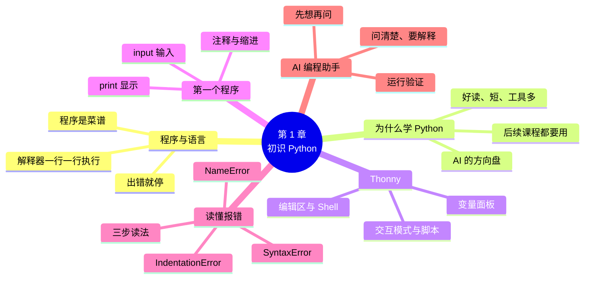

# 第 1 章 初识 Python：搭好环境，写出第一个程序

!!! abstract "本章学时"
    理论 4 学时 · 实验 2 学时（本章共 3 个实验，教师可任选）

## 学习目标

学完本章，你应该能够：

1. **说出**程序、编程语言、解释器的含义，以及 Python 在人工智能中的用途（记忆）；
2. **解释**解释器一行一行执行程序的过程，以及交互模式和脚本文件的区别（理解）；
3. **安装** Thonny，新建、保存、运行一个 Python 程序（应用）；
4. **编写**使用 `print`、`input` 和注释的简单程序（应用）；
5. **读懂**报错信息，说出出错的行号、错误类型和大致原因（分析）。

!!! info "先修要求"
    学习本章前，你需要：

    - 会用电脑打字、新建文件夹、下载和安装软件；
    - 知道文件保存在哪个文件夹里（“我的文档”“桌面”这些位置）。

    不需要任何编程基础，也不需要英语基础，用到的英文单词书里都会解释。

??? abstract "本章概念清单（15 个，点击查看定义和例子）"
    1. [程序](../../appendix/glossary.md#g-程序)
    2. [编程](../../appendix/glossary.md#g-编程)
    3. [编程语言](../../appendix/glossary.md#g-编程语言)
    4. [解释器](../../appendix/glossary.md#g-解释器)
    5. [集成开发环境](../../appendix/glossary.md#g-集成开发环境)
    6. [函数](../../appendix/glossary.md#g-函数)
    7. [字符串](../../appendix/glossary.md#g-字符串)
    8. [注释](../../appendix/glossary.md#g-注释)
    9. [交互模式](../../appendix/glossary.md#g-交互模式)
    10. [脚本](../../appendix/glossary.md#g-脚本)
    11. [缩进](../../appendix/glossary.md#g-缩进)
    12. [PEP 8](../../appendix/glossary.md#g-PEP-8)
    13. [追踪信息](../../appendix/glossary.md#g-追踪信息)
    14. [语法错误](../../appendix/glossary.md#g-语法错误)
    15. [AI 编程助手](../../appendix/glossary.md#g-AI-编程助手)

## 情景导入

陈姐在幸福路开了一家社区小店“街坊便利店”，卖饮料、零食、早餐和日用品。店里请了一位店员小周，三十出头，以前在工厂做质检，现在一边上班一边读开放大学的人工智能技术应用专业。

每天晚上关门以后，陈姐都要把当天的流水抄到一个硬皮本上：几点卖了什么、卖了多少钱、哪位会员买的。月底再用计算器一笔一笔加，算这个月卖了多少、哪样东西卖得最好。有一次加错了一位数，对了一晚上账都没对上。

小周说：“姐，这些事让电脑做就行了。我这学期正好在学 Python，学会了给你写个小程序：收银时自动算钱，记录自动存进电脑，月底一键出报表，还能画成图。”陈姐半信半疑：“你以前又没学过编程，这东西难不难？”

小周心里也没底。打开课本一看，第一章只要求做三件事：把编程软件装好，让电脑在屏幕上说一句“你好”，再学会看懂电脑报错时说了什么。这一章，我们就跟着小周迈出第一步。

## 1.1 程序和编程语言

### 1.1.1 程序就是写给电脑的菜谱

做一道番茄炒蛋，菜谱会这样写：

1. 番茄切块，鸡蛋打散，加一点盐；
2. 热锅放油，倒入蛋液，炒到凝固后盛出；
3. 再放一点油，下番茄翻炒出汁；
4. 倒回鸡蛋，翻炒均匀，出锅。

菜谱有三个特点：步骤是**一条一条**的；要**按顺序**做；每一步都要**写清楚**，不能写“适当处理一下”。

[**程序**](../../appendix/glossary.md#g-程序 "让计算机按顺序完成任务的一条条指令"){ .term }（Program）就是写给电脑的菜谱：一条一条的指令，告诉电脑先做什么、再做什么。手机上的微信、收银台的收银系统、导航软件，都是程序。和人不同，电脑非常“死板”：它不会猜你的意思，指令写错一个符号，它就做不下去。所以写程序最重要的习惯是：**写清楚，写准确**。

写程序的过程叫[**编程**](../../appendix/glossary.md#g-编程 "用编程语言编写程序的过程"){ .term }（Programming）。编程的人要用电脑能看懂的“话”来写指令，这种“话”就是[**编程语言**](../../appendix/glossary.md#g-编程语言 "人和计算机都能理解、用来编写程序的语言"){ .term }（Programming Language）。

### 1.1.2 解释器：一行一行地执行

电脑的芯片其实只认识 0 和 1。我们用 Python 写的程序，是怎么变成电脑能执行的动作的呢？中间有一个“翻译”，叫[**解释器**](../../appendix/glossary.md#g-解释器 "把 Python 代码逐行翻译并执行的程序，遇到错误就停止"){ .term }（Interpreter）。安装 Python，主要就是在电脑上装好这个解释器。

解释器的工作方式很像同声传译：从程序的**第一行**开始，翻译一行、执行一行，再翻译下一行……直到最后一行。如果某一行出了错，它就在那一行**停下来**，报告错误，后面的代码都不会执行。

下面的动画演示了这个过程。点“下一步”，看解释器每执行一行，右边的变量和输出发生了什么变化；再切换到“出错的程序”，看程序在哪一行停下来。

<iframe class="sim-frame" src="../../sims/run-program/main.html" height="520" loading="lazy" title="程序是怎么运行的"></iframe>
动画：程序是怎么运行的。左边橙色的行是下一步要执行的行，右边是变量和输出。[全屏打开](../../sims/run-program/main.html){ target=_blank }
{ .sim-caption }

动画里出现的 `print`、`input`、变量，本章和下一章都会详细讲。现在只要记住一点：**程序从上往下，一行一行地执行；出错就停。**

### 1.1.3 编程语言有很多种

和人类有汉语、英语一样，编程语言也有很多种：C 语言常用来写操作系统和单片机程序，Java 常用来写大型企业系统，JavaScript 是网页的语言，Python 则在数据分析和人工智能领域用得最多。不同的语言“语法”不同，但核心思想相通：变量、判断、循环、函数……学会一门，再学别的就快多了。

!!! tip "学编程需要数学很好吗？"
    不需要。本书用到的数学只有加减乘除和百分比。编程更像是“把一件事拆成清楚的步骤”，和整理仓库、安排排班的思路是一样的。

## 1.2 为什么学 Python { #12 }

### 1.2.1 Python 的特点 { #121 }

Python 由荷兰程序员吉多·范罗苏姆（Guido van Rossum）在 1989 年底开始设计，1991 年发布第一个版本。<sup class="cite">[[1]](#ref1-1)</sup> 它的名字来自一部英国喜剧，和蟒蛇没有关系，不过很多人还是喜欢用蟒蛇做它的图标。Python 有三个特点，让它特别适合初学者：

1. **读起来像英语**。比如 `print("你好")` 就是“打印你好”，`if 金额 > 100` 就是“如果金额大于 100”。
2. **写得短**。同样的功能，Python 代码往往只有其他语言的几分之一。
3. **现成的工具多**。全世界的程序员写好了几十万个工具包，免费下载使用：处理表格的、画图的、做人工智能的，几乎应有尽有。

Python 是**免费**、**开源**的，由非营利组织 Python 软件基金会维护，每年 10 月发布一个新版本。本书使用 **Python 3.14**（2025 年 10 月发布）。2026 年 10 月刚发布的 3.15 也能运行本书的全部代码。

### 1.2.2 Python 与人工智能 { #122 }

你可能听说过 DeepSeek、通义千问、文心一言这些大模型，也可能用过手机上的人脸识别、语音输入。这些人工智能产品背后，大量的数据处理、模型训练和应用开发工作都是用 Python 完成的。百度的飞桨（PaddlePaddle）、华为的昇思（MindSpore）、国外的 PyTorch 等人工智能框架，都把 Python 作为主要的使用语言。

可以这样理解：人工智能的“发动机”（底层计算）多半是用 C/C++ 写的，追求运行速度；而“方向盘”（使用这些能力的接口）是 Python，追求好学好用。学会 Python，你就握住了方向盘。

### 1.2.3 本专业哪些课程要用 Python { #123 }

本课程是人工智能技术应用专业的第一门编程课。后面这些课程都要用到本书学到的内容：

| 课程（学期） | 用 Python 做什么 |
|---|---|
| 机器学习（第 3 学期） | 读入数据、训练模型、评估效果 |
| 大数据技术处理技术、自然语言处理导论（第 3 学期） | 处理大量文本和数据 |
| 人工智能开发框架技术、人工智能数据分析与处理（第 4 学期） | 搭建神经网络、清洗和分析数据 |
| 计算机视觉、语音合成与识别（第 4 学期） | 处理图片、声音 |
| 网络爬虫（第 4 学期） | 从网页上自动收集数据 |

所以本课程的目标不是成为程序员，而是能**看懂**这些课程里的代码，能**运行**、能**改一改**。本书最后一章会带你用 Python 调用人工智能能力，给“街坊便利店”做一个小助手。

!!! cert "证书考点 · 信息技术水平-人工智能（Python）"
    了解 Python 的特点和应用领域，会安装开发环境、运行程序。对照的计算机二级 Python 大纲要求“熟练使用 IDLE 开发环境”，IDLE 是 Python 自带的简易编辑器，用法和 Thonny 类似，1.3.3 节会提到（详见[证书考点对照](../../certificate.md)）。

## 1.3 安装 Thonny { #13 }

### 1.3.1 下载与安装

写 Python 程序需要两样东西：**解释器**（负责执行）和**编辑器**（负责写代码）。把编辑、运行、调试等功能集成在一起的软件叫[**集成开发环境**](../../appendix/glossary.md#g-集成开发环境 "把编辑、运行、调试等功能集成在一起的编程软件"){ .term }（Integrated Development Environment，IDE）。

本书使用 **Thonny**。它是爱沙尼亚塔尔图大学专门为初学者设计的免费 IDE，<sup class="cite">[[2]](#ref1-2)</sup><sup class="cite">[[3]](#ref1-3)</sup> 有三个好处：

- **一次装好**：安装包里自带 Python 解释器（Thonny 5.0.1 自带 Python 3.14），不用另外安装 Python；
- **界面简单**：只有编辑区、运行按钮和输出区，不会被一堆菜单吓到；
- **能看见变量**：可以一步一步运行程序，随时看每个变量里存的是什么，非常适合找错。

安装步骤（以 Windows 10/11 为例，详细图解和 macOS 的装法见附录 A）：

1. 打开官网 thonny.org，在页面右上角的下载区点 **Windows** 下的安装包（Intel/AMD 电脑选 x64，约 30 MB）。
2. 双击下载好的 `.exe` 文件，一路点“Next”（下一步），最后点“Install”（安装）。安装位置用默认的就行。
3. 安装完成后，从开始菜单打开 Thonny。第一次打开时会让你选语言，选“简体中文”，点“Let's go!”。

!!! warning "安装时常见的两个问题"
    1. **杀毒软件拦截**：个别杀毒软件会误报。Thonny 是开源软件，只要是从官网下载的，选择“允许”即可。
    2. **文件夹名有中文**：Windows 用户名是中文时，个别情况下会出问题。遇到奇怪的报错，可以按附录 A 的办法把 Thonny 装到 `D:\Thonny` 这样的纯英文路径下。

### 1.3.2 认识 Thonny 的界面 { #132 }

打开 Thonny，界面主要有三块：

| 区域 | 位置 | 用途 |
|---|---|---|
| 编辑区 | 上方大块空白 | 写程序的地方，写好后保存成 `.py` 文件 |
| Shell（交互区） | 下方 | 显示程序的运行结果；也可以直接在这里输入一行代码马上看结果 |
| 工具栏 | 最上面一排图标 | 新建、打开、保存；绿色三角形“运行”；红色方块“停止” |

再做一件事：点菜单“视图 → 变量”，右边会出现“变量”面板。以后运行程序时，这里会列出每个变量当前的值。

### 1.3.3 其他编程工具（了解）

除了 Thonny，常见的 Python 编程工具还有：

- **IDLE**：从 python.org 安装 Python 时自带的简易编辑器，计算机等级考试用的就是它，用法和 Thonny 差不多；
- **VS Code**：微软出品的免费编辑器，功能强大，专业程序员用得多；
- **Jupyter**：在网页里写代码，代码和结果、图表混排在一起，做数据分析很方便，本书第 11 章会用到；
- **在线平台**：百度飞桨 AI Studio、阿里云天池等平台提供网页版的 Python 环境，不用安装。

本书网页版的很多代码块下面有“▶ 试一试”按钮，点一下就能在浏览器里直接修改、运行，手机上也能用。不过它只是用来“试一试”的，正式做实验还是用 Thonny。

## 1.4 第一个程序

### 1.4.1 print：让电脑说话 { #141 }

在 Thonny 的编辑区输入下面这一行（注意：括号和引号都要用**英文**的）：

<div class="tryit" markdown>

```python
print("你好，Python！")
```

</div>

点工具栏上的绿色三角形“运行”（或按键盘上的 F5）。第一次运行时，Thonny 会让你先保存文件：新建一个文件夹 `python-labs` 专门放本课程的程序，文件名写 `hello`，Thonny 会自动加上 `.py` 后缀。保存后，下方的 Shell 里出现：

```text
你好，Python！
```

恭喜你，第一个程序成功了！

`print` 是 Python 自带的[**函数**](../../appendix/glossary.md#g-函数 "有名字、能完成一项功能的代码，用“名字(内容)”的形式调用"){ .term }（Function），作用是把括号里的内容显示（打印）出来。函数可以理解为一个“有名字的功能”，用的时候写它的名字，后面跟一对圆括号，括号里放要处理的内容。第 8 章会专门讲函数，现在只要会用就行。

引号里的内容叫[**字符串**](../../appendix/glossary.md#g-字符串 "用引号括起来的一段文字，也就是文本数据"){ .term }（String），也就是一段文字。用引号括起来，Python 就知道这是要原样显示的文字，而不是指令。单引号、双引号都可以，但要成对使用。

`print` 还有几种常见用法：

<div class="tryit" markdown>

```python
print("1 + 1 =", 1 + 1)        # 逗号隔开多个内容，显示时自动加空格
print(3 * 4)                   # 不加引号的算式会先算出结果
print("街坊便利店", "开张啦", sep=" —— ")   # sep 指定用什么隔开
print("=" * 20)                # 字符串乘以数字：重复 20 次
print()                        # 什么都不写：输出一个空行
```

</div>

```text
1 + 1 = 2
12
街坊便利店 —— 开张啦
====================

```

注意第一行的区别：引号里的 `"1 + 1 ="` 原样显示；没有引号的 `1 + 1` 被当成算式，算出 2 再显示。

!!! warning "中文标点是新手的第一大坑"
    `print（"你好"）` 用了中文括号，`print("你好”)` 后面用了中文引号，都会报错。写代码时先把输入法切换到英文状态（按 Shift 键），只有引号**里面**的文字才可以用中文。

### 1.4.2 input：让电脑听你说 { #142 }

光会说还不够，程序还要能“听”。`input` 函数会在屏幕上显示一句提示，然后**停下来等你输入**，你输入内容、按回车后，程序才继续往下走：

<div class="tryit" markdown>

```python
name = input("请问怎么称呼？")
print(name + "，欢迎光临街坊便利店！")
```

</div>

运行后，Shell 里先出现“请问怎么称呼？”，光标在后面闪烁。输入“小周”并按回车：

```text
请问怎么称呼？小周
小周，欢迎光临街坊便利店！
```

第一行的意思是：把 `input` 收到的内容存起来，起个名字叫 `name`。这个“名字”就是**变量**（Variable），下一章详细讲。第二行的 `+` 把两段文字连成一段再显示。

!!! note "本书中运行结果的写法"
    带 `input` 的程序，运行结果里提示文字后面的内容（如上面的“小周”）是编者当时用键盘输入的，不是程序打印的。你可以输入别的内容，结果会跟着变。

### 1.4.3 注释：写给人看的话

以 `#` 开头的内容叫[**注释**](../../appendix/glossary.md#g-注释 "以 # 开头、写给人看的说明，运行时被忽略"){ .term }（Comment）。Python 运行时会完全忽略它，它是写给人看的说明：

```python
# 这是一个打招呼的程序，作者：小周，2026 年 9 月
name = input("请问怎么称呼？")   # 把输入的名字存到 name 里
print(name + "，欢迎光临！")
```

好的注释说明“为什么这样做”，帮助几个月后的自己和同事看懂程序。本书的实验代码都有中文注释，读代码时先读注释。

注释还有一个妙用：暂时不想运行某一行，在它前面加个 `#` 就行，这叫“注释掉”。在 Thonny 里选中几行，按 Ctrl+3 可以一次注释多行。

## 1.5 交互模式与脚本文件

### 1.5.1 Shell：问一句答一句 { #151 }

Thonny 下方的 Shell 有一个提示符 `>>>`，在它后面直接输入代码，按回车，马上就能看到结果。这种方式叫[**交互模式**](../../appendix/glossary.md#g-交互模式 "在 >>> 提示符后输入一行代码、立即得到结果的使用方式"){ .term }（Interactive Mode），就像和电脑一问一答：

```text
>>> 3.5 * 2
7.0
>>> print("你好")
你好
>>> 100 - 37
63
```

在交互模式下，直接输入算式，不用 `print` 也会显示结果。交互模式适合**试一试**：忘了某个写法，在这里敲一下就知道。缺点是关掉就没了，没法保存。

### 1.5.2 脚本文件：保存起来反复运行

在编辑区写好、保存成 `.py` 文件的程序叫[**脚本**](../../appendix/glossary.md#g-脚本 "保存在 .py 文件里、可以反复运行的程序"){ .term }（Script）。脚本可以保存、修改、反复运行，也可以发给别人。正式的程序都写成脚本。

| | 交互模式（Shell） | 脚本文件（编辑区） |
|---|---|---|
| 怎么用 | `>>>` 后面输入一行，回车 | 写好多行，保存，点“运行” |
| 能否保存 | 不能 | 能，保存为 `.py` 文件 |
| 显示结果 | 输入算式自动显示 | 要用 `print` 才显示 |
| 适合做什么 | 试一个写法、算个数 | 写完整的程序 |

!!! tip "给文件起名的好习惯"
    文件名用英文字母、数字和下划线，例如 `lab1_2_poster.py`；不要用空格，也尽量不用中文；**千万不要**起名叫 `print.py`、`random.py`、`turtle.py` 这类和 Python 自带功能同名的名字，否则会出现莫名其妙的错误（第 10 章会解释原因）。

### 1.5.3 缩进和代码规范

Python 对每行开头的空格非常敏感。行首的空格叫[**缩进**](../../appendix/glossary.md#g-缩进 "代码行开头的空格，在 Python 中表示代码的层次，不能随意添加"){ .term }（Indentation），在 Python 里缩进是有含义的（第 4 章讲 `if` 时会用到），**不能随便加**。现阶段请记住：每一行代码都从最左边顶格开始写。

除了必须遵守的语法，Python 社区还有一份大家约定俗成的写法建议，叫 [**PEP 8**](../../appendix/glossary.md#g-PEP-8 "Python 官方的代码风格建议"){ .term }。<sup class="cite">[[4]](#ref1-4)</sup> 现阶段记住三条就够：

1. 逗号后面加一个空格：`print("合计", 100)`；
2. 运算符两边各加一个空格：`total = price * qty`；
3. `#` 注释的 `#` 后面加一个空格。

不遵守 PEP 8 程序也能运行，但遵守了别人读起来更舒服。Thonny 和 AI 编程助手写出来的代码基本都符合这个规范。

## 1.6 读懂报错信息 { #16 }

### 1.6.1 报错不可怕

初学编程，报错是家常便饭。有经验的程序员也天天遇到报错，区别只在于他们**会看**报错信息。Python 的报错信息看起来是一堆英文，其实结构很固定，而且越来越“友好”：新版本的 Python 经常能直接猜出你想写什么。

### 1.6.2 三步读法

以下面这个程序为例，它在第 3 行把变量名 `shop_name` 打成了 `shop_nmae`：

```python
# 报错 2：变量名写错了一个字母
shop_name = "街坊便利店"
print(shop_nmae)
```

运行后，Shell 里出现（文件路径因电脑而不同，这里用省略号代替）：

```text
Traceback (most recent call last):
  File "……\errors\error2_name.py", line 3, in <module>
    print(shop_nmae)
          ^^^^^^^^^
NameError: name 'shop_nmae' is not defined. Did you mean: 'shop_name'?
```

这段报错叫[**追踪信息**](../../appendix/glossary.md#g-追踪信息 "程序出错时 Python 给出的报告，包括出错位置和错误类型"){ .term }（Traceback）。按三步读：

1. **看最后一行，知道“什么错”**。冒号前是错误类型 `NameError`（名字错误），冒号后是说明：名字 `shop_nmae` 没有定义。后面还贴心地问：“你是不是想写 `shop_name`？”
2. **看 `line`，知道“哪一行”**。`line 3` 说明错在第 3 行，下面还把这一行代码贴了出来，并用 `^^^^` 标出了出问题的位置。
3. **回到代码，想想“为什么”**。对照提示一看，原来是字母顺序打反了。

不认识的英文单词，用翻译软件查一下即可。附录 C 整理了初学者最常见的 20 多种报错的中文解释和改法。

### 1.6.3 三种最常见的报错

| 错误类型 | 中文意思 | 最常见的原因 | 例子 |
|---|---|---|---|
| `SyntaxError` | 语法错误 | 括号、引号不成对；用了中文标点；少了冒号 | `print("合计", 1288` 少了右括号 |
| `NameError` | 名字错误 | 变量名、函数名拼错；变量还没赋值就用了；文字忘了加引号 | `print(shop_nmae)`、`prnit("你好")` |
| `IndentationError` | 缩进错误 | 行首多了或少了空格 | 第二行前面多打了 4 个空格 |

[**语法错误**](../../appendix/glossary.md#g-语法错误 "代码不符合 Python 语法规则的错误，运行前就会被发现"){ .term }（Syntax Error）比较特别：解释器在运行**之前**会先把整个程序检查一遍，发现语法错误就直接报告，一行都不运行。而 `NameError` 这类错误是运行到那一行才发现的，前面的行已经执行过了。

!!! cert "证书考点 · 信息技术水平-人工智能（Python）"
    程序的基本格式（缩进、注释）和常见错误类型是理论题的常见考点，例如“以下哪个是 Python 的注释符号”“下面代码运行会出现什么错误”（详见[证书考点对照](../../certificate.md)）。

## 1.7 前沿视窗：AI 编程助手 { #17 }

2023 年以来，大模型写代码的能力突飞猛进。国内常见的 [**AI 编程助手**](../../appendix/glossary.md#g-AI-编程助手 "基于大模型、能解释代码、排查报错、生成代码的工具"){ .term }（AI Coding Assistant）有阿里云的通义灵码、百度的文心快码（Comate）、字节跳动的 Trae 等，个人用户可以免费使用，一般以插件形式装在 VS Code 等编辑器里。<sup class="cite">[[5]](#ref1-5)</sup> 也可以直接在 DeepSeek、豆包、通义千问等大模型的网页对话框里提问。它们能做的事包括：

- 解释一段看不懂的代码，逐行讲解；
- 解释报错信息，指出可能的原因；
- 根据你的描述写出代码。

对初学者来说，AI 是一位随叫随到的“助教”，但用法很关键。**建议这样用**：

1. **先自己想**。遇到报错，先按 1.6.2 节的三步读法自己判断，再问 AI，对比一下谁说得对。
2. **问清楚**。把完整的报错信息和相关代码一起发过去，说清楚“我想做什么”“我是初学者，请用简单的话解释”。
3. **让它解释，而不是只给答案**。多问一句“为什么这样改”。
4. **一定要运行验证**。AI 也会出错，而且错得很自信。

**不建议这样用**：直接让 AI 写出整个作业交上去。原因很简单：本课程期末是**闭卷考试**，要求你自己读程序、写程序；后续课程里的代码也需要你能看懂、能修改。AI 替你写得越多，你自己练得越少。

!!! warning "保护隐私"
    不要把含有真实姓名、手机号、身份证号、账号密码的数据发给 AI。本书的“街坊便利店”数据全部是虚构的，可以放心使用。

## 本章实验

!!! abstract "实验总览"
    | 实验 | 类型 | 建议时长 | 内容 |
    |---|---|---|---|
    | 实验 1-1 | ★ 基础 | 30 分钟 | 安装 Thonny，运行第一个程序，查看 Python 版本 |
    | 实验 1-2 | ★ 基础 | 40 分钟 | 用 print 打印开业海报，用 input 做一张个人名片 |
    | 实验 1-3 | ☆ 拓展 | 30 分钟 | 运行三个故意写错的程序，读懂报错信息，再请 AI 助手解释 |

    代码见配套资源 `labs/ch01/` 目录。

### 实验 1-1 ★ 安装环境并运行第一个程序

**实验目的**

1. 在自己的电脑上装好 Thonny，能新建、保存、运行程序；
2. 确认 Python 的版本，熟悉 Thonny 的编辑区、Shell 和变量面板。

**实验环境**：本机 CPU。Windows 10/11 或 macOS，安装 Thonny 5.0.1（自带 Python 3.14）。

**实验数据**：无。

**实验步骤与代码**

第 1 步，按 1.3.1 节下载、安装 Thonny，界面语言选“简体中文”。

第 2 步，在 D 盘（或“文档”文件夹）新建文件夹 `python-labs`，以后本课程的程序都保存在这里。把配套资源 `labs` 文件夹整个复制进来。

第 3 步，在 Thonny 里点“文件 → 打开”，打开 `labs/ch01/lab1_1_hello.py`：

```python
# 实验 1-1 第一个程序：检查环境，向世界问好
# 在 Thonny 里打开本文件，点绿色的“运行”按钮（或按 F5）

import sys                      # 导入 sys 模块，用来查看 Python 的版本

print("你好，Python！")
print("我正在用的 Python 版本是：", sys.version.split()[0])
print("1 + 1 =", 1 + 1)
print("街坊便利店", "开张啦", sep=" —— ")
```

`import sys` 和 `sys.version.split()[0]` 现在看不懂没关系，第 10 章会讲，这里只是借用它们查看版本号。

第 4 步，点“运行”。

第 5 步，在 Shell 的 `>>>` 后面依次输入 `365 * 24`、`100 / 3`，看看结果。

**运行结果**

```text
你好，Python！
我正在用的 Python 版本是： 3.14.6
1 + 1 = 2
街坊便利店 —— 开张啦
```

版本号的最后一位（3.14.6 里的 6）可能和你的不同，只要前面是 3.14 或更高就行。

**实验记录表**

| 项目 | 你的结果 |
|---|---|
| 你的操作系统（Windows 10 / 11 / macOS） | |
| Thonny 和 Python 的版本号 | |
| 程序保存在哪个文件夹（完整路径） | |
| Shell 里 `365 * 24` 的结果 | |
| Shell 里 `100 / 3` 的结果 | |

**常见问题排查**

| 现象 | 原因 | 解决办法 |
|---|---|---|
| 点“运行”没反应，弹出保存对话框 | 新文件还没保存 | 先保存，再运行 |
| Shell 里出现红色的 `SyntaxError` | 括号或引号用了中文标点 | 切换到英文输入法重新输入 |
| 找不到“变量”面板 | 默认没打开 | 菜单“视图 → 变量” |
| 版本号显示 3.10 或更低 | 装的是旧版 Thonny | 到官网重新下载 5.0 以上版本 |

**思考与练习**

1. 把第 8 行的 `sep=" —— "` 改成 `sep="❤"`，结果是什么？
2. 在 Shell 里输入 `print("哈" * 10)`，结果是什么？

**实验报告要求**

提交 Thonny 运行结果的截图（要能看到代码和 Shell）以及实验记录表。

### 实验 1-2 ★ 打印小店开业海报和个人名片

**实验目的**

1. 熟练使用 `print` 打印文字和分隔线；
2. 会用 `input` 接收输入，并和其他文字拼接后输出。

**实验环境**：本机 CPU。

**实验数据**：无。

**实验步骤与代码**

打开 `labs/ch01/lab1_2_poster.py`。程序分两部分，第一部分打印开业海报：

```python
# 第一部分：用 print 打印一张开业海报
print("=" * 30)
print("      街坊便利店  开业大吉")
print("=" * 30)
print("营业时间：每天 7:00 - 23:00")
print("开业三天：全场饮料 9 折")
print("地址：幸福路 18 号（地铁站 B 出口）")
print("=" * 30)
print()                          # 空一行
```

第二部分问三个问题，再把答案排成一张名片：

```python
# 第二部分：用 input 问几个问题，再把答案打印成一张名片
name = input("请输入你的名字：")
job = input("请输入你的职务：")
phone = input("请输入你的联系电话：")

print()
print("+" + "-" * 28 + "+")
print("  姓名：" + name)
print("  职务：" + job)
print("  电话：" + phone)
print("  街坊便利店 · 欢迎光临")
print("+" + "-" * 28 + "+")
```

运行程序，按提示依次输入名字、职务、电话（运行结果中编者输入的是“小周”“店员”和虚构的号码“13800001234”）。

**运行结果**

```text
==============================
      街坊便利店  开业大吉
==============================
营业时间：每天 7:00 - 23:00
开业三天：全场饮料 9 折
地址：幸福路 18 号（地铁站 B 出口）
==============================

请输入你的名字：小周
请输入你的职务：店员
请输入你的联系电话：13800001234

+----------------------------+
  姓名：小周
  职务：店员
  电话：13800001234
  街坊便利店 · 欢迎光临
+----------------------------+
```

**实验记录表**

| 修改 | 你的做法 | 结果是否符合预期 |
|---|---|---|
| 把海报上的店名换成你想开的店 | | |
| 把分隔线 `"=" * 30` 改成用 `*` 号、长度 40 | | |
| 名片上增加一行“微信号”，需要加哪两行代码？ | | |

**常见问题排查**

| 现象 | 原因 | 解决办法 |
|---|---|---|
| 程序“卡住”不动了 | 程序在等你输入 | 在 Shell 里输入内容，按回车 |
| `SyntaxError: invalid character '（' (U+FF08)` | 用了中文括号 | 改成英文括号 |
| 名片上显示的是 `name` 而不是名字 | 给 `name` 加了引号，变成了文字 | 变量名不加引号：`"姓名：" + name` |

**思考与练习**

1. 把 `print("  姓名：" + name)` 改成 `print("  姓名：", name)`，显示效果有什么不同？
2. 设计一个“今日特价”公告：先问“特价商品是什么”“原价多少”“特价多少”，再打印成公告。

**实验报告要求**

提交修改后的代码、运行截图和实验记录表。

### 实验 1-3 ☆ 读懂报错信息

**实验目的**

1. 能按“三步读法”从报错信息中找出出错的行、错误类型和原因；
2. 学会向 AI 编程助手正确提问，并判断它的回答对不对。

**实验环境**：本机 CPU；一个 AI 对话工具（DeepSeek、豆包、通义千问等的网页版均可）。

**实验数据**：`labs/ch01/errors/` 里三个故意写错的程序。

**实验步骤与代码**

三个程序的代码如下：

```python
# 报错 1：少了一个右括号（error1_syntax.py）
print("今天营业额：", 1288
```

```python
# 报错 2：变量名写错了一个字母（error2_name.py）
shop_name = "街坊便利店"
print(shop_nmae)
```

```python
# 报错 3：行首多了空格（error3_indent.py）
print("开门了")
    print("今天天气不错")
```

第 1 步，逐个运行，**先不要改**，按三步读法填写记录表。

第 2 步，改正错误，再运行一次。

第 3 步，选一个报错，把代码和报错信息一起发给 AI 助手，提问：“我是 Python 初学者，运行这段代码报了下面的错，请用简单的话解释原因和改法。”

**运行结果**

```text
  File "……\errors\error1_syntax.py", line 2
    print("今天营业额：", 1288
         ^
SyntaxError: '(' was never closed
```

```text
Traceback (most recent call last):
  File "……\errors\error2_name.py", line 3, in <module>
    print(shop_nmae)
          ^^^^^^^^^
NameError: name 'shop_nmae' is not defined. Did you mean: 'shop_name'?
```

```text
  File "……\errors\error3_indent.py", line 3
    print("今天天气不错")
IndentationError: unexpected indent
```

注意报错 1 和报错 3 都没有 `Traceback` 那一行：它们是运行前检查出来的语法类错误，程序一行都没执行；报错 2 是运行到第 3 行才发现的。报错 1 的 `'(' was never closed` 意思是“左括号一直没有闭合”。

**实验记录表**

| 程序 | 出错的行号 | 错误类型 | 用自己的话说原因 | 怎么改 |
|---|---|---|---|---|
| error1_syntax.py | | | | |
| error2_name.py | | | | |
| error3_indent.py | | | | |
| AI 的解释和你的判断一致吗？ | | | | |

**常见问题排查**

| 现象 | 原因 | 解决办法 |
|---|---|---|
| 改完后报了另一个错 | 改的时候引入了新错误，例如用了中文括号 | 再按三步读法读一遍新的报错 |
| AI 给出的代码和原题不一样 | AI 有时会“顺手”改写整个程序 | 要求它“只改出错的地方” |

**思考与练习**

1. 把 `print("开门了")` 写成 `Print("开门了")`（大写 P），会报什么错？为什么？
2. 自己“制造”一个新的报错，让同桌用三步读法找出原因。

**实验报告要求**

提交实验记录表，以及你向 AI 提问和它回答的截图，写一两句话评价 AI 的回答是否准确。

## 本章小结

- **程序**是写给电脑的一条条指令，用**编程语言**来写；Python 程序由**解释器**从上到下一行一行执行，遇到错误就停止。
- Python 读起来像英语、写得短、现成工具多，是人工智能领域最常用的语言；本专业后续课程都要用到它。
- 本书用 Thonny（自带 Python 3.14）作为**集成开发环境**：编辑区写**脚本**，Shell 里可以用**交互模式**一问一答。
- `print` 显示内容，`input` 接收键盘输入；引号括起来的文字是**字符串**；`#` 后面是**注释**。代码中的括号、引号、逗号必须用英文标点，每行顶格写，不能随便加**缩进**。
- 读**追踪信息**的三步：看最后一行知道什么错，看 `line` 知道哪一行，回到代码想为什么。最常见的是**语法错误**、`NameError` 和 `IndentationError`。
- **AI 编程助手**要先自己想、再问它，让它解释原因，并运行验证；不要让它代替自己写作业。



**下一章预告**

本章的程序只会把文字原样显示出来。收银可不行：顾客买了 2 瓶 3.5 元的可乐，程序要能算出 7 元；顾客给了 10 元，要能算出找零 3 元。下一章学习**变量**和**运算**，让程序真正“算”起来。

## 参考文献

正文中的上标编号（如<sup class="cite">[[1]](#ref1-1)</sup>）对应下面的文献。带链接的可以直接打开；书籍可在图书馆或电子书平台查阅。

<div class="refs" markdown>

**教材与专著**

- <span id="ref1-6"></span>[6] 嵩天, 礼欣, 黄天羽. Python 语言程序设计基础[M]. 2 版. 北京: 高等教育出版社, 2017.
    <span class="ref-note">国内高校使用广泛的 Python 入门教材，计算机二级 Python 考试的参考教材之一，对应全书。</span>

**经典论文**

- <span id="ref1-3"></span>[3] ANNAMAA A. Introducing Thonny, a Python IDE for learning programming[C]//Proceedings of the 15th Koli Calling Conference on Computing Education Research. New York: ACM, 2015: 117-121.
    <span class="ref-note">Thonny 作者介绍其设计思路：单步执行、变量面板等功能如何帮助初学者，对应 1.3 节。</span>

**在线资源与数据**

- <span id="ref1-1"></span>[1] Python Software Foundation. Python 教程[EB/OL]. [2026-11-01]. https://docs.python.org/zh-cn/3.14/tutorial/index.html.
    <span class="ref-note">Python 官方的中文入门教程，对应 1.2 节和全书。</span>
- <span id="ref1-2"></span>[2] Thonny. Python IDE for beginners[EB/OL]. [2026-11-01]. https://thonny.org/.
    <span class="ref-note">Thonny 官网，提供各系统的安装包，截至 2026 年 11 月最新版为 5.0.1，自带 Python 3.14，对应 1.3 节。</span>
- <span id="ref1-4"></span>[4] VAN ROSSUM G, WARSAW B, COGHLAN A. PEP 8 – Style guide for Python code[EB/OL]. [2026-11-01]. https://peps.python.org/pep-0008/.
    <span class="ref-note">Python 官方代码风格指南，对应 1.5.3 节。</span>
- <span id="ref1-5"></span>[5] 阿里云. 通义灵码[EB/OL]. [2026-11-01]. https://lingma.aliyun.com/.
    <span class="ref-note">阿里云的 AI 编程助手，支持代码生成、智能问答、报错排查，个人可免费使用，对应 1.7 节。</span>

</div>

## 课后练习

选择题和判断题可以直接点击选项作答，系统会马上告诉你对错，并展开答案与解析；多选题选好后点“提交答案”。简答和实操题请先自己作答，再点开“答案与解析”核对。每道题的解析下方都有“回看”链接，做错了可以直接跳回正文复习。

**一、单项选择题**

<div class="quiz" data-answer="C" markdown>

**1.** 把 Python 程序“翻译”给电脑并逐行执行的是（　　）。

- A. 编辑器
- B. 操作系统
- C. 解释器
- D. 浏览器

</div>

??? tip "答案与解析"
    **答案：C**

    解释器从第一行开始，翻译一行、执行一行。编辑器只负责写代码。

    考查：解释器 · 认知层次：记忆 · [回看 1.1.2](#112)
    { .quiz-meta }

<div class="quiz" data-answer="B" markdown>

**2.** Python 中表示注释的符号是（　　）。

- A. `//`
- B. `#`
- C. `/* */`
- D. `--`

</div>

??? tip "答案与解析"
    **答案：B**

    Python 用 `#` 写注释。`//` 在 Python 里是整除运算符（第 2 章），`/* */` 是 C 语言、Java 的注释写法。

    考查：注释 · 认知层次：记忆 · [回看 1.4.3](#143)
    { .quiz-meta }

<div class="quiz" data-answer="D" markdown>

**3.** 执行 `print("3 + 4 =", 3 + 4)`，输出是（　　）。

- A. `3 + 4 = 3 + 4`
- B. `7 = 7`
- C. `3 + 4 =7`
- D. `3 + 4 = 7`

</div>

??? tip "答案与解析"
    **答案：D**

    引号里的 `"3 + 4 ="` 原样输出；没有引号的 `3 + 4` 先算出 7；逗号隔开的两项之间自动加一个空格。

    考查：print 函数 · 认知层次：应用 · [回看 1.4.1](#141)
    { .quiz-meta }

<div class="quiz" data-answer="A" markdown>

**4.** 执行 `print("ab" * 3)`，输出是（　　）。

- A. `ababab`
- B. `ab3`
- C. `ab ab ab`
- D. 报错

</div>

??? tip "答案与解析"
    **答案：A**

    字符串乘以整数表示重复，`"ab" * 3` 就是把 `ab` 重复 3 次，中间不加空格。

    考查：print 函数 · 认知层次：应用 · [回看 1.4.1](#141)
    { .quiz-meta }

<div class="quiz" data-answer="C" markdown>

**5.** 程序执行到 `input("请输入：")` 时会（　　）。

- A. 自动输入一个空字符串，继续往下执行
- B. 报错，因为没有给它数据
- C. 显示“请输入：”，停下来等待用户输入并按回车
- D. 结束程序

</div>

??? tip "答案与解析"
    **答案：C**

    `input` 先显示括号里的提示，然后暂停，等用户输入并按回车后，才把输入的内容交给程序，继续往下执行。

    考查：input 函数 · 认知层次：理解 · [回看 1.4.2](#142)
    { .quiz-meta }

<div class="quiz" data-answer="B" markdown>

**6.** 运行一个程序，最后一行报错是 `NameError: name 'pirnt' is not defined`，最可能的原因是（　　）。

- A. 少了右括号
- B. 把 `print` 拼错了
- C. 行首多了空格
- D. 用了中文引号

</div>

??? tip "答案与解析"
    **答案：B**

    `NameError` 说明 Python 不认识这个名字。`pirnt` 是 `print` 拼错了。少括号是 `SyntaxError`，多空格是 `IndentationError`。

    考查：读懂报错 · 认知层次：分析 · [回看 1.6.3](#163)
    { .quiz-meta }

<div class="quiz" data-answer="A" markdown>

**7.** 关于交互模式（Shell 中的 `>>>`），下列说法正确的是（　　）。

- A. 输入算式回车后，不用 `print` 也会显示结果
- B. 输入的代码会自动保存成 `.py` 文件
- C. 只能输入一行，不能输入第二行
- D. 只能用来显示报错信息

</div>

??? tip "答案与解析"
    **答案：A**

    交互模式一问一答，输入算式马上显示结果；但不能保存，关掉就没了。

    考查：交互模式 · 认知层次：理解 · [回看 1.5.1](#151)
    { .quiz-meta }

<div class="quiz" data-answer="D" markdown>

**8.** 下列文件名中，最**不**适合用来保存自己写的 Python 程序的是（　　）。

- A. `lab1_2_poster.py`
- B. `my_shop.py`
- C. `receipt2.py`
- D. `random.py`

</div>

??? tip "答案与解析"
    **答案：D**

    `random` 是 Python 自带模块的名字，文件起这个名字会和它“撞名”，导致莫名其妙的错误。

    考查：脚本文件 · 认知层次：应用 · [回看 1.5.2](#152)
    { .quiz-meta }

**二、多项选择题**

<div class="quiz quiz-multi" data-answer="ABD" markdown>

**1.** 下列代码中，运行时会报错的有（　　）。

- A. `print（"你好"）`
- B. `print("你好”)`
- C. `print('你好')`
- D. `Print("你好")`

</div>

??? tip "答案与解析"
    **答案：ABD**

    A 用了中文括号，B 后面用了中文引号，都是语法错误；D 的 `Print` 首字母大写，Python 区分大小写，不认识这个名字，报 `NameError`。C 用单引号是可以的。

    考查：print 函数、读懂报错 · 认知层次：分析 · [回看 1.4.1](#141)
    { .quiz-meta }

<div class="quiz quiz-multi" data-answer="ABC" markdown>

**2.** Thonny 适合初学者的原因有（　　）。

- A. 安装包自带 Python 解释器
- B. 有变量面板，能看到变量的值
- C. 可以一步一步地运行程序
- D. 能自动把程序翻译成中文

</div>

??? tip "答案与解析"
    **答案：ABC**

    Thonny 自带 Python、界面简单、能单步执行和查看变量。它不会把程序翻译成中文。

    考查：集成开发环境 · 认知层次：理解 · [回看 1.3.1](#131)
    { .quiz-meta }

<div class="quiz quiz-multi" data-answer="ACD" markdown>

**3.** 使用 AI 编程助手时，正确的做法有（　　）。

- A. 先自己读报错信息，再问 AI 并对比
- B. 把含真实客户手机号的数据发给 AI 帮忙分析
- C. 让 AI 解释为什么这样改
- D. 把 AI 给出的代码运行一遍，验证是否正确

</div>

??? tip "答案与解析"
    **答案：ACD**

    B 会泄露个人信息。AI 也会出错，所以要先自己想、要求它解释、并运行验证。

    考查：AI 编程助手 · 认知层次：评价 · [回看 1.7](#17)
    { .quiz-meta }

**三、判断题**

<div class="quiz quiz-judge" data-answer="×" markdown>

**1.** 程序中某一行出错后，解释器会跳过这一行，继续执行后面的代码。（　　）

- √
- ×

</div>

??? tip "答案与解析"
    **答案：×**

    解释器遇到错误就停止，后面的代码都不会执行。

    考查：解释器 · 认知层次：理解 · [回看 1.1.2](#112)
    { .quiz-meta }

<div class="quiz quiz-judge" data-answer="√" markdown>

**2.** Python 中，单引号和双引号都可以用来表示字符串，但必须成对使用。（　　）

- √
- ×

</div>

??? tip "答案与解析"
    **答案：√**

    `'你好'` 和 `"你好"` 都可以，但不能一边单引号一边双引号。

    考查：字符串 · 认知层次：记忆 · [回看 1.4.1](#141)
    { .quiz-meta }

<div class="quiz quiz-judge" data-answer="×" markdown>

**3.** 为了让代码好看，可以在任何一行的开头随意加几个空格。（　　）

- √
- ×

</div>

??? tip "答案与解析"
    **答案：×**

    Python 中行首的空格（缩进）有含义，随意添加会报 `IndentationError`。

    考查：缩进 · 认知层次：理解 · [回看 1.5.3](#153)
    { .quiz-meta }

<div class="quiz quiz-judge" data-answer="√" markdown>

**4.** 程序中有语法错误时，Python 在运行前就会发现，程序的第一行也不会执行。（　　）

- √
- ×

</div>

??? tip "答案与解析"
    **答案：√**

    解释器运行前会先检查整个程序的语法，发现语法错误就直接报告。

    考查：语法错误 · 认知层次：理解 · [回看 1.6.3](#163)
    { .quiz-meta }

<div class="quiz quiz-judge" data-answer="×" markdown>

**5.** `#` 后面的注释内容也会被 Python 执行。（　　）

- √
- ×

</div>

??? tip "答案与解析"
    **答案：×**

    注释是写给人看的，Python 运行时完全忽略。

    考查：注释 · 认知层次：记忆 · [回看 1.4.3](#143)
    { .quiz-meta }

**四、简答题**

**1.** 读程序写结果。下面的程序运行时，用户输入“陈姐”，Shell 中会显示什么？

```python
print("-" * 10)
who = input("您是：")
print("欢迎", who)
print(who + "，今天辛苦了")
```

??? tip "答案与解析"
    **参考答案**

    ```text
    ----------
    您是：陈姐
    欢迎 陈姐
    陈姐，今天辛苦了
    ```

    要点：`"-" * 10` 是 10 个减号；`print` 用逗号隔开时中间有空格，用 `+` 连接时没有空格。

    考查：print 与 input · 认知层次：应用 · [回看 1.4.2](#142)
    { .quiz-meta }

**2.** 找错并改正。下面的程序有 3 处错误，指出并改正。

```python
print("街坊便利店"）
  print("欢迎光临")
print(“营业时间 7:00-23:00")
```

??? tip "答案与解析"
    **参考答案**

    1. 第 1 行右括号是中文的 `）`，改成 `)`；
    2. 第 2 行行首多了空格，删掉；
    3. 第 3 行左引号是中文的 `“`，改成 `"`。

    考查：读懂报错 · 认知层次：分析 · [回看 1.6.3](#163)
    { .quiz-meta }

**3.** 简述交互模式和脚本文件的区别，各适合做什么。

??? tip "答案与解析"
    **参考答案**

    交互模式在 Shell 的 `>>>` 后输入一行代码马上看到结果，输入算式自动显示，但不能保存，适合试一个写法或算个数；脚本文件在编辑区写好多行并保存成 `.py` 文件，可以反复运行和修改，要用 `print` 才显示结果，适合写完整的程序。

    考查：交互模式与脚本 · 认知层次：理解 · [回看 1.5.2](#152)
    { .quiz-meta }

**五、实操题**

**1.** 写一个“会员登记”程序：依次询问顾客的姓名和手机号，然后打印一条欢迎信息，格式如下（假设输入的是“李芳”和“13900002222”）：

```text
====================
欢迎 李芳 成为街坊便利店会员！
登记手机：13900002222
====================
```

??? tip "答案与解析"
    **参考答案**

    ```python
    name = input("请输入姓名：")
    phone = input("请输入手机号：")
    print("=" * 20)
    print("欢迎", name, "成为街坊便利店会员！")
    print("登记手机：" + phone)
    print("=" * 20)
    ```

    第 4 行用逗号隔开，名字两边自然有空格；第 5 行用 `+` 连接，冒号后不留空格。

    考查：print 与 input · 认知层次：应用 · [回看 1.4.2](#142)
    { .quiz-meta }

**2.** 用 AI 编程助手完成一次“对比实验”：自己写一个含有错误的三行程序，先自己按三步读法找出错误，再请 AI 解释，写出你们两个结论的异同（100 字左右）。

??? tip "答案与解析"
    **评分要点**

    1. 程序确实能报错，并贴出完整的报错信息（2 分）；
    2. 自己的判断写出了行号、错误类型和原因（4 分）；
    3. 对 AI 回答的评价具体，指出了它说得对或不对的地方（4 分）。

    考查：读懂报错、AI 编程助手 · 认知层次：评价 · [回看 1.7](#17)
    { .quiz-meta }
