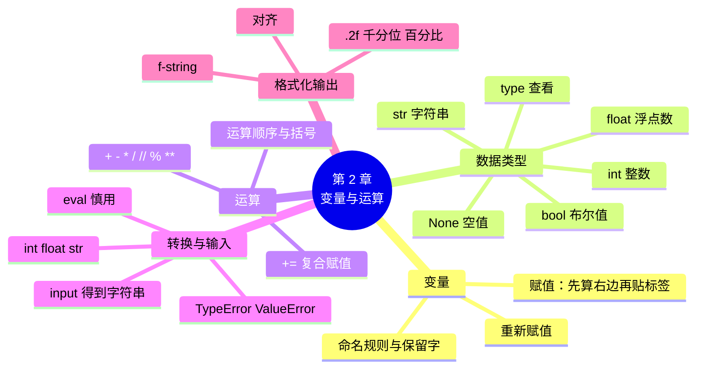

# 第 2 章 变量、数据类型与运算

!!! abstract "本章学时"
    理论 4 学时 · 实验 2 学时（本章共 3 个实验，教师可任选）

## 学习目标

学完本章，你应该能够：

1. **说出**整数、浮点数、字符串、布尔值、`None` 五种数据的写法和用途（记忆）；
2. **解释**赋值语句“先算右边、再贴标签”的执行过程，以及 `input` 得到的为什么是字符串（理解）；
3. **计算**含 `+ - * / // % **` 的表达式的结果，正确判断运算顺序（应用）；
4. **编写**用 `int`、`float` 转换输入、用 f-string 格式化输出的计算程序（应用）；
5. **分析**`TypeError`、`ValueError` 等类型相关报错的原因并改正（分析）。

!!! info "先修要求"
    学习本章前，你需要：

    - 会用 Thonny 新建、保存、运行程序（[1.3 安装 Thonny](../01-getting-started/index.md#13)）；
    - 会用 `print` 和 `input`（[1.4 第一个程序](../01-getting-started/index.md#14)）；
    - 会按三步读法看报错信息（[1.6.2 三步读法](../01-getting-started/index.md#162)）。

??? abstract "本章概念清单（10 个，点击查看定义和例子）"
    1. [变量](../../appendix/glossary.md#g-变量)
    2. [赋值语句](../../appendix/glossary.md#g-赋值语句)
    3. [保留字](../../appendix/glossary.md#g-保留字)
    4. [数据类型](../../appendix/glossary.md#g-数据类型)
    5. [整数](../../appendix/glossary.md#g-整数)
    6. [浮点数](../../appendix/glossary.md#g-浮点数)
    7. [布尔值](../../appendix/glossary.md#g-布尔值)
    8. [复合赋值运算符](../../appendix/glossary.md#g-复合赋值运算符)
    9. [类型转换](../../appendix/glossary.md#g-类型转换)
    10. [f-string](../../appendix/glossary.md#g-f-string)

## 情景导入

早上七点半，上班族排着队买早餐。一位顾客拿了 2 瓶可乐、3 个包子、1 盒牛奶，递过来一张 20 元。小周一边按计算器一边念叨：“可乐 3.5 乘 2 是 7，包子……”后面的顾客开始催了。

晚上小周想：能不能写个程序，输入单价和数量，自动算出总价和找零？他照着第 1 章的样子写了一行：

```python
print(input("单价：") * input("数量："))
```

运行后输入 3.5 和 2，结果却报错了：`TypeError: can't multiply sequence by non-int of type 'str'`。明明输入的是数字，为什么不能相乘？

原来，电脑里的数据是分“类型”的：`3.5` 和 `"3.5"` 看起来一样，一个是能计算的数，一个是一段文字。这一章，我们学习怎样用[**变量**](../../appendix/glossary.md#g-变量 "贴在数据上的名字标签，通过名字可以找到和修改数据"){ .term }把数据存起来，认识 Python 的几种基本数据类型，学会让程序真正地“算账”。

## 2.1 变量：给数据贴标签

### 2.1.1 赋值语句

程序在运行过程中要记住很多数据：单价、数量、总价……给数据起一个名字，以后用名字就能找到它，这个名字就叫**变量**（Variable）。

<div class="tryit" markdown>

```python
price = 3.5          # 单价
qty = 2              # 数量
total = price * qty  # 总价
print("应收", total, "元")
```

</div>

```text
应收 7.0 元
```

`price = 3.5` 这样的语句叫[**赋值语句**](../../appendix/glossary.md#g-赋值语句 "用 = 把右边算出的值存起来、贴上左边名字的语句，先算右边再赋值"){ .term }（Assignment Statement）。这里的等号 `=` **不是**数学里的“等于”，而是“把右边的值存起来，贴上左边的名字”。可以把变量想象成一张**标签**：数据放在电脑内存里，变量名是贴在数据上的标签，通过标签就能找到数据。

赋值语句的执行顺序是：**先算右边，再贴到左边**。所以第 3 行先算 `price * qty`，也就是 3.5 × 2 = 7.0，再把 7.0 贴上 `total` 这个标签。

### 2.1.2 变量可以重新赋值

标签可以撕下来贴到别的数据上，这叫**重新赋值**。下面的动画里，“改价格”程序把 `price` 改成了 4.0。猜一猜：`total` 会不会自动变成 8.0？点“下一步”验证。

<iframe class="sim-frame" src="../../sims/variable-labels/main.html" height="560" loading="lazy" title="变量：给数据贴标签"></iframe>
动画：变量：给数据贴标签。浅黄色标出刚刚改变的变量。[全屏打开](../../sims/variable-labels/main.html){ target=_blank }
{ .sim-caption }

答案是**不会**。`total` 保存的是当时算出来的结果 7.0，它不知道这个 7.0 是怎么来的。想用新价格，必须重新算一遍。这一点和 Excel 不同：Excel 里改了单价，总价单元格会自动重算；程序里的变量不会。

动画的第二个程序“计数与交换”里有一句在数学上“不成立”的代码：

```python
count = count + 1
```

按“先算右边，再贴到左边”来理解就很自然：先取出 `count` 原来的值，加 1，再把结果贴回 `count`。这是程序里最常用的写法之一，用来**计数**。它还有一种简写 `count += 1`，2.4.3 节会讲。

### 2.1.3 变量的命名规则

变量名不能随便起，要遵守几条规则：

1. 只能由**字母、数字、下划线**组成，不能有空格和标点；
2. **不能以数字开头**：`total2` 可以，`2total` 不行；
3. **区分大小写**：`Price` 和 `price` 是两个不同的变量；
4. 不能使用 Python 的[**保留字**](../../appendix/glossary.md#g-保留字 "Python 自己使用的专用词，不能用作变量名，3.14 共 35 个"){ .term }（Keyword）。

保留字是 Python 自己要用的“专用词”，例如 `if`、`for`、`while`、`True`、`None`、`def`、`import`。Python 3.14 共有 35 个保留字，在 Shell 里运行下面两行可以全部列出来：

```python
import keyword
print(keyword.kwlist)
```

```text
['False', 'None', 'True', 'and', 'as', 'assert', 'async', 'await', 'break', 'class', 'continue', 'def', 'del', 'elif', 'else', 'except', 'finally', 'for', 'from', 'global', 'if', 'import', 'in', 'is', 'lambda', 'nonlocal', 'not', 'or', 'pass', 'raise', 'return', 'try', 'while', 'with', 'yield']
```

不用死记，Thonny 会把保留字显示成特殊的颜色，看到颜色不对就知道撞名了。

除了规则，还有好的命名**习惯**：

- **见名知义**：`price`、`total` 比 `a`、`b` 好懂得多；
- **多个单词用下划线连接**：`unit_price`、`member_count`（这种写法叫“蛇形命名”）；
- **用英文或拼音**：Python 3 其实允许中文变量名（`单价 = 3.5` 能运行），但输入法来回切换容易出错，和别人合作、用第三方库时也不方便，本书统一用英文。

!!! cert "证书考点 · 信息技术水平-人工智能（Python）"
    变量命名规则和保留字几乎每次都考，常见题型是“以下哪个是合法的变量名”。判断方法：只看规则 1～4，例如 `_total`、`total_2` 合法，`2total`、`my-total`、`class` 不合法（详见[证书考点对照](../../certificate.md)）。

## 2.2 数字：整数与浮点数

### 2.2.1 两种数字

Python 里的数字主要有两种：

- [**整数**](../../appendix/glossary.md#g-整数 "没有小数部分的数"){ .term }（Integer，类型名 `int`）：没有小数点的数，如 `2`、`-5`、`2025`。Python 的整数可以非常大，`10 ** 20` 也能精确算出 `100000000000000000000`。
- [**浮点数**](../../appendix/glossary.md#g-浮点数 "带小数点的数，内部保存的是近似值"){ .term }（Floating-point Number，类型名 `float`）：带小数点的数，如 `3.5`、`0.9`、`-15.0`。注意 `7.0` 也是浮点数，因为有小数点。很大或很小的数可以用科学计数法写：`1e3` 就是 1000.0，`2.5e-3` 就是 0.0025。

整数和浮点数一起运算，结果是浮点数，所以 `3.5 * 2` 的结果是 `7.0` 而不是 `7`。

### 2.2.2 0.1 + 0.2 为什么不等于 0.3 { #222 }

在 Shell 里试一下：

<div class="tryit" markdown>

```python
print(0.1 + 0.2)
print(0.1 + 0.2 == 0.3)
```

</div>

```text
0.30000000000000004
False
```

这不是 Python 的错误。电脑内部用二进制保存小数，就像十进制写不尽 1/3（0.3333……）一样，二进制也写不尽 0.1，只能保存一个非常接近的近似值，于是计算结果在小数点后很多位出现了一点误差。<sup class="cite">[[1]](#ref2-1)</sup> 几乎所有编程语言都有这个现象。

对收银这类场景，处理办法很简单：**显示时保留两位小数**（2.6 节），比较时先四舍五入。真正对精度要求很高的财务系统会使用专门的 `decimal` 模块，本书不展开。

### 2.2.3 round：四舍五入

`round(数字, 位数)` 把数字保留指定位数的小数：

<div class="tryit" markdown>

```python
print(round(0.1 + 0.2, 2))
print(round(3.14159, 2))
print(round(2.5), round(3.5))
```

</div>

```text
0.3
3.14
2 4
```

注意最后一行：`round(2.5)` 得到 2，`round(3.5)` 得到 4。Python 的 `round` 遇到“正好一半”时，会取**偶数**那一边，这叫“银行家舍入”，目的是让大量数据舍入后的总误差更小。收银时如果一定要“逢五进一”，可以用 2.6 节的格式化显示。

## 2.3 字符串、布尔值与 None { #23 }

### 2.3.1 字符串

第 1 章已经见过**字符串**：用引号括起来的文字，类型名是 `str`。字符串可以用 `+` 连接、用 `*` 重复：

```python
print("3" + "5")    # 两段文字连在一起
print("3" * 3)      # 文字重复 3 次
```

```text
35
333
```

`"3" + "5"` 得到的是 `"35"` 而不是 8，因为它们是文字，不是数。字符串的更多用法见第 3 章。

### 2.3.2 布尔值

有些问题的答案只有“是”和“不是”：今天是不是周末？顾客是不是会员？金额是不是超过 100 元？表示“真”和“假”的数据叫[**布尔值**](../../appendix/glossary.md#g-布尔值 "表示真假的值，只有 True 和 False 两个"){ .term }（Boolean，类型名 `bool`），只有两个：`True` 和 `False`，首字母必须大写。

```python
is_member = True
print(3 > 2, 0.1 + 0.2 == 0.3)
```

```text
True False
```

比较运算（`>`、`==` 等）的结果就是布尔值。布尔值是第 4 章“条件判断”的基础。

### 2.3.3 None：什么都没有

`None` 是一个特殊的值，表示“没有值”“空”。例如顾客没有会员号，可以写 `member_id = None`。它的类型是 `NoneType`。初学阶段知道它表示“空”就行，第 8 章讲函数时还会遇到它。

### 2.3.4 用 type 查看类型 { #234 }

不确定一个数据是什么类型，就用 `type()` 问一问：

<div class="tryit" markdown>

```python
print(type(3), type(3.0), type("3"))
print(type(True), type(None))
```

</div>

```text
<class 'int'> <class 'float'> <class 'str'>
<class 'bool'> <class 'NoneType'>
```

五种基本[**数据类型**](../../appendix/glossary.md#g-数据类型 "数据的种类，决定了数据能做哪些运算"){ .term }（Data Type）汇总如下：

| 类型 | 类型名 | 例子 | 用途 |
|---|---|---|---|
| 整数 | `int` | `2`、`-5`、`2025` | 数量、年份、个数 |
| 浮点数 | `float` | `3.5`、`0.9`、`1e3` | 价格、重量、温度 |
| 字符串 | `str` | `"可乐"`、`'13800001234'` | 名称、电话、地址 |
| 布尔值 | `bool` | `True`、`False` | 是否会员、是否周末 |
| 空值 | `NoneType` | `None` | 没有值 |

!!! tip "手机号为什么用字符串？"
    手机号、身份证号、邮编虽然由数字组成，但从来不需要加减乘除，而且可能以 0 开头（如区号 020），所以都用字符串保存。判断标准是：**需要计算的用数字，只是一串编号的用字符串。**

## 2.4 运算符

### 2.4.1 算术运算符

| 运算符 | 含义 | 例子 | 结果 |
|---|---|---|---|
| `+` | 加 | `3 + 2` | `5` |
| `-` | 减 | `3 - 2` | `1` |
| `*` | 乘 | `3 * 2` | `6` |
| `/` | 除 | `7 / 2` | `3.5` |
| `//` | 整除（只要商的整数部分） | `7 // 2` | `3` |
| `%` | 取余数 | `7 % 2` | `1` |
| `**` | 乘方 | `2 ** 10` | `1024` |

两个要注意的地方：

1. `/` 的结果**总是浮点数**，哪怕正好除尽：`10 / 5` 得到 `2.0`。
2. `//` 和 `%` 是一对：`7 // 2` 是商 3，`7 % 2` 是余数 1。它们在生活中很有用：

<div class="tryit" markdown>

```python
minutes = 135
print(minutes // 60, "小时", minutes % 60, "分钟")   # 135 分钟是几小时几分？
eggs = 47
print("能装满", eggs // 10, "盒，还剩", eggs % 10, "个")   # 一盒装 10 个
print("2025 是偶数吗？", 2025 % 2 == 0)               # 除以 2 余数为 0 就是偶数
```

</div>

```text
2 小时 15 分钟
能装满 4 盒，还剩 7 个
2025 是偶数吗？ False
```

除数为 0 时会报 `ZeroDivisionError: division by zero`（除以零错误），第 1 章动画里的“出错的程序”就是这个错误。

### 2.4.2 运算顺序

和数学一样，先乘方，再乘除，后加减；同级的从左往右算；有括号先算括号里的：

```python
print(3 + 2 * 4, (3 + 2) * 4, 10 - 4 - 3)
```

```text
11 20 3
```

拿不准的时候就**加括号**，既保证正确，也方便别人看懂。实验 2-3 的月供公式就加了很多括号。

### 2.4.3 复合赋值运算符

`count = count + 1` 太常用了，Python 提供了简写：

| 简写 | 等价于 | 例子（设 `x = 5`） |
|---|---|---|
| `x += 3` | `x = x + 3` | `x` 变成 8 |
| `x -= 3` | `x = x - 3` | `x` 变成 2 |
| `x *= 2` | `x = x * 2` | `x` 变成 10 |
| `x /= 2` | `x = x / 2` | `x` 变成 2.5 |

这些叫[**复合赋值运算符**](../../appendix/glossary.md#g-复合赋值运算符 "把运算和赋值合在一起的简写，如 +=、-=、*="){ .term }（Augmented Assignment Operator）。注意 Python 没有其他语言里的 `x++` 写法。

## 2.5 类型转换与 input

### 2.5.1 input 得到的永远是字符串 { #251 }

回到情景导入的问题。`input` 不管你输入什么，交给程序的**都是字符串**。输入 `2`，得到的是 `"2"`：

```python
qty = input("数量：")     # 输入 2
print(qty * 3)
```

```text
数量：2
222
```

`"2" * 3` 是把文字“2”重复 3 次，于是得到 222。而 `"3.5" * "2"` 两段文字相乘就更没有意义了，所以报 `TypeError`（类型错误）。

### 2.5.2 int、float、str 转换 { #252 }

解决办法是[**类型转换**](../../appendix/glossary.md#g-类型转换 "把数据从一种类型变成另一种类型"){ .term }（Type Conversion）：用 `int()` 把字符串转成整数，`float()` 转成浮点数，`str()` 把数字转成字符串。

<div class="tryit" markdown>

```python
price = float(input("单价："))   # 输入 3.5
qty = int(input("数量："))       # 输入 2
print("应收", price * qty)
```

</div>

```text
单价：3.5
数量：2
应收 7.0
```

`float(input("单价："))` 是两个函数“套”在一起：先执行里面的 `input`，拿到字符串 `"3.5"`，再交给外面的 `float`，转成浮点数 3.5。

几个转换的例子和常见错误：

```python
print(int("12") + 3, float("3.5") * 2, str(100) + "元")
print(int(3.9), int(-3.9))     # int 直接去掉小数部分，不是四舍五入
```

```text
15 7.0 100元
3 -3
```

| 写法 | 结果 | 说明 |
|---|---|---|
| `int("3.5")` | `ValueError: invalid literal for int() with base 10: '3.5'` | 带小数点的字符串不能直接转整数，先 `float` 再 `int` |
| `int("两个")` | `ValueError` | 不是数字的文字不能转 |
| `"合计" + 7` | `TypeError: can only concatenate str (not "int") to str` | 字符串只能和字符串连接，要写 `"合计" + str(7)` |

**`ValueError`**（值错误）是“类型对了但内容不对”，**`TypeError`**（类型错误）是“类型就不对”。两者都是初学者天天会遇到的报错。

!!! warning "输入数量时输错了怎么办？"
    店员手一抖把数量输成了 `2a`，`int("2a")` 会报错，程序就停了。第 9 章会学习用“异常处理”让程序不怕输错。

### 2.5.3 eval：把字符串当代码算（慎用）

还有一个函数 `eval()`，它会把字符串当成 Python 表达式来计算：

```python
print(eval("3 + 4 * 2"))
```

```text
11
```

有人会写 `x = eval(input("请输入："))`，这样输入整数、小数都能自动识别。但这样做有风险：如果输入的不是数字，而是一段恶意代码，`eval` 也会照样执行。所以本书**不推荐**用 `eval` 处理用户输入，转换数字请用 `int` 和 `float`。计算机二级考试中常见 `eval(input())` 的写法，能看懂即可。

!!! cert "证书考点 · 信息技术水平-人工智能（Python）"
    `input` 返回字符串、`int`/`float`/`str`/`eval` 的转换结果、`type()` 的输出，是“读程序写结果”题的高频考点。例如：`x = input()` 输入 `5`，`print(x * 2)` 的结果是 `55` 而不是 `10`（详见[证书考点对照](../../certificate.md)）。

## 2.6 f-string 格式化输出 { #26 }

### 2.6.1 在字符串里插入变量

小票上要显示“单价 3.50 元 × 2”。用逗号或 `+` 拼起来很麻烦，还要处理小数位数。Python 提供了更方便的写法 [**f-string**](../../appendix/glossary.md#g-f-string "以 f 开头、用花括号插入变量和格式说明的字符串"){ .term }（格式化字符串）：在引号前加一个字母 `f`，字符串里用花括号 `{}` 放变量或算式，运行时会自动替换成它的值。<sup class="cite">[[2]](#ref2-2)</sup>

<div class="tryit" markdown>

```python
price = 3.5
qty = 3
print(f"单价{price}元，数量{qty}，合计{price * qty:.2f}元")
```

</div>

```text
单价3.5元，数量3，合计10.50元
```

### 2.6.2 格式说明 { #262 }

花括号里冒号后面的部分叫“格式说明”，控制显示的样子。最常用的几种：

| 写法 | 含义 | 例子 | 结果 |
|---|---|---|---|
| `{x:.2f}` | 保留 2 位小数 | `f"{3.14159:.2f}"` | `3.14` |
| `{x:,.2f}` | 千分位逗号 + 2 位小数 | `f"{1234567.891:,.2f}"` | `1,234,567.89` |
| `{x:.1%}` | 百分比，1 位小数 | `f"{0.256:.1%}"` | `25.6%` |
| `{x:>6}` | 占 6 格，靠右对齐 | `f"{'可乐':>6}"` | `    可乐` |
| `{x:<6}` | 占 6 格，靠左对齐 | `f"{'可乐':<6}"` | `可乐    ` |
| `{x:05d}` | 整数占 5 位，前面补 0 | `f"{42:05d}"` | `00042` |

`.2f` 里的 `f` 是“浮点数”的意思，和字符串前面的 `f` 不是一回事。`.2f` 显示时会四舍五入，但**不会改变变量本身的值**。

以前的教材里还能看到 `"%.2f" % x` 和 `"{:.2f}".format(x)` 两种老写法，作用和 f-string 一样，能看懂即可，自己写代码用 f-string。

## 2.7 前沿视窗：报错越来越友好 { #27 }

Python 每年 10 月发布一个新版本，近几年一个重要的改进方向是**让报错信息更友好**。第 1 章看到的 `Did you mean: 'shop_name'?` 就是 3.10 以后才有的。本书使用的 Python 3.14（2025 年 10 月发布）进一步改进：把保留字打错了，它也能猜出来。<sup class="cite">[[3]](#ref2-3)</sup>

```python
whille True:
    pass
```

```text
    whille True:
    ^^^^^^
SyntaxError: invalid syntax. Did you mean 'while'?
```

3.14 的交互模式还会给代码**自动上色**，并能在 `import` 后面按 Tab 键补全模块名。2026 年 10 月发布的 Python 3.15 则把默认的文件编码统一为 UTF-8，<sup class="cite">[[4]](#ref2-4)</sup> 以后在 Windows 上读写中文文件出乱码的情况会少很多（第 3、9 章会讲编码）。

这些变化说明，编程语言的设计者也在努力降低入门门槛。但无论报错多友好，**读懂报错**仍然是程序员的基本功。

## 本章实验

!!! abstract "实验总览"
    | 实验 | 类型 | 建议时长 | 内容 |
    |---|---|---|---|
    | 实验 2-1 | ★ 基础 | 30 分钟 | 收银小票计算器：输入单价、数量、付款，算出应收和找零 |
    | 实验 2-2 | ★ 基础 | 30 分钟 | 斤与千克、华氏度与摄氏度换算，计算 BMI |
    | 实验 2-3 | ☆ 拓展 | 30 分钟 | 按等额本息公式计算分期付款的月供和利息 |

    代码见配套资源 `labs/ch02/` 目录。

### 实验 2-1 ★ 小店收银小票计算器

**实验目的**

1. 会用 `float`、`int` 把输入转换成数字，再进行计算；
2. 会用 f-string 把金额格式化成保留两位小数的形式。

**实验环境**：本机 CPU。

**实验数据**：运行时从键盘输入。编者输入的是：商品“可乐330ml”，单价 3.5，数量 2，顾客付款 10。

**实验步骤与代码**

打开 `labs/ch02/lab2_1_receipt.py`：

```python
print("====== 街坊便利店 收银 ======")
name = input("商品名称：")
price = float(input("单价（元）："))      # input 拿到的是字符串，用 float 转成小数
qty = int(input("数量："))               # 数量是整数，用 int 转换
total = price * qty                      # 应收金额
paid = float(input("顾客付款（元）："))
change = paid - total                    # 找零

print()
print("---------- 小 票 ----------")
print(f"商品：{name}")
print(f"单价：{price:.2f} 元 × {qty}")
print(f"应收：{total:.2f} 元")
print(f"实收：{paid:.2f} 元")
print(f"找零：{change:.2f} 元")
print("----------------------------")
print("谢谢惠顾，欢迎再来！")
```

运行，按提示输入。然后打开“变量”面板，看看 `price`、`qty`、`total` 分别是什么类型。

**运行结果**

```text
====== 街坊便利店 收银 ======
商品名称：可乐330ml
单价（元）：3.5
数量：2
顾客付款（元）：10

---------- 小 票 ----------
商品：可乐330ml
单价：3.50 元 × 2
应收：7.00 元
实收：10.00 元
找零：3.00 元
----------------------------
谢谢惠顾，欢迎再来！
```

**实验记录表**

| 输入（商品、单价、数量、付款） | 应收 | 找零 | 是否正确 |
|---|---|---|---|
| 可乐330ml、3.5、2、10 | 7.00 | 3.00 | |
| 鲜牛奶250ml、4.5、3、20 | | | |
| 大米5kg、32.8、1、50 | | | |
| 付款比应收少（如 5 元），找零显示什么？ | | | |

**常见问题排查**

| 现象 | 原因 | 解决办法 |
|---|---|---|
| `ValueError: could not convert string to float: '3.5元'` | 输入时多打了“元” | 只输入数字 |
| `ValueError: invalid literal for int() with base 10: '2.0'` | 数量输入了小数 | 数量用 `int`，只能输入整数 |
| 小票上找零显示 `2.9999999999999996` | 没有用 `:.2f` 格式化 | 写成 `{change:.2f}` |

**思考与练习**

1. 付款比应收少时，找零是负数。这说明程序还缺少什么功能？（第 4 章会解决。）
2. 修改程序，增加一行“会员 9.5 折后应收”。

**实验报告要求**

提交修改后的代码、运行截图和实验记录表。

### 实验 2-2 ★ 单位换算与 BMI 计算

**实验目的**

1. 能把生活中的换算公式写成 Python 表达式；
2. 掌握 `/` 和 `**` 的用法以及运算顺序。

**实验环境**：本机 CPU。

**实验数据**：运行时从键盘输入。编者输入：大米 10 斤，冰淇淋保存温度 5 华氏度，身高 1.70 米，体重 65 千克。

**实验步骤与代码**

打开 `labs/ch02/lab2_2_convert.py`：

```python
# 第一部分：斤和千克、华氏度和摄氏度的换算
jin = float(input("大米有多少斤？"))
kg = jin / 2                              # 1 千克 = 2 斤
print(f"{jin} 斤 = {kg} 千克")

f = float(input("进口冰淇淋包装上写的保存温度（华氏度）："))
c = (f - 32) * 5 / 9                      # 华氏度换算成摄氏度
print(f"{f} 华氏度 = {c:.1f} 摄氏度")

# 第二部分：BMI（身体质量指数）= 体重（千克）÷ 身高（米）的平方
height = float(input("身高（米，例如 1.70）："))
weight = float(input("体重（千克）："))
bmi = weight / height ** 2               # ** 是乘方，先算乘方再算除法
print(f"你的 BMI 是 {bmi:.1f}")
print("参考：我国成人 BMI 在 18.5～23.9 之间为正常")
```

**运行结果**

```text
大米有多少斤？10
10.0 斤 = 5.0 千克
进口冰淇淋包装上写的保存温度（华氏度）：5
5.0 华氏度 = -15.0 摄氏度
身高（米，例如 1.70）：1.70
体重（千克）：65
你的 BMI 是 22.5
参考：我国成人 BMI 在 18.5～23.9 之间为正常
```

BMI 的正常范围来自国家卫生行业标准《成人体重判定》（WS/T 428—2013）。<sup class="cite">[[5]](#ref2-5)</sup>

**实验记录表**

| 问题 | 你的答案 |
|---|---|
| 输入 10 斤，为什么显示 `10.0` 而不是 `10`？ | |
| 把 `(f - 32) * 5 / 9` 去掉括号，结果是多少？对不对？ | |
| 你的 BMI 是多少？ | |
| 把 `weight / height ** 2` 写成 `weight / height * 2`，结果是多少？为什么错？ | |

**常见问题排查**

| 现象 | 原因 | 解决办法 |
|---|---|---|
| BMI 算出来是 0.0022 左右 | 身高输入的是厘米（170） | 输入米（1.70），或在程序里除以 100 |
| 温度结果不对 | 少了括号，先算了 `32 * 5 / 9` | 写成 `(f - 32) * 5 / 9` |

**思考与练习**

1. 增加“千克换算成斤”的功能。
2. 在“变量”面板里，`f` 的值是什么类型？为什么？

**实验报告要求**

提交运行截图和实验记录表。

### 实验 2-3 ☆ 分期付款月供计算

**实验目的**

1. 能把较复杂的公式正确地翻译成 Python 表达式；
2. 会用 `:,.2f` 和 `:.1%` 格式化金额和百分比。

**实验环境**：本机 CPU。

**实验数据**：运行时输入。编者输入：贷款 12000 元，年利率 6%，分 12 期。

**实验步骤与代码**

等额本息的月供公式（\(P\) 为本金，\(r\) 为月利率，\(n\) 为期数）：

\[
\text{月供} = \frac{P \times r \times (1 + r)^n}{(1 + r)^n - 1}
\]

打开 `labs/ch02/lab2_3_installment.py`：

```python
principal = float(input("贷款金额（元）："))
year_rate = float(input("年利率（%，例如 6）："))
months = int(input("分几期（月）："))

r = year_rate / 100 / 12                  # 年利率换算成月利率（小数）
monthly = principal * r * (1 + r) ** months / ((1 + r) ** months - 1)
total = monthly * months                  # 一共要还多少
interest = total - principal              # 其中利息多少

print(f"每月还款：{monthly:,.2f} 元")
print(f"总共还款：{total:,.2f} 元")
print(f"其中利息：{interest:,.2f} 元")
print(f"利息占本金的 {interest / principal:.1%}")
```

**运行结果**

```text
贷款金额（元）：12000
年利率（%，例如 6）：6
分几期（月）：12
每月还款：1,032.80 元
总共还款：12,393.57 元
其中利息：393.57 元
利息占本金的 3.3%
```

**实验记录表**

| 期数 | 月供 | 总利息 |
|---|---|---|
| 12 | 1,032.80 | 393.57 |
| 24 | | |
| 36 | | |
| 结论：期数越长，月供和总利息怎样变化？ | | |

**常见问题排查**

| 现象 | 原因 | 解决办法 |
|---|---|---|
| `ZeroDivisionError: float division by zero` | 年利率输入了 0，公式分母为 0 | 无息分期直接用“本金 ÷ 期数” |
| 月供大得离谱 | 年利率没有除以 100 | 6% 要写成 0.06 |

**思考与练习**

1. 网上常见的“每期手续费 0.6%”，换算成年利率大约是多少？查一查为什么说它“看起来便宜”。
2. 把公式中最外层的括号去掉，结果会怎样？

**实验报告要求**

提交实验记录表和一段 100 字左右的分析：分期期数怎样选更合适。

## 本章小结

- **变量**是贴在数据上的名字标签；**赋值语句**先算右边、再贴到左边，`=` 不是“相等”。变量不会自动重算，`count = count + 1` 是常用的计数写法。
- 变量名只能由字母、数字、下划线组成，不能以数字开头，区分大小写，不能用**保留字**；要见名知义，多个单词用下划线连接。
- 五种基本**数据类型**：**整数** `int`、**浮点数** `float`、字符串 `str`、**布尔值** `bool`（`True`/`False`）、空值 `None`；用 `type()` 查看类型。浮点数有微小误差，显示时保留两位小数。
- 算术运算符 `+ - * / // % **`；`/` 结果总是浮点数，`//` 取商、`%` 取余；先乘方、再乘除、后加减，拿不准就加括号；**复合赋值运算符** `+=` 等是简写。
- `input` 得到的永远是字符串，要用 `int()`、`float()` 做**类型转换**；常见报错是 `TypeError` 和 `ValueError`。`eval` 能看懂即可，不要用来处理用户输入。
- **f-string** 用 `f"...{变量:格式}..."` 输出，`.2f` 保留两位小数，`,` 加千分位，`%` 显示百分比，`>`、`<` 对齐。



**下一章预告**

小店的会员登记表里，手机号有的带空格、有的带横线；地址里“幸福路”有时写成“幸福路 ”；要把手机号中间四位换成星号……这些都是对“文字”的处理。下一章深入学习**字符串**：取出其中一段、查找、替换、拆分、拼接，以及中文为什么会出现乱码。

## 参考文献

正文中的上标编号（如<sup class="cite">[[1]](#ref2-1)</sup>）对应下面的文献。带链接的可以直接打开；书籍可在图书馆或电子书平台查阅。

<div class="refs" markdown>

**教材与专著**

- <span id="ref2-6"></span>[6] MATTHES E. Python 编程：从入门到实践[M]. 袁国忠, 译. 3 版. 北京: 人民邮电出版社, 2023.
    <span class="ref-note">国内外广泛使用的 Python 零基础入门书，第 2 章讲变量和简单数据类型，对应本章。</span>

**经典论文与标准**

- <span id="ref2-5"></span>[5] 中华人民共和国国家卫生和计划生育委员会. 成人体重判定: WS/T 428—2013[S]. 北京: 中国标准出版社, 2013.
    <span class="ref-note">规定我国成人 BMI 18.5～23.9 为正常、24～27.9 为超重、28 及以上为肥胖，对应实验 2-2。</span>

**在线资源与数据**

- <span id="ref2-1"></span>[1] Python Software Foundation. 浮点算术：争议和限制[EB/OL]. [2026-11-01]. https://docs.python.org/zh-cn/3.14/tutorial/floatingpoint.html.
    <span class="ref-note">Python 官方教程中解释 0.1 + 0.2 不等于 0.3 的原因，对应 2.2.2 节。</span>
- <span id="ref2-2"></span>[2] SMITH E V. PEP 498 – Literal string interpolation[EB/OL]. [2026-11-01]. https://peps.python.org/pep-0498/.
    <span class="ref-note">提出 f-string 写法的 Python 增强提案，Python 3.6 起可用，对应 2.6 节。</span>
- <span id="ref2-3"></span>[3] Python Software Foundation. What's new in Python 3.14[EB/OL]. [2026-11-01]. https://docs.python.org/3/whatsnew/3.14.html.
    <span class="ref-note">Python 3.14 的更新说明，包括更友好的报错信息和交互模式语法高亮，对应 2.7 节。</span>
- <span id="ref2-4"></span>[4] INADA N. PEP 686 – Make UTF-8 mode default[EB/OL]. [2026-11-01]. https://peps.python.org/pep-0686/.
    <span class="ref-note">把 UTF-8 设为 Python 默认编码的提案，在 Python 3.15 中实施，对应 2.7 节。</span>

</div>

## 课后练习

选择题和判断题可以直接点击选项作答，系统会马上告诉你对错，并展开答案与解析；多选题选好后点“提交答案”。简答和实操题请先自己作答，再点开“答案与解析”核对。每道题的解析下方都有“回看”链接，做错了可以直接跳回正文复习。

**一、单项选择题**

<div class="quiz" data-answer="C" markdown>

**1.** 下列变量名中，合法的是（　　）。

- A. `2total`
- B. `my-price`
- C. `_total_2`
- D. `class`

</div>

??? tip "答案与解析"
    **答案：C**

    A 以数字开头，B 含减号，D 是保留字。C 只含字母、数字、下划线，且不以数字开头。

    考查：变量命名规则 · 认知层次：应用 · [回看 2.1.3](#213)
    { .quiz-meta }

<div class="quiz" data-answer="B" markdown>

**2.** 执行下面的代码后，`total` 的值是（　　）。

```python
price = 3.5
qty = 2
total = price * qty
price = 5
```

- A. `10`
- B. `7.0`
- C. `10.0`
- D. 报错

</div>

??? tip "答案与解析"
    **答案：B**

    `total` 在第 3 行算出 7.0 后就固定了，第 4 行修改 `price` 不会让 `total` 自动重算。

    考查：赋值语句 · 认知层次：应用 · [回看 2.1.2](#212)
    { .quiz-meta }

<div class="quiz" data-answer="D" markdown>

**3.** `7 // 2` 和 `7 % 2` 的结果分别是（　　）。

- A. `3.5` 和 `1`
- B. `3` 和 `3.5`
- C. `1` 和 `3`
- D. `3` 和 `1`

</div>

??? tip "答案与解析"
    **答案：D**

    `//` 是整除，取商 3；`%` 是取余数，7 除以 2 余 1。

    考查：算术运算符 · 认知层次：应用 · [回看 2.4.1](#241)
    { .quiz-meta }

<div class="quiz" data-answer="A" markdown>

**4.** 表达式 `10 / 5` 的结果是（　　）。

- A. `2.0`
- B. `2`
- C. `"2"`
- D. `2.00`

</div>

??? tip "答案与解析"
    **答案：A**

    `/` 的结果总是浮点数，即使正好除尽。

    考查：算术运算符 · 认知层次：理解 · [回看 2.4.1](#241)
    { .quiz-meta }

<div class="quiz" data-answer="C" markdown>

**5.** 运行 `x = input("数量：")`，输入 `3`，再执行 `print(x * 2)`，输出是（　　）。

- A. `6`
- B. `6.0`
- C. `33`
- D. 报错

</div>

??? tip "答案与解析"
    **答案：C**

    `input` 得到的是字符串 `"3"`，字符串乘以 2 是重复两次。

    考查：input 与类型 · 认知层次：应用 · [回看 2.5.1](#251)
    { .quiz-meta }

<div class="quiz" data-answer="B" markdown>

**6.** 表达式 `2 + 3 * 2 ** 2` 的值是（　　）。

- A. `100`
- B. `14`
- C. `38`
- D. `22`

</div>

??? tip "答案与解析"
    **答案：B**

    先乘方 `2 ** 2 = 4`，再乘法 `3 * 4 = 12`，最后加法 `2 + 12 = 14`。

    考查：运算顺序 · 认知层次：应用 · [回看 2.4.2](#242)
    { .quiz-meta }

<div class="quiz" data-answer="D" markdown>

**7.** `print(type(3.0))` 的输出是（　　）。

- A. `<class 'int'>`
- B. `<class 'str'>`
- C. `<class 'number'>`
- D. `<class 'float'>`

</div>

??? tip "答案与解析"
    **答案：D**

    带小数点的数是浮点数，类型名 `float`。

    考查：数据类型 · 认知层次：记忆 · [回看 2.3.4](#234)
    { .quiz-meta }

<div class="quiz" data-answer="A" markdown>

**8.** 设 `x = 2.5`，`print(f"{x * 2:.2f}元")` 的输出是（　　）。

- A. `5.00元`
- B. `5.0元`
- C. `5元`
- D. `{x * 2:.2f}元`

</div>

??? tip "答案与解析"
    **答案：A**

    f-string 先算出 `x * 2` 为 5.0，再按 `.2f` 保留两位小数显示。

    考查：f-string · 认知层次：应用 · [回看 2.6.2](#262)
    { .quiz-meta }

**二、多项选择题**

<div class="quiz quiz-multi" data-answer="ACD" markdown>

**1.** 下列语句运行时会报错的有（　　）。

- A. `print("合计" + 7)`
- B. `print("合计" + str(7))`
- C. `print(int("3.5"))`
- D. `print(10 / 0)`

</div>

??? tip "答案与解析"
    **答案：ACD**

    A 字符串和整数不能用 `+` 连接（`TypeError`）；C 带小数点的字符串不能直接转整数（`ValueError`）；D 除数为 0（`ZeroDivisionError`）。B 先把 7 转成字符串，可以运行。

    考查：类型转换 · 认知层次：分析 · [回看 2.5.2](#252)
    { .quiz-meta }

<div class="quiz quiz-multi" data-answer="BC" markdown>

**2.** 下列数据中，适合用字符串保存的有（　　）。

- A. 商品单价
- B. 顾客手机号
- C. 邮政编码
- D. 库存数量

</div>

??? tip "答案与解析"
    **答案：BC**

    手机号、邮编是编号，不需要计算，且可能以 0 开头，用字符串；单价和库存要参与计算，用数字。

    考查：数据类型 · 认知层次：应用 · [回看 2.3.4](#234)
    { .quiz-meta }

<div class="quiz quiz-multi" data-answer="ABD" markdown>

**3.** 设 `x = 10`，执行后 `x` 的值为 20 的有（　　）。

- A. `x += 10`
- B. `x *= 2`
- C. `x = x ** 2`
- D. `x = x + x`

</div>

??? tip "答案与解析"
    **答案：ABD**

    A 是 10 + 10，B 是 10 × 2，D 是 10 + 10，都是 20；C 是 10 的平方 100。

    考查：复合赋值运算符 · 认知层次：应用 · [回看 2.4.3](#243)
    { .quiz-meta }

**三、判断题**

<div class="quiz quiz-judge" data-answer="×" markdown>

**1.** 在 Python 中，`count = count + 1` 是错误的写法，因为等号两边不相等。（　　）

- √
- ×

</div>

??? tip "答案与解析"
    **答案：×**

    `=` 是赋值，不是相等。这句先算右边 `count + 1`，再存回 `count`，是常用的计数写法（前提是 `count` 之前已经赋过值）。

    考查：赋值语句 · 认知层次：理解 · [回看 2.1.2](#212)
    { .quiz-meta }

<div class="quiz quiz-judge" data-answer="√" markdown>

**2.** `Price` 和 `price` 是两个不同的变量。（　　）

- √
- ×

</div>

??? tip "答案与解析"
    **答案：√**

    Python 区分大小写。

    考查：变量命名规则 · 认知层次：记忆 · [回看 2.1.3](#213)
    { .quiz-meta }

<div class="quiz quiz-judge" data-answer="×" markdown>

**3.** `int(3.9)` 的结果是 4。（　　）

- √
- ×

</div>

??? tip "答案与解析"
    **答案：×**

    `int` 直接去掉小数部分，结果是 3；要四舍五入请用 `round`。

    考查：类型转换 · 认知层次：应用 · [回看 2.5.2](#252)
    { .quiz-meta }

<div class="quiz quiz-judge" data-answer="√" markdown>

**4.** 布尔值只有 `True` 和 `False` 两个，首字母必须大写。（　　）

- √
- ×

</div>

??? tip "答案与解析"
    **答案：√**

    写成 `true` 会报 `NameError`。

    考查：布尔值 · 认知层次：记忆 · [回看 2.3.2](#232)
    { .quiz-meta }

<div class="quiz quiz-judge" data-answer="×" markdown>

**5.** 用 `f"{x:.2f}"` 显示后，变量 `x` 的值就变成了保留两位小数的数。（　　）

- √
- ×

</div>

??? tip "答案与解析"
    **答案：×**

    格式化只影响显示，不改变变量本身。

    考查：f-string · 认知层次：理解 · [回看 2.6.2](#262)
    { .quiz-meta }

**四、简答题**

**1.** 读程序写结果。

```python
a = 17
b = 5
print(a // b, a % b)
print(a / b)
c = str(a) + str(b)
print(c, type(c))
```

??? tip "答案与解析"
    **参考答案**

    ```text
    3 2
    3.4
    175 <class 'str'>
    ```

    17 除以 5 商 3 余 2；`/` 得 3.4；两个字符串连接得到 `"175"`，类型是 `str`。

    考查：运算符与类型 · 认知层次：应用 · [回看 2.4.1](#241)
    { .quiz-meta }

**2.** 找错并改正。下面的程序想算两件商品的总价，运行时报错，指出原因并改正。

```python
a = input("第一件价格：")
b = input("第二件价格：")
print("合计：" + a + b)
```

??? tip "答案与解析"
    **参考答案**

    这段程序其实不会报错，但结果不对：`a`、`b` 都是字符串，`a + b` 是把两段文字连起来（输入 3.5 和 2 会显示“合计：3.52”）。改正：

    ```python
    a = float(input("第一件价格："))
    b = float(input("第二件价格："))
    print(f"合计：{a + b:.2f}")
    ```

    考查：类型转换 · 认知层次：分析 · [回看 2.5.1](#251)
    { .quiz-meta }

**3.** 为什么 `0.1 + 0.2 == 0.3` 的结果是 `False`？在收银程序中应该怎样处理？

??? tip "答案与解析"
    **参考答案**

    电脑用二进制保存小数，0.1、0.2 都只能保存近似值，相加后有很小的误差（0.30000000000000004）。收银时显示用 `:.2f` 保留两位小数，比较时先用 `round(x, 2)` 四舍五入再比较；要求严格精确的财务计算可以用 `decimal` 模块。

    考查：浮点数 · 认知层次：理解 · [回看 2.2.2](#222)
    { .quiz-meta }

**五、实操题**

**1.** 写一个“鸡蛋装盒”程序：输入鸡蛋的个数，每盒装 10 个，输出能装满几盒、还剩几个。例如输入 47，输出“能装满 4 盒，还剩 7 个”。

??? tip "答案与解析"
    **参考答案**

    ```python
    eggs = int(input("鸡蛋有多少个？"))
    print(f"能装满 {eggs // 10} 盒，还剩 {eggs % 10} 个")
    ```

    考查：整除与取余 · 认知层次：应用 · [回看 2.4.1](#241)
    { .quiz-meta }

**2.** 写一个“会员积分”程序：输入消费金额（可以有小数），每消费 1 元积 1 分（不足 1 元的部分不积分），输出本次积分和“积分可抵扣金额”（100 分抵 1 元，保留两位小数）。例如消费 88.6 元，积 88 分，可抵扣 0.88 元。

??? tip "答案与解析"
    **参考答案**

    ```python
    amount = float(input("消费金额："))
    points = int(amount)            # 去掉小数部分
    print(f"本次积分：{points} 分")
    print(f"可抵扣：{points / 100:.2f} 元")
    ```

    考查：类型转换与格式化 · 认知层次：应用 · [回看 2.5.2](#252)
    { .quiz-meta }
