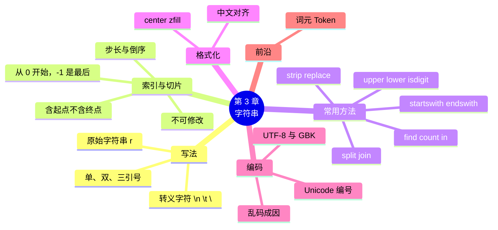

# 第 3 章 字符串：处理文字信息

!!! abstract "本章学时"
    理论 4 学时 · 实验 2 学时（本章共 3 个实验，教师可任选）

## 学习目标

学完本章，你应该能够：

1. **说出**转义字符 `\n`、`\t`、`\\` 的含义，以及字符串“不可修改”的特点（记忆）；
2. **解释**正向索引、反向索引和切片“含起点、不含终点”的规则（理解）；
3. **使用**`strip`、`split`、`join`、`replace`、`find`、`count`、`startswith`、`isdigit` 等方法整理和检查文字（应用）；
4. **写出**取出前几位、后几位、中间一段的切片表达式，完成手机号脱敏等任务（应用）；
5. **分析**中文乱码产生的原因，说出 UTF-8 和 GBK 的区别（分析）。

!!! info "先修要求"
    学习本章前，你需要：

    - 知道字符串是用引号括起来的文字，会用 `+` 连接、`*` 重复（[2.3.1 字符串](../02-variables/index.md#231)）；
    - 会用 `len`、`int`、`str` 等函数，会用 f-string 输出（[2.5 类型转换与 input](../02-variables/index.md#25)、[2.6 f-string](../02-variables/index.md#26)）。

??? abstract "本章概念清单（9 个，点击查看定义和例子）"
    1. [转义字符](../../appendix/glossary.md#g-转义字符)
    2. [原始字符串](../../appendix/glossary.md#g-原始字符串)
    3. [索引](../../appendix/glossary.md#g-索引)
    4. [切片](../../appendix/glossary.md#g-切片)
    5. [方法](../../appendix/glossary.md#g-方法)
    6. [Unicode](../../appendix/glossary.md#g-Unicode)
    7. [字符编码](../../appendix/glossary.md#g-字符编码)
    8. [UTF-8](../../appendix/glossary.md#g-UTF-8)
    9. [词元](../../appendix/glossary.md#g-词元)

## 情景导入

陈姐想给老顾客办会员卡，让小周把登记表录进电脑。登记表是顾客自己填的，五花八门：有人把手机号写成“138 0013 8000”，有人写成“138-0013-8000”；有人名字前面多空了一格；地址里“幸福路”有的写成“幸福路 ”，有的写成“幸福 路”。

陈姐还提了个要求：“小票上印手机号，中间四位要打星号，现在都讲究保护个人信息。”小周在网上见过别人做的会员系统，打出来的小票上是“138****8000”，可这是怎么做到的呢？

这些工作的共同点是：处理的都是**文字**。电脑擅长算数，处理文字同样拿手。这一章，我们深入学习**字符串**：怎样取出其中一段，怎样去掉多余的空格、替换文字、拆开和拼接，以及为什么用 Excel 打开一个文件会冒出一堆“锟斤拷”式的乱码。

## 3.1 字符串的写法

### 3.1.1 单引号、双引号和三引号

字符串可以用单引号或双引号括起来，两者完全一样。如果文字里本身有引号，就用另一种引号括起来：

```python
print('他说："你好"', "It's OK")
```

```text
他说："你好" It's OK
```

要写跨越多行的文字，用**三个引号**（`"""` 或 `'''`）括起来，换行会原样保留：

```python
notice = """营业时间调整通知
即日起每天 7:00 - 23:00 营业"""
print(notice)
```

```text
营业时间调整通知
即日起每天 7:00 - 23:00 营业
```

### 3.1.2 转义字符

有些字符没法直接打出来，比如“换行”。Python 用反斜杠 `\` 加一个字母来表示，这叫[**转义字符**](../../appendix/glossary.md#g-转义字符 "以反斜杠 \ 开头、表示特殊字符的写法"){ .term }（Escape Character）：

| 转义字符 | 含义 | 例子 | 显示效果 |
|---|---|---|---|
| `\n` | 换行 | `"第一行\n第二行"` | 分成两行显示 |
| `\t` | 制表符（Tab，跳到下一个对齐位置） | `"姓名\t电话"` | `姓名	电话` |
| `\\` | 反斜杠本身 | `"C:\\new\\table"` | `C:\new\table` |
| `\"`、`\'` | 引号本身 | `"他说：\"好\""` | `他说："好"` |

Windows 的文件路径里有很多反斜杠，很容易“误伤”。比如 `print("C:\new\table")` 里的 `\n` 被当成换行、`\t` 被当成 Tab，结果变成：

```text
C:
ew	able
```

有两种解决办法：把每个 `\` 写成 `\\`，或者在引号前加字母 `r`，写成 `r"C:\new\table"`。加了 `r` 的叫[**原始字符串**](../../appendix/glossary.md#g-原始字符串 "在引号前加 r，让反斜杠不再转义，原样保留"){ .term }（Raw String），里面的反斜杠不再转义。第 9 章读写文件时会经常用到。

## 3.2 索引与切片

### 3.2.1 索引：从 0 开始数 { #321 }

字符串里的每个字符都有一个编号，叫[**索引**](../../appendix/glossary.md#g-索引 "字符在字符串中的位置编号，从 0 开始；负数表示从末尾往前数"){ .term }（Index）。Python 的索引**从 0 开始**：第 1 个字符的索引是 0，第 2 个是 1……用“字符串[索引]”就能取出某个字符。

索引也可以是负数，表示**从后往前数**：-1 是最后一个，-2 是倒数第二个。以 `s = "街坊便利店欢迎您"` 为例：

| 字符 | 街 | 坊 | 便 | 利 | 店 | 欢 | 迎 | 您 |
|---|---|---|---|---|---|---|---|---|
| 正向索引 | 0 | 1 | 2 | 3 | 4 | 5 | 6 | 7 |
| 反向索引 | -8 | -7 | -6 | -5 | -4 | -3 | -2 | -1 |

<div class="tryit" markdown>

```python
s = "街坊便利店欢迎您"
print(s[0], s[4], s[-1], s[-3])
print(len(s))
```

</div>

```text
街 店 您 欢
8
```

`len()` 返回字符串的长度，也就是有多少个字符。一个汉字、一个字母、一个空格、一个标点都算 1 个字符。长度为 8 的字符串，最大索引是 7，写 `s[8]` 就会报错 `IndexError: string index out of range`（索引超出范围）。

### 3.2.2 切片：取出一段

取出连续的一段用[**切片**](../../appendix/glossary.md#g-切片 "用 [开始:结束:步长] 取出一段，包含开始、不包含结束"){ .term }（Slicing），写法是 `字符串[起点:终点]`，取出从起点开始、到终点**之前**为止的字符，即“**含起点，不含终点**”：

<div class="tryit" markdown>

```python
s = "街坊便利店欢迎您"
print(s[0:4])    # 第 0、1、2、3 个
print(s[4:])     # 终点留空：一直取到最后
print(s[:2])     # 起点留空：从头开始
print(s[-3:])    # 最后 3 个
```

</div>

```text
街坊便利
店欢迎您
街坊
欢迎您
```

“不含终点”有一个好处：`s[:4]` 正好取出 4 个字符，`s[4:]` 正好是剩下的，两者拼起来就是原字符串，不重不漏。

切片还可以加第三个数——**步长**，写成 `[起点:终点:步长]`，表示每隔几个取一个。步长为负数时从后往前取，`[::-1]` 是把字符串倒过来的常用写法：

```python
print(s[::2], s[1:6:2], s[::-1])
```

```text
街便店迎 坊利欢 您迎欢店利便坊街
```

下面的动画是一把“切片尺”，拖动滑块，看看每种写法取出了哪几个字。

<iframe class="sim-frame" src="../../sims/slice-ruler/main.html" height="430" loading="lazy" title="字符串切片尺"></iframe>
动画：字符串切片尺。蓝色背景是被取出的字，终点那个字不取。[全屏打开](../../sims/slice-ruler/main.html){ target=_blank }
{ .sim-caption }

切片的几个实用写法：

| 需求 | 写法 | `phone = "13800138000"` 时的结果 |
|---|---|---|
| 前 3 位 | `phone[:3]` | `'138'` |
| 后 4 位 | `phone[-4:]` | `'8000'` |
| 去掉第一位 | `phone[1:]` | `'3800138000'` |
| 第 4～7 位 | `phone[3:7]` | `'0013'` |
| 手机号脱敏 | `phone[:3] + "****" + phone[-4:]` | `'138****8000'` |

切片超出范围**不会报错**，只会取到能取的部分，例如 `"abc"[1:100]` 得到 `'bc'`；这一点和索引不同。

### 3.2.3 字符串不能修改

字符串一旦创建，里面的字符就**不能修改**，这叫“不可变”（Immutable）：

```python
s = "abc"
s[0] = "x"
```

```text
TypeError: 'str' object does not support item assignment
```

要“修改”字符串，实际做法是**生成一个新字符串**，再赋值给变量，例如 `s = "x" + s[1:]`。下面要讲的 `replace`、`upper` 等方法也是这样：它们都不改原字符串，而是返回一个新的。

!!! cert "证书考点 · 信息技术水平-人工智能（Python）"
    索引和切片是“读程序写结果”的必考内容，特别是负数索引、省略起点或终点、步长为 -1。做题时先在草稿纸上把每个字符的正、反向索引写出来，再按“含起点不含终点”去取（详见[证书考点对照](../../certificate.md)）。

## 3.3 字符串的常用方法

### 3.3.1 什么是方法

除了 `len()` 这样的函数，字符串还自带很多“技能”，叫[**方法**](../../appendix/glossary.md#g-方法 "属于某种数据、用“数据.方法名()”调用的函数"){ .term }（Method）。调用方法的写法是“**字符串.方法名(参数)**”，中间有一个点：

```python
x = "abc"
y = x.upper()      # upper：转成大写
print(x, y)
```

```text
abc ABC
```

注意 `x` 没有变，`upper()` 返回了一个新字符串，存到了 `y` 里。如果想让 `x` 变成大写，要写 `x = x.upper()`。初学者常犯的错误是只写 `x.upper()` 却不赋值，结果发现 `x` 没变。

### 3.3.2 去空格：strip { #332 }

| 方法 | 作用 |
|---|---|
| `s.strip()` | 去掉两头的空格（也包括换行、Tab） |
| `s.lstrip()` | 只去掉左边（开头）的 |
| `s.rstrip()` | 只去掉右边（结尾）的 |

```python
t = "  可乐330ml  "
print("[" + t.strip() + "]", "[" + t.lstrip() + "]", "[" + t.rstrip() + "]")
```

```text
[可乐330ml] [可乐330ml  ] [  可乐330ml]
```

这里在前后加上方括号，是为了看清空格在哪里。录入数据时，**先 strip 一下**是好习惯。`strip` 只去两头，中间的空格要用下面的 `replace`。

### 3.3.3 替换：replace { #333 }

`s.replace(旧, 新)` 把所有的“旧”换成“新”：

<div class="tryit" markdown>

```python
print("幸福路18号".replace("18", "28"))
phone = " 138 0013-8000 "
phone = phone.strip().replace(" ", "").replace("-", "")
print(phone)
```

</div>

```text
幸福路28号
13800138000
```

第三行把三个方法**连着写**：先 `strip`，在结果上再 `replace` 两次。因为每个方法都返回一个新字符串，所以可以一直“点”下去。把“新”写成空字符串 `""`，就相当于删除。

### 3.3.4 拆分与拼接：split 和 join { #334 }

`s.split(分隔符)` 按分隔符把字符串**拆开**，得到一个**列表**（用方括号括起来的一组数据，第 6 章详细讲）。不写分隔符时，按空格（连续的空格、换行都算）拆：

<div class="tryit" markdown>

```python
print("2025-03-07".split("-"))
print("矿泉水,可乐,绿茶".split(","))
print("老板 很 热情".split())
```

</div>

```text
['2025', '03', '07']
['矿泉水', '可乐', '绿茶']
['老板', '很', '热情']
```

`join` 正好相反，用一个连接符把一组字符串**连起来**，写法是“连接符.join(一组字符串)”：

```python
print("-".join(["2025", "03", "07"]))
```

```text
2025-03-07
```

`split` 和 `join` 在处理表格数据时非常常用：表格的一行“矿泉水,2.0,91”按逗号一拆，就得到了三个格子的内容。第 9 章读 CSV 文件时会用到。

### 3.3.5 查找与计数 { #335 }

| 方法或写法 | 作用 | 例子 | 结果 |
|---|---|---|---|
| `s.find(子串)` | 找子串第一次出现的位置，找不到返回 -1 | `"街坊便利店".find("便利")` | `2` |
| `s.index(子串)` | 同上，但找不到时报错 `ValueError` | `"街坊便利店".index("超市")` | 报错 |
| `s.count(子串)` | 统计子串出现几次 | `"好吃好吃".count("好")` | `2` |
| `s.startswith(x)` | 是否以 x 开头 | `"D00012".startswith("D")` | `True` |
| `s.endswith(x)` | 是否以 x 结尾 | `"photo.jpg".endswith(".jpg")` | `True` |
| `x in s` | s 里是否包含 x | `"便利" in "街坊便利店"` | `True` |
| `x not in s` | s 里是否不包含 x | `"超市" not in "街坊便利店"` | `True` |

`in` 不是方法，而是一个运算符，读起来像英语：“便利 在 街坊便利店 里吗？”它的结果是布尔值，下一章写判断条件时经常用到。

### 3.3.6 大小写转换 { #336 }

`upper()` 转大写、`lower()` 转小写，只对英文字母起作用：

```python
print("Coke Cola".upper(), "Coke Cola".lower())
```

```text
COKE COLA coke cola
```

用户输入英文时大小写不统一（`Yes`、`YES`、`yes`），先统一转成小写再比较，就不会漏掉。身份证号末位的 `x` 也常用 `upper()` 统一成大写 `X`。

## 3.4 长度与判断方法

`len()` 前面已经用过。字符串还有一组以 `is` 开头的方法，用来检查内容，结果都是布尔值：

| 方法 | 检查什么 | 例子 | 结果 |
|---|---|---|---|
| `s.isdigit()` | 是否全是数字字符 | `"123".isdigit()`、`"12.5".isdigit()` | `True`、`False` |
| `s.isalpha()` | 是否全是字母（含汉字） | `"可乐".isalpha()` | `True` |
| `s.isalnum()` | 是否全是字母或数字 | `"abc123".isalnum()` | `True` |
| `s.isupper()` / `s.islower()` | 字母是否全大写 / 全小写 | `"ABC".isupper()` | `True` |

注意 `"12.5".isdigit()` 是 `False`，因为小数点不是数字字符。检查手机号时，可以组合起来：长度是 11、全是数字、以 1 开头，三个条件都满足才算格式正确。怎样把三个条件“组合”起来？下一章学习。

## 3.5 格式化进阶

### 3.5.1 对齐与填充

2.6 节学过 f-string 的对齐写法。字符串还有几个现成的方法：

```python
print("可乐".center(10, "*"))   # 居中，总宽 10，两边用 * 填充
print("42".zfill(5))             # 前面补 0 到 5 位
```

```text
****可乐****
00042
```

`zfill` 适合生成单号：`"D" + str(12).zfill(5)` 得到 `D00012`。

### 3.5.2 中文对齐的小麻烦

用 f-string 对齐中英文混合的内容时，会发现对不齐：

```python
print(f"[{'可乐':>6}][{'Cola':>6}]")
```

```text
[    可乐][  Cola]
```

两个都是占 6 格，但屏幕上一个汉字通常占两个字母的宽度，所以中文那一格看起来更宽。打印小票时，可以把中文内容放在每行最后，或者用 Tab（`\t`）分隔，避免这个问题。这是所有编程语言处理中文时都会遇到的小麻烦，不必深究。

## 3.6 中文与编码初识

### 3.6.1 字符在电脑里是数字 { #361 }

电脑只能保存数字。每个字符都有一个对应的编号，Python 的 `ord()` 函数可以查到编号，`chr()` 反过来由编号得到字符：

<div class="tryit" markdown>

```python
print(ord("A"), ord("a"), ord("中"))
print(chr(20013), chr(65))
```

</div>

```text
65 97 20013
中 A
```

这套全世界统一的编号叫 [**Unicode**](../../appendix/glossary.md#g-Unicode "给世界上几乎所有字符统一编号的标准"){ .term }，它给世界上几乎所有文字的每个字符都分配了一个编号，“中”是 20013。<sup class="cite">[[1]](#ref3-1)</sup> Python 3 的字符串就是一串 Unicode 字符，所以处理中文和处理英文一样方便。

### 3.6.2 编码：把字符存成文件 { #362 }

字符串要保存到文件、在网络上传输时，还要把编号换成一个个**字节**（电脑存储的基本单位）。把字符变成字节的规则叫[**字符编码**](../../appendix/glossary.md#g-字符编码 "把字符编号存成字节的规则；存和读用的编码不一致就会乱码"){ .term }（Character Encoding）。中文环境最常见的两种：

| 编码 | 特点 | 一个汉字占几个字节 |
|---|---|---|
| [**UTF-8**](../../appendix/glossary.md#g-UTF-8 "最常用的 Unicode 编码方式，英文占 1 字节，常用汉字占 3 字节"){ .term } | 国际通用，网页、Linux、手机、Python 的默认编码 | 3 |
| **GBK** | 中文 Windows 的传统编码，老的 Excel、记事本常用 | 2 |

字符串的 `encode()` 方法按指定编码变成字节，`decode()` 反过来：

```python
print("街坊".encode("utf-8"), "街坊".encode("gbk"))
print(len("街坊".encode("utf-8")), len("街坊".encode("gbk")))
```

```text
b'\xe8\xa1\x97\xe5\x9d\x8a' b'\xbd\xd6\xb7\xbb'
6 4
```

`b'...'` 表示这是字节，`\xe8` 这样的写法是一个字节的十六进制数。看不懂没关系，要看懂的是：同样两个字，两种编码存出来的字节完全不同。

### 3.6.3 乱码是怎么来的

**用 A 编码存的文件，却用 B 编码去读，就会出现乱码。**比如按 UTF-8 存的“街坊”，被当成 GBK 来读：

```python
print("街坊".encode("utf-8").decode("gbk", errors="replace"))
```

```text
琛楀潑
```

“街坊”变成了“琛楀潑”。这就是乱码的本质：文字没丢，只是“翻译”用错了字典。最常见的场景是：Python 程序按 UTF-8 保存了一个表格文件，在中文 Windows 上用老版本 Excel 双击打开，Excel 按 GBK 去读，满屏乱码。解决办法在第 9 章：保存时用 `utf-8-sig` 编码，Excel 就能认出来。

!!! tip "遇到乱码怎么办"
    1. 先想：这个文件是什么程序、在什么系统上生成的？Windows 老软件生成的多半是 GBK。
    2. 读文件时换一个编码试试：UTF-8 不行就试 GBK。
    3. 自己保存文件时，统一用 UTF-8。好消息是 2026 年 10 月发布的 Python 3.15 已把 UTF-8 设为默认编码（见 2.7 节），以后这类问题会越来越少。

## 3.7 前沿视窗：大模型眼中的文字 { #37 }

我们用 `len()` 数的是“字符”。大模型（如 DeepSeek、通义千问）读文字时，用的却是另一种单位，叫 [**词元**](../../appendix/glossary.md#g-词元 "大模型处理文字的最小单位，一个汉字可能是一个或几个词元"){ .term }（Token）。模型会先把一句话切成一个个词元，再把每个词元换成一个编号去计算。一个词元可能是一个汉字、半个汉字，也可能是一个常见的词；英文里常见单词通常是一个词元，生僻长词会被切成几段。<sup class="cite">[[2]](#ref3-2)</sup>

这件事和我们有两个关系：

1. **按词元计费**。调用大模型接口（第 12 章）通常按输入、输出的词元数收费，同样的意思写得越啰嗦，花钱越多。
2. **大模型数字数常常数不准**。让大模型“写一段正好 50 个字的广告”，它经常写不准，原因之一就是它“看”到的是词元而不是字。而用 Python 的 `len()` 一数就准。这正说明：**把大模型和程序结合起来**，各取所长，才是用好 AI 的方式。

把一段文字切成词元的过程，叫分词。中文分词还有一个常用的 Python 工具 jieba，第 12 章会用它统计顾客评价里的高频词。

## 本章实验

!!! abstract "实验总览"
    | 实验 | 类型 | 建议时长 | 内容 |
    |---|---|---|---|
    | 实验 3-1 | ★ 基础 | 30 分钟 | 整理会员姓名和手机号，生成脱敏的手机号 |
    | 实验 3-2 | ★ 基础 | 30 分钟 | 用切片从（虚构的）身份证号中取出出生日期等信息 |
    | 实验 3-3 | ☆ 拓展 | 30 分钟 | 统计顾客评价的字数和关键词，替换不文明用语 |

    代码见配套资源 `labs/ch03/` 目录。

### 实验 3-1 ★ 会员信息整理与手机号脱敏

**实验目的**

1. 会用 `strip`、`replace` 清理输入的文字；
2. 会用 `len`、`isdigit`、`startswith` 检查手机号格式；
3. 会用切片完成手机号脱敏。

**实验环境**：本机 CPU。

**实验数据**：运行时输入。编者输入的姓名是“  陈静 ”（前面两个空格、后面一个空格），手机号是“ 138 0013-8000 ”（虚构）。

**实验步骤与代码**

打开 `labs/ch03/lab3_1_member.py`：

```python
name = input("会员姓名：")
phone = input("手机号：")

name = name.strip()                          # 去掉姓名前后的空格
phone = phone.strip()                        # 去掉手机号前后的空格
phone = phone.replace(" ", "").replace("-", "")   # 去掉中间的空格和横线

print("整理后的姓名：", name)
print("整理后的手机号：", phone)
print("手机号位数：", len(phone))
print("是否全是数字：", phone.isdigit())
print("是否以 1 开头：", phone.startswith("1"))

masked = phone[:3] + "****" + phone[-4:]     # 前 3 位 + 4 个星号 + 后 4 位
print("小票上显示：", masked)
print(f"会员 {name[0]}**，手机 {masked}，欢迎光临！")   # 姓名只显示第一个字
```

**运行结果**

```text
会员姓名：  陈静 
手机号： 138 0013-8000 
整理后的姓名： 陈静
整理后的手机号： 13800138000
手机号位数： 11
是否全是数字： True
是否以 1 开头： True
小票上显示： 138****8000
会员 陈**，手机 138****8000，欢迎光临！
```

**实验记录表**

| 输入的手机号 | 整理后 | 位数 | 全是数字？ | 脱敏结果 |
|---|---|---|---|---|
| ` 138 0013-8000 ` | 13800138000 | 11 | True | 138****8000 |
| `139-0000-2222` | | | | |
| `1380013800`（少一位） | | | | |
| `138O0138000`（把 0 打成了字母 O） | | | | |

**常见问题排查**

| 现象 | 原因 | 解决办法 |
|---|---|---|
| 整理后还有空格 | 只写了 `phone.strip()` 没有赋值 | 写成 `phone = phone.strip()` |
| 中间的空格没去掉 | `strip` 只去两头 | 用 `replace(" ", "")` |
| `IndexError: string index out of range` | 姓名输入为空，`name[0]` 取不到 | 输入不为空的姓名（第 4 章学会先判断） |

**思考与练习**

1. 用户输入的是全角数字“１３８”时，`isdigit()` 的结果是什么？试一试，再想想全角数字会带来什么问题。
2. 如果要求脱敏后只显示手机号后 4 位（前面全是星号），怎么写？

**实验报告要求**

提交运行截图和实验记录表，并完成思考题 2 的代码。

### 实验 3-2 ★ 从身份证号中取出出生日期

**实验目的**

1. 能根据“第几位”换算出正确的索引和切片；
2. 会把切片结果和其他文字拼接成需要的格式。

**实验环境**：本机 CPU。

**实验数据**：运行时输入一个**虚构**的 18 位身份证号。编者输入的是“44010619900307153x”（虚构，不对应任何人）。

!!! warning "保护个人信息"
    身份证号属于敏感个人信息，练习时只能使用虚构号码，不要输入自己或他人的真实号码，也不要把真实号码发给 AI 工具。

**实验步骤与代码**

18 位身份证号的结构：第 1～6 位是地区码，第 7～14 位是出生日期，第 15～17 位是顺序码（第 17 位奇数为男、偶数为女），第 18 位是校验码。<sup class="cite">[[3]](#ref3-3)</sup> 关键是把“第几位”换算成索引：第 7 位的索引是 6，第 14 位的索引是 13，所以“第 7～14 位”就是 `[6:14]`。

打开 `labs/ch03/lab3_2_idcard.py`：

```python
id_no = input("请输入 18 位身份证号（虚构）：").strip().upper()   # 末位的 x 统一转成大写 X

area = id_no[:6]
year = id_no[6:10]
month = id_no[10:12]
day = id_no[12:14]
seq = id_no[14:17]
gender_digit = int(id_no[16])            # 第 17 位，索引是 16

print("号码长度：", len(id_no))
print("地区码：", area)
print(f"出生日期：{year} 年 {month} 月 {day} 日")
print(f"出生日期（另一种格式）：{year}-{month}-{day}")
print("顺序码：", seq)
print(f"第 17 位是 {gender_digit}，除以 2 的余数是 {gender_digit % 2}（余 1 为男，余 0 为女）")
print("校验码：", id_no[-1])
print("脱敏显示：", id_no[:3] + "*" * 11 + id_no[-4:])
```

**运行结果**

```text
请输入 18 位身份证号（虚构）：44010619900307153x
号码长度： 18
地区码： 440106
出生日期：1990 年 03 月 07 日
出生日期（另一种格式）：1990-03-07
顺序码： 153
第 17 位是 3，除以 2 的余数是 1（余 1 为男，余 0 为女）
校验码： X
脱敏显示： 440***********153X
```

**实验记录表**

| 信息 | 位置（第几位） | 切片写法 | 结果 |
|---|---|---|---|
| 出生年份 | 第 7～10 位 | `id_no[6:10]` | 1990 |
| 出生月份 | | | |
| 出生日 | | | |
| 顺序码 | | | |
| 校验码 | 第 18 位 | | |

**常见问题排查**

| 现象 | 原因 | 解决办法 |
|---|---|---|
| 年份显示成“9900” | 把第 7 位当成了索引 7 | 索引 = 第几位 − 1 |
| 月份少了一位 | 切片终点少加了 1 | 终点不取，`[10:12]` 才是两位 |
| `ValueError: invalid literal for int()` | 第 17 位不是数字，号码输错了 | 检查输入 |

**思考与练习**

1. 输出“出生于 1990 年 3 月 7 日”（月份、日期前面不要 0），怎么写？（提示：`int("03")` 得到 3。）
2. 15 位的老身份证号，出生日期在第 7～12 位，只有两位年份，怎样取出来？

**实验报告要求**

提交实验记录表和两道思考题的代码。

### 实验 3-3 ☆ 商品评价文本统计与敏感词替换

**实验目的**

1. 会用三引号写多行字符串，用 `count`、`find`、`in` 统计和查找；
2. 会用 `replace` 替换文字，用 `split`、`join` 拆分和拼接。

**实验环境**：本机 CPU。

**实验数据**：程序中的 5 条顾客评价（教材编写，内容为虚构）。

**实验步骤与代码**

打开 `labs/ch03/lab3_3_reviews.py`：

```python
reviews = """老板很热情，东西很新鲜。
价格实惠，离家近很方便，就是排队太久，真烦人！
早餐好吃，包子很香，肠粉味道不错。
有时候缺货，晚上没有面包了，烦死了。
店里很干净，找零很快，老板人很好。"""

print("评价全文共", len(reviews), "个字符（含标点和换行）")
print("其中换行符有", reviews.count("\n"), "个，所以一共", reviews.count("\n") + 1, "条评价")
print("“老板”出现了", reviews.count("老板"), "次")
print("“很”出现了", reviews.count("很"), "次")
print("第一次提到“排队”的位置（索引）：", reviews.find("排队"))
print("有没有提到“价格”：", "价格" in reviews)
print("有没有提到“送货”：", "送货" in reviews)

clean = reviews.replace("真烦人", "***").replace("烦死了", "***")   # 不文明用语换成星号
print()
print("替换后的评价：")
print(clean)

first = reviews.split("\n")[0]          # 按换行符拆开，取第一条
print()
print("第一条评价：", first)
print("第一条评价按逗号拆开：", first.split("，"))
print("用“ | ”重新连起来：", " | ".join(first.split("，")))
```

**运行结果**

```text
评价全文共 91 个字符（含标点和换行）
其中换行符有 4 个，所以一共 5 条评价
“老板”出现了 2 次
“很”出现了 7 次
第一次提到“排队”的位置（索引）： 27
有没有提到“价格”： True
有没有提到“送货”： False

替换后的评价：
老板很热情，东西很新鲜。
价格实惠，离家近很方便，就是排队太久，***！
早餐好吃，包子很香，肠粉味道不错。
有时候缺货，晚上没有面包了，***。
店里很干净，找零很快，老板人很好。

第一条评价： 老板很热情，东西很新鲜。
第一条评价按逗号拆开： ['老板很热情', '东西很新鲜。']
用“ | ”重新连起来： 老板很热情 | 东西很新鲜。
```

注意 `split("，")` 用的是**中文逗号**，因为评价里的逗号是中文的；如果写成英文逗号 `","`，就拆不开。

**实验记录表**

| 问题 | 你的答案 |
|---|---|
| “新鲜”出现了几次？代码怎么写？ | |
| 第二条评价是什么？代码怎么写？ | |
| 把“排队太久”替换成“高峰期需要排队”，代码怎么写？ | |
| 为什么“很”的次数比你肉眼数的可能多或少？ | |

**常见问题排查**

| 现象 | 原因 | 解决办法 |
|---|---|---|
| `split` 后只得到 1 段 | 分隔符的中英文不一致 | 看清原文用的是中文还是英文标点 |
| 替换没有效果 | 没有把结果赋值给变量 | `clean = reviews.replace(...)` |

**思考与练习**

1. 统计所有评价中“好”字的个数，再想一想：“好吃”“不好”都含“好”，按字数统计情感靠谱吗？（第 12 章用分词改进。）
2. 把五条评价合并成一行，用“；”隔开。

**实验报告要求**

提交实验记录表和思考题的代码。

## 本章小结

- 字符串用单引号、双引号或三引号括起来；`\n`、`\t`、`\\` 是常用的**转义字符**；路径可以写成**原始字符串** `r"..."`。
- **索引**从 0 开始，-1 是最后一个；**切片** `s[起点:终点:步长]` 含起点不含终点，留空表示到头，`[::-1]` 是倒序；切片越界不报错，索引越界报 `IndexError`。
- 字符串不可修改，所有**方法**都返回新字符串，要赋值才能保存结果。常用方法：`strip` 去两头空格，`replace` 替换，`split` 拆分、`join` 拼接，`find`/`count` 查找计数，`startswith`/`endswith` 判断开头结尾，`upper`/`lower` 转大小写，`isdigit` 等检查内容；`in` 判断包含关系。
- `zfill` 补零、`center` 居中；中英文混排时对齐会有偏差。
- 电脑用 **Unicode** 编号表示字符；保存时按**字符编码**变成字节，常见的有 **UTF-8**（3 字节一个汉字）和 GBK（2 字节）；用错编码读文件就会出现乱码。
- 大模型按**词元**而不是字符处理文字，按词元计费；数字数这类事交给程序更可靠。



**下一章预告**

实验 3-1 检查手机号时，我们分别打印了“位数是不是 11”“是不是全是数字”，但程序并没有根据检查结果**做出不同的反应**：格式错了应该提示“请重新输入”，格式对了才打印小票。下一章学习**条件判断**，让程序学会做选择。

## 参考文献

正文中的上标编号（如<sup class="cite">[[1]](#ref3-1)</sup>）对应下面的文献。带链接的可以直接打开；书籍可在图书馆或电子书平台查阅。

<div class="refs" markdown>

**教材与专著**

- <span id="ref3-4"></span>[4] 嵩天, 礼欣, 黄天羽. Python 语言程序设计基础[M]. 2 版. 北京: 高等教育出版社, 2017.
    <span class="ref-note">第 3 章“基本数据类型”讲字符串的索引、切片和常用方法，对应 3.2～3.4 节。</span>

**经典论文与标准**

- <span id="ref3-3"></span>[3] 国家质量技术监督局. 公民身份号码: GB 11643—1999[S]. 北京: 中国标准出版社, 1999.
    <span class="ref-note">规定 18 位公民身份号码由地址码、出生日期码、顺序码和校验码组成，顺序码奇数分配给男性、偶数分配给女性，对应实验 3-2。</span>

**在线资源与数据**

- <span id="ref3-1"></span>[1] The Unicode Consortium. The Unicode standard[EB/OL]. [2026-11-01]. https://www.unicode.org/standard/standard.html.
    <span class="ref-note">Unicode 标准的官方介绍，对应 3.6.1 节。</span>
- <span id="ref3-2"></span>[2] OpenAI. What are tokens and how to count them?[EB/OL]. [2026-11-01]. https://help.openai.com/en/articles/4936856-what-are-tokens-and-how-to-count-them.
    <span class="ref-note">解释大模型的词元（Token）概念及其与字数的关系，对应 3.7 节。</span>
- <span id="ref3-5"></span>[5] Python Software Foundation. 文本序列类型——str[EB/OL]. [2026-11-01]. https://docs.python.org/zh-cn/3.14/library/stdtypes.html#text-sequence-type-str.
    <span class="ref-note">Python 官方文档中字符串全部方法的说明，可作为 3.3、3.4 节的查阅手册。</span>

</div>

## 课后练习

选择题和判断题可以直接点击选项作答，系统会马上告诉你对错，并展开答案与解析；多选题选好后点“提交答案”。简答和实操题请先自己作答，再点开“答案与解析”核对。每道题的解析下方都有“回看”链接，做错了可以直接跳回正文复习。

**一、单项选择题**

<div class="quiz" data-answer="B" markdown>

**1.** 设 `s = "Python"`，`s[1]` 的值是（　　）。

- A. `'P'`
- B. `'y'`
- C. `'t'`
- D. `'n'`

</div>

??? tip "答案与解析"
    **答案：B**

    索引从 0 开始，`s[0]` 是 P，`s[1]` 是 y。

    考查：索引 · 认知层次：应用 · [回看 3.2.1](#321)
    { .quiz-meta }

<div class="quiz" data-answer="D" markdown>

**2.** 设 `s = "Python"`，`s[-2:]` 的值是（　　）。

- A. `'Py'`
- B. `'o'`
- C. `'nohtyP'`
- D. `'on'`

</div>

??? tip "答案与解析"
    **答案：D**

    -2 是倒数第二个字符 o，终点留空取到最后，得到 `'on'`。

    考查：切片 · 认知层次：应用 · [回看 3.2.2](#322)
    { .quiz-meta }

<div class="quiz" data-answer="A" markdown>

**3.** 设 `s = "13800138000"`，下列能取出前 3 位 `'138'` 的是（　　）。

- A. `s[:3]`
- B. `s[1:3]`
- C. `s[0:2]`
- D. `s[3]`

</div>

??? tip "答案与解析"
    **答案：A**

    `s[:3]` 取索引 0、1、2。B 取索引 1、2；C 取索引 0、1；D 只取索引 3 一个字符。

    考查：切片 · 认知层次：应用 · [回看 3.2.2](#322)
    { .quiz-meta }

<div class="quiz" data-answer="C" markdown>

**4.** `"a,b,,c".split(",")` 的结果是（　　）。

- A. `['a', 'b', 'c']`
- B. `['a,b,,c']`
- C. `['a', 'b', '', 'c']`
- D. `['a', 'b', ',', 'c']`

</div>

??? tip "答案与解析"
    **答案：C**

    两个逗号之间什么都没有，拆出来就是空字符串 `''`。

    考查：split · 认知层次：应用 · [回看 3.3.4](#334)
    { .quiz-meta }

<div class="quiz" data-answer="B" markdown>

**5.** 执行下面的代码后，输出是（　　）。

```python
s = "hello"
s.upper()
print(s)
```

- A. `HELLO`
- B. `hello`
- C. `Hello`
- D. 报错

</div>

??? tip "答案与解析"
    **答案：B**

    `upper()` 返回新字符串，但没有赋值给任何变量；`s` 本身没有改变。

    考查：方法与不可变 · 认知层次：理解 · [回看 3.3.1](#331)
    { .quiz-meta }

<div class="quiz" data-answer="D" markdown>

**6.** `"街坊便利店".find("超市")` 的结果是（　　）。

- A. `0`
- B. `None`
- C. 报错 `ValueError`
- D. `-1`

</div>

??? tip "答案与解析"
    **答案：D**

    `find` 找不到时返回 -1；`index` 找不到时才报错。

    考查：查找 · 认知层次：记忆 · [回看 3.3.5](#335)
    { .quiz-meta }

<div class="quiz" data-answer="A" markdown>

**7.** `print("A\tB\nC")` 的输出有几行（　　）。

- A. 2 行
- B. 1 行
- C. 3 行
- D. 4 行

</div>

??? tip "答案与解析"
    **答案：A**

    `\t` 是 Tab，不换行；`\n` 换行一次，所以是两行：`A	B` 和 `C`。

    考查：转义字符 · 认知层次：理解 · [回看 3.1.2](#312)
    { .quiz-meta }

<div class="quiz" data-answer="C" markdown>

**8.** 用 UTF-8 编码保存的中文文件，用 GBK 编码打开会（　　）。

- A. 自动转换，显示正常
- B. 文字全部丢失
- C. 显示成乱码
- D. 报错，无法打开

</div>

??? tip "答案与解析"
    **答案：C**

    字节按错误的规则“翻译”，得到的就是乱码，例如“街坊”变成“琛楀潑”。

    考查：字符编码 · 认知层次：理解 · [回看 3.6.3](#363)
    { .quiz-meta }

**二、多项选择题**

<div class="quiz quiz-multi" data-answer="ABC" markdown>

**1.** 设 `s = "abcdef"`，结果为 `'cde'` 的有（　　）。

- A. `s[2:5]`
- B. `s[-4:-1]`
- C. `s[2:-1]`
- D. `s[3:6]`

</div>

??? tip "答案与解析"
    **答案：ABC**

    c、d、e 的正向索引是 2、3、4，反向索引是 -4、-3、-2。A、B、C 都取这三个；D 取 d、e、f。

    考查：切片 · 认知层次：应用 · [回看 3.2.2](#322)
    { .quiz-meta }

<div class="quiz quiz-multi" data-answer="BD" markdown>

**2.** 下列表达式结果为 `True` 的有（　　）。

- A. `"12.5".isdigit()`
- B. `"便利" in "街坊便利店"`
- C. `"photo.jpg".startswith(".jpg")`
- D. `"abc".upper() == "ABC"`

</div>

??? tip "答案与解析"
    **答案：BD**

    A 含小数点不是全数字；C 应该用 `endswith`。

    考查：判断方法 · 认知层次：应用 · [回看 3.4](#34)
    { .quiz-meta }

<div class="quiz quiz-multi" data-answer="ACD" markdown>

**3.** 下列说法正确的有（　　）。

- A. 字符串创建后不能修改其中的某个字符
- B. `s.strip()` 会去掉字符串中所有的空格
- C. `"-".join(["a", "b"])` 的结果是 `'a-b'`
- D. 切片超出范围不会报错

</div>

??? tip "答案与解析"
    **答案：ACD**

    `strip` 只去掉两头的空格，中间的要用 `replace`。

    考查：字符串方法 · 认知层次：理解 · [回看 3.3.2](#332)
    { .quiz-meta }

**三、判断题**

<div class="quiz quiz-judge" data-answer="√" markdown>

**1.** 长度为 5 的字符串，最后一个字符的索引是 4，也可以写成 -1。（　　）

- √
- ×

</div>

??? tip "答案与解析"
    **答案：√**

    索引从 0 开始，最大索引是长度减 1。

    考查：索引 · 认知层次：理解 · [回看 3.2.1](#321)
    { .quiz-meta }

<div class="quiz quiz-judge" data-answer="×" markdown>

**2.** `s[2:5]` 会取出索引为 2、3、4、5 的四个字符。（　　）

- √
- ×

</div>

??? tip "答案与解析"
    **答案：×**

    切片含起点不含终点，只取 2、3、4 三个。

    考查：切片 · 认知层次：理解 · [回看 3.2.2](#322)
    { .quiz-meta }

<div class="quiz quiz-judge" data-answer="√" markdown>

**3.** `r"C:\new"` 中的 `\n` 不会被当成换行。（　　）

- √
- ×

</div>

??? tip "答案与解析"
    **答案：√**

    加了 `r` 的原始字符串，反斜杠不转义。

    考查：原始字符串 · 认知层次：记忆 · [回看 3.1.2](#312)
    { .quiz-meta }

<div class="quiz quiz-judge" data-answer="×" markdown>

**4.** `len("你好 Python")` 的结果是 8。（　　）

- √
- ×

</div>

??? tip "答案与解析"
    **答案：×**

    “你”“好”、1 个空格、P-y-t-h-o-n 共 6 个字母，一共 9 个字符。

    考查：len · 认知层次：应用 · [回看 3.2.1](#321)
    { .quiz-meta }

<div class="quiz quiz-judge" data-answer="√" markdown>

**5.** 在 UTF-8 编码中，一个常用汉字通常占 3 个字节。（　　）

- √
- ×

</div>

??? tip "答案与解析"
    **答案：√**

    “街坊”两个字按 UTF-8 编码是 6 个字节。

    考查：字符编码 · 认知层次：记忆 · [回看 3.6.2](#362)
    { .quiz-meta }

**四、简答题**

**1.** 读程序写结果。

```python
s = "2025-03-07"
parts = s.split("-")
print(parts)
print(parts[1] + "月" + parts[2] + "日")
print(s[::-1])
print(s.replace("-", "/"))
```

??? tip "答案与解析"
    **参考答案**

    ```text
    ['2025', '03', '07']
    03月07日
    70-30-5202
    2025/03/07
    ```

    考查：split、切片、replace · 认知层次：应用 · [回看 3.3.4](#334)
    { .quiz-meta }

**2.** 找错并改正。下面的程序想去掉商品名两头的空格并转成大写，但输出没有变化，为什么？怎么改？

```python
name = "  cola  "
name.strip()
name.upper()
print(name)
```

??? tip "答案与解析"
    **参考答案**

    字符串不可修改，`strip()`、`upper()` 返回的是新字符串，但没有赋值，`name` 还是原来的值。改为：

    ```python
    name = "  cola  "
    name = name.strip().upper()
    print(name)
    ```

    考查：方法与不可变 · 认知层次：分析 · [回看 3.3.1](#331)
    { .quiz-meta }

**3.** 用自己的话解释：为什么用 Excel 打开 Python 生成的 CSV 文件，中文可能是乱码？

??? tip "答案与解析"
    **参考答案**

    文件保存时要按某种字符编码把文字变成字节。Python 默认用 UTF-8 保存，而中文 Windows 上的老版本 Excel 默认按 GBK 读取，用错误的编码“翻译”字节，就得到了乱码。保存时改用 `utf-8-sig` 编码（第 9 章），Excel 就能正确识别。

    考查：字符编码 · 认知层次：理解 · [回看 3.6.3](#363)
    { .quiz-meta }

**五、实操题**

**1.** 输入一个商品编号（如“p07”），把它整理成统一格式：去掉两头空格、字母转大写、数字部分补足 3 位（输出“P007”）。提示：字母是第一个字符，后面是数字。

??? tip "答案与解析"
    **参考答案**

    ```python
    code = input("商品编号：").strip().upper()
    print(code[0] + code[1:].zfill(3))
    ```

    输入 `p07` 时，`code` 变成 `P07`，`code[1:]` 是 `'07'`，补零得 `'007'`。

    考查：strip、upper、切片、zfill · 认知层次：应用 · [回看 3.5.1](#351)
    { .quiz-meta }

**2.** 输入一个电子邮箱（如“zhoulin@example.com”），输出用户名和域名两部分，并把用户名脱敏成“第一个字母 + *** ”的形式（输出“z***@example.com”）。

??? tip "答案与解析"
    **参考答案**

    ```python
    email = input("邮箱：").strip()
    user, domain = email.split("@")
    print("用户名：", user, "域名：", domain)
    print(user[0] + "***@" + domain)
    ```

    `user, domain = ...` 把拆出来的两段分别赋给两个变量（第 6 章“解包”会详细讲）；也可以写成 `parts = email.split("@")`，再用 `parts[0]`、`parts[1]`。

    考查：split 与切片 · 认知层次：应用 · [回看 3.3.4](#334)
    { .quiz-meta }
