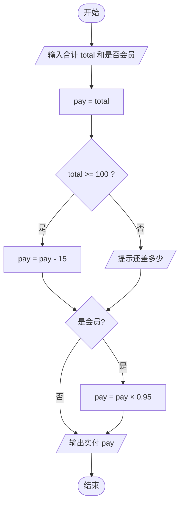
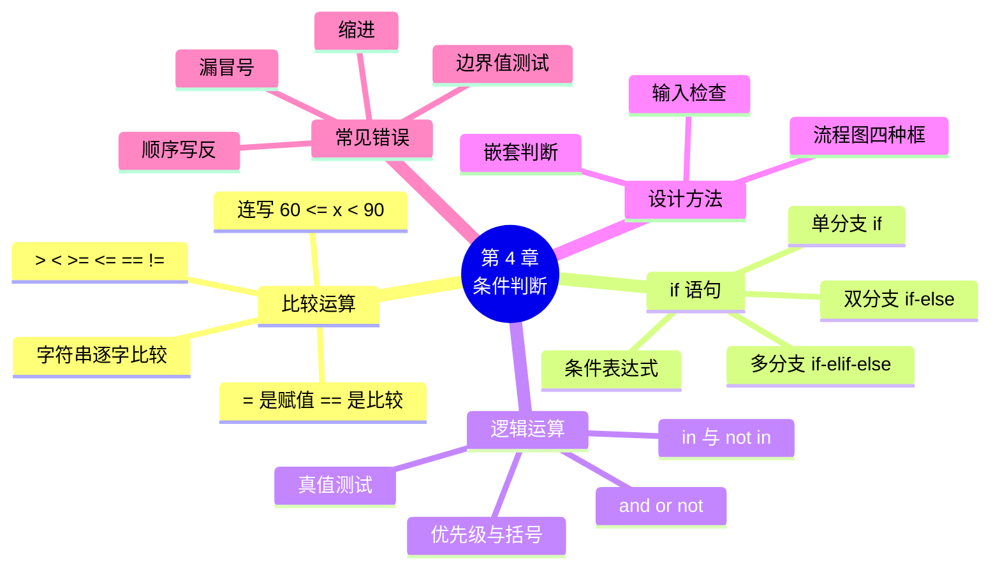

# 第 4 章 条件判断：让程序做选择

!!! abstract "本章学时"
    理论 4 学时 · 实验 2 学时（本章共 3 个实验，教师可任选）

## 学习目标

学完本章，你应该能够：

1. **说出** 6 个比较运算符和 `and`、`or`、`not` 的含义，以及哪些值会被当作“假”（记忆）；
2. **解释** if-else 两条路只走一条、if-elif-else 从上往下“遇到成立就停”的执行规则（理解）；
3. **使用** if、if-else、if-elif-else 和逻辑运算写出满减、阶梯电价、成绩等级等判断程序（应用）；
4. **画出** 简单的程序流程图，并把流程图翻译成代码（应用）；
5. **找出** 缩进错误、`=` 与 `==` 混用、条件顺序写反等常见错误，并改正（分析）。

!!! info "先修要求"
    学习本章前，你需要：

    - 知道布尔值 `True`、`False` 和 `None`（[2.3 字符串、布尔值与 None](../02-variables/index.md#23)）；
    - 会用 `input` 输入、用 `int`、`float` 转换类型（[2.5 类型转换与 input](../02-variables/index.md#25)）；
    - 会用 `strip`、`isdigit` 整理和检查输入（[3.3.2 去空格：strip](../03-strings/index.md#332)、[3.4 长度与判断方法](../03-strings/index.md#34)）。

??? abstract "本章概念清单（10 个，点击查看定义和例子）"
    1. [比较运算符](../../appendix/glossary.md#g-比较运算符)
    2. [布尔表达式](../../appendix/glossary.md#g-布尔表达式)
    3. [顺序结构](../../appendix/glossary.md#g-顺序结构)
    4. [分支结构](../../appendix/glossary.md#g-分支结构)
    5. [条件表达式](../../appendix/glossary.md#g-条件表达式)
    6. [逻辑运算符](../../appendix/glossary.md#g-逻辑运算符)
    7. [真值测试](../../appendix/glossary.md#g-真值测试)
    8. [流程图](../../appendix/glossary.md#g-流程图)
    9. [嵌套](../../appendix/glossary.md#g-嵌套)
    10. [输入检查](../../appendix/glossary.md#g-输入检查)

## 情景导入

国庆节快到了，陈姐想搞一次促销：“满 100 元减 15 元，会员再打 9.5 折。”她让小周把这个规则加到收银程序里。

小周第 2 章写的收银程序只会一种算法：单价乘数量，加起来，找零。现在不一样了：有的顾客买了 128 元，能减 15；有的只买了 86 元，不能减；有的是会员，要再打折；有的不是。同一个程序，要根据**不同的情况**算出**不同的结果**。

小周拿笔在纸上画了画：“如果满 100，就减 15，否则不减；然后，如果是会员，就打 9.5 折……”画着画着他发现，自己写下的全是“如果……就……否则……”。

这正是本章要学的内容：**条件判断**。学会它，程序就不再只会从头算到尾，而是能像收银员一样“看情况办事”。

## 4.1 比较运算与布尔表达式 { #41 }

### 4.1.1 六个比较运算符 { #411 }

要做判断，先要会“比”。Python 有 6 个[**比较运算符**](../../appendix/glossary.md#g-比较运算符 "比较两个值、结果为 True 或 False 的运算符，共 6 个"){ .term }，比较的结果只有两种：`True`（成立）或 `False`（不成立）。

| 运算符 | 含义 | 例子（`price = 3.5`） | 结果 |
|---|---|---|---|
| `>` | 大于 | `price > 3` | `True` |
| `<` | 小于 | `price < 3` | `False` |
| `>=` | 大于等于 | `price >= 3.5` | `True` |
| `<=` | 小于等于 | `price <= 3` | `False` |
| `==` | 等于 | `price == 3.5` | `True` |
| `!=` | 不等于 | `price != 3.5` | `False` |

像 `price > 3` 这样，结果是 `True` 或 `False` 的式子，叫[**布尔表达式**](../../appendix/glossary.md#g-布尔表达式 "结果是 True 或 False 的式子，常用作 if 的条件"){ .term }。后面 if 语句里写的“条件”，就是一个布尔表达式。

<div class="tryit" markdown>

```python
price = 3.5
print(price > 3, price == 3.5, price != 3.5, price <= 3)
```

</div>

```text
True True False False
```

!!! warning "两个等号才是“等于”"
    `=` 是**赋值**（把右边的值贴上左边的名字），`==` 才是**比较是否相等**。`price = 3.5` 是把 3.5 存进 price；`price == 3.5` 是问“price 等于 3.5 吗？”。这是初学者最常犯的错误，4.5 节还会再讲。

`>=` 和 `<=` 是两个字符连着写，中间不能有空格，也不能写成数学里的 `≥`、`≤` 或者反过来写成 `=>`。

### 4.1.2 比较字符串 { #412 }

字符串也能比较。`==` 判断两个字符串是否**一模一样**，多一个空格、大小写不同都不算相等：

```python
print("可乐" == "可乐", "可乐" == "可 乐", "abc" == "ABC")
```

```text
True False False
```

所以第 3 章强调，比较之前先用 `strip()` 去空格、用 `lower()` 统一大小写。

字符串之间还能比大小，规则是从第一个字符开始，逐个比较字符的编号（3.6.1 节讲过的 Unicode 编号）：

```python
print("apple" < "banana", "Apple" < "apple", "10" < "9", 10 < 9)
```

```text
True True True False
```

`"10" < "9"` 结果是 `True`，因为字符串比较是先比第一个字符：`"1"` 的编号比 `"9"` 小，后面就不用比了。这说明：**数字一定要先转成数字再比较**，用 `input` 得到的字符串直接比大小，结果会出错。

### 4.1.3 连写的比较与小数比较 { #413 }

数学里写“60 ≤ 分数 < 90”，Python 可以几乎照抄：

```python
x = 85
print(60 <= x < 90)
```

```text
True
```

`60 <= x < 90` 的意思是“`60 <= x` 并且 `x < 90`”，两个都成立才是 `True`。

还记得 2.2.2 节的 `0.1 + 0.2` 不等于 `0.3` 吗？小数有微小误差，所以**不要用 `==` 直接比较两个小数**，可以先 `round` 再比：

```python
print(0.1 + 0.2 == 0.3, round(0.1 + 0.2, 2) == 0.3)
```

```text
False True
```

## 4.2 if 语句：让程序做选择 { #42 }

程序默认从上往下一行一行执行，这叫[**顺序结构**](../../appendix/glossary.md#g-顺序结构 "程序从上往下一行一行执行的结构"){ .term }。有了 if 语句，程序可以根据条件决定执行哪些行、跳过哪些行，这叫[**分支结构**](../../appendix/glossary.md#g-分支结构 "根据条件决定执行哪些代码、跳过哪些代码的结构"){ .term }。

### 4.2.1 单分支 if { #421 }

最简单的 if 语句只有一个分支：条件成立就做某件事，不成立就什么也不做。

```python
total = float(input("合计："))
if total >= 100:
    total = total - 15
    print("满 100 减 15")
print("实付", total)
```

输入 128 和 86，分别运行两次：

```text
合计：128
满 100 减 15
实付 113.0
```

```text
合计：86
实付 86.0
```

写 if 语句要注意三点：

1. `if` 后面写条件，条件后面一定要有**英文冒号** `:`；
2. 条件成立时要做的事写在下一行，并且**缩进 4 个空格**（Thonny 里按一下 Tab 键，或者打完冒号回车会自动缩进）；
3. 缩进相同的几行属于同一个“代码块”，要么一起执行，要么一起跳过。最后一行 `print("实付", total)` 没有缩进，不属于 if，无论条件是否成立都会执行。

第 1 章说过，Python 用缩进表示代码的层次。到了 if 语句，缩进就有了真正的作用：**它决定了哪些行受条件控制**。

### 4.2.2 双分支 if-else { #422 }

条件成立做一件事，不成立做另一件事，用 if-else：

<div class="tryit" markdown>

```python
total = 86
if total >= 100:
    print("已满 100 元，减 15 元")
else:
    print(f"还差 {100 - total} 元可享满减")
```

</div>

```text
还差 14 元可享满减
```

`else` 后面同样要有冒号，它下面的代码也要缩进。`else` 不能单独使用，也不带条件，它的意思就是“否则”。if 和 else 两条路**只走一条，而且一定走一条**。

### 4.2.3 多分支 if-elif-else { #423 }

情况多于两种时，用 if-elif-else。`elif` 是 else if 的缩写，意思是“否则，如果……”。

<div class="tryit" markdown>

```python
score = 75
if score >= 90:
    level = "优秀"
elif score >= 80:
    level = "良好"
elif score >= 70:
    level = "中等"
elif score >= 60:
    level = "及格"
else:
    level = "不及格"
print("等级：", level)
```

</div>

```text
等级： 中等
```

Python 执行 if-elif-else 的规则是：**从上往下逐个判断，遇到第一个成立的条件，就执行它下面的代码，然后跳过剩下的所有分支**；如果一个都不成立，就执行 else。

以 75 分为例：75 >= 90 不成立，看下一个；75 >= 80 不成立，再看下一个；75 >= 70 成立，于是 level 设为“中等”，后面的 `elif score >= 60` 和 `else` 都不再看。

你可能会问：第三个条件为什么只写 `score >= 70`，而不写 `70 <= score < 80`？因为能走到这一行，说明前面的 `score >= 80` 已经不成立了，score 一定小于 80，不用再写一遍。

下面的动画演示程序在不同输入下走了哪条路。点“下一步”，注意被跳过的行不会被高亮。

<iframe class="sim-frame" src="../../sims/branch-flow/main.html" height="600" loading="lazy" title="分支流程走一遍"></iframe>
动画：分支流程走一遍。橙色是下一步要执行的行，被跳过的分支不会亮。[全屏打开](../../sims/branch-flow/main.html){ target=_blank }
{ .sim-caption }

!!! tip "多个 if 和 if-elif 不一样"
    下面两段代码，score 是 95 时输出不同：

    ```python
    if score >= 60:
        print("及格")
    if score >= 90:
        print("优秀")
    ```

    这是**两个独立的 if**，每个都要判断，95 分会输出“及格”和“优秀”两行。如果把第二个 `if` 改成 `elif`，它们就成了一个整体，只走一条路，95 分只输出“及格”。

    什么时候用独立的 if？几件事互不影响、可以同时发生时，比如“满 100 减 15”和“会员打折”可以同时享受，就写两个 if（实验 4-1）。几种情况互相排斥、只能是其中一种时，比如成绩等级，就用 if-elif-else。

### 4.2.4 一行写完的条件表达式 { #424 }

如果只是根据条件在两个值里选一个，可以写成一行，叫[**条件表达式**](../../appendix/glossary.md#g-条件表达式 "用一行写成的二选一：条件成立取前一个值，否则取后一个"){ .term }：

<div class="tryit" markdown>

```python
qty = 12
unit = "箱" if qty >= 12 else "瓶"
print(unit)
```

</div>

```text
箱
```

读法是：“如果 `qty >= 12`，就取 `"箱"`，否则取 `"瓶"`”。它相当于下面 4 行：

```python
if qty >= 12:
    unit = "箱"
else:
    unit = "瓶"
```

条件表达式适合简单的二选一。逻辑一复杂，还是老老实实写 if-else，更容易读懂。

!!! cert "证书考点 · 信息技术水平-人工智能（Python）"
    分支结构是“读程序写结果”的高频题，常考：if-elif-else 遇到成立就停；几个独立的 if 每个都要判断；条件表达式 `A if 条件 else B`。做题时把每个条件的 True / False 写在旁边，再看走哪条路（详见[证书考点对照](../../certificate.md)）。

## 4.3 逻辑运算 and、or、not 与 in { #43 }

### 4.3.1 and、or、not { #431 }

现实中的条件常常不止一个。比如“成年**并且**是会员才能参加抽奖”“满 100 元**或者**有优惠券都能减钱”。把几个条件组合起来，用[**逻辑运算符**](../../appendix/glossary.md#g-逻辑运算符 "把几个条件组合起来的运算符：and 并且、or 或者、not 取反"){ .term }：

| 运算符 | 含义 | 什么时候是 True | 例子 |
|---|---|---|---|
| `and` | 并且 | 两边**都**是 True | `age >= 18 and member` |
| `or` | 或者 | 两边**至少一个**是 True | `total >= 100 or coupon` |
| `not` | 不是 | 把 True 变 False，False 变 True | `not member` |

<div class="tryit" markdown>

```python
age = 25
member = True
total = 80
coupon = True
print(age >= 18 and member)
print(total >= 100 or coupon)
print(not member)
```

</div>

```text
True
True
False
```

可以把 `and` 想成两道门**串**在一起，两道都开才能过；`or` 是两道门**并排**，开一道就能过。

### 4.3.2 优先级 { #432 }

三个逻辑运算符的优先级是：`not` 最高，`and` 其次，`or` 最低。比较运算符（`>`、`==` 等）又比它们都高。所以：

```python
print(True or False and False, (True or False) and False)
```

```text
True False
```

左边先算 `False and False` 得 False，再算 `True or False` 得 True；右边有括号，先算括号里的 `True or False` 得 True，再算 `True and False` 得 False。

记不住优先级没关系，**加括号**就行。括号让意思更清楚，别人也更容易读懂。

### 4.3.3 in 和 not in { #433 }

第 3 章用过 `in` 判断一段文字是否包含另一段文字，它在 if 语句里非常好用：

<div class="tryit" markdown>

```python
answer = "Y"
if answer.lower() in "yes是":
    print("会员价")
else:
    print("普通价")
```

</div>

```text
会员价
```

这样写，用户输入 `y`、`Y`、`yes`、`是` 都能被识别。不过要注意：`in` 检查的是“是不是其中的一段”，`"es"` 也在 `"yes是"` 里面。第 6 章学了列表以后，可以写成更严格的 `answer in ["y", "yes", "是"]`。

`not in` 是 `in` 的反面：`"芬达" not in "可乐,雪碧,矿泉水"` 的结果是 `True`。

### 4.3.4 什么算“真”，什么算“假” { #434 }

if 后面不一定要写比较运算，也可以直接写一个值。Python 会把它当成真或假，这叫[**真值测试**](../../appendix/glossary.md#g-真值测试 "把任意值当作真或假：False、None、0、空字符串等为假，其余为真"){ .term }。规则很简单，下面这些值被当作“假”，其余都是“真”：

- `False` 和 `None`；
- 数字 0（`0`、`0.0`）；
- 空字符串 `""`，以及后面要学的空列表 `[]`、空字典 `{}` 等“空的容器”。

```python
name = ""
if name:
    print("有名字")
else:
    print("名字为空")
```

```text
名字为空
```

`if name:` 的意思就是“如果 name 不是空的”。注意 `" "`（一个空格）和 `"0"`、`"False"` 都**不是**空字符串，它们都是“真”。

!!! note "拓展阅读：短路求值"
    Python 算 `A and B` 时，如果 A 已经是假，整个结果一定是假，就不再看 B；算 `A or B` 时，如果 A 已经是真，就不再看 B。这叫“短路”。利用这一点，`y != 0 and 10 / y > 1` 在 y 是 0 时不会报除以 0 的错误，因为前半句不成立，后半句根本没算。

## 4.4 先画流程图再写代码 { #44 }

### 4.4.1 流程图的基本符号 { #441 }

条件一多，直接写代码容易乱。专业的做法是先画[**流程图**](../../appendix/glossary.md#g-流程图 "用起止框、输入输出框、处理框、判断框和箭头画出程序步骤的图"){ .term }，把“先做什么、在哪里判断、往哪里走”画清楚，再照着图写代码。我国有专门的国家标准规定流程图符号<sup class="cite">[[1]](#ref4-1)</sup>，初学阶段只需要记住 4 种：

| 符号 | 形状 | 含义 |
|---|---|---|
| 起止框 | 圆角矩形 | 开始、结束 |
| 输入输出框 | 平行四边形 | `input`、`print` |
| 处理框 | 矩形 | 计算、赋值 |
| 判断框 | 菱形 | 条件，引出“是”“否”两条线 |

情景导入里的促销规则，画成流程图是这样的：



图里有两个菱形，对应程序里的两个 if；第一个菱形的“是”“否”两条线最后又汇合到一起，说明两个判断是**先后**进行的，互不影响。对照这张图，就能写出实验 4-1 的代码。

画流程图不需要专门的软件，纸笔就够。线下课和作业里，老师可能要求你先交流程图再交代码，这是在训练“先想清楚再动手”的习惯。

### 4.4.2 嵌套判断 { #442 }

if 语句里面还可以再写 if，叫[**嵌套**](../../appendix/glossary.md#g-嵌套 "在一个语句的代码块里再写同类语句，如 if 里面再写 if"){ .term }。比如小店的“会员日”规则：会员才能参加；会员里消费满 50 元送鸡蛋，不满 50 元送纸巾。

<div class="tryit" markdown>

```python
member = "y"
total = 68
if member == "y":
    if total >= 50:
        print("会员满 50，送鸡蛋一盒")
    else:
        print("会员，送纸巾一包")
else:
    print("办会员卡可参加会员日活动")
```

</div>

```text
会员满 50，送鸡蛋一盒
```

里层的 if-else 又多缩进了一层（8 个空格）。缩进的层数就代表了嵌套的层数，同一层的 `if` 和 `else` 必须**左边对齐**。

嵌套最好不超过两三层，太深了自己都看不懂。很多时候可以用 `and` 把嵌套“拉平”，例如上面的程序也可以写成：

```python
if member == "y" and total >= 50:
    print("会员满 50，送鸡蛋一盒")
elif member == "y":
    print("会员，送纸巾一包")
else:
    print("办会员卡可参加会员日活动")
```

### 4.4.3 先检查输入，再计算 { #443 }

第 2 章的程序有一个毛病：用户输入“abc”，`int()` 就报错，程序直接崩溃。学了 if 以后，可以**先检查、后转换**：

```python
text = input("购买数量：").strip()
if text.isdigit():
    qty = int(text)
    print("数量是", qty)
else:
    print("请输入整数")
```

输入 `3` 输出“数量是 3”；输入 `三` 或 `3.5` 输出“请输入整数”。`isdigit()` 在第 3 章学过，它判断字符串是否全由数字组成。

这种“先把关、再干活”的写法叫[**输入检查**](../../appendix/glossary.md#g-输入检查 "在使用输入之前先检查它是否合法，不合法就提示"){ .term }（也叫输入校验），是写程序的好习惯。实验 4-3 会完整练习。第 9 章还会学一种更通用的办法：异常处理 `try-except`。

## 4.5 常见错误 { #45 }

条件判断的代码不长，但很容易写错。下面是编者在 Python 3.14 中运行的真实报错。

**错误一：把 `==` 写成 `=`**

```python
x = 5
if x = 5:
    print("ok")
```

```text
  File "……\t.py", line 2
    if x = 5:
       ^^^^^
SyntaxError: invalid syntax. Maybe you meant '==' or ':=' instead of '='?
```

报错的最后一行已经提示了：“你是不是想写 `==`？”（`:=` 是一种高级写法，本书不用。）

**错误二：漏写冒号**

```python
if x == 5
    print("ok")
```

```text
  File "……\t.py", line 2
    if x == 5
             ^
SyntaxError: expected ':'
```

“expected ':'” 的意思是“这里应该有一个冒号”。`if`、`elif`、`else` 后面都要有冒号，而且必须是**英文**冒号；用中文冒号 `：` 同样会报错。

**错误三：该缩进的没缩进**

```python
if x == 5:
print("ok")
```

```text
  File "……\t.py", line 3
    print("ok")
    ^^^^^
IndentationError: expected an indented block after 'if' statement on line 2
```

意思是：“第 2 行的 if 语句后面，应该有一个缩进的代码块”。

**错误四：不该缩进的缩进了**

```python
if x > 3:
    print("a")
      print("b")
```

```text
  File "……\t.py", line 4
    print("b")
IndentationError: unexpected indent
```

“unexpected indent” 是“意外的缩进”：第 4 行比第 3 行多缩进了两格，Python 不知道它属于哪一层。同一个代码块的每一行，缩进必须完全相同。另外，**不要混用 Tab 键和空格**，统一用 4 个空格最稳妥（Thonny 按 Tab 键会自动换成 4 个空格）。

**错误五：条件顺序写反（不报错，但结果错）**

```python
score = 95
if score >= 60:
    print("及格")
elif score >= 90:
    print("优秀")
```

```text
及格
```

95 分应该是“优秀”，却输出了“及格”。原因是第一个条件 `score >= 60` 已经成立，后面的 elif 根本没机会判断。这种错误**不会报错**，比前面四种更难发现。规则是：**范围从严到宽**，按“大于等于”比较时，先写大的数（`>= 90` 在 `>= 60` 前面）；按“小于”比较时，先写小的数。

!!! tip "测试分支程序的小窍门"
    写完分支程序，不要只用一个数测试。每个分支至少测一个值，再加上“边界值”：比如成绩等级，测 95、85、75、65、30，再测 90、89、60、59、100、0 这些正好在分界线上的数。实验 4-3 的记录表就是这样设计的。

## 4.6 前沿视窗：AI 是怎样“做判断”的 { #46 }

你可能觉得 if 语句太简单了，跟人工智能扯不上关系。其实，早期的人工智能正是靠成百上千条“如果……那么……”规则工作的。20 世纪 70 年代美国斯坦福大学研制的医疗诊断系统 MYCIN，用大约几百条规则帮助医生判断细菌感染、推荐抗生素<sup class="cite">[[2]](#ref4-2)</sup>。这类系统叫“专家系统”，规则由专家一条条写出来，本质上就是一大串 if 语句。

专家系统的问题是：规则太多写不完，情况一变规则就得改。现在的机器学习换了思路：**不再由人写规则，而是让计算机从大量数据中自己“学”出判断方法**。比如判断一条顾客评价是好评还是差评，与其写“如果包含‘好吃’就是好评”，不如给模型看几千条标好的评价，让它自己学。第 12 章会用三行代码体验一下。

有意思的是，机器学习里有一种很常用的模型叫**决策树**，它学出来的结果就是一棵“if-else 树”，学过本章的你完全能看懂。后续的《机器学习》课程会专门介绍它。

不过，在真实的软件里，**规则并没有过时**。满减、阶梯电价、会员等级这类“规矩明确、不能出错”的事，依然由程序员用 if 语句写成规则；只有“说不清规则”的事，比如认图片、听语音、读懂评价，才交给机器学习。会写清楚的规则，是用好 AI 的基础。

## 本章实验

!!! abstract "实验总览"
    | 实验 | 类型 | 建议时长 | 内容 |
    |---|---|---|---|
    | 实验 4-1 | ★ 基础 | 30 分钟 | 实现“满 100 减 15、会员 9.5 折”的收银计算 |
    | 实验 4-2 | ★ 基础 | 30 分钟 | 用 if-elif-else 计算三档阶梯电费 |
    | 实验 4-3 | ☆ 拓展 | 30 分钟 | 成绩等级评定，并检查输入是否合法 |

    代码见配套资源 `labs/ch04/` 目录。

### 实验 4-1 ★ 满减与会员折扣计算 { #lab4-1 }

**实验目的**

1. 会把流程图翻译成两个先后执行的 if 语句；
2. 会用 if-else 在满足和不满足条件时给出不同的提示；
3. 会用 `strip().lower()` 统一用户输入后再比较。

**实验环境**：本机 CPU。

**实验数据**：运行时输入。编者输入了三组：128 元会员、128 元非会员、86 元会员。

**实验步骤与代码**

1. 对照 4.4.1 节的流程图，说出程序有几个判断、分别判断什么；
2. 打开 `labs/ch04/lab4_1_discount.py`，读懂代码后运行三次，分别输入三组数据。

```python
# 实验 4-1 满减与会员折扣计算
# 规则：消费满 100 元减 15 元；会员在满减之后再打 9.5 折

total = float(input("商品合计（元）："))
is_member = input("是否会员（y/n）：").strip().lower()

pay = total                      # 先假设没有任何优惠
if total >= 100:                 # 规则一：满 100 减 15
    pay = pay - 15
    print("已满 100 元，减 15 元")
else:
    print(f"还差 {100 - total:.2f} 元可享满减")

if is_member == "y":             # 规则二：会员 9.5 折
    pay = pay * 0.95
    print("会员 9.5 折")

print(f"原价 {total:.2f} 元，实付 {pay:.2f} 元，共优惠 {total - pay:.2f} 元")
```

**运行结果**

```text
商品合计（元）：128
是否会员（y/n）：y
已满 100 元，减 15 元
会员 9.5 折
原价 128.00 元，实付 107.35 元，共优惠 20.65 元
```

```text
商品合计（元）：128
是否会员（y/n）：n
已满 100 元，减 15 元
原价 128.00 元，实付 113.00 元，共优惠 15.00 元
```

```text
商品合计（元）：86
是否会员（y/n）：y
还差 14.00 元可享满减
会员 9.5 折
原价 86.00 元，实付 81.70 元，共优惠 4.30 元
```

128 元会员的计算过程是：(128 − 15) × 0.95 = 113 × 0.95 = 107.35 元。

**实验记录表**

| 合计 | 会员 | 是否满减 | 是否打折 | 实付（程序） | 实付（手算） |
|---|---|---|---|---|---|
| 128 | y | 是 | 是 | 107.35 | 107.35 |
| 100 | n | | | | |
| 99.9 | y | | | | |
| 200 | Y（大写） | | | | |

**常见问题排查**

| 现象 | 原因 | 解决办法 |
|---|---|---|
| 输入大写 `Y` 不打折 | 没有统一大小写 | 输入后加 `.lower()` |
| `TypeError: '>=' not supported between instances of 'str' and 'int'` | `input` 得到的是字符串，忘了用 `float()` 转换 | `total = float(input(...))` |
| 会员打折算成了 (128 × 0.95) − 15 | 两个 if 的先后顺序写反了 | 按规则先满减、后打折 |

**思考与练习**

1. 如果规则改成“先打折、后满减”，128 元会员实付多少？对顾客来说哪种更划算？
2. 陈姐又加了一条：“满 200 减 40”。满 200 时只能享受减 40，不能再叠加减 15。请修改程序（提示：把第一个 if-else 改成 if-elif-else，注意条件的先后顺序）。

**实验报告要求**

提交流程图、运行截图和实验记录表，并完成思考题 2 的代码。

### 实验 4-2 ★ 阶梯电价计算 { #lab4-2 }

**实验目的**

1. 会用 if-elif-else 处理“分段计算”问题；
2. 能根据分段规则正确写出每一段的计算公式。

**实验环境**：本机 CPU。

**实验数据**：运行时输入用电量。小店楼上是陈姐的家，她想算算每月电费。我国居民用电实行**阶梯电价**：把每月用电量分成三档，用得越多，超出部分的电价越高<sup class="cite">[[3]](#ref4-3)</sup>。各地的分档和电价不同，本实验使用下面的简化数值（**教学用，不是任何地区的真实电价**）：

| 档位 | 用电量 | 电价 |
|---|---|---|
| 第一档 | 200 度及以内 | 0.59 元/度 |
| 第二档 | 201～400 度的部分 | 0.64 元/度 |
| 第三档 | 超过 400 度的部分 | 0.89 元/度 |

“部分”二字很关键。用了 350 度，不是 350 度都按 0.64 元算，而是前 200 度按 0.59 元，后 150 度按 0.64 元。

**实验步骤与代码**

1. 先手算 350 度的电费：200 × 0.59 + 150 × 0.64 = 118 + 96 = 214 元；
2. 打开 `labs/ch04/lab4_2_electricity.py`，运行并输入 150、350、520、-5，对比手算结果。

```python
# 实验 4-2 阶梯电价计算
# 电价为教学用的简化数值，实际电价以当地供电部门公布的为准
# 第一档：200 度及以内，每度 0.59 元
# 第二档：201～400 度的部分，每度 0.64 元
# 第三档：超过 400 度的部分，每度 0.89 元

kwh = float(input("本月用电量（度）："))

if kwh < 0:
    print("用电量不能是负数，请检查输入")
elif kwh <= 200:
    fee = kwh * 0.59
    print(f"第一档，电费 {fee:.2f} 元")
elif kwh <= 400:
    fee = 200 * 0.59 + (kwh - 200) * 0.64
    print(f"第二档，电费 {fee:.2f} 元")
else:
    fee = 200 * 0.59 + 200 * 0.64 + (kwh - 400) * 0.89
    print(f"第三档，电费 {fee:.2f} 元")
```

**运行结果**（运行 4 次）

```text
本月用电量（度）：150
第一档，电费 88.50 元
```

```text
本月用电量（度）：350
第二档，电费 214.00 元
```

```text
本月用电量（度）：520
第三档，电费 352.80 元
```

```text
本月用电量（度）：-5
用电量不能是负数，请检查输入
```

520 度的算法：前 200 度 118 元，第 201～400 度 200 × 0.64 = 128 元，超出 400 的 120 度 120 × 0.89 = 106.8 元，合计 352.8 元。

**实验记录表**

| 用电量（度） | 档位 | 手算电费 | 程序电费 | 一致？ |
|---|---|---|---|---|
| 350 | 第二档 | 214.00 | 214.00 | 是 |
| 200 | | | | |
| 201 | | | | |
| 400 | | | | |
| 0 | | | | |

**常见问题排查**

| 现象 | 原因 | 解决办法 |
|---|---|---|
| 350 度算成 224 元 | 全部按 0.64 元算了 | 只有超出 200 的部分按第二档算 |
| 520 度显示“第二档” | elif 的条件写成了 `kwh >= 200` | 按“从小到大”的顺序写 `<=` 条件 |
| 输入“三百”报 `ValueError` | `float()` 转不了汉字 | 输入阿拉伯数字（第 9 章学习异常处理） |

**思考与练习**

1. 为什么第三个分支只写 `kwh <= 400`，不写 `kwh > 200 and kwh <= 400`？
2. 查一查你所在城市的居民阶梯电价（供电部门网站或电费账单），把程序里的分档和电价改成真实数值。

**实验报告要求**

提交运行截图和实验记录表；思考题 2 要注明数据来源。

### 实验 4-3 ☆ 成绩等级评定加输入检查 { #lab4-3 }

**实验目的**

1. 会先检查输入是否合法，再进行计算；
2. 会用嵌套的 if 和 if-elif-else 处理多种情况；
3. 会用“每个分支 + 边界值”的方法设计测试数据。

**实验环境**：本机 CPU。

**实验数据**：运行时输入。规则：90 分及以上优秀，80～89 良好，70～79 中等，60～69 及格，60 以下不及格；输入不是 0～100 的整数时给出提示。

**实验步骤与代码**

1. 先画流程图：第一个菱形判断“是不是全由数字组成”，第二个判断“是否超过 100”，然后是 4 个等级判断；
2. 尝试自己写出程序，再对照 `labs/ch04/lab4_3_grade.py`：

```python
# 实验 4-3 成绩等级评定（带输入检查）
# 90 分及以上：优秀；80～89：良好；70～79：中等；60～69：及格；60 以下：不及格

text = input("请输入成绩（0～100 的整数）：").strip()

if not text.isdigit():                 # 先检查：是不是全由数字组成
    print("输入有误：请输入整数，不要带小数点、字母或空格")
else:
    score = int(text)
    if score > 100:                    # 再检查：是否超出范围
        print("输入有误：成绩不能超过 100")
    elif score >= 90:
        print("等级：优秀")
    elif score >= 80:
        print("等级：良好")
    elif score >= 70:
        print("等级：中等")
    elif score >= 60:
        print("等级：及格")
    else:
        print("等级：不及格")
```

**运行结果**（编者用 8 个值测试，下面列出其中 5 次）

```text
请输入成绩（0～100 的整数）：82
等级：良好
```

```text
请输入成绩（0～100 的整数）：100
等级：优秀
```

```text
请输入成绩（0～100 的整数）：105
输入有误：成绩不能超过 100
```

```text
请输入成绩（0～100 的整数）：85.5
输入有误：请输入整数，不要带小数点、字母或空格
```

```text
请输入成绩（0～100 的整数）：
输入有误：请输入整数，不要带小数点、字母或空格
```

最后一次是直接按了回车。空字符串的 `isdigit()` 是 `False`，所以也能被拦住。为什么不用检查“小于 0”？因为负数带有负号 `-`，`"-5".isdigit()` 是 `False`，在第一步就被拦下了。

**实验记录表**

| 输入 | 预期结果 | 实际结果 | 通过？ |
|---|---|---|---|
| 95 | 优秀 | 优秀 | 是 |
| 90 | | | |
| 89 | | | |
| 60 | | | |
| 59 | | | |
| 0 | | | |
| -5 | | | |
| abc | | | |

**常见问题排查**

| 现象 | 原因 | 解决办法 |
|---|---|---|
| 输入 abc 报 `ValueError` | 先 `int()` 后检查，顺序反了 | 先 `isdigit()` 检查，通过了再 `int()` |
| 95 分显示“及格” | 条件从宽到严写反了 | 先写 `>= 90`，再写 `>= 80`…… |
| `IndentationError` | `else` 和 `if` 没有对齐 | 同一层的 if、elif、else 左边对齐 |

**思考与练习**

1. 输入“ 88 ”（前后有空格）能否正常评级？为什么？去掉代码里的 `.strip()` 再试试。
2. 改写程序：允许输入一位小数（如 85.5）。提示：可以用 `text.replace(".", "", 1).isdigit()` 判断。

**实验报告要求**

提交流程图、实验记录表（8 个测试值全部填写），并说明你的程序是如何处理非法输入的。

## 本章小结

- 6 个**比较运算符**：`>`、`<`、`>=`、`<=`、`==`、`!=`，结果是 `True` 或 `False`；结果为真假的式子叫**布尔表达式**。`==` 是比较，`=` 是赋值。字符串逐字符比较，数字要先转换再比较；小数不要直接用 `==`。
- if 语句让程序出现**分支结构**：单分支 if、双分支 if-else、多分支 if-elif-else。条件后要加英文冒号，代码块要缩进 4 个空格。if-elif-else 从上往下判断，遇到第一个成立的就执行并跳过其余分支；多个独立的 if 则每个都要判断。
- **条件表达式** `A if 条件 else B` 用一行完成二选一。
- **逻辑运算符** `and`（都成立）、`or`（至少一个成立）、`not`（取反），优先级 not > and > or，拿不准就加括号。`in`、`not in` 判断包含。`False`、`None`、0、空字符串等被当作假（**真值测试**）。
- 复杂的判断先画**流程图**（起止框、输入输出框、处理框、判断框），再写代码；**嵌套**的 if 不宜太深，可用 `and` 拉平；先做**输入检查**再计算。
- 常见错误：`=` 与 `==` 混用、漏冒号、缩进错误、条件顺序写反（不报错但结果错）。测试分支程序要覆盖每个分支和边界值。
- 早期 AI 靠人写的规则做判断，机器学习则从数据中学出判断方法；规则明确的事仍用 if 语句。



**下一章预告**

实验 4-3 有一个不方便的地方：输错了，程序只是提示一句“输入有误”就结束了，想再输一次只能重新运行。能不能让程序“输错就重新输，直到输对为止”？小店一天有一百多单，能不能让程序一单接一单地算，而不是每单都重新运行一次？下一章学习**循环**，让程序重复做事。

## 参考文献

正文中的上标编号（如<sup class="cite">[[1]](#ref4-1)</sup>）对应下面的文献。带链接的可以直接打开；书籍和标准可在图书馆或电子书平台查阅。

<div class="refs" markdown>

**教材与专著**

- <span id="ref4-4"></span>[4] 嵩天, 礼欣, 黄天羽. Python 语言程序设计基础[M]. 2 版. 北京: 高等教育出版社, 2017.
    <span class="ref-note">第 4 章“程序的控制结构”讲程序流程图、分支结构和逻辑运算，对应 4.2～4.4 节。</span>
- <span id="ref4-2"></span>[2] SHORTLIFFE E H. Computer-based medical consultations: MYCIN[M]. New York: Elsevier, 1976.
    <span class="ref-note">介绍用规则进行医疗诊断的专家系统 MYCIN，对应 4.6 节。</span>

**经典论文与标准**

- <span id="ref4-1"></span>[1] 国家标准局. 信息处理 数据流程图、程序流程图、系统流程图、程序网络图和系统资源图的文件编制符号及约定: GB/T 1526—1989[S]. 北京: 中国标准出版社, 1989.
    <span class="ref-note">规定程序流程图中各种框的形状和用法，对应 4.4.1 节。</span>
- <span id="ref4-3"></span>[3] 国家发展和改革委员会. 关于印发《关于居民生活用电试行阶梯电价的指导意见》的通知: 发改价格〔2011〕2617号[Z]. 2011.
    <span class="ref-note">我国居民阶梯电价的政策依据，各省据此制定具体分档和电价，对应实验 4-2。</span>

**在线资源与数据**

- <span id="ref4-5"></span>[5] Python Software Foundation. Python 教程：4.1 if 语句[EB/OL]. [2026-11-01]. https://docs.python.org/zh-cn/3.14/tutorial/controlflow.html#if-statements.
    <span class="ref-note">官方教程中 if-elif-else 的说明；同一页 4.7 节介绍了 Python 3.10 起新增的 match 语句，有兴趣可以自学。</span>

</div>

## 课后练习

选择题和判断题可以直接点击选项作答，系统会马上告诉你对错，并展开答案与解析；多选题选好后点“提交答案”。简答和实操题请先自己作答，再点开“答案与解析”核对。每道题的解析下方都有“回看”链接，做错了可以直接跳回正文复习。

**一、单项选择题**

<div class="quiz" data-answer="C" markdown>

**1.** 下列表示“x 等于 10”的条件，写法正确的是（　　）。

- A. `x = 10`
- B. `x === 10`
- C. `x == 10`
- D. `x =< 10`

</div>

??? tip "答案与解析"
    **答案：C**

    `==` 是比较是否相等；`=` 是赋值；Python 没有 `===` 和 `=<`。

    考查：比较运算符 · 认知层次：记忆 · [回看 4.1.1](#411)
    { .quiz-meta }

<div class="quiz" data-answer="B" markdown>

**2.** 表达式 `"10" < "9"` 的值是（　　）。

- A. `False`
- B. `True`
- C. 报错
- D. `None`

</div>

??? tip "答案与解析"
    **答案：B**

    两个都是字符串，从第一个字符比起，`"1"` 的编号小于 `"9"`，所以结果是 True。数字要先转成 int 再比较。

    考查：字符串比较 · 认知层次：理解 · [回看 4.1.2](#412)
    { .quiz-meta }

<div class="quiz" data-answer="A" markdown>

**3.** 执行下面的代码，输出是（　　）。

```python
x = 15
if x > 10:
    print("大")
elif x > 5:
    print("中")
else:
    print("小")
```

- A. 大
- B. 中
- C. 大 和 中 两行
- D. 小

</div>

??? tip "答案与解析"
    **答案：A**

    15 > 10 成立，执行第一个分支后跳过其余分支。虽然 15 > 5 也成立，但不会再判断。

    考查：if-elif-else 执行规则 · 认知层次：应用 · [回看 4.2.3](#423)
    { .quiz-meta }

<div class="quiz" data-answer="D" markdown>

**4.** 下列值中，用在 if 后面被当作“真”的是（　　）。

- A. `0`
- B. `""`
- C. `None`
- D. `"0"`

</div>

??? tip "答案与解析"
    **答案：D**

    `"0"` 是一个包含字符 0 的非空字符串，是真；0、空字符串、None 都是假。

    考查：真值测试 · 认知层次：理解 · [回看 4.3.4](#434)
    { .quiz-meta }

<div class="quiz" data-answer="B" markdown>

**5.** 表达式 `True or False and False` 的值是（　　）。

- A. `False`
- B. `True`
- C. 报错
- D. `None`

</div>

??? tip "答案与解析"
    **答案：B**

    and 优先级高于 or，先算 `False and False` 得 False，再算 `True or False` 得 True。

    考查：逻辑运算优先级 · 认知层次：应用 · [回看 4.3.2](#432)
    { .quiz-meta }

<div class="quiz" data-answer="C" markdown>

**6.** 执行 `n = 7` 和 `print("奇数" if n % 2 == 1 else "偶数")`，输出是（　　）。

- A. 偶数
- B. True
- C. 奇数
- D. 报错

</div>

??? tip "答案与解析"
    **答案：C**

    7 % 2 的余数是 1，条件成立，取 if 前面的值“奇数”。

    考查：条件表达式 · 认知层次：应用 · [回看 4.2.4](#424)
    { .quiz-meta }

<div class="quiz" data-answer="A" markdown>

**7.** 运行时报错 `IndentationError: expected an indented block after 'if' statement on line 2`，最可能的原因是（　　）。

- A. 第 2 行的 if 下面一行没有缩进
- B. 第 2 行的 if 漏写了冒号
- C. 第 2 行把 `==` 写成了 `=`
- D. 变量名拼写错误

</div>

??? tip "答案与解析"
    **答案：A**

    “expected an indented block” 意思是“需要一个缩进的代码块”。漏写冒号报 `expected ':'`；`=` 写错报 `invalid syntax`；变量名拼错报 `NameError`。

    考查：常见错误 · 认知层次：分析 · [回看 4.5](#45)
    { .quiz-meta }

<div class="quiz" data-answer="D" markdown>

**8.** 在程序流程图中，表示“判断”的是（　　）。

- A. 圆角矩形
- B. 平行四边形
- C. 矩形
- D. 菱形

</div>

??? tip "答案与解析"
    **答案：D**

    圆角矩形是起止框，平行四边形是输入输出框，矩形是处理框，菱形是判断框。

    考查：流程图 · 认知层次：记忆 · [回看 4.4.1](#441)
    { .quiz-meta }

**二、多项选择题**

<div class="quiz quiz-multi" data-answer="ABD" markdown>

**1.** 设 `x = 85`，下列表达式值为 `True` 的有（　　）。

- A. `60 <= x < 90`
- B. `x >= 60 and x < 90`
- C. `x < 60 or x >= 90`
- D. `not x < 60`

</div>

??? tip "答案与解析"
    **答案：ABD**

    A 和 B 意思相同，都成立；C 两边都不成立；D 中 `x < 60` 是 False，取反为 True。

    考查：连写比较、逻辑运算 · 认知层次：应用 · [回看 4.3.1](#431)
    { .quiz-meta }

<div class="quiz quiz-multi" data-answer="AC" markdown>

**2.** 下列 if 语句写法正确的有（　　）。

- A. `if a > b:`
- B. `if a > b`
- C. `if a != b and b > 0:`
- D. `if a > b：`（冒号是中文的）

</div>

??? tip "答案与解析"
    **答案：AC**

    if 的条件后必须有英文冒号。B 漏写冒号，D 用了中文冒号，都会报 SyntaxError。

    考查：if 语法 · 认知层次：记忆 · [回看 4.2.1](#421)
    { .quiz-meta }

<div class="quiz quiz-multi" data-answer="BCD" markdown>

**3.** 下列说法正确的有（　　）。

- A. if-elif-else 中，所有成立的分支都会被执行
- B. if-else 的两个分支一定会执行其中一个
- C. 同一个代码块里每一行的缩进必须相同
- D. 条件顺序写反可能不报错，但结果错误

</div>

??? tip "答案与解析"
    **答案：BCD**

    A 错：if-elif-else 只执行第一个成立的分支。

    考查：分支执行规则、常见错误 · 认知层次：理解 · [回看 4.2.3](#423)
    { .quiz-meta }

**三、判断题**

<div class="quiz quiz-judge" data-answer="×" markdown>

**1.** `if x = 5:` 可以判断 x 是否等于 5。（　　）

- √
- ×

</div>

??? tip "答案与解析"
    **答案：×**

    `=` 是赋值，在 if 后面使用会报 `SyntaxError`，判断相等要用 `==`。

    考查：= 与 == · 认知层次：记忆 · [回看 4.5](#45)
    { .quiz-meta }

<div class="quiz quiz-judge" data-answer="√" markdown>

**2.** `else` 后面不写条件，它下面的代码在前面所有条件都不成立时执行。（　　）

- √
- ×

</div>

??? tip "答案与解析"
    **答案：√**

    else 表示“否则”，不带条件。

    考查：if-else · 认知层次：理解 · [回看 4.2.2](#422)
    { .quiz-meta }

<div class="quiz quiz-judge" data-answer="×" markdown>

**3.** `" "`（只包含一个空格的字符串）在 if 后面被当作假。（　　）

- √
- ×

</div>

??? tip "答案与解析"
    **答案：×**

    只有空字符串 `""` 是假，包含空格的字符串不是空的，是真。

    考查：真值测试 · 认知层次：理解 · [回看 4.3.4](#434)
    { .quiz-meta }

<div class="quiz quiz-judge" data-answer="√" markdown>

**4.** 设 `y = 0`，表达式 `y != 0 and 10 / y > 1` 不会报错，值为 `False`。（　　）

- √
- ×

</div>

??? tip "答案与解析"
    **答案：√**

    `y != 0` 为 False，and 发生短路，后面的 `10 / y` 不会计算，所以不会出现除以 0 的错误。

    考查：短路求值 · 认知层次：分析 · [回看 4.3.4](#434)
    { .quiz-meta }

<div class="quiz quiz-judge" data-answer="√" markdown>

**5.** 用户输入的数字要先用 `int()` 或 `float()` 转换，再和数字比较大小。（　　）

- √
- ×

</div>

??? tip "答案与解析"
    **答案：√**

    input 得到的是字符串，字符串和数字不能比大小（会报 TypeError），字符串之间比较的结果也不是数值大小。

    考查：比较前的类型转换 · 认知层次：理解 · [回看 4.1.2](#412)
    { .quiz-meta }

**四、简答题**

**1.** 读程序写结果。分别写出 `total` 为 260、300、99 时的输出。

```python
if total >= 300:
    cut = 50
elif total >= 200:
    cut = 30
elif total >= 100:
    cut = 15
else:
    cut = 0
print(total, "减", cut, "实付", total - cut)
```

??? tip "答案与解析"
    **参考答案**

    ```text
    260 减 30 实付 230
    300 减 50 实付 250
    99 减 0 实付 99
    ```

    260 不满足 `>= 300`，满足 `>= 200`，减 30；300 正好满足第一个条件，减 50；99 一个都不满足，走 else。

    考查：if-elif-else · 认知层次：应用 · [回看 4.2.3](#423)
    { .quiz-meta }

**2.** 找错并改正。下面的程序想实现“90 分及以上优秀、60 分及以上及格、60 分以下不及格”，有两处错误，请找出来并改正。

```python
score = int(input("成绩："))
if score >= 60:
    print("及格")
elif score >= 90
    print("优秀")
else:
    print("不及格")
```

??? tip "答案与解析"
    **参考答案**

    第一处：`elif score >= 90` 后面漏写了冒号，运行时报 `SyntaxError: expected ':'`。

    第二处：条件顺序写反了。`score >= 60` 写在前面，90 分以上也会先满足它，永远不会输出“优秀”。改为：

    ```python
    score = int(input("成绩："))
    if score >= 90:
        print("优秀")
    elif score >= 60:
        print("及格")
    else:
        print("不及格")
    ```

    考查：常见错误 · 认知层次：分析 · [回看 4.5](#45)
    { .quiz-meta }

**3.** 用自己的话说明：在什么情况下用几个独立的 if，什么情况下用 if-elif-else？各举一个小店里的例子。

??? tip "答案与解析"
    **参考答案**

    几件事互不影响、可以同时发生时，用几个独立的 if，每个都要判断。例如“满 100 减 15”和“会员 9.5 折”可以同时享受。

    几种情况互相排斥、只可能是其中一种时，用 if-elif-else，只走一条路。例如按消费金额定会员等级（金卡、银卡、普通卡），一个人只能是其中一种。

    考查：分支结构的选择 · 认知层次：理解 · [回看 4.2.3](#423)
    { .quiz-meta }

**五、实操题**

**1.** 输入一个年份，判断是否为闰年。规则：能被 4 整除但不能被 100 整除，或者能被 400 整除。用 2024、2025、1900、2000 测试。

??? tip "答案与解析"
    **参考答案**

    ```python
    year = int(input("年份："))
    if (year % 4 == 0 and year % 100 != 0) or year % 400 == 0:
        print(year, "是闰年")
    else:
        print(year, "不是闰年")
    ```

    编者测试结果：2024 是闰年，2025 不是，1900 不是（能被 100 整除但不能被 400 整除），2000 是。

    考查：and、or 组合条件 · 认知层次：应用 · [回看 4.3.1](#431)
    { .quiz-meta }

**2.** 小店开通了送货上门服务。运费规则：订单满 99 元免运费；不满 99 元时，重量 1 公斤以内 10 元，超过 1 公斤的部分每公斤加 3 元。输入重量和订单金额，输出运费（保留两位小数）。

??? tip "答案与解析"
    **参考答案**

    ```python
    weight = float(input("重量（公斤）："))
    amount = float(input("订单金额（元）："))
    if amount >= 99:
        fee = 0
    elif weight <= 1:
        fee = 10
    else:
        fee = 10 + (weight - 1) * 3
    print(f"运费 {fee:.2f} 元")
    ```

    编者测试：0.8 公斤 50 元，运费 10.00；2.5 公斤 50 元，运费 14.50；2.5 公斤 120 元，运费 0.00。注意先判断是否免运费，再按重量计算。

    考查：if-elif-else、分段计算 · 认知层次：应用 · [回看 实验 4-2](#lab4-2)
    { .quiz-meta }
