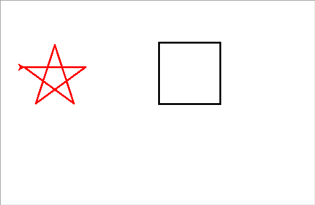
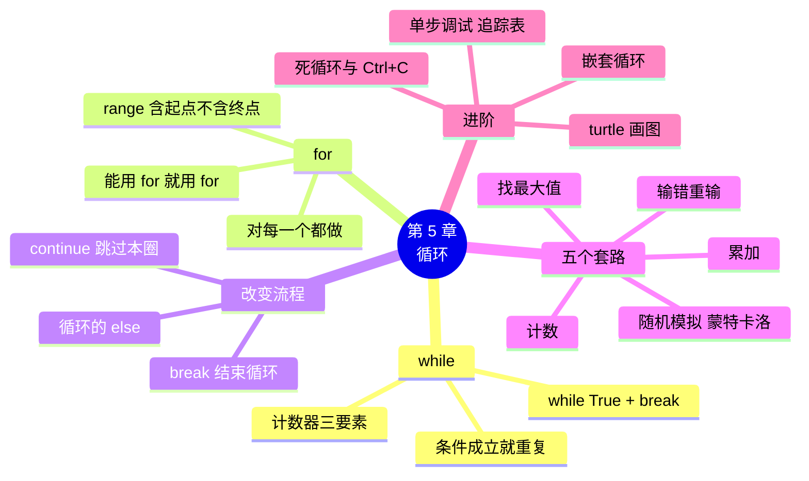

# 第 5 章 循环：让程序重复做事

!!! abstract "本章学时"
    理论 4 学时 · 实验 2 学时（本章共 3 个实验，教师可任选）

## 学习目标

学完本章，你应该能够：

1. **说出** while 循环和 for 循环的写法，以及 `range` 三个参数的含义（记忆）；
2. **解释** break 和 continue 的区别，说出死循环产生的原因（理解）；
3. **使用** 累加、计数、找最大值、输错重输、随机模拟五个套路解决小店里的重复计算问题（应用）；
4. **画出** 简单循环程序的变量追踪表，预测程序的输出（应用）；
5. **使用** 嵌套循环和 turtle 库画出简单图形（应用）。

!!! info "先修要求"
    学习本章前，你需要：

    - 会写 if、if-else、if-elif-else，懂得缩进的作用（[4.2 if 语句](../04-conditions/index.md#42)）；
    - 会用 `isdigit` 检查输入（[4.4.3 先检查输入，再计算](../04-conditions/index.md#443)）；
    - 知道 f-string 和 `print` 的用法（[2.6 f-string](../02-variables/index.md#26)）。

??? abstract "本章概念清单（9 个，点击查看定义和例子）"
    1. [循环](../../appendix/glossary.md#g-循环)
    2. [循环体](../../appendix/glossary.md#g-循环体)
    3. [计数器](../../appendix/glossary.md#g-计数器)
    4. [死循环](../../appendix/glossary.md#g-死循环)
    5. [循环变量](../../appendix/glossary.md#g-循环变量)
    6. [累加器](../../appendix/glossary.md#g-累加器)
    7. [蒙特卡洛方法](../../appendix/glossary.md#g-蒙特卡洛方法)
    8. [嵌套循环](../../appendix/glossary.md#g-嵌套循环)
    9. [二分查找](../../appendix/glossary.md#g-二分查找)

## 情景导入

促销活动很成功，小店一天能卖一百多单。小周的收银程序有个大问题：每算完一单，程序就结束了，下一位顾客来了只能再点一次“运行”。晚上对账更麻烦：陈姐把一周七天的营业额念给他，他得用计算器一个一个加。

陈姐问：“电脑不是最擅长干重复的活儿吗？”

没错。人做重复的事会累、会烦、会出错，电脑做一万遍和做一遍一样快、一样准。让程序重复做事的语句，叫[**循环**](../../appendix/glossary.md#g-循环 "让一段代码重复执行的结构，Python 有 while 和 for 两种"){ .term }。这一章学两种循环：一种是“只要条件成立就一直做”的 while，一种是“对每一个都做一遍”的 for；还要学会几个最常用的循环套路，以及循环停不下来时怎么办。

## 5.1 while 循环与计数器 { #51 }

### 5.1.1 while 的写法 { #511 }

while 循环的意思是“**只要**条件成立，**就**一直重复做”。写法和 if 很像，只是把 `if` 换成了 `while`：

<div class="tryit" markdown>

```python
count = 1
while count <= 3:
    print("第", count, "单")
    count += 1
print("结束，count =", count)
```

</div>

```text
第 1 单
第 2 单
第 3 单
结束，count = 4
```

执行过程是这样的：

1. 先判断条件 `count <= 3`。成立，就执行下面缩进的代码（叫[**循环体**](../../appendix/glossary.md#g-循环体 "循环语句下面缩进的、每圈都要执行的代码"){ .term }）；
2. 循环体执行完，**回到 while 这一行重新判断**；
3. 条件还成立，就再执行一遍循环体……直到条件不成立，才跳到循环后面（最后一行 `print`）。

和 if 的区别就在第 2 步：if 只判断一次，while 执行完会回头再判断。

### 5.1.2 计数器 { #512 }

上面程序里的 `count` 叫[**计数器**](../../appendix/glossary.md#g-计数器 "记录次数的变量，要有初始值、条件和更新三要素"){ .term }，它控制着循环的次数。一个计数器要有三个要素，缺一不可：

| 要素 | 代码 | 作用 |
|---|---|---|
| 初始值 | `count = 1` | 循环开始前，从几数起 |
| 条件 | `count <= 3` | 数到几为止 |
| 更新 | `count += 1` | 每圈数一下 |

最容易忘的是“更新”。如果漏写了 `count += 1`，count 永远是 1，条件永远成立，程序就会不停地打印“第 1 单”，停不下来。这叫[**死循环**](../../appendix/glossary.md#g-死循环 "条件永远成立又没有 break、停不下来的循环"){ .term }，5.6 节专门讲怎么办。

## 5.2 for 循环与 range { #52 }

### 5.2.1 for 循环：对每一个都做一遍 { #521 }

for 循环的意思是“**对**一组数据里的**每一个**，都做一遍”。最简单的例子是对字符串里的每个字：

<div class="tryit" markdown>

```python
for ch in "街坊":
    print(ch)
```

</div>

```text
街
坊
```

读法是“对于 `"街坊"` 里的每一个字符 `ch`，都打印出来”。每转一圈，Python 自动从字符串里取出下一个字符放进 `ch`，取完了循环就结束。`ch` 叫[**循环变量**](../../appendix/glossary.md#g-循环变量 "for 循环每圈自动取出的那个值所放的变量"){ .term }，名字可以自己起。

for 循环不需要自己写计数器，也就不会忘了更新，所以**知道要处理哪些数据时，优先用 for**。

### 5.2.2 range：生成一串整数 { #522 }

要让循环执行固定的次数，配合 `range` 函数。`range` 生成一串整数，有三种写法：

| 写法 | 生成的数 | 说明 |
|---|---|---|
| `range(5)` | 0, 1, 2, 3, 4 | 从 0 开始，到 5 **之前**为止，共 5 个 |
| `range(1, 6)` | 1, 2, 3, 4, 5 | 从 1 开始，到 6 之前为止 |
| `range(0, 10, 3)` | 0, 3, 6, 9 | 第三个数是步长，每次加 3 |
| `range(5, 0, -1)` | 5, 4, 3, 2, 1 | 步长为负数，倒着数 |

是不是很眼熟？`range` 的规则和字符串切片（3.2.2 节）一样：**含起点、不含终点**。所以 `range(1, 6)` 不包括 6，想要 1～100 要写 `range(1, 101)`。

用 for 和 range 算 1 加到 100：

<div class="tryit" markdown>

```python
total = 0
for i in range(1, 101):
    total += i
print(total)
```

</div>

```text
5050
```

### 5.2.3 for 和 while 怎么选 { #523 }

| 情况 | 选择 | 例子 |
|---|---|---|
| 知道要处理哪些数据，或知道要做几次 | for | 7 天营业额、1 加到 100、每个字符 |
| 不知道要做几次，只知道什么时候停 | while | 输错就重输，直到输对；顾客没走就一直收银 |

for 能做的事，while 一般也能做，但要自己管计数器，更容易出错。初学阶段记住一句话：**能用 for 就用 for**。

## 5.3 break 与 continue { #53 }

有时候循环做到一半，需要提前结束，或者跳过某一圈。Python 提供了两个语句：

- `break`：**立刻结束整个循环**，跳到循环后面的代码；
- `continue`：**跳过本圈剩下的代码**，直接开始下一圈。

<div class="tryit" markdown>

```python
for i in range(1, 8):
    if i == 5:
        break
    print(i, end=" ")
print()
for i in range(1, 8):
    if i % 2 == 0:
        continue
    print(i, end=" ")
```

</div>

```text
1 2 3 4 
1 3 5 7 
```

第一段遇到 5 就 break，后面的 5、6、7 都不处理了；第二段遇到偶数就 continue，跳过 print，所以只输出了奇数。`print(..., end=" ")` 的意思是打印完不换行，而是接一个空格。

break 和 continue 一般写在 if 里面，表示“遇到某种情况就……”。

!!! note "拓展阅读：循环的 else"
    Python 的 for 和 while 后面还可以跟一个 else，它在循环**正常结束**（没有被 break 打断）时执行。实验 5-2 用它来处理“7 次都没猜中”的情况。这个写法其他语言很少见，看懂即可。

## 5.4 五个常用套路 { #54 }

循环的用法千变万化，但小店里（以及以后的数据处理里）最常用的，是下面五个套路。熟记它们，大部分循环题都能套上。

### 5.4.1 套路一：累加 { #541 }

把一串数加起来，用一个[**累加器**](../../appendix/glossary.md#g-累加器 "循环前清零、每圈加上一个值，用来求和的变量"){ .term }变量，循环前清零，每圈加一个：

```python
total = 0                 # 1. 循环前清零
for i in range(1, 101):
    total += i            # 2. 每圈加上一个
print(total)              # 3. 循环结束后用结果
```

5.2.2 节的 1 加到 100 就是累加。实验 5-1 用同样的方法把一周 7 天的营业额加起来。

### 5.4.2 套路二：计数 { #542 }

数一数有多少个满足条件的，计数器循环前清零，**满足条件时**加 1：

<div class="tryit" markdown>

```python
s = "老板很热情，东西很新鲜，价格很实惠"
n = 0
for ch in s:
    if ch == "很":
        n += 1
print(n)
```

</div>

```text
3
```

和累加的区别是：累加每圈加“这个数”，计数每圈（满足条件时）加 1。这个例子用 `s.count("很")` 也能得到 3，但“满足条件才计数”的套路更通用，比如“数一数营业额超过 1500 元的有几天”，count 方法就做不到。

### 5.4.3 套路三：找最大值 { #543 }

找最大值的思路，就像擂台赛：先让一个人站在台上，后面的人一个一个上来比，谁大谁留在台上。

<div class="tryit" markdown>

```python
best = 0                      # 擂台上先放一个很小的数
for p in "3.5 12 6.8 25 9.9".split():
    p = float(p)
    if p > best:              # 来挑战的比台上的大
        best = p              # 就换它上台
print(best)
```

</div>

```text
25.0
```

初始值 0 的前提是所有数都大于 0。营业额、价格都满足；如果数据可能是负数（比如利润），就把第一个数作为初始值。找最小值同理，把 `>` 换成 `<`。

下面的动画演示了累加和找最大值。点“自动播放”，注意右边变量表里的值每一圈怎么变。

<iframe class="sim-frame" src="../../sims/loop-trace/main.html" height="600" loading="lazy" title="循环追踪：变量一步步变化"></iframe>
动画：循环追踪。浅黄色是刚变化的变量，切换标签可以看找最大值和 break、continue。[全屏打开](../../sims/loop-trace/main.html){ target=_blank }
{ .sim-caption }

!!! tip "手画追踪表"
    考试时没有电脑，可以在草稿纸上画一张**追踪表**：每一列是一个变量，每转一圈写一行。比如上面找最大值的程序：

    | 圈 | p | p > best？ | best |
    |---|---|---|---|
    | 开始 | | | 0 |
    | 1 | 3.5 | 是 | 3.5 |
    | 2 | 12.0 | 是 | 12.0 |
    | 3 | 6.8 | 否 | 12.0 |
    | 4 | 25.0 | 是 | 25.0 |
    | 5 | 9.9 | 否 | 25.0 |

### 5.4.4 套路四：输错就重新输 { #544 }

第 4 章的输入检查只能提示一句就结束了。配合 while 循环，可以“输错就重新输，直到输对为止”：

```python
while True:
    text = input("购买数量：").strip()
    if text.isdigit():
        qty = int(text)
        break                     # 输对了，跳出循环
    print("请输入整数，重新输")
print("数量是", qty)
```

```text
购买数量：三
请输入整数，重新输
购买数量：2.5
请输入整数，重新输
购买数量：3
数量是 3
```

`while True` 的条件永远成立，本身是一个死循环，**出口靠循环体里的 break**。不知道用户会输错几次，用这种写法最方便。

### 5.4.5 套路五：用随机数模拟 { #545 }

Python 自带的 `random` 模块能产生随机数，使用前要先写 `import random`（导入模块，第 10 章详细讲）：

| 写法 | 结果 |
|---|---|
| `random.randint(1, 6)` | 1～6 之间的随机整数，**包括 6**（像掷骰子） |
| `random.random()` | 0～1 之间的随机小数（不包括 1） |
| `random.choice("ABC")` | 从中随机挑一个 |

注意 `randint` 的两头**都包括**，这和 `range` 不一样。

用大量随机数去“模拟”一件事，从而估算结果的方法，叫[**蒙特卡洛方法**](../../appendix/glossary.md#g-蒙特卡洛方法 "用大量随机数模拟一件事，从而估算结果的方法"){ .term }。这个名字来自摩纳哥的蒙特卡洛赌场，20 世纪 40 年代由研究原子弹的科学家乌拉姆（Ulam）和梅特罗波利斯（Metropolis）等人提出并命名<sup class="cite">[[1]](#ref5-1)</sup>。它最经典的例子是估算圆周率 π：

在一个边长为 1 的正方形里随机撒点，正方形里有一个半径为 1 的四分之一圆（扇形）。扇形面积是 π/4，正方形面积是 1，所以落在扇形里的点约占 π/4。数一数落在扇形里的点有多少，乘以 4 再除以总点数，就能估算出 π。判断一个点 (x, y) 在不在扇形里，就看它到原点的距离是否不超过 1，即 `x * x + y * y <= 1`。

```python
import random

n = int(input("撒多少个点："))
hit = 0                              # 落在扇形里的点数
for i in range(n):
    x = random.random()              # 0～1 之间的随机小数
    y = random.random()
    if x * x + y * y <= 1:           # 到原点的距离不超过 1
        hit += 1
print("圆周率约等于", 4 * hit / n)
```

编者运行了三次，结果如下（随机数每次不同，你的结果会略有差别）：

```text
撒多少个点：100
圆周率约等于 3.2
撒多少个点：10000
圆周率约等于 3.1308
撒多少个点：1000000
圆周率约等于 3.142776
```

点越多，结果越接近 3.14159…。这个程序其实同时用了套路二（计数）和套路五（随机模拟）。蒙特卡洛方法今天仍广泛用于金融风险评估、天气预报和人工智能。

## 5.5 嵌套循环 { #55 }

循环里面再写一个循环，叫[**嵌套循环**](../../appendix/glossary.md#g-嵌套循环 "循环里面再写循环，外层转一圈、内层转一整遍"){ .term }。外层循环每转一圈，内层循环要从头到尾转完一整遍。就像时钟：分针转一格，秒针要转一整圈。

<div class="tryit" markdown>

```python
for i in range(1, 4):
    for j in range(1, 3):
        print(i, j, end=" | ")
```

</div>

```text
1 1 | 1 2 | 2 1 | 2 2 | 3 1 | 3 2 | 
```

外层 3 圈，内层每次 2 圈，内层的 print 一共执行 3 × 2 = 6 次。

嵌套循环最常见的用途是处理“行和列”。比如打印一个三角形，第 i 行打印 i 个星号：

```python
for i in range(1, 5):
    print("*" * i)
```

```text
*
**
***
****
```

这里用字符串乘法 `"*" * i` 代替了内层循环。实验 5-1 的九九乘法表是真正的嵌套循环：第 i 行有 i 个算式，内层循环写成 `for j in range(1, i + 1)`。

## 5.6 死循环怎么办 { #56 }

### 5.6.1 让程序停下来 { #561 }

条件永远成立、又没有 break 的循环，就是**死循环**。最常见的原因是忘了更新计数器：

```python
count = 1
while count <= 3:
    print("第", count, "单")
```

程序会不停地输出“第 1 单”。这时不用慌：

- 在 Thonny 中，点工具栏上红色的“停止”按钮；
- 在命令行窗口中，按 **Ctrl + C**。

程序会停下来，并显示 `KeyboardInterrupt`（键盘中断），这不是程序的错误，而是你主动让它停的。

预防死循环，写 while 时检查三件事：计数器有没有更新？更新的方向对不对（条件是 `count <= 3` 却写成了 `count -= 1`）？`while True` 里有没有能走到的 break？

### 5.6.2 用 Thonny 单步执行看变量 { #562 }

循环结果不对、又看不出哪里错时，用 Thonny 的**调试**功能，让程序一步一步执行：

1. 点工具栏上的小虫子图标“调试当前脚本”（快捷键 Ctrl + F5），程序会停在第一行；
2. 点“步过”（F6），每点一次执行一行，同时观察右侧“变量”面板里每个变量的值；
3. 点“步进”（F7）可以看得更细，连表达式的计算过程都会显示出来。

这和本章的“循环追踪”动画是一样的道理。用单步执行一圈一圈看下去，哪一圈变量的值和你想的不一样，错误就在那里。

## 5.7 用 turtle 画图 { #57 }

Python 自带一个画图模块 `turtle`（海龟）。想象一只海龟趴在画布中央，尾巴蘸着墨水，你命令它前进、转弯，它爬过的地方就留下一条线。这个想法来自 20 世纪 60 年代麻省理工学院为孩子设计的 Logo 语言<sup class="cite">[[2]](#ref5-2)</sup>，用来让初学者直观地感受程序和循环。

常用命令如下：

| 命令 | 作用 |
|---|---|
| `t.forward(100)` | 前进 100 像素 |
| `t.left(90)`、`t.right(90)` | 左转、右转 90 度 |
| `t.penup()`、`t.pendown()` | 抬笔（移动不画线）、落笔 |
| `t.goto(x, y)` | 移动到坐标 (x, y)，画布中心是 (0, 0) |
| `t.color("red")`、`t.pensize(3)` | 设置颜色、笔的粗细 |
| `t.begin_fill()`、`t.end_fill()` | 两句之间画出的图形会被填充颜色 |
| `t.write("文字")` | 在当前位置写字 |

画正方形，就是“前进 100、左转 90 度”重复 4 次；画五角星，是“前进 100、右转 144 度”重复 5 次：

```python
import turtle

t = turtle.Turtle()
t.pensize(3)
for i in range(4):        # 正方形：前进 100，左转 90 度，重复 4 次
    t.forward(100)
    t.left(90)

t.penup()
t.goto(-220, 60)
t.pendown()
t.color("red")
for i in range(5):        # 五角星：前进 100，右转 144 度，重复 5 次
    t.forward(100)
    t.right(144)
turtle.done()
```



最后的 `turtle.done()` 让画图窗口保持打开，关掉窗口程序才结束。turtle 的窗口需要在电脑上运行（Thonny 可以），网页上的“试一试”运行不了它。

!!! cert "证书考点 · 信息技术水平-人工智能（Python）"
    循环是程序控制结构的核心考点：`range` 的含起点不含终点、break 与 continue 的区别、嵌套循环的执行次数、`random.randint` 两头都包含；`turtle` 和 `random` 也是计算机二级“计算生态”部分列出的标准库（详见[证书考点对照](../../certificate.md)）。

## 5.8 前沿视窗：训练 AI 模型也是一个大循环 { #58 }

你可能想不到，训练一个人工智能模型，核心就是一个循环。以机器学习为例，它的过程大致是：

```text
重复很多轮：
    让模型对训练数据做一遍预测
    算一算预测错了多少
    根据错误把模型的参数调整一点点
```

每一轮叫一个“轮次”（epoch）。模型一开始几乎全猜错，一轮一轮下来，错误越来越少，这和我们手画追踪表、看着变量一圈圈变化的道理完全一样<sup class="cite">[[3]](#ref5-3)</sup>。训练大模型时，这个循环要在成千上万块芯片上转几个月。

循环在 AI 里还有很多身影：大模型写文章时是一个字一个字（准确地说是一个词元一个词元）往外“吐”的，每吐一个，就把它接到前文后面，再预测下一个，这也是一个循环，直到生成结束标记为止。

所以本章学的累加器、计数器、终止条件，正是以后理解 AI 训练过程的基础。在后续的《机器学习》课程里，你会看到 `for epoch in range(100):` 这样的代码，到时候你就知道它在做什么了。

## 本章实验

!!! abstract "实验总览"
    | 实验 | 类型 | 建议时长 | 内容 |
    |---|---|---|---|
    | 实验 5-1 | ★ 基础 | 30 分钟 | 用嵌套循环打印九九乘法表；输入一周营业额，算合计、日均和最高 |
    | 实验 5-2 | ★ 基础 | 30 分钟 | 用 random 和 while 写猜数字游戏 |
    | 实验 5-3 | ☆ 拓展 | 30 分钟 | 用 turtle 画小店招牌 |

    代码见配套资源 `labs/ch05/` 目录。

### 实验 5-1 ★ 九九乘法表与一周对账汇总 { #lab5-1 }

**实验目的**

1. 会用嵌套循环按“行、列”输出表格；
2. 会用累加和找最大值两个套路处理一周的营业额；
3. 会用 `end=""` 控制 print 不换行。

**实验环境**：本机 CPU。

**实验数据**：第二部分运行时输入。编者输入的一周营业额（虚构）为：1280、1150.5、1320、1406、1890、2350.8、2108。

**实验步骤与代码**

打开 `labs/ch05/lab5_1_table.py`：

```python
# 实验 5-1 九九乘法表与一周对账汇总

# 第一部分：九九乘法表（嵌套循环）
for i in range(1, 10):              # 外层循环：第 i 行
    for j in range(1, i + 1):       # 内层循环：第 i 行有 i 个算式
        print(f"{j}×{i}={i * j:<3}", end="")   # end="" 表示不换行
    print()                         # 一行结束，换行

print()

# 第二部分：一周对账汇总
# 依次输入周一到周日的营业额，算出合计、日均和最高的一天
days = "一二三四五六日"
total = 0
best_day = ""
best_money = 0
for d in days:                      # 字符串也可以逐个字符循环
    money = float(input(f"周{d}营业额（元）："))
    total = total + money           # 套路一：累加
    if money > best_money:          # 套路三：找最大值
        best_money = money
        best_day = d

print(f"本周合计 {total:.2f} 元，日均 {total / 7:.2f} 元")
print(f"营业额最高的是周{best_day}，{best_money:.2f} 元")
```

`{i * j:<3}` 是 2.6 节学过的格式说明：占 3 格、左对齐，让每一列对得整齐。

**运行结果**

```text
1×1=1  
1×2=2  2×2=4  
1×3=3  2×3=6  3×3=9  
1×4=4  2×4=8  3×4=12 4×4=16 
1×5=5  2×5=10 3×5=15 4×5=20 5×5=25 
1×6=6  2×6=12 3×6=18 4×6=24 5×6=30 6×6=36 
1×7=7  2×7=14 3×7=21 4×7=28 5×7=35 6×7=42 7×7=49 
1×8=8  2×8=16 3×8=24 4×8=32 5×8=40 6×8=48 7×8=56 8×8=64 
1×9=9  2×9=18 3×9=27 4×9=36 5×9=45 6×9=54 7×9=63 8×9=72 9×9=81 

周一营业额（元）：1280
周二营业额（元）：1150.5
周三营业额（元）：1320
周四营业额（元）：1406
周五营业额（元）：1890
周六营业额（元）：2350.8
周日营业额（元）：2108
本周合计 11505.30 元，日均 1643.61 元
营业额最高的是周六，2350.80 元
```

**实验记录表**

| 修改 | 预测结果 | 实际结果 |
|---|---|---|
| 把内层 `range(1, i + 1)` 改成 `range(1, 10)` | | |
| 把 `print()` 那一行删掉 | | |
| 把 `money > best_money` 改成 `money < best_money`（不改初始值） | | |
| 增加计数：营业额超过 1500 元的有几天 | | |

**常见问题排查**

| 现象 | 原因 | 解决办法 |
|---|---|---|
| 乘法表全挤在一行 | 漏了外层的 `print()` | 内层循环结束后换行 |
| 乘法表成了一列 | 内层 print 漏了 `end=""` | 加上 `end=""` |
| 合计只是最后一天的营业额 | 写成了 `total = money` | 改为 `total = total + money` |
| 合计越来越大、不对 | `total = 0` 写进了循环里面或者多次运行没清零 | 累加器在循环**前**清零 |

**思考与练习**

1. 把乘法表改成“倒三角”（第一行 9 个算式，最后一行 1 个）。
2. 在第二部分增加“找最低营业额”的功能。最低值的初始值应该设为多少？

**实验报告要求**

提交运行截图、实验记录表和思考题 2 的代码。

### 实验 5-2 ★ 猜数字游戏 { #lab5-2 }

**实验目的**

1. 会用 `random.randint` 生成随机整数；
2. 会用 while、break、continue 控制循环；
3. 会用“二分”的策略玩游戏，体会算法的作用。

**实验环境**：本机 CPU。

**实验数据**：运行时输入。

**实验步骤与代码**

打开 `labs/ch05/lab5_2_guess.py`：

```python
# 实验 5-2 猜数字游戏
import random

secret = random.randint(1, 100)     # 随机生成 1～100 之间的整数（含 1 和 100）
count = 0                           # 记录猜了几次

print("我想好了一个 1～100 之间的整数，你来猜！最多猜 7 次。")
while count < 7:
    text = input("你猜：").strip()
    if not text.isdigit():          # 输错不算次数，重新输
        print("请输入整数")
        continue
    guess = int(text)
    count += 1
    if guess > secret:
        print("大了")
    elif guess < secret:
        print("小了")
    else:
        print(f"猜对了！你用了 {count} 次")
        break
else:                               # while 正常结束（没有被 break）时执行
    print(f"7 次机会用完了，答案是 {secret}")
```

**运行结果**（数字是随机的，每次不同。编者的一次运行如下，第一次故意输入了汉字）

```text
我想好了一个 1～100 之间的整数，你来猜！最多猜 7 次。
你猜：五十
请输入整数
你猜：50
小了
你猜：75
大了
你猜：62
小了
你猜：68
猜对了！你用了 4 次
```

编者每次都猜“剩下范围的正中间”：1～100 猜 50，小了就在 51～100 里猜 75，大了就在 51～74 里猜 62……每猜一次，范围缩小一半，这叫[**二分查找**](../../appendix/glossary.md#g-二分查找 "每次猜剩下范围的正中间，把范围缩小一半的查找方法"){ .term }。100 个数最多 7 次一定能猜中，因为 2 的 7 次方是 128，比 100 大。

**实验记录表**

| 第几局 | 每次猜的数 | 用了几次 | 是否用了“猜中间”的策略 |
|---|---|---|---|
| 1 | | | |
| 2 | | | |
| 3 | | | |

**常见问题排查**

| 现象 | 原因 | 解决办法 |
|---|---|---|
| `NameError: name 'random' is not defined` | 漏写 `import random` | 在程序开头导入 |
| 每次猜完程序就结束 | 把 while 写成了 if | 用 while 循环 |
| 猜对了还继续让猜 | 漏写 break | 猜对后 break |
| 输入汉字后程序报错 | 先 `int()` 后检查 | 先 `isdigit()`，不合格就 continue |

**思考与练习**

1. 如果把范围改成 1～1000，最多需要猜几次？把程序里的 7 改成多少合适？
2. 增加功能：游戏结束后问“再玩一局吗？(y/n)”，输入 y 就重新开始（提示：在外面再套一层 `while True`）。

**实验报告要求**

提交至少 3 局的实验记录表，并用自己的话说明“猜中间”为什么快。

### 实验 5-3 ☆ 用 turtle 画小店招牌 { #lab5-3 }

**实验目的**

1. 会用 turtle 的移动、转向、抬笔落笔、填充和写字命令；
2. 会用 for 循环画重复的图形。

**实验环境**：本机 CPU，需要在 Thonny 等桌面环境中运行（会弹出画图窗口）。

**实验数据**：无。

**实验步骤与代码**

打开 `labs/ch05/lab5_3_turtle.py`，先运行看效果，再读懂每一段：

```python
# 实验 5-3 用 turtle 画小店招牌
import turtle

t = turtle.Turtle()
t.speed(0)                          # 0 表示最快
turtle.bgcolor("white")

# 1. 画招牌的长方形边框
t.penup()
t.goto(-200, 60)
t.pendown()
t.pensize(4)
t.color("darkred", "lightyellow")
t.begin_fill()
for i in range(2):                  # 长方形：长边、短边各画 2 次
    t.forward(400)
    t.right(90)
    t.forward(120)
    t.right(90)
t.end_fill()

# 2. 写店名
t.penup()
t.goto(0, -20)
t.color("darkred")
t.write("街坊便利店", align="center", font=("Microsoft YaHei", 36, "bold"))

# 3. 在招牌下方画一排 5 颗小星星
t.color("orange")
for k in range(5):
    t.penup()
    t.goto(-160 + k * 80, -110)
    t.pendown()
    t.begin_fill()
    for i in range(5):              # 五角星：前进、右转 144 度，重复 5 次
        t.forward(30)
        t.right(144)
    t.end_fill()

t.hideturtle()
turtle.done()                       # 保持窗口打开，关闭窗口后程序结束
```

`t.color("darkred", "lightyellow")` 的两个颜色分别是线条颜色和填充颜色。“Microsoft YaHei”是微软雅黑字体，Windows 自带。

**运行结果**


（编者截图。五角星中间的五边形没有被填充，这是 turtle 填充自相交图形时的正常效果。）

**实验记录表**

| 修改 | 效果 |
|---|---|
| 把 `t.speed(0)` 改为 `t.speed(1)` | |
| 把长方形改为 400 × 150 | |
| 把星星改为 7 颗，间距怎么调？ | |
| 把店名换成你自己设计的店名 | |

**常见问题排查**

| 现象 | 原因 | 解决办法 |
|---|---|---|
| 画完窗口一闪就没了 | 漏了 `turtle.done()` | 程序最后加上 |
| 移动时留下多余的线 | 移动前没有 `penup()` | 先抬笔，到位后再落笔 |
| 星星没有填充颜色 | `begin_fill()`、`end_fill()` 位置不对 | 把画星星的循环放在两句之间 |
| 中文显示成方框 | 系统中没有这个字体 | 换成 "SimHei"（黑体）等已安装的字体 |

**思考与练习**

1. 用循环画一个正六边形（每次转多少度？）。
2. 画一个由 36 个正方形组成的“花朵”：每画完一个正方形，向右转 10 度。

**实验报告要求**

提交你设计的招牌截图和代码。

## 本章小结

- **循环**让程序重复做事。while 循环“只要条件成立就一直做”，执行完**循环体**会回到开头重新判断；用**计数器**控制次数时，初始值、条件、更新三要素缺一不可。
- for 循环“对每一个都做一遍”，**循环变量**依次取出字符串、range 等里的每个值。`range(起点, 终点, 步长)` 含起点不含终点。知道次数或数据时优先用 for，只知道何时停时用 while。
- `break` 结束整个循环，`continue` 跳过本圈。循环正常结束（未被 break）时执行循环的 else。
- 五个套路：累加（**累加器**循环前清零）、计数、找最大值（擂台法）、输错重输（`while True` + break）、随机模拟（`random` 模块与**蒙特卡洛方法**）。
- **嵌套循环**中外层转一圈，内层转一整遍，常用于处理行和列。
- 条件永远成立又没有 break 就是**死循环**，用 Thonny 的停止按钮或 Ctrl + C 停下。用单步调试或手画追踪表找循环中的错误。
- `turtle` 用前进、转向等命令画图，重复的图形用循环来画。
- 训练 AI 模型和大模型生成文字，本质上都是循环。



**下一章预告**

实验 5-1 输入了一周 7 天的营业额，可是循环结束后，我们只留下了合计和最大值，每一天的数据都“用完就丢”了。如果还想知道“哪几天高于平均值”，就得把 7 个数都存下来。难道要建 7 个变量 `money1`、`money2`……？下一章学习**列表**，一个变量就能装下一整串数据。

## 参考文献

正文中的上标编号（如<sup class="cite">[[1]](#ref5-1)</sup>）对应下面的文献。带链接的可以直接打开；书籍可在图书馆或电子书平台查阅。

<div class="refs" markdown>

**教材与专著**

- <span id="ref5-2"></span>[2] PAPERT S. Mindstorms: children, computers, and powerful ideas[M]. New York: Basic Books, 1980.
    <span class="ref-note">Logo 语言和“海龟画图”的设计者讲述用编程帮助儿童学习的思想，对应 5.7 节。</span>
- <span id="ref5-3"></span>[3] 周志华. 机器学习[M]. 北京: 清华大学出版社, 2016.
    <span class="ref-note">国内常用的机器学习教材，第 5 章“神经网络”介绍了逐轮迭代调整参数的训练过程，对应 5.8 节。</span>
- <span id="ref5-4"></span>[4] 嵩天, 礼欣, 黄天羽. Python 语言程序设计基础[M]. 2 版. 北京: 高等教育出版社, 2017.
    <span class="ref-note">第 4 章“程序的控制结构”讲循环结构、random 库和蒙特卡洛法求圆周率，第 2 章用 turtle 库画图，对应 5.1～5.5 节和 5.7 节。</span>

**经典论文与标准**

- <span id="ref5-1"></span>[1] METROPOLIS N, ULAM S. The Monte Carlo method[J]. Journal of the American Statistical Association, 1949, 44(247): 335-341.
    <span class="ref-note">第一篇以“蒙特卡洛方法”为题的论文，对应 5.4.5 节。</span>

**在线资源与数据**

- <span id="ref5-5"></span>[5] Python Software Foundation. Python 教程：4.2 for 语句[EB/OL]. [2026-11-01]. https://docs.python.org/zh-cn/3.14/tutorial/controlflow.html#for-statements.
    <span class="ref-note">官方教程中 for 语句、range 函数、break 和 continue 的说明，对应 5.2、5.3 节。</span>
- <span id="ref5-6"></span>[6] Python Software Foundation. turtle：海龟绘图[EB/OL]. [2026-11-01]. https://docs.python.org/zh-cn/3.14/library/turtle.html.
    <span class="ref-note">turtle 模块全部命令的说明，做实验 5-3 时可以查阅。</span>
- <span id="ref5-7"></span>[7] Python Software Foundation. random：生成伪随机数[EB/OL]. [2026-11-01]. https://docs.python.org/zh-cn/3.14/library/random.html.
    <span class="ref-note">random 模块的官方说明，对应 5.4.5 节和实验 5-2。</span>

</div>

## 课后练习

选择题和判断题可以直接点击选项作答，系统会马上告诉你对错，并展开答案与解析；多选题选好后点“提交答案”。简答和实操题请先自己作答，再点开“答案与解析”核对。每道题的解析下方都有“回看”链接，做错了可以直接跳回正文复习。

**一、单项选择题**

<div class="quiz" data-answer="B" markdown>

**1.** `range(1, 5)` 生成的整数是（　　）。

- A. 1, 2, 3, 4, 5
- B. 1, 2, 3, 4
- C. 0, 1, 2, 3, 4
- D. 2, 3, 4, 5

</div>

??? tip "答案与解析"
    **答案：B**

    range 含起点、不含终点。

    考查：range · 认知层次：记忆 · [回看 5.2.2](#522)
    { .quiz-meta }

<div class="quiz" data-answer="C" markdown>

**2.** 执行下面的代码，输出是（　　）。

```python
total = 0
for i in range(1, 6, 2):
    total += i
print(total)
```

- A. 15
- B. 6
- C. 9
- D. 5

</div>

??? tip "答案与解析"
    **答案：C**

    `range(1, 6, 2)` 生成 1、3、5，和为 9。

    考查：range 步长、累加 · 认知层次：应用 · [回看 5.4.1](#541)
    { .quiz-meta }

<div class="quiz" data-answer="A" markdown>

**3.** 执行下面的代码，输出是（　　）。

```python
n = 10
while n > 0:
    n -= 3
print(n)
```

- A. -2
- B. 1
- C. 0
- D. -3

</div>

??? tip "答案与解析"
    **答案：A**

    n 依次变为 7、4、1、-2。n 为 1 时条件成立，再减 3 得 -2，此时条件不成立，循环结束。

    考查：while 执行过程 · 认知层次：应用 · [回看 5.1.1](#511)
    { .quiz-meta }

<div class="quiz" data-answer="D" markdown>

**4.** 能够立即结束整个循环的语句是（　　）。

- A. `continue`
- B. `pass`
- C. `else`
- D. `break`

</div>

??? tip "答案与解析"
    **答案：D**

    break 结束整个循环；continue 只跳过本圈。

    考查：break · 认知层次：记忆 · [回看 5.3](#53)
    { .quiz-meta }

<div class="quiz" data-answer="C" markdown>

**5.** 执行下面的代码，一共输出几个星号？（　　）

```python
for i in range(3):
    for j in range(2):
        print("*", end="")
```

- A. 3
- B. 5
- C. 6
- D. 2

</div>

??? tip "答案与解析"
    **答案：C**

    外层 3 圈，内层每次 2 圈，共 3 × 2 = 6 次。

    考查：嵌套循环 · 认知层次：应用 · [回看 5.5](#55)
    { .quiz-meta }

<div class="quiz" data-answer="B" markdown>

**6.** `for i in range(10, 0, -2):` 的循环体执行几次？（　　）

- A. 4
- B. 5
- C. 6
- D. 10

</div>

??? tip "答案与解析"
    **答案：B**

    生成 10、8、6、4、2，共 5 个数，不包括终点 0。

    考查：range 负步长 · 认知层次：应用 · [回看 5.2.2](#522)
    { .quiz-meta }

<div class="quiz" data-answer="D" markdown>

**7.** `random.randint(1, 6)` 可能得到的结果是（　　）。

- A. 0～6 之间的整数
- B. 1～5 之间的整数
- C. 1～6 之间的小数
- D. 1～6 之间的整数，包括 1 和 6

</div>

??? tip "答案与解析"
    **答案：D**

    randint 两头都包括，这一点和 range 不同。

    考查：random · 认知层次：记忆 · [回看 5.4.5](#545)
    { .quiz-meta }

<div class="quiz" data-answer="A" markdown>

**8.** 下面的程序运行后停不下来，原因是（　　）。

```python
i = 1
while i <= 5:
    print(i)
```

- A. 循环体里没有更新 i
- B. while 后面应该写 for
- C. 条件应该写成 `i < 5`
- D. print 不能放在循环里

</div>

??? tip "答案与解析"
    **答案：A**

    i 一直是 1，条件永远成立，成为死循环。应在循环体中加 `i += 1`。

    考查：死循环 · 认知层次：分析 · [回看 5.6.1](#561)
    { .quiz-meta }

**二、多项选择题**

<div class="quiz quiz-multi" data-answer="ABC" markdown>

**1.** 下列写法中，生成 0、1、2 三个数的有（　　）。

- A. `range(3)`
- B. `range(0, 3)`
- C. `range(0, 3, 1)`
- D. `range(1, 3)`

</div>

??? tip "答案与解析"
    **答案：ABC**

    D 生成 1、2。

    考查：range · 认知层次：应用 · [回看 5.2.2](#522)
    { .quiz-meta }

<div class="quiz quiz-multi" data-answer="AB" markdown>

**2.** 下列对象中，可以直接放在 `for x in ___:` 中逐个取出的有（　　）。

- A. `"abc"`
- B. `range(5)`
- C. `123`
- D. `3.14`

</div>

??? tip "答案与解析"
    **答案：AB**

    字符串和 range 可以逐个取出；整数和小数不行，会报 `TypeError: 'int' object is not iterable`。

    考查：for 循环 · 认知层次：理解 · [回看 5.2.1](#521)
    { .quiz-meta }

<div class="quiz quiz-multi" data-answer="BD" markdown>

**3.** 下列说法正确的有（　　）。

- A. continue 会结束整个循环
- B. while 的条件一开始就不成立时，循环体一次也不执行
- C. 内层循环中的 break 会同时结束内外两层循环
- D. 累加器应该在循环开始前赋初值

</div>

??? tip "答案与解析"
    **答案：BD**

    A：continue 只跳过本圈。C：break 只结束它所在的那一层循环。

    考查：循环执行规则 · 认知层次：理解 · [回看 5.3](#53)
    { .quiz-meta }

**三、判断题**

<div class="quiz quiz-judge" data-answer="×" markdown>

**1.** `range(5)` 生成的整数中包括 5。（　　）

- √
- ×

</div>

??? tip "答案与解析"
    **答案：×**

    `range(5)` 生成 0～4，不含终点 5。

    考查：range · 认知层次：记忆 · [回看 5.2.2](#522)
    { .quiz-meta }

<div class="quiz quiz-judge" data-answer="√" markdown>

**2.** 在 print 中写 `end=""`，可以让下一次输出接在同一行。（　　）

- √
- ×

</div>

??? tip "答案与解析"
    **答案：√**

    print 默认以换行结尾，`end=""` 把结尾改成空字符串。

    考查：print 的 end 参数 · 认知层次：记忆 · [回看 5.3](#53)
    { .quiz-meta }

<div class="quiz quiz-judge" data-answer="√" markdown>

**3.** 写成 `while True:` 的循环，必须在循环体里有能执行到的 break，否则就是死循环。（　　）

- √
- ×

</div>

??? tip "答案与解析"
    **答案：√**

    `while True` 的条件永远成立，只能靠 break 跳出。

    考查：输错重输套路 · 认知层次：理解 · [回看 5.4.4](#544)
    { .quiz-meta }

<div class="quiz quiz-judge" data-answer="×" markdown>

**4.** 用蒙特卡洛方法估算圆周率，每次运行的结果都完全一样。（　　）

- √
- ×

</div>

??? tip "答案与解析"
    **答案：×**

    随机数每次不同，结果也会略有差别；撒的点越多，结果越接近真实值。

    考查：蒙特卡洛方法 · 认知层次：理解 · [回看 5.4.5](#545)
    { .quiz-meta }

<div class="quiz quiz-judge" data-answer="√" markdown>

**5.** 程序陷入死循环时，可以在命令行窗口中按 Ctrl + C 让它停下来。（　　）

- √
- ×

</div>

??? tip "答案与解析"
    **答案：√**

    按 Ctrl + C 会产生 `KeyboardInterrupt`，程序停止；在 Thonny 中也可以点“停止”按钮。

    考查：死循环 · 认知层次：记忆 · [回看 5.6.1](#561)
    { .quiz-meta }

**四、简答题**

**1.** 读程序写结果。

```python
for i in range(1, 10):
    if i % 3 == 0:
        continue
    if i > 7:
        break
    print(i, end=" ")
```

??? tip "答案与解析"
    **参考答案**

    ```text
    1 2 4 5 7 
    ```

    3、6 是 3 的倍数，被 continue 跳过；到 8 时 8 > 7，break 结束循环，9 也不再处理。

    考查：break、continue · 认知层次：应用 · [回看 5.3](#53)
    { .quiz-meta }

**2.** 找错并改正。下面的程序想计算 1 + 2 + … + 100，有两处错误，请找出来并改正。

```python
total = 0
i = 1
while i < 100:
    total = total + i
print(total)
```

??? tip "答案与解析"
    **参考答案**

    第一处：循环体中没有更新 i，会成为死循环，要加上 `i += 1`。

    第二处：条件 `i < 100` 不包括 100，应改为 `i <= 100`。改正后输出 5050：

    ```python
    total = 0
    i = 1
    while i <= 100:
        total = total + i
        i += 1
    print(total)
    ```

    考查：计数器三要素 · 认知层次：分析 · [回看 5.1.2](#512)
    { .quiz-meta }

**3.** 用自己的话说明 for 循环和 while 循环各适合什么情况，各举一个小店里的例子。

??? tip "答案与解析"
    **参考答案**

    for 循环适合知道要处理哪些数据或要做几次的情况，例如把一周 7 天的营业额加起来、给 30 种商品逐个打印价签。

    while 循环适合不知道要做几次、只知道什么时候停的情况，例如“输错就重新输，直到输对”、“顾客没说结束就一直扫码收银”。

    考查：for 与 while 的选择 · 认知层次：理解 · [回看 5.2.3](#523)
    { .quiz-meta }

**五、实操题**

**1.** 统计 1～100 中能被 7 整除的数有多少个，它们的和是多少。

??? tip "答案与解析"
    **参考答案**

    ```python
    count = 0
    total = 0
    for i in range(1, 101):
        if i % 7 == 0:
            count += 1
            total += i
    print(count, total)
    ```

    编者运行结果：`14 735`。也可以写 `range(7, 101, 7)` 直接生成 7 的倍数。

    考查：计数、累加 · 认知层次：应用 · [回看 5.4.2](#542)
    { .quiz-meta }

**2.** 写一个登录程序：密码是 `jf2026`，最多允许输入 3 次。输对显示“登录成功”；输错显示“密码错误，还剩 N 次机会”；3 次都错显示“错误次数太多，账户已锁定”。

??? tip "答案与解析"
    **参考答案**

    ```python
    for times in range(1, 4):
        pwd = input("请输入密码：")
        if pwd == "jf2026":
            print("登录成功")
            break
        print(f"密码错误，还剩 {3 - times} 次机会")
    else:
        print("错误次数太多，账户已锁定")
    ```

    编者测试：先输 123 再输 jf2026，显示“密码错误，还剩 2 次机会”和“登录成功”；连续输错 3 次，最后显示“错误次数太多，账户已锁定”。for 后面的 else 只有在循环没有被 break 时才执行。也可以用一个变量记录是否登录成功，循环结束后再判断。

    考查：for、break、循环的 else · 认知层次：应用 · [回看 实验 5-2](#lab5-2)
    { .quiz-meta }
