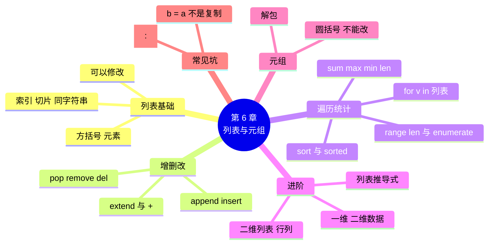

# 第 6 章 列表与元组：批量管理数据

!!! abstract "本章学时"
    理论 4 学时 · 实验 2 学时（本章共 3 个实验，教师可任选）

## 学习目标

学完本章，你应该能够：

1. **说出** 列表和元组的写法，以及两者最大的区别（记忆）；
2. **解释** append、insert、pop、remove、del 的区别，以及 `sort()` 和 `sorted()` 的区别（理解）；
3. **使用** 索引、切片、循环和 `sum`、`max`、`min`、`len` 完成营业额统计等任务（应用）；
4. **写出** 最基本的列表推导式，用二维列表存放和读取表格数据（应用）；
5. **分析** “b = a 之后改 b，a 也变了”的原因，并正确复制列表（分析）。

!!! info "先修要求"
    学习本章前，你需要：

    - 会用索引和切片取字符串中的字符（[3.2 索引与切片](../03-strings/index.md#32)）；
    - 会写 for 循环，掌握累加、计数、找最大值等套路（[5.2 for 循环与 range](../05-loops/index.md#52)、[5.4 五个常用套路](../05-loops/index.md#54)）。

??? abstract "本章概念清单（9 个，点击查看定义和例子）"
    1. [列表](../../appendix/glossary.md#g-列表)
    2. [元素](../../appendix/glossary.md#g-元素)
    3. [遍历](../../appendix/glossary.md#g-遍历)
    4. [列表推导式](../../appendix/glossary.md#g-列表推导式)
    5. [二维列表](../../appendix/glossary.md#g-二维列表)
    6. [一维数据](../../appendix/glossary.md#g-一维数据)
    7. [二维数据](../../appendix/glossary.md#g-二维数据)
    8. [元组](../../appendix/glossary.md#g-元组)
    9. [解包](../../appendix/glossary.md#g-解包)

## 情景导入

月底了，陈姐想看看这个月每周的经营情况：“哪天卖得最好？哪天最差？有几天超过了平均水平？”

小周想起实验 5-1：用循环输入 7 天的营业额，一边输一边累加、一边找最大值。可陈姐还想知道“高于平均的有几天”，这就麻烦了：平均值要等 7 天都输完才算得出来，而那时前面 6 天的数据早就被覆盖掉了。

要么建 7 个变量 `money1`、`money2`……`money7`？一周 7 天还凑合，一个月 30 天呢？一年 365 天呢？

我们需要一种能装下“一串数据”的东西，这就是本章要学的[**列表**](../../appendix/glossary.md#g-列表 "用方括号括起来、按顺序存放多个元素的数据类型，可以修改"){ .term }。有了它，一个变量就能存下一整周、一整年的营业额，存下全店 30 种商品，存下一整张表格。

## 6.1 列表的创建、索引与切片 { #61 }

### 6.1.1 创建列表 { #611 }

用方括号 `[ ]` 把一串数据括起来，中间用英文逗号隔开，就是一个**列表**（List）。列表里的每一个数据叫[**元素**](../../appendix/glossary.md#g-元素 "列表、元组等容器里存放的每一个数据"){ .term }：

```python
money = [1280, 1150.5, 1320, 1406, 1890, 2350.8, 2108]   # 一周营业额
goods = ["可乐", "面包", "牛奶", "鸡蛋", "矿泉水"]          # 商品名
item = ["可乐", 3.5, 2, True]                              # 不同类型也可以放一起
empty = []                                                 # 空列表
```

还可以用 `list()` 把其他数据转成列表：

<div class="tryit" markdown>

```python
print(list("街坊"), list(range(5)))
```

</div>

```text
['街', '坊'] [0, 1, 2, 3, 4]
```

### 6.1.2 索引与切片 { #612 }

列表的索引和切片，规则和字符串**完全一样**：索引从 0 开始，-1 是最后一个；切片含起点、不含终点。

<div class="tryit" markdown>

```python
goods = ["可乐", "面包", "牛奶", "鸡蛋", "矿泉水"]
print(goods[0], goods[-1], goods[1:3], len(goods))
print("牛奶" in goods)
```

</div>

```text
可乐 矿泉水 ['面包', '牛奶'] 5
True
```

注意：取一个元素（`goods[0]`）得到的是元素本身，取一段（`goods[1:3]`）得到的还是一个列表。索引超出范围同样会报 `IndexError: list index out of range`。

### 6.1.3 列表可以修改 { #613 }

列表和字符串有一个重要区别：字符串不能修改（3.2.3 节），**列表可以**。直接给某个位置赋新值：

```python
goods[1] = "全麦面包"
print(goods)
```

```text
['可乐', '全麦面包', '牛奶', '鸡蛋', '矿泉水']
```

能修改，意味着列表可以随时增加、删除元素，这正是它好用的地方，下一节详细讲。

## 6.2 增删改：让列表变起来 { #62 }

列表自带很多方法，最常用的是“加”和“删”两组：

| 操作 | 写法 | 作用 | 有返回值吗 |
|---|---|---|---|
| 加到末尾 | `c.append(x)` | 把 x 加到最后 | 没有 |
| 插入 | `c.insert(i, x)` | 把 x 插到索引 i 的位置，后面的往后挪 | 没有 |
| 删最后一个 | `c.pop()` | 删除最后一个，并返回它 | 返回被删的元素 |
| 按位置删 | `c.pop(i)` 或 `del c[i]` | 删除索引 i 的元素 | pop 返回，del 不返回 |
| 按值删 | `c.remove(x)` | 删除第一个等于 x 的元素 | 没有 |
| 修改 | `c[i] = x` | 把索引 i 的元素换成 x | 没有 |

<div class="tryit" markdown>

```python
c = ["可乐", "面包"]
c.append("牛奶")
print(c)
c.insert(0, "鸡蛋")
print(c)
x = c.pop()
print(x, c)
c.remove("面包")
print(c)
del c[0]
print(c)
```

</div>

```text
['可乐', '面包', '牛奶']
['鸡蛋', '可乐', '面包', '牛奶']
牛奶 ['鸡蛋', '可乐', '面包']
['鸡蛋', '可乐']
['可乐']
```

`pop` 像是从列表里“拿出来”，拿出来的东西还能用（存进 x）；`remove` 和 `del` 是直接“扔掉”。

删除时最常见的两个报错：对空列表 `pop()` 报 `IndexError: pop from empty list`；`remove` 一个不存在的元素报 `ValueError: list.remove(x): x not in list`。删之前可以先用 `len(c) > 0` 或 `x in c` 判断一下。

下面的操作台可以随意点按钮试一试，黑框里会显示对应的代码和结果。

<iframe class="sim-frame" src="../../sims/list-console/main.html" height="640" loading="lazy" title="列表操作台"></iframe>
动画：列表操作台。选好元素和位置，点按钮操作，浅黄色是刚变化的元素。[全屏打开](../../sims/list-console/main.html){ target=_blank }
{ .sim-caption }

另外还有两个合并列表的写法：`a.extend([3, 4])` 把另一个列表的元素逐个加到 a 后面；`[1, 2] + [3]` 得到新列表 `[1, 2, 3]`。`[0] * 3` 得到 `[0, 0, 0]`，和字符串的乘法一样。

!!! warning "append 一个列表，只算一个元素"
    `a = [1, 2, 3]` 之后执行 `a.append([4, 5])`，a 变成 `[1, 2, 3, [4, 5]]`，长度是 4 而不是 5：整个 `[4, 5]` 作为一个元素加了进去。想逐个加入，用 `extend`。

## 6.3 遍历与统计 { #63 }

### 6.3.1 用 for 遍历列表 { #631 }

把列表的元素一个一个取出来处理，叫[**遍历**](../../appendix/glossary.md#g-遍历 "把容器里的元素一个一个取出来处理"){ .term }。有三种写法：

```python
money = [1280, 1150.5, 1320]
for v in money:                     # 写法一：直接取元素
    print(v, end=" ")
```

```text
1280 1150.5 1320 
```

```python
days = ["周一", "周二"]
for i in range(len(days)):          # 写法二：用索引
    print(i, days[i])
for i, d in enumerate(days, start=1):   # 写法三：同时要序号和元素
    print(i, d)
```

```text
0 周一
1 周二
1 周一
2 周二
```

只要元素，用写法一，最简单；要用索引去另一个列表里取对应的值（比如用同一个 i 取 `days[i]` 和 `money[i]`），用写法二；要给用户显示“第几项”，用写法三 `enumerate`，`start=1` 表示序号从 1 开始。

### 6.3.2 统计函数 { #632 }

第 5 章用循环写的累加、找最大值，对列表来说有现成的函数：

| 函数 | 作用 | `money = [1280, 1150.5, 1320]` 时 |
|---|---|---|
| `len(money)` | 元素个数 | `3` |
| `sum(money)` | 求和 | `3750.5` |
| `max(money)` | 最大值 | `1320` |
| `min(money)` | 最小值 | `1150.5` |
| `money.index(1320)` | 1320 的位置 | `2` |
| `money.count(1280)` | 1280 出现几次 | `1` |

平均值是 `sum(money) / len(money)`。想知道“最高的是哪一天”，先 `max` 找到值，再用 `index` 找到它的位置，最后到 `days` 里取同一个位置的元素，实验 6-1 就是这样做的。

### 6.3.3 排序：sort 和 sorted { #633 }

排序有两个写法，区别很重要：

<div class="tryit" markdown>

```python
s = [3, 1, 2]
print(sorted(s), s)        # sorted：返回新列表，原列表不变
r = s.sort()               # sort：直接改原列表，返回 None
print(r, s)
print(sorted(s, reverse=True))
```

</div>

```text
[1, 2, 3] [3, 1, 2]
None [1, 2, 3]
[3, 2, 1]
```

- `sorted(列表)` 是函数，**返回一个排好序的新列表**，原列表不动；
- `列表.sort()` 是方法，**直接把原列表排好**，它的返回值是 `None`（什么都没有）；
- 两者都可以加 `reverse=True` 变成从大到小。

初学者常犯的错误是写 `prices = prices.sort()`，结果 prices 变成了 None（见课后练习简答题 2）。

中文排序要注意：`sorted(["可乐", "面包", "牛奶"])` 得到 `['可乐', '牛奶', '面包']`，这是按 Unicode 编号排的，**不是按拼音**。

## 6.4 列表推导式 { #64 }

“对列表里的每个元素做同样的处理，得到一个新列表”，是很常见的需求。比如全场商品打 9 折：

```python
prices = [3.5, 6.8, 4.5, 12.0, 2.0]
new = []
for p in prices:
    new.append(round(p * 0.9, 2))
print(new)
```

Python 允许把这 3 行压缩成 1 行，叫[**列表推导式**](../../appendix/glossary.md#g-列表推导式 "用一行 `[表达式 for 变量 in 列表 if 条件]` 生成新列表的写法"){ .term }：

<div class="tryit" markdown>

```python
prices = [3.5, 6.8, 4.5, 12.0, 2.0]
print([round(p * 0.9, 2) for p in prices])
print([p for p in prices if p >= 5])
print([i * i for i in range(1, 6)])
```

</div>

```text
[3.15, 6.12, 4.05, 10.8, 1.8]
[6.8, 12.0]
[1, 4, 9, 16, 25]
```

读法：`[对 p 做什么  for p in 列表]`，从中间的 for 开始读。后面还可以加 `if`，只留下满足条件的元素，第二行就是“价格在 5 元及以上的商品”。

列表推导式只要求**看得懂、会写最简单的**。逻辑复杂时，写成普通的 for 循环更清楚，效果完全一样。

## 6.5 二维列表：用列表装一张表 { #65 }

列表的元素可以是任何东西，包括另一个列表。“列表套列表”就能装下一张表格，叫[**二维列表**](../../appendix/glossary.md#g-二维列表 "元素也是列表的列表，用来存放有行有列的表格"){ .term }：

| 商品 | 单价 | 本月销量 |
|---|---|---|
| 可乐 | 3.5 | 120 |
| 面包 | 6.8 | 45 |
| 牛奶 | 4.5 | 80 |

```python
table = [
    ["可乐", 3.5, 120],
    ["面包", 6.8, 45],
    ["牛奶", 4.5, 80],
]
print(table[1], table[1][0], table[2][2], len(table), len(table[0]))
for row in table:
    print(row[0], row[1] * row[2])
```

```text
['面包', 6.8, 45] 面包 80 3 3
可乐 420.0
面包 306.0
牛奶 360.0
```

`table[1]` 是第 2 行（一个列表），`table[1][0]` 是第 2 行的第 1 个元素，即“先选行、再选列”。`len(table)` 是行数，`len(table[0])` 是列数。

像 `money` 这样排成一行的数据叫[**一维数据**](../../appendix/glossary.md#g-一维数据 "排成一行或一列的一组数据"){ .term }，像 `table` 这样有行有列的叫[**二维数据**](../../appendix/glossary.md#g-二维数据 "有行有列的表格数据"){ .term }。Excel 表格、CSV 文件、数据库里的表，都是二维数据。第 9 章会把二维列表存成 CSV 文件，第 11 章会用 pandas 处理更大的表格。

## 6.6 元组与解包 { #66 }

### 6.6.1 元组：不能修改的列表 { #661 }

把方括号换成圆括号，就是[**元组**](../../appendix/glossary.md#g-元组 "用圆括号括起来、创建后不能修改的有序数据"){ .term }（Tuple）：

```python
t = ("可乐", 3.5)
print(t[0], len(t), type(t))
t[1] = 4
```

```text
可乐 2 <class 'tuple'>
TypeError: 'tuple' object does not support item assignment
```

元组可以索引、切片、遍历，和列表一样；但它**不能修改**，没有 append、remove 这些方法。

既然不能改，为什么还要元组？因为有些数据本来就不该被改，比如一个坐标 `(x, y)`、一天的营业时间 `("7:00", "23:00")`。用元组存放，可以防止被程序不小心改掉。另外，第 8 章函数“返回多个值”时，返回的就是元组。

!!! note "只有一个元素的元组"
    `(5)` 不是元组，是带括号的整数 5；只有一个元素的元组要写成 `(5,)`，后面加一个逗号。

### 6.6.2 解包 { #662 }

把一个列表或元组里的元素，一次性分别赋给几个变量，叫[**解包**](../../appendix/glossary.md#g-解包 "把列表或元组里的多个元素一次赋给多个变量"){ .term }：

```python
name, price = ("可乐", 3.5)
print(name, price)
```

```text
可乐 3.5
```

变量的个数要和元素的个数一样多，否则报 `ValueError`。2.1 节交换两个变量的 `a, b = b, a`，其实就是先把右边打包成元组，再解包。

解包在遍历二维列表时特别好用，实验 6-2 中的 `for name, price, qty in cart:` 每圈直接把一行拆成三个变量，比 `item[0]`、`item[1]`、`item[2]` 好读得多。

## 6.7 常见坑：b = a 不是复制 { #67 }

看下面的程序，猜猜输出是什么：

```python
a = ["可乐", "面包"]
b = a
b.append("牛奶")
print(a)
```

```text
['可乐', '面包', '牛奶']
```

明明改的是 b，a 怎么也变了？还记得第 2 章的比喻吗：**变量是标签，不是盒子**。`b = a` 并没有复制出一个新列表，而是给同一个列表**又贴了一个标签 b**。a 和 b 是同一个列表的两个名字，通过哪个名字修改，另一个名字看到的都是修改后的样子。

想要一个真正独立的副本，用 `copy()` 或切片 `[:]`：

<div class="tryit" markdown>

```python
a = ["可乐", "面包"]
b = a.copy()          # 也可以写 b = a[:]
b.append("牛奶")
print(a, b)
```

</div>

```text
['可乐', '面包'] ['可乐', '面包', '牛奶']
```

字符串、数字不会有这个问题，因为它们不能修改，“修改”时总是生成新的值。只有列表这类**可以修改**的数据，才需要注意。

!!! cert "证书考点 · 信息技术水平-人工智能（Python）"
    列表是“组合数据类型”的重点：索引与切片、append/insert/pop/remove 的区别、`sort()` 返回 None 而 `sorted()` 返回新列表、`len`/`sum`/`max`/`min`、列表推导式、二维列表的 `[行][列]`、元组不可修改、一维与二维数据的概念（详见[证书考点对照](../../certificate.md)）。

## 6.8 前沿视窗：在 AI 眼里，一切都是一串数字 { #68 }

本章的列表存的是营业额、商品名。在人工智能里，列表（准确地说是数字组成的“向量”）几乎无处不在：

- **一张图片**是一个二维列表：每一行是一排像素，每个像素是一个表示亮度的数字（彩色图片每个像素有红、绿、蓝 3 个数字）。
- **一段声音**是一个很长的一维列表：每秒钟采样几万次，每次记下一个数字。
- **一个词**也可以变成一串数字。2013 年，谷歌的研究者提出了 word2vec 方法，把每个词表示成几百个数字组成的列表，意思相近的词，数字也相近<sup class="cite">[[1]](#ref6-1)</sup>。今天的大模型同样先把每个词元变成这样一串数字（叫“嵌入向量”），再进行计算。

所以，AI 处理图片、声音、文字，本质上都是在处理一串串数字。第 11 章学的 NumPy，就是专门高效处理“数字列表”的工具；后续的《计算机视觉》《自然语言处理》课程，第一步都是把数据变成这样的列表。

## 本章实验

!!! abstract "实验总览"
    | 实验 | 类型 | 建议时长 | 内容 |
    |---|---|---|---|
    | 实验 6-1 | ★ 基础 | 30 分钟 | 统计一周营业额：合计、平均、最高、最低、高于平均的天数 |
    | 实验 6-2 | ★ 基础 | 30 分钟 | 用列表和菜单循环写一个购物车程序 |
    | 实验 6-3 | ☆ 拓展 | 30 分钟 | 用列表推导式和 random 写会员抽奖程序 |

    代码见配套资源 `labs/ch06/` 目录。

### 实验 6-1 ★ 一周营业额统计 { #lab6-1 }

**实验目的**

1. 会用 `sum`、`len`、`max`、`min`、`index` 统计列表；
2. 会用同一个索引在两个列表中取对应的值；
3. 会区分 `sorted` 和 `sort`，会用切片取出一段数据。

**实验环境**：本机 CPU。

**实验数据**：程序中的一周营业额（虚构）：1280、1150.5、1320、1406、1890、2350.8、2108 元。

**实验步骤与代码**

打开 `labs/ch06/lab6_1_week.py`：

```python
# 实验 6-1 一周营业额统计
days = ["周一", "周二", "周三", "周四", "周五", "周六", "周日"]
money = [1280, 1150.5, 1320, 1406, 1890, 2350.8, 2108]   # 虚构数据，单位：元

total = sum(money)
avg = total / len(money)
print(f"合计 {total:.2f} 元，日均 {avg:.2f} 元")

# 最高、最低是哪一天：先找出值，再用 index 找到它的位置
high = max(money)
low = min(money)
print(f"最高 {days[money.index(high)]} {high} 元，最低 {days[money.index(low)]} {low} 元")

# 高于平均值的有哪几天
above = []
for i in range(len(money)):
    if money[i] > avg:
        above.append(days[i])
print(f"高于平均的有 {len(above)} 天：{'、'.join(above)}")

# 排序：sorted 返回新列表，原列表不变
print("从高到低：", sorted(money, reverse=True))
print("原列表没变：", money)

# 周末（最后两天）占全周的比例：用切片取出
weekend = money[-2:]
print(f"周末营业额 {sum(weekend):.2f} 元，占 {sum(weekend) / total:.1%}")
```

`{...:.1%}` 是 f-string 的百分比格式：乘以 100、保留 1 位小数、加百分号。

**运行结果**

```text
合计 11505.30 元，日均 1643.61 元
最高 周六 2350.8 元，最低 周二 1150.5 元
高于平均的有 3 天：周五、周六、周日
从高到低： [2350.8, 2108, 1890, 1406, 1320, 1280, 1150.5]
原列表没变： [1280, 1150.5, 1320, 1406, 1890, 2350.8, 2108]
周末营业额 4458.80 元，占 38.8%
```

和实验 5-1 用同样的数据，这次不用一边输入一边算，先存下来，想怎么算就怎么算。

**实验记录表**

| 问题 | 代码 | 结果 |
|---|---|---|
| 工作日（周一到周五）合计 | | |
| 营业额低于 1300 元的有几天 | | |
| 把周三的营业额改成 1500，重新运行，平均值变成多少 | | |
| 最高比最低多多少元 | | |

**常见问题排查**

| 现象 | 原因 | 解决办法 |
|---|---|---|
| `IndexError: list index out of range` | 用了 `range(1, 8)` 或 `money[7]` | 7 个元素的索引是 0～6，用 `range(len(money))` |
| “高于平均”输出了列表的样子 `['周五', ...]` | 直接打印了列表 | 用 `"、".join(above)` 连成字符串 |
| 排序后原列表也变了 | 用了 `money.sort()` | 要保留原顺序就用 `sorted(money)` |

**思考与练习**

1. 用列表推导式一行写出“高于平均的天”：`[days[i] for i in range(7) if money[i] > avg]`，和程序里的写法比一比。
2. 增加一项统计：相邻两天的营业额变化（周二比周一多了还是少了多少）。

**实验报告要求**

提交运行截图、实验记录表和思考题 2 的代码。

### 实验 6-2 ★ 购物车菜单程序 { #lab6-2 }

**实验目的**

1. 会用 `while True` 加菜单写一个能反复操作的程序；
2. 会用二维列表存放商品表和购物车，会用 append、pop 增删；
3. 会用 enumerate 显示序号，用解包取出一行中的多个值。

**实验环境**：本机 CPU。

**实验数据**：程序中的 5 种商品（价格为虚构）。

**实验步骤与代码**

打开 `labs/ch06/lab6_2_cart.py`：

```python
# 实验 6-2 购物车菜单程序
# 商品表是一个二维列表：每一行是 [商品名, 单价]
goods = [
    ["可乐", 3.5],
    ["面包", 6.8],
    ["牛奶", 4.5],
    ["鸡蛋", 12.0],
    ["矿泉水", 2.0],
]
cart = []          # 购物车：每一项是 [商品名, 单价, 数量]

while True:
    print("\n===== 街坊便利店 =====")
    print("1 看商品  2 加入购物车  3 删除商品  4 查看购物车并结账  0 退出")
    choice = input("请选择：").strip()

    if choice == "1":
        for i, g in enumerate(goods, start=1):       # enumerate 同时给出序号和元素
            print(f"{i}. {g[0]}  {g[1]:.2f} 元")
    elif choice == "2":
        no = input("商品序号：").strip()
        qty = input("数量：").strip()
        if no.isdigit() and qty.isdigit() and 1 <= int(no) <= len(goods):
            name, price = goods[int(no) - 1]          # 解包：一行取出两个值
            cart.append([name, price, int(qty)])
            print(f"已加入：{name} × {qty}")
        else:
            print("输入有误")
    elif choice == "3":
        if len(cart) == 0:
            print("购物车是空的")
        else:
            for i, item in enumerate(cart, start=1):
                print(f"{i}. {item[0]} × {item[2]}")
            no = input("删除第几项：").strip()
            if no.isdigit() and 1 <= int(no) <= len(cart):
                removed = cart.pop(int(no) - 1)
                print("已删除：", removed[0])
            else:
                print("输入有误")
    elif choice == "4":
        total = 0
        for name, price, qty in cart:                 # 每一项直接解包成三个变量
            print(f"{name:<6}{price:>6.2f} × {qty} = {price * qty:>7.2f}")
            total += price * qty
        print(f"合计 {total:.2f} 元，共 {len(cart)} 项")
    elif choice == "0":
        print("再见！")
        break
    else:
        print("没有这个选项")
```

注意用户看到的序号从 1 开始，而列表索引从 0 开始，所以取商品时要写 `goods[int(no) - 1]`。

**运行结果**（编者依次操作：加入可乐 2 瓶、面包 1 个、鸡蛋 1 盒，删除面包，结账，退出。开头“看商品”一步的输出从略）

```text
===== 街坊便利店 =====
1 看商品  2 加入购物车  3 删除商品  4 查看购物车并结账  0 退出
请选择：2
商品序号：1
数量：2
已加入：可乐 × 2
（加入面包、鸡蛋的过程从略）
===== 街坊便利店 =====
1 看商品  2 加入购物车  3 删除商品  4 查看购物车并结账  0 退出
请选择：3
1. 可乐 × 2
2. 面包 × 1
3. 鸡蛋 × 1
删除第几项：2
已删除： 面包

===== 街坊便利店 =====
1 看商品  2 加入购物车  3 删除商品  4 查看购物车并结账  0 退出
请选择：4
可乐      3.50 × 2 =    7.00
鸡蛋     12.00 × 1 =   12.00
合计 19.00 元，共 2 项

===== 街坊便利店 =====
1 看商品  2 加入购物车  3 删除商品  4 查看购物车并结账  0 退出
请选择：0
再见！
```

**实验记录表**

| 测试操作 | 预期结果 | 实际结果 |
|---|---|---|
| 购物车为空时选 3 | 提示“购物车是空的” | |
| 加入商品时序号输入 9 | 提示“输入有误” | |
| 菜单输入 x | 提示“没有这个选项” | |
| 同一种商品加入两次，结账显示几行？ | | |

**常见问题排查**

| 现象 | 原因 | 解决办法 |
|---|---|---|
| 选 1 号商品加入的却是面包 | 忘了减 1 | `goods[int(no) - 1]` |
| `ValueError: too many values to unpack` | 解包的变量个数和元素个数不一致 | 购物车每项 3 个元素，用 3 个变量解包 |
| 程序不能退出 | 选 0 时漏了 break | 在 `choice == "0"` 分支里 break |

**思考与练习**

1. 同一种商品加入两次，会在购物车里出现两行。改进程序：加入前先检查购物车里有没有这种商品，有就只增加数量。
2. 结账时加入第 4 章的满减规则（满 100 减 15）。

**实验报告要求**

提交运行截图、实验记录表和思考题 1 的代码。

### 实验 6-3 ☆ 会员抽奖程序 { #lab6-3 }

**实验目的**

1. 会用列表推导式生成和筛选列表；
2. 会用 `random.sample` 不重复地随机抽取。

**实验环境**：本机 CPU。

**实验数据**：程序生成的 60 个虚构会员编号 M001～M060。

**实验步骤与代码**

打开 `labs/ch06/lab6_3_lottery.py`：

```python
# 实验 6-3 会员抽奖程序
import random

# 用列表推导式生成 60 个会员编号 M001～M060（虚构）
members = [f"M{i:03d}" for i in range(1, 61)]
print("参加抽奖的会员共", len(members), "人，前 5 个是：", members[:5])

# 不在抽奖名单里的：本店员工的家属（虚构）
staff_family = ["M007", "M023"]
pool = [m for m in members if m not in staff_family]
print("去掉员工家属后剩", len(pool), "人")

# random.sample 一次抽出 k 个，不会重复
winners = random.sample(pool, 6)
prizes = ["一等奖：大米 10 斤", "二等奖：食用油一桶", "二等奖：食用油一桶",
          "三等奖：鸡蛋一盒", "三等奖：鸡蛋一盒", "三等奖：鸡蛋一盒"]
for i in range(len(winners)):
    print(winners[i], prizes[i])
```

`f"M{i:03d}"` 中的 `:03d` 表示整数占 3 位、不足补 0，和第 3 章的 `zfill(3)` 效果一样。

**运行结果**（中奖名单每次随机，下面是编者的一次运行）

```text
参加抽奖的会员共 60 人，前 5 个是： ['M001', 'M002', 'M003', 'M004', 'M005']
去掉员工家属后剩 58 人
M058 一等奖：大米 10 斤
M039 二等奖：食用油一桶
M033 二等奖：食用油一桶
M031 三等奖：鸡蛋一盒
M006 三等奖：鸡蛋一盒
M002 三等奖：鸡蛋一盒
```

**实验记录表**

| 第几次运行 | 一等奖 | 是否出现重复的中奖号码 | 是否抽到 M007 或 M023 |
|---|---|---|---|
| 1 | | | |
| 2 | | | |
| 3 | | | |

**常见问题排查**

| 现象 | 原因 | 解决办法 |
|---|---|---|
| 同一个人中了两次奖 | 用 `random.choice` 抽了 6 次 | 用 `random.sample` 一次抽完，或抽中后从 pool 中 remove |
| `ValueError: Sample larger than population or is negative` | 要抽的人数比名单人数多 | 检查 sample 的第二个参数 |

**思考与练习**

1. 不用 sample，改用循环 + `random.choice` + `remove` 实现“抽中就移出名单”。
2. 用 `random.shuffle(pool)` 把名单打乱，再取前 6 个，也能实现不重复抽奖，试一试。

**实验报告要求**

提交 3 次运行的实验记录表和思考题 1 的代码。

## 本章小结

- **列表**用方括号存放一串数据，其中每个数据叫**元素**，元素可以是不同类型。索引、切片的规则和字符串相同。列表**可以修改**，字符串不能。
- 加：`append` 加到末尾，`insert` 插到指定位置；删：`pop` 删除并返回，`remove` 按值删，`del` 按位置删；改：`c[i] = x`。对空列表 pop 报 IndexError，remove 不存在的值报 ValueError。
- **遍历**列表有三种写法：`for v in 列表`、`for i in range(len(列表))`、`for i, v in enumerate(列表)`。统计用 `len`、`sum`、`max`、`min`、`index`、`count`。`sorted()` 返回新列表，`sort()` 修改原列表并返回 None；中文默认按编码排序。
- **列表推导式** `[表达式 for 变量 in 列表 if 条件]` 一行生成新列表。
- **二维列表**装表格，`table[行][列]` 取值；一行一行的是**一维数据**，有行有列的是**二维数据**。
- **元组**用圆括号，不能修改；一个元素写成 `(5,)`。**解包**把多个元素一次赋给多个变量。
- `b = a` 只是多贴一个标签，复制列表要用 `a.copy()` 或 `a[:]`。
- 在 AI 中，图片、声音、文字最终都变成一串串数字来处理。



**下一章预告**

实验 6-2 的商品表有一个不方便的地方：顾客说“拿两瓶可乐”，程序得让收银员先查“可乐是第几号”，再按序号取价格。如果能直接用“可乐”这个名字查到价格，就像查字典一样，那该多好！下一章学习**字典**，按名字找数据。

## 参考文献

正文中的上标编号（如<sup class="cite">[[1]](#ref6-1)</sup>）对应下面的文献。带链接的可以直接打开；书籍可在图书馆或电子书平台查阅。

<div class="refs" markdown>

**教材与专著**

- <span id="ref6-2"></span>[2] 嵩天, 礼欣, 黄天羽. Python 语言程序设计基础[M]. 2 版. 北京: 高等教育出版社, 2017.
    <span class="ref-note">第 6 章“组合数据类型”讲列表、元组的操作和一维、二维数据的概念，对应 6.1～6.6 节。</span>

**经典论文与标准**

- <span id="ref6-1"></span>[1] MIKOLOV T, CHEN K, CORRADO G, et al. Efficient estimation of word representations in vector space[EB/OL]. (2013-01-16)[2026-11-01]. https://arxiv.org/abs/1301.3781.
    <span class="ref-note">提出 word2vec，把每个词表示为一串数字（词向量），对应 6.8 节。</span>

**在线资源与数据**

- <span id="ref6-3"></span>[3] Python Software Foundation. Python 教程：5.1 列表详解[EB/OL]. [2026-11-01]. https://docs.python.org/zh-cn/3.14/tutorial/datastructures.html#more-on-lists.
    <span class="ref-note">官方教程中列表全部方法、列表推导式、元组和解包的说明，对应 6.2～6.6 节。</span>

</div>

## 课后练习

选择题和判断题可以直接点击选项作答，系统会马上告诉你对错，并展开答案与解析；多选题选好后点“提交答案”。简答和实操题请先自己作答，再点开“答案与解析”核对。每道题的解析下方都有“回看”链接，做错了可以直接跳回正文复习。

**一、单项选择题**

<div class="quiz" data-answer="C" markdown>

**1.** 设 `a = [10, 20, 30, 40]`，`a[-2]` 的值是（　　）。

- A. 10
- B. 20
- C. 30
- D. 40

</div>

??? tip "答案与解析"
    **答案：C**

    -1 是 40，-2 是 30。

    考查：列表索引 · 认知层次：应用 · [回看 6.1.2](#612)
    { .quiz-meta }

<div class="quiz" data-answer="B" markdown>

**2.** 执行 `a = [1, 2, 3]` 和 `a.append([4, 5])` 后，`len(a)` 的值是（　　）。

- A. 3
- B. 4
- C. 5
- D. 报错

</div>

??? tip "答案与解析"
    **答案：B**

    append 把整个 `[4, 5]` 作为一个元素加入，a 变成 `[1, 2, 3, [4, 5]]`。

    考查：append · 认知层次：理解 · [回看 6.2](#62)
    { .quiz-meta }

<div class="quiz" data-answer="D" markdown>

**3.** 执行下面的代码，输出是（　　）。

```python
a = [3, 1, 2]
b = a.sort()
print(b)
```

- A. `[1, 2, 3]`
- B. `[3, 1, 2]`
- C. `[3, 2, 1]`
- D. `None`

</div>

??? tip "答案与解析"
    **答案：D**

    `sort()` 直接修改原列表，返回值是 None。要得到排好序的新列表，用 `sorted(a)`。

    考查：sort 与 sorted · 认知层次：理解 · [回看 6.3.3](#633)
    { .quiz-meta }

<div class="quiz" data-answer="A" markdown>

**4.** 执行下面的代码，输出是（　　）。

```python
a = [1, 2, 3]
b = a
b[0] = 9
print(a)
```

- A. `[9, 2, 3]`
- B. `[1, 2, 3]`
- C. `[9]`
- D. 报错

</div>

??? tip "答案与解析"
    **答案：A**

    `b = a` 让 a、b 指向同一个列表，通过 b 修改，a 也看到变化。

    考查：列表的复制 · 认知层次：分析 · [回看 6.7](#67)
    { .quiz-meta }

<div class="quiz" data-answer="B" markdown>

**5.** `[x * 2 for x in range(3)]` 的结果是（　　）。

- A. `[2, 4, 6]`
- B. `[0, 2, 4]`
- C. `[0, 1, 2]`
- D. `[0, 2, 4, 6]`

</div>

??? tip "答案与解析"
    **答案：B**

    `range(3)` 是 0、1、2，各乘以 2。

    考查：列表推导式 · 认知层次：应用 · [回看 6.4](#64)
    { .quiz-meta }

<div class="quiz" data-answer="C" markdown>

**6.** 设 `t = (1, 2, 3)`，下列操作会报错的是（　　）。

- A. `t[0]`
- B. `t[1:]`
- C. `t[0] = 5`
- D. `len(t)`

</div>

??? tip "答案与解析"
    **答案：C**

    元组不能修改，赋值会报 `TypeError: 'tuple' object does not support item assignment`。

    考查：元组 · 认知层次：理解 · [回看 6.6.1](#661)
    { .quiz-meta }

<div class="quiz" data-answer="D" markdown>

**7.** 设 `table = [[1, 2, 3], [4, 5, 6]]`，`table[1][0]` 的值是（　　）。

- A. 1
- B. 2
- C. 5
- D. 4

</div>

??? tip "答案与解析"
    **答案：D**

    先选行：`table[1]` 是 `[4, 5, 6]`；再选列：第 0 个是 4。

    考查：二维列表 · 认知层次：应用 · [回看 6.5](#65)
    { .quiz-meta }

<div class="quiz" data-answer="A" markdown>

**8.** 执行 `a = ["a", "b", "c"]` 和 `a.insert(1, "x")` 后，a 是（　　）。

- A. `['a', 'x', 'b', 'c']`
- B. `['x', 'a', 'b', 'c']`
- C. `['a', 'b', 'x', 'c']`
- D. `['a', 'x', 'c']`

</div>

??? tip "答案与解析"
    **答案：A**

    x 插到索引 1 的位置，原来的 b、c 往后挪。

    考查：insert · 认知层次：应用 · [回看 6.2](#62)
    { .quiz-meta }

**二、多项选择题**

<div class="quiz quiz-multi" data-answer="ABC" markdown>

**1.** 下列写法中，能从列表中删除元素的有（　　）。

- A. `c.pop()`
- B. `c.remove("可乐")`
- C. `del c[0]`
- D. `c.sort()`

</div>

??? tip "答案与解析"
    **答案：ABC**

    sort 只排序，不删除元素。

    考查：删除操作 · 认知层次：记忆 · [回看 6.2](#62)
    { .quiz-meta }

<div class="quiz quiz-multi" data-answer="ABC" markdown>

**2.** 下列表达式的结果是 `[1, 2, 3]` 的有（　　）。

- A. `sorted([3, 2, 1])`
- B. `[1, 2] + [3]`
- C. `list(range(1, 4))`
- D. `[3, 2, 1].reverse()`

</div>

??? tip "答案与解析"
    **答案：ABC**

    D：reverse 和 sort 一样直接修改列表，返回 None。

    考查：列表运算 · 认知层次：应用 · [回看 6.3.3](#633)
    { .quiz-meta }

<div class="quiz quiz-multi" data-answer="ABD" markdown>

**3.** 关于元组，下列说法正确的有（　　）。

- A. 元组的元素不能修改
- B. `(5,)` 是一个元组
- C. `(5)` 是一个元组
- D. 元组可以用索引和切片取值

</div>

??? tip "答案与解析"
    **答案：ABD**

    `(5)` 只是带括号的整数 5，一个元素的元组要加逗号。

    考查：元组 · 认知层次：记忆 · [回看 6.6.1](#661)
    { .quiz-meta }

**三、判断题**

<div class="quiz quiz-judge" data-answer="√" markdown>

**1.** 同一个列表里可以存放不同类型的元素。（　　）

- √
- ×

</div>

??? tip "答案与解析"
    **答案：√**

    例如 `["可乐", 3.5, 2, True]`。

    考查：列表的创建 · 认知层次：记忆 · [回看 6.1.1](#611)
    { .quiz-meta }

<div class="quiz quiz-judge" data-answer="×" markdown>

**2.** `a.sort()` 会返回一个排好序的新列表，原列表 a 不变。（　　）

- √
- ×

</div>

??? tip "答案与解析"
    **答案：×**

    这是 `sorted(a)` 的特点。`a.sort()` 直接修改 a，返回 None。

    考查：sort 与 sorted · 认知层次：理解 · [回看 6.3.3](#633)
    { .quiz-meta }

<div class="quiz quiz-judge" data-answer="√" markdown>

**3.** 列表可以通过 `a[0] = 值` 修改元素，字符串不能这样修改。（　　）

- √
- ×

</div>

??? tip "答案与解析"
    **答案：√**

    列表可变，字符串和元组不可变。

    考查：列表可以修改 · 认知层次：理解 · [回看 6.1.3](#613)
    { .quiz-meta }

<div class="quiz quiz-judge" data-answer="×" markdown>

**4.** 执行 `b = a` 后，再修改列表 b 的元素，不会影响 a。（　　）

- √
- ×

</div>

??? tip "答案与解析"
    **答案：×**

    a 和 b 是同一个列表的两个名字，要独立的副本须用 `a.copy()`。

    考查：列表的复制 · 认知层次：理解 · [回看 6.7](#67)
    { .quiz-meta }

<div class="quiz quiz-judge" data-answer="√" markdown>

**5.** `sum([1, 2, 3]) / len([1, 2, 3])` 的值是 2.0。（　　）

- √
- ×

</div>

??? tip "答案与解析"
    **答案：√**

    和为 6，个数为 3，`/` 的结果是浮点数 2.0。

    考查：统计函数 · 认知层次：应用 · [回看 6.3.2](#632)
    { .quiz-meta }

**四、简答题**

**1.** 读程序写结果。

```python
a = [5, 3, 8, 1]
a.append(6)
a.remove(3)
a.insert(0, 9)
x = a.pop()
print(a, x, len(a))
a.sort(reverse=True)
print(a[:2])
```

??? tip "答案与解析"
    **参考答案**

    ```text
    [9, 5, 8, 1] 6 4
    [9, 8]
    ```

    依次为：`[5, 3, 8, 1, 6]` → 删 3 得 `[5, 8, 1, 6]` → 头部插 9 得 `[9, 5, 8, 1, 6]` → pop 拿走 6。从大到小排序后是 `[9, 8, 5, 1]`，前两个是 `[9, 8]`。

    考查：列表增删与排序 · 认知层次：应用 · [回看 6.2](#62)
    { .quiz-meta }

**2.** 找错并改正。下面的程序想输出最便宜的价格，运行时报错 `TypeError: 'NoneType' object is not subscriptable`，为什么？怎么改？

```python
prices = [3.5, 6.8, 4.5]
prices = prices.sort()
print(prices[0])
```

??? tip "答案与解析"
    **参考答案**

    `prices.sort()` 的返回值是 None，第二行把 None 赋给了 prices，原来的列表就丢了；对 None 取 `[0]` 报错（“NoneType 对象不能用下标取值”）。改为下面任一种：

    ```python
    prices.sort()            # 不赋值，直接排序
    print(prices[0])
    ```

    ```python
    print(sorted(prices)[0]) # 或者用 sorted
    ```

    求最小值其实直接 `min(prices)` 最简单。

    考查：sort 的返回值 · 认知层次：分析 · [回看 6.3.3](#633)
    { .quiz-meta }

**3.** 列表和元组有什么相同点和不同点？各举一个适合用列表、适合用元组的例子。

??? tip "答案与解析"
    **参考答案**

    相同点：都能按顺序存放多个元素，都能索引、切片、遍历、用 len 求长度。

    不同点：列表用方括号，可以增删改；元组用圆括号，创建后不能修改。

    适合用列表：购物车里的商品，会随时增加和删除。适合用元组：商店的营业时间 `("7:00", "23:00")`、地图上的坐标，不应被随意修改。

    考查：列表与元组 · 认知层次：理解 · [回看 6.6.1](#661)
    { .quiz-meta }

**五、实操题**

**1.** 歌唱比赛有 5 位评委打分，规则是去掉一个最高分和一个最低分，剩下的求平均。输入一行用空格分开的 5 个分数（如 `9.2 8.8 9.5 9.0 8.6`），输出最后得分（保留 2 位小数）。

??? tip "答案与解析"
    **参考答案**

    ```python
    text = input("5 位评委的分数（空格分开）：")
    scores = [float(s) for s in text.split()]
    scores.remove(max(scores))
    scores.remove(min(scores))
    print(f"最后得分 {sum(scores) / len(scores):.2f}")
    ```

    编者用 `9.2 8.8 9.5 9.0 8.6` 测试：去掉 9.5 和 8.6 后剩 `[9.2, 8.8, 9.0]`，输出“最后得分 9.00”。

    考查：split、列表推导式、remove、统计函数 · 认知层次：应用 · [回看 6.4](#64)
    { .quiz-meta }

**2.** 有一个列表 `names = ["可乐", "面包", "可乐", "牛奶", "面包"]`，去掉重复的商品名，并保持原来出现的顺序，得到 `['可乐', '面包', '牛奶']`。

??? tip "答案与解析"
    **参考答案**

    ```python
    names = ["可乐", "面包", "可乐", "牛奶", "面包"]
    result = []
    for n in names:
        if n not in result:
            result.append(n)
    print(result)
    ```

    思路是准备一个空列表，遍历原列表，没出现过的才加进去。第 7 章的集合 `set` 去重更方便，但不保证顺序。

    考查：遍历、in、append · 认知层次：应用 · [回看 6.3.1](#631)
    { .quiz-meta }
