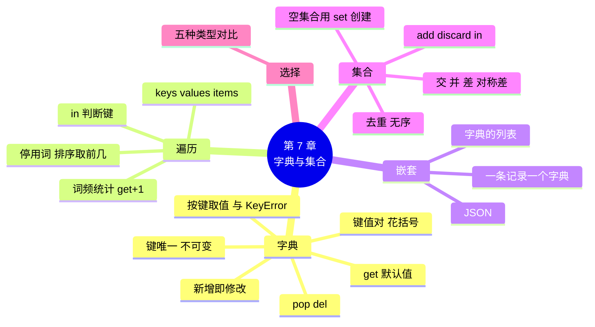

# 第 7 章 字典与集合：按名字找数据

!!! abstract "本章学时"
    理论 4 学时 · 实验 2 学时（本章共 3 个实验，教师可任选）

## 学习目标

学完本章，你应该能够：

1. **说出** 字典“键值对”的写法和键的规则，以及集合的两个特点（记忆）；
2. **解释** `d[键]` 和 `d.get(键, 默认值)` 在键不存在时的区别（理解）；
3. **使用** 字典完成按名称查价格、词频统计等任务，用 `items()` 遍历字典（应用）；
4. **使用** 集合去重，用交集、并集、差集比较两组数据（应用）；
5. **选择** 合适的数据类型（字符串、列表、元组、字典、集合）存放给定的数据（分析）。

!!! info "先修要求"
    学习本章前，你需要：

    - 会创建列表，会用 for 循环遍历列表（[6.3 遍历与统计](../06-lists/index.md#63)）；
    - 会用元组解包把多个值分别赋给多个变量（[6.6.2 解包](../06-lists/index.md#662)）；
    - 知道计数的套路（[5.4.2 套路二：计数](../05-loops/index.md#542)）。

??? abstract "本章概念清单（9 个，点击查看定义和例子）"
    1. [字典](../../appendix/glossary.md#g-字典)
    2. [键](../../appendix/glossary.md#g-键)
    3. [值](../../appendix/glossary.md#g-值)
    4. [键值对](../../appendix/glossary.md#g-键值对)
    5. [词频统计](../../appendix/glossary.md#g-词频统计)
    6. [停用词](../../appendix/glossary.md#g-停用词)
    7. [JSON](../../appendix/glossary.md#g-JSON)
    8. [集合](../../appendix/glossary.md#g-集合)
    9. [去重](../../appendix/glossary.md#g-去重)

## 情景导入

新来的兼职店员小林第一天上班，顾客问：“酸奶多少钱？”小林翻出价目表，从第一行往下找：矿泉水、可乐、绿茶、鲜牛奶……找到第五行才看到“酸奶 6 元”。陈姐笑着说：“干久了，你一听名字就知道价钱了。”

程序也有同样的问题。第 6 章的商品表是一个二维列表，要知道酸奶的价格，只能从头到尾一行一行地比。30 种商品还好，3000 种呢？

我们平时查字典，不会从第一页翻到最后一页，而是按拼音或部首直接翻到那个字。Python 里也有这样的东西，名字就叫[**字典**](../../appendix/glossary.md#g-字典 "用花括号存放“键: 值”对、按键查找值的数据类型"){ .term }：给它一个名字（“酸奶”），它直接告诉你对应的值（6.0）。这一章学习字典，以及它的好兄弟[**集合**](../../appendix/glossary.md#g-集合 "元素不重复、没有顺序的数据类型，用于去重和比较两组数据"){ .term }。

## 7.1 字典：键值对 { #71 }

### 7.1.1 创建字典与取值 { #711 }

**字典**（Dictionary）用花括号 `{ }` 括起来，里面是一对一对的“[**键**](../../appendix/glossary.md#g-键 "字典中用来查找的名字，不能重复，必须是不可修改的类型"){ .term }: [**值**](../../appendix/glossary.md#g-值 "字典中键所对应的数据，可以是任何类型，可以重复"){ .term }”，叫[**键值对**](../../appendix/glossary.md#g-键值对 "字典中“键: 值”组成的一对数据"){ .term }：

```python
prices = {"可乐": 3.5, "面包": 5.5, "牛奶": 4.5}
```

这里“可乐”是键，3.5 是值。键就像字典里的“字”，值就是它的“解释”。取值时，把键写在方括号里：

<div class="tryit" markdown>

```python
prices = {"可乐": 3.5, "面包": 5.5, "牛奶": 4.5}
print(prices["可乐"], len(prices))
print(prices["雪碧"])
```

</div>

```text
3.5 3
Traceback (most recent call last):
  ……
KeyError: '雪碧'
```

`len` 得到键值对的个数。用一个不存在的键取值，报 `KeyError`（键错误）。

和列表比一比：列表用**位置**（0、1、2……）找数据，字典用**名字**找数据。名字比位置好记得多，而且不管字典有多大，按键查找都几乎一样快。

### 7.1.2 增加、修改与删除 { #712 }

<div class="tryit" markdown>

```python
prices = {"可乐": 3.5, "面包": 5.5}
prices["牛奶"] = 4.5        # 键不存在：新增
prices["可乐"] = 3.8        # 键已存在：修改
print(prices)
x = prices.pop("面包")      # 删除并返回值
print(x, prices)
del prices["牛奶"]          # 删除
print(prices)
```

</div>

```text
{'可乐': 3.8, '面包': 5.5, '牛奶': 4.5}
5.5 {'可乐': 3.8, '牛奶': 4.5}
{'可乐': 3.8}
```

增加和修改是**同一个写法** `字典[键] = 值`：键不存在就新增，键已存在就修改。删除用 `pop(键)`（返回被删的值）或 `del 字典[键]`。

### 7.1.3 get：查不到也不报错 { #713 }

为了不让程序因为 KeyError 崩溃，可以先用 `in` 判断键在不在，或者用 `get` 方法：

```python
print("雪碧" in prices)              # in 判断的是“键”
print(prices.get("雪碧"))            # 查不到返回 None
print(prices.get("雪碧", 0))         # 查不到返回给定的默认值 0
```

```text
False
None
0
```

`get(键, 默认值)` 是字典最有用的方法之一，7.2 节的词频统计全靠它。

### 7.1.4 键的规则 { #714 }

1. **键不能重复**。同一个键写两次，后面的值会覆盖前面的：`{"a": 1, "a": 2}` 的结果是 `{'a': 2}`。值可以重复，比如可乐和绿茶都是 3.5 元。
2. **键必须是不能修改的类型**，常用字符串和数字，元组也可以；列表不能当键：

```text
>>> {["a"]: 1}
TypeError: cannot use 'list' as a dict key (unhashable type: 'list')
```

3. 字典会**记住键值对加入的顺序**，打印和遍历时按加入的先后排列。

## 7.2 遍历字典与词频统计 { #72 }

### 7.2.1 keys、values、items { #721 }

字典有三个方法，分别取出所有的键、所有的值、所有的键值对：

```python
d = {"可乐": 3.5, "面包": 5.5, "牛奶": 4.5}
print(list(d.keys()), list(d.values()), list(d.items()))
```

```text
['可乐', '面包', '牛奶'] [3.5, 5.5, 4.5] [('可乐', 3.5), ('面包', 5.5), ('牛奶', 4.5)]
```

遍历字典最常用的写法是 `items()` 加解包，每圈同时拿到键和值：

<div class="tryit" markdown>

```python
d = {"可乐": 3.5, "面包": 5.5, "牛奶": 4.5}
for name, price in d.items():
    print(name, price)
print(sum(d.values()))
```

</div>

```text
可乐 3.5
面包 5.5
牛奶 4.5
13.5
```

直接写 `for k in d:` 取出的是**键**。同样，`in` 判断的也是键：`3.5 in d` 是 False，要判断值，写 `3.5 in d.values()`。

### 7.2.2 词频统计 { #722 }

统计一段文字里每个词出现了几次，叫[**词频统计**](../../appendix/glossary.md#g-词频统计 "统计一段文字中每个词出现的次数"){ .term }，这是文本分析最基本的一步。用字典做，核心只有一行：

```python
counts = {}
for w in words:
    counts[w] = counts.get(w, 0) + 1
```

`counts.get(w, 0)` 查 w 已经出现了几次，第一次见到时查不到，得到 0；再加 1，存回去。这一行同时处理了“第一次见到”和“又见到”两种情况。如果用 if-else 写，是这样的：

```python
if w in counts:
    counts[w] = counts[w] + 1
else:
    counts[w] = 1
```

下面的动画把词频统计一步一步演示出来，注意右边字典 counts 是怎么“长”起来的。

<iframe class="sim-frame" src="../../sims/word-count/main.html" height="600" loading="lazy" title="词频统计：一词一词计出来"></iframe>
动画：词频统计。浅黄色是刚变化的变量，第二个标签演示字典的增改查和 KeyError。[全屏打开](../../sims/word-count/main.html){ target=_blank }
{ .sim-caption }

统计完以后，常常要按次数从多到少排序，找出出现最多的词。写法是：

```python
items = sorted(counts.items(), key=lambda x: x[1], reverse=True)
```

意思是“把键值对按第 2 项（次数）从大到小排”。`key=lambda x: x[1]` 的含义第 8 章 8.6 节解释，现在先照着写。实验 7-2 会完整地做一遍。

## 7.3 字典和列表嵌套 { #73 }

### 7.3.1 一条记录是一个字典 { #731 }

字典不只能存“名字→价格”这种一对一的关系，还很适合存放**一条记录**的各个字段：

```python
member = {"会员号": "M001", "姓名": "周洋", "积分": 693}
print(member["姓名"])
```

```text
周洋
```

比起列表 `["M001", "周洋", 693]`，用 `member["姓名"]` 比 `member[1]` 好懂得多，不用记“姓名是第几个”。

### 7.3.2 一张表是字典的列表 { #732 }

多条记录放进一个列表，就是一张表：

<div class="tryit" markdown>

```python
members = [
    {"会员号": "M001", "姓名": "周洋", "积分": 693},
    {"会员号": "M002", "姓名": "黄敏", "积分": 577},
]
for m in members:
    print(m["姓名"], m["积分"])
print(sum(m["积分"] for m in members))
```

</div>

```text
周洋 693
黄敏 577
1270
```

（会员信息均为虚构。）`sum(m["积分"] for m in members)` 和列表推导式类似，是把每个会员的积分取出来求和。

这种“列表里装字典、字典里还可以再装列表”的结构，就是互联网上最常用的数据格式 [**JSON**](../../appendix/glossary.md#g-JSON "互联网上最常用的数据格式，结构和 Python 的字典、列表嵌套相同"){ .term } 的样子<sup class="cite">[[1]](#ref7-1)</sup>。手机 App 和服务器之间、你的程序和大模型之间传递的数据，大多是 JSON。第 9 章学习把它存成文件，第 12 章读取大模型返回的 JSON。

## 7.4 集合：去重与交集、并集、差集 { #74 }

### 7.4.1 创建集合与去重 { #741 }

**集合**（Set）也用花括号，但里面只有值，没有键。集合有两个特点：**元素不重复**、**没有顺序**。

<div class="tryit" markdown>

```python
s = {"可乐", "面包", "可乐"}
print(s, len(s))
names = ["可乐", "面包", "可乐", "牛奶", "面包"]
print(len(set(names)))
```

</div>

```text
{'面包', '可乐'} 2
3
```

重复的“可乐”自动只留一个。用 `set(列表)` 把列表转成集合，是最简单的[**去重**](../../appendix/glossary.md#g-去重 "去掉重复的数据，只留一份"){ .term }方法。

因为没有顺序，集合**不能用索引**，`s[0]` 会报 `TypeError: 'set' object is not subscriptable`；打印出来的顺序也可能和写的时候不一样，每次运行都可能不同。需要有序时，用 `sorted(集合)` 转成排好序的列表。

集合常用的操作：`s.add(x)` 加入元素，`s.discard(x)` 删除元素（不存在也不报错），`x in s` 判断是否包含（比在列表里找快得多）。

!!! warning "空集合要写 set()"
    `{}` 是**空字典**，不是空集合。创建空集合必须写 `set()`。

### 7.4.2 交集、并集、差集 { #742 }

集合最有用的地方是比较两组数据，就像数学里的韦恩图：

| 运算 | 写法 | 含义 | `a = {1, 2, 3}`、`b = {2, 3, 4}` |
|---|---|---|---|
| 交集 | `a & b` | 两边都有的 | `{2, 3}` |
| 并集 | <code>a &#124; b</code> | 两边合起来（去重） | `{1, 2, 3, 4}` |
| 差集 | `a - b` | a 有、b 没有的 | `{1}` |
| 对称差集 | `a ^ b` | 只在一边有的 | `{1, 4}` |

例如比较周六和周日来店的会员：`a & b` 是两天都来的“铁杆顾客”，`a - b` 是只周六来的，`a | b` 是整个周末来过的所有人。实验 7-3 会用一份虚构的名单试一试。

!!! cert "证书考点 · 信息技术水平-人工智能（Python）"
    字典和集合属于“组合数据类型”考点：字典的创建、`d[键]` 与 `get`、增删改、`keys`/`values`/`items` 遍历、键不能重复且须为不可变类型；集合自动去重、无序、`& | - ^` 运算、空集合写 `set()`。词频统计是二级操作题的常见题型（详见[证书考点对照](../../certificate.md)）。

## 7.5 怎么选：五种数据类型对比 { #75 }

学到这里，我们已经认识了 5 种可以“装数据”的类型。遇到一份数据，该用哪一种？

| 类型 | 写法 | 有序？ | 能修改？ | 能重复？ | 怎么取值 | 适合存放 |
|---|---|---|---|---|---|---|
| 字符串 | `"可乐"` | 有序 | 不能 | 能 | 索引 | 一段文字 |
| 列表 | `[3.5, 5.5]` | 有序 | 能 | 能 | 索引 | 一串同类数据，会增删 |
| 元组 | `(3.5, 5.5)` | 有序 | 不能 | 能 | 索引 | 固定不变的一组数据 |
| 字典 | `{"可乐": 3.5}` | 按加入顺序 | 能 | 键不能 | 键 | 按名字查找、一条记录 |
| 集合 | `{"可乐", "面包"}` | 无序 | 能 | 不能 | 不能取单个 | 去重、比较两组数据 |

一个简单的判断方法：

1. 要“按名字查”吗？用**字典**；
2. 要“去重”或“比较两组有什么相同、不同”吗？用**集合**；
3. 要“按顺序排一串”，并且会增删吗？用**列表**；不会变吗？用**元组**。

## 7.6 前沿视窗：大模型的“词表”就是一本字典 { #76 }

3.7 节说过，大模型先把文字切成一个个词元，再把每个词元换成一个编号。这个“词元 → 编号”的对照表，叫**词表**（Vocabulary），它本质上就是一个巨大的 Python 字典，例如 `{"你": 1234, "好": 5678, ……}`，常见大模型的词表有十几万个键值对。模型输出编号时，再用一个“编号 → 词元”的反向字典把它翻译回文字。

不仅如此，本章的词频统计也是 AI 处理文本的基础：在大模型出现之前，判断一条评价是好评还是差评、给新闻分类，很多方法都是先统计词频，再交给模型计算。即使在今天，构建词表的第一步，仍然是在海量文本上统计哪些字和词出现得最多<sup class="cite">[[2]](#ref7-2)</sup>。

你调用大模型接口时收到的回复（第 12 章），也是一个层层嵌套的字典，要用 `回复["choices"][0]["message"]["content"]` 这样的写法一层层取值。学好字典，这些都不难。

## 本章实验

!!! abstract "实验总览"
    | 实验 | 类型 | 建议时长 | 内容 |
    |---|---|---|---|
    | 实验 7-1 | ★ 基础 | 30 分钟 | 用字典做价格表，按商品名收银并打印小票 |
    | 实验 7-2 | ★ 基础 | 30 分钟 | 统计顾客评价中每个词出现的次数，找出最多的 5 个 |
    | 实验 7-3 | ☆ 拓展 | 30 分钟 | 用集合比较周六、周日两天的会员名单 |

    代码见配套资源 `labs/ch07/` 目录。

### 实验 7-1 ★ 商品价格表与收银 { #lab7-1 }

**实验目的**

1. 会创建字典，用 `in` 判断键是否存在，用 `[键]` 取值；
2. 会用 `get` 累加数量，用 `items()` 遍历字典；
3. 会修改和新增键值对。

**实验环境**：本机 CPU。

**实验数据**：程序中的 10 种商品，售价参考配套数据 `labs/data/products.csv`（名称做了简写）。

**实验步骤与代码**

打开 `labs/ch07/lab7_1_price.py`：

```python
# 实验 7-1 商品价格表与收银
# 价格表是一个字典：键是商品名，值是售价（参考 labs/data/products.csv，名称做了简写）
prices = {
    "矿泉水": 2.0, "可乐": 3.5, "绿茶": 3.5, "鲜牛奶": 4.5, "酸奶": 6.0,
    "方便面": 4.5, "薯片": 7.5, "饼干": 6.0, "巧克力": 10.0, "鸡蛋": 12.0,
}
print("今日商品：", "、".join(prices.keys()))

cart = {}                                   # 购物车也是字典：商品名 -> 数量
while True:
    name = input("商品名（直接回车结账）：").strip()
    if name == "":
        break
    if name not in prices:                  # 先判断有没有这个键
        print("没有这个商品，请重新输入")
        continue
    qty = int(input("数量："))
    cart[name] = cart.get(name, 0) + qty    # 已经买过就累加数量
    print(f"{name} 单价 {prices[name]:.2f} 元，购物车里共 {cart[name]} 件")

print("\n------ 小票 ------")
total = 0
for name, qty in cart.items():              # 同时取出键和值
    money = prices[name] * qty
    total += money
    print(f"{name:<5}{qty:>3} 件 {money:>7.2f} 元")
print(f"合计 {total:.2f} 元")

# 调价：鸡蛋涨到 12.5 元；新增商品：面包
prices["鸡蛋"] = 12.5
prices["面包"] = 5.5
print("调价后鸡蛋", prices["鸡蛋"], "元；商品种数", len(prices))
```

**运行结果**（编者依次输入：可乐 2、雪碧、鸡蛋 1、可乐 1、薯片 2，然后直接回车）

```text
今日商品： 矿泉水、可乐、绿茶、鲜牛奶、酸奶、方便面、薯片、饼干、巧克力、鸡蛋
商品名（直接回车结账）：可乐
数量：2
可乐 单价 3.50 元，购物车里共 2 件
商品名（直接回车结账）：雪碧
没有这个商品，请重新输入
商品名（直接回车结账）：鸡蛋
数量：1
鸡蛋 单价 12.00 元，购物车里共 1 件
商品名（直接回车结账）：可乐
数量：1
可乐 单价 3.50 元，购物车里共 3 件
商品名（直接回车结账）：薯片
数量：2
薯片 单价 7.50 元，购物车里共 2 件
商品名（直接回车结账）：

------ 小票 ------
可乐     3 件   10.50 元
鸡蛋     1 件   12.00 元
薯片     2 件   15.00 元
合计 37.50 元
调价后鸡蛋 12.5 元；商品种数 11
```

可乐分两次输入，购物车里自动合并成了 3 件，这就是 `cart.get(name, 0) + qty` 的作用。对比实验 6-2 的列表购物车，同一种商品会出现两行。

**实验记录表**

| 操作 | 代码 | 结果 |
|---|---|---|
| 查酸奶的价格 | | |
| 把薯片的价格改成 8.0 | | |
| 删除巧克力 | | |
| 求所有商品的平均售价 | | |

**常见问题排查**

| 现象 | 原因 | 解决办法 |
|---|---|---|
| 输入“可乐 ”（带空格）提示没有这个商品 | 键必须完全一致 | 输入后 `.strip()` |
| `KeyError: '雪碧'` | 没有先判断就用 `prices[name]` 取值 | 先 `if name not in prices` |
| 第二次买可乐，数量没有累加而是被覆盖 | 写成了 `cart[name] = qty` | 用 `cart.get(name, 0) + qty` |

**思考与练习**

1. 增加功能：结账时如果合计满 30 元，送一瓶矿泉水（在 cart 中加入矿泉水，金额记 0）。
2. 用 `max(prices, key=prices.get)` 找出最贵的商品，试一试，想一想它的意思。

**实验报告要求**

提交运行截图、实验记录表和思考题 1 的代码。

### 实验 7-2 ★ 顾客评价词频统计 { #lab7-2 }

**实验目的**

1. 会用 `split()` 把文字拆成词，用字典和 `get` 统计词频；
2. 会用停用词列表过滤掉标点和没有意义的词；
3. 会对字典的键值对按值排序，取出前几名。

**实验环境**：本机 CPU。

**实验数据**：8 条顾客评价（虚构，摘自配套数据 `labs/data/reviews.txt`），已经切好词、用空格隔开。

**实验步骤与代码**

打开 `labs/ch07/lab7_2_wordfreq.py`：

```python
# 实验 7-2 顾客评价词频统计
# 评价已经用分词工具切好词、用空格隔开（第 12 章学习怎样用 jieba 自动分词）
reviews = """老板 很 热情 ， 找零 很 快 ， 排队 太 久 。
包子 很 香 。
牛奶 每天 都 有 新货 。
离家 近 很 方便 ， 包子 很 香 。
找零 很 快 。
价格 实惠 ， 老板 很 热情 。
排队 太 久 ， 但是 包子 很 香 。
店里 很 干净 ， 价格 实惠 。"""

stop = ["，", "。", "很", "太", "都", "有", "但是"]   # 停用词：标点和没有实际意义的词

counts = {}
for word in reviews.split():               # split() 不带参数，按空格和换行拆开
    if word in stop:
        continue
    counts[word] = counts.get(word, 0) + 1  # 词频统计的核心一行

print("一共有", len(counts), "个不同的词")
print(counts)

# 按次数从多到少排序（key=lambda 的写法第 8 章解释，这里先照着写）
items = sorted(counts.items(), key=lambda x: x[1], reverse=True)
print("出现最多的 5 个词：")
for word, n in items[:5]:
    print(f"{word:<4}{n:>2} 次  " + "■" * n)
```

像“很”“的”“了”这样到处都有、却说明不了什么的词，叫[**停用词**](../../appendix/glossary.md#g-停用词 "到处出现却没有实际意义、统计前要去掉的词和标点"){ .term }，统计前一般先去掉。

**运行结果**

```text
一共有 18 个不同的词
{'老板': 2, '热情': 2, '找零': 2, '快': 2, '排队': 2, '久': 2, '包子': 3, '香': 3, '牛奶': 1, '每天': 1, '新货': 1, '离家': 1, '近': 1, '方便': 1, '价格': 2, '实惠': 2, '店里': 1, '干净': 1}
出现最多的 5 个词：
包子   3 次  ■■■
香    3 次  ■■■
老板   2 次  ■■
热情   2 次  ■■
找零   2 次  ■■
```

次数相同的词，按它们在字典中出现的先后排列。顾客最常提到的是“包子香”和“老板热情”，陈姐可以把包子作为招牌商品。

**实验记录表**

| 问题 | 你的答案 |
|---|---|
| “排队”出现了几次？代码怎么写？ | |
| 把“久”也加入停用词，“一共有几个不同的词”变成多少？ | |
| 只出现 1 次的词有哪些？代码怎么写？ | |
| 你认为还有哪些词应该算停用词？ | |

**常见问题排查**

| 现象 | 原因 | 解决办法 |
|---|---|---|
| 结果里有“，”“。” | 没有过滤停用词 | 检查 stop 列表和 continue |
| `KeyError: '老板'` | 写成了 `counts[word] + 1` | 用 `counts.get(word, 0) + 1` |
| 每个词都只有 1 次 | 把 `counts = {}` 写进了循环 | 字典在循环前创建 |

**思考与练习**

1. 不排序，用循环找出出现次数最多的词（第 5 章“找最大值”套路）。
2. 直接对没切词的原文统计“字频”（`for ch in 原文:`），和词频的结果比一比，哪个更有意义？

**实验报告要求**

提交运行截图和实验记录表。

### 实验 7-3 ☆ 两天顾客名单对比 { #lab7-3 }

**实验目的**

1. 会用 `set()` 把列表转成集合去重；
2. 会用交集、并集、差集回答实际问题。

**实验环境**：本机 CPU。

**实验数据**：程序中周六、周日来店消费的会员编号（虚构），同一个人一天可能来几次。

**实验步骤与代码**

打开 `labs/ch07/lab7_3_customers.py`：

```python
# 实验 7-3 两天顾客名单对比
# 周六、周日来店消费的会员编号（虚构，同一个人一天可能来几次）
sat = ["M003", "M015", "M027", "M003", "M041", "M052", "M015", "M008"]
sun = ["M015", "M033", "M041", "M008", "M060", "M033", "M019"]

a = set(sat)            # 转成集合，自动去掉重复
b = set(sun)
print("周六来了", len(sat), "人次，", len(a), "位会员")
print("周日来了", len(sun), "人次，", len(b), "位会员")

print("两天都来的：", sorted(a & b))       # 交集
print("周末来过的一共：", len(a | b), "位")  # 并集
print("只有周六来的：", sorted(a - b))     # 差集
print("只来了一天的：", sorted(a ^ b))     # 对称差集
print("M060 周六来过吗？", "M060" in a)
```

集合没有顺序，用 `sorted` 转成排好序的列表再打印，结果才整齐、稳定。

**运行结果**

```text
周六来了 8 人次， 6 位会员
周日来了 7 人次， 6 位会员
两天都来的： ['M008', 'M015', 'M041']
周末来过的一共： 9 位
只有周六来的： ['M003', 'M027', 'M052']
只来了一天的： ['M003', 'M019', 'M027', 'M033', 'M052', 'M060']
M060 周六来过吗？ False
```

**实验记录表**

| 问题 | 代码 | 结果 |
|---|---|---|
| 只有周日来的 | | |
| 验证：并集人数 = 周六人数 + 周日人数 − 交集人数 | | |
| 用列表（不用集合）求两天都来的，代码怎么写？ | | |

**常见问题排查**

| 现象 | 原因 | 解决办法 |
|---|---|---|
| 每次运行打印的顺序都不一样 | 集合无序 | 用 `sorted()` 排序后再打印 |
| `TypeError: unsupported operand type(s) for &: 'list' and 'list'` | 对列表用了 `&` | 先用 `set()` 转成集合 |

**思考与练习**

1. 再加一个周五的名单，找出三天都来的会员。
2. 周六有 6 位会员，却有 8 人次。用第 7.2 节的方法统计每位会员周六来了几次。

**实验报告要求**

提交实验记录表和思考题 1 的代码。

## 本章小结

- **字典**用花括号存放**键值对**，按**键**查找**值**。`d[键]` 键不存在时报 KeyError；`d.get(键, 默认值)` 查不到返回默认值。`d[键] = 值` 键不存在就新增、存在就修改；`pop`、`del` 删除。键不能重复，必须是字符串、数字、元组等不可修改的类型。
- `keys()`、`values()`、`items()` 分别取键、值、键值对，`for k, v in d.items()` 最常用；`in` 判断的是键。
- **词频统计**的核心是 `counts[w] = counts.get(w, 0) + 1`，统计前去掉**停用词**；按次数排序用 `sorted(d.items(), key=lambda x: x[1], reverse=True)`。
- 一条记录用字典，一张表用“字典的列表”，这就是 **JSON** 的样子。
- **集合**元素不重复、无序，不能索引；`set(列表)` 去重；`&` 交集、`|` 并集、`-` 差集、`^` 对称差集；空集合写 `set()`。
- 按名字查用字典，去重和比较用集合，有序且会增删用列表，固定不变用元组。
- 大模型的词表是一个巨大的字典，接口返回的是嵌套字典。



**下一章预告**

到现在，我们的收银程序已经能查价格、算满减、打小票了，可代码也越来越长。小周发现，“算折扣”的那几行代码，在收银、退货、会员日活动里各复制了一遍；陈姐一改折扣规则，他就得改三个地方，还老是漏改一处。能不能把“算折扣”打包成一个小工具，写一次、到处用？下一章学习**函数**。

## 参考文献

正文中的上标编号（如<sup class="cite">[[1]](#ref7-1)</sup>）对应下面的文献。带链接的可以直接打开；书籍可在图书馆或电子书平台查阅。

<div class="refs" markdown>

**教材与专著**

- <span id="ref7-3"></span>[3] 嵩天, 礼欣, 黄天羽. Python 语言程序设计基础[M]. 2 版. 北京: 高等教育出版社, 2017.
    <span class="ref-note">第 6 章“组合数据类型”讲集合、字典和词频统计实例，对应 7.1～7.4 节和实验 7-2。</span>

**经典论文与标准**

- <span id="ref7-1"></span>[1] BRAY T. The JavaScript Object Notation (JSON) data interchange format: RFC 8259[S/OL]. Internet Engineering Task Force, 2017[2026-11-01]. https://www.rfc-editor.org/rfc/rfc8259.
    <span class="ref-note">JSON 格式的国际标准，规定了对象（对应字典）、数组（对应列表）等写法，对应 7.3.2 节。</span>
- <span id="ref7-2"></span>[2] SENNRICH R, HADDOW B, BIRCH A. Neural machine translation of rare words with subword units[C]//Proceedings of the 54th Annual Meeting of the Association for Computational Linguistics. Berlin: ACL, 2016: 1715-1725.
    <span class="ref-note">提出用 BPE 方法构建子词词表：从字符出发，反复统计并合并最常一起出现的片段，今天许多大模型的词表都基于类似方法，对应 7.6 节。</span>

**在线资源与数据**

- <span id="ref7-4"></span>[4] Python Software Foundation. Python 教程：5.4 集合、5.5 字典[EB/OL]. [2026-11-01]. https://docs.python.org/zh-cn/3.14/tutorial/datastructures.html#dictionaries.
    <span class="ref-note">官方教程中字典和集合的说明，对应 7.1～7.4 节。</span>

</div>

## 课后练习

选择题和判断题可以直接点击选项作答，系统会马上告诉你对错，并展开答案与解析；多选题选好后点“提交答案”。简答和实操题请先自己作答，再点开“答案与解析”核对。每道题的解析下方都有“回看”链接，做错了可以直接跳回正文复习。

**一、单项选择题**

<div class="quiz" data-answer="C" markdown>

**1.** 执行 `d = {"a": 1, "b": 2}` 和 `d["c"] = 3` 后，`len(d)` 的值是（　　）。

- A. 1
- B. 2
- C. 3
- D. 6

</div>

??? tip "答案与解析"
    **答案：C**

    键 c 不存在，赋值即新增，字典有 3 个键值对。

    考查：字典新增 · 认知层次：应用 · [回看 7.1.2](#712)
    { .quiz-meta }

<div class="quiz" data-answer="B" markdown>

**2.** 设 `d = {"可乐": 3.5}`，`d.get("雪碧", 0)` 的值是（　　）。

- A. 3.5
- B. 0
- C. None
- D. 报 KeyError

</div>

??? tip "答案与解析"
    **答案：B**

    键不存在时 get 返回给定的默认值 0。

    考查：get · 认知层次：应用 · [回看 7.1.3](#713)
    { .quiz-meta }

<div class="quiz" data-answer="A" markdown>

**3.** 设 `d = {"可乐": 3.5}`，执行 `print(d["雪碧"])` 的结果是（　　）。

- A. 报 KeyError
- B. 输出 None
- C. 输出 0
- D. 输出空行

</div>

??? tip "答案与解析"
    **答案：A**

    用 `[键]` 取不存在的键会报 KeyError；不想报错用 get。

    考查：KeyError · 认知层次：理解 · [回看 7.1.1](#711)
    { .quiz-meta }

<div class="quiz" data-answer="D" markdown>

**4.** 设 `d = {"可乐": 3.5, "面包": 5.5}`，执行 `for k in d: print(k)` 输出的是（　　）。

- A. 3.5 和 5.5
- B. ('可乐', 3.5) 和 ('面包', 5.5)
- C. 报错
- D. 可乐 和 面包

</div>

??? tip "答案与解析"
    **答案：D**

    直接遍历字典，取出的是键。要值用 `d.values()`，要键值对用 `d.items()`。

    考查：遍历字典 · 认知层次：理解 · [回看 7.2.1](#721)
    { .quiz-meta }

<div class="quiz" data-answer="B" markdown>

**5.** `len(set([1, 2, 2, 3]))` 的值是（　　）。

- A. 4
- B. 3
- C. 2
- D. 1

</div>

??? tip "答案与解析"
    **答案：B**

    转成集合后去掉重复的 2，剩 {1, 2, 3}。

    考查：集合去重 · 认知层次：应用 · [回看 7.4.1](#741)
    { .quiz-meta }

<div class="quiz" data-answer="C" markdown>

**6.** `{1, 2, 3} & {2, 3, 4}` 的结果是（　　）。

- A. `{1, 2, 3, 4}`
- B. `{1}`
- C. `{2, 3}`
- D. `{1, 4}`

</div>

??? tip "答案与解析"
    **答案：C**

    `&` 是交集，取两边都有的元素。

    考查：集合运算 · 认知层次：应用 · [回看 7.4.2](#742)
    { .quiz-meta }

<div class="quiz" data-answer="D" markdown>

**7.** 下列不能作为字典的键的是（　　）。

- A. `"可乐"`
- B. `101`
- C. `("A", 1)`
- D. `["A", 1]`

</div>

??? tip "答案与解析"
    **答案：D**

    键必须是不可修改的类型，列表可以修改，不能作键。

    考查：键的规则 · 认知层次：理解 · [回看 7.1.4](#714)
    { .quiz-meta }

<div class="quiz" data-answer="A" markdown>

**8.** 创建一个空集合，正确的写法是（　　）。

- A. `set()`
- B. `{}`
- C. `[]`
- D. `()`

</div>

??? tip "答案与解析"
    **答案：A**

    `{}` 是空字典，`[]` 是空列表，`()` 是空元组。

    考查：空集合 · 认知层次：记忆 · [回看 7.4.1](#741)
    { .quiz-meta }

**二、多项选择题**

<div class="quiz quiz-multi" data-answer="ABD" markdown>

**1.** 关于字典，下列说法正确的有（　　）。

- A. 同一个字典中键不能重复
- B. 不同的键可以对应相同的值
- C. 列表可以作为字典的键
- D. 可以用 `in` 判断某个键是否存在

</div>

??? tip "答案与解析"
    **答案：ABD**

    列表可以修改，不能作键。

    考查：字典的规则 · 认知层次：理解 · [回看 7.1.4](#714)
    { .quiz-meta }

<div class="quiz quiz-multi" data-answer="ACD" markdown>

**2.** 关于集合，下列说法正确的有（　　）。

- A. 集合中的元素不会重复
- B. 可以用 `s[0]` 取出集合的第一个元素
- C. 可以求两个集合的交集、并集和差集
- D. 集合中的元素没有固定顺序

</div>

??? tip "答案与解析"
    **答案：ACD**

    集合无序，不能用索引。

    考查：集合的特点 · 认知层次：理解 · [回看 7.4.1](#741)
    { .quiz-meta }

<div class="quiz quiz-multi" data-answer="BC" markdown>

**3.** 设 `d = {"可乐": 3.5, "面包": 5.5}`，下列能得到 `9.0` 的有（　　）。

- A. `sum(d)`
- B. `sum(d.values())`
- C. `d["可乐"] + d["面包"]`
- D. `sum(d.keys())`

</div>

??? tip "答案与解析"
    **答案：BC**

    A、D 都是对键（字符串）求和，会报 TypeError。

    考查：values 与取值 · 认知层次：应用 · [回看 7.2.1](#721)
    { .quiz-meta }

**三、判断题**

<div class="quiz quiz-judge" data-answer="×" markdown>

**1.** `s = {}` 创建的是一个空集合。（　　）

- √
- ×

</div>

??? tip "答案与解析"
    **答案：×**

    `{}` 是空字典，空集合要写 `set()`。

    考查：空集合 · 认知层次：记忆 · [回看 7.4.1](#741)
    { .quiz-meta }

<div class="quiz quiz-judge" data-answer="√" markdown>

**2.** 创建字典时同一个键写了两次，后面的值会覆盖前面的值。（　　）

- √
- ×

</div>

??? tip "答案与解析"
    **答案：√**

    `{"a": 1, "a": 2}` 的结果是 `{'a': 2}`。

    考查：键的规则 · 认知层次：理解 · [回看 7.1.4](#714)
    { .quiz-meta }

<div class="quiz quiz-judge" data-answer="×" markdown>

**3.** `3.5 in {"可乐": 3.5}` 的结果是 True。（　　）

- √
- ×

</div>

??? tip "答案与解析"
    **答案：×**

    in 判断的是键，3.5 是值不是键，结果是 False。

    考查：in 与字典 · 认知层次：理解 · [回看 7.2.1](#721)
    { .quiz-meta }

<div class="quiz quiz-judge" data-answer="√" markdown>

**4.** `d.pop("可乐")` 会删除键“可乐”，并返回它对应的值。（　　）

- √
- ×

</div>

??? tip "答案与解析"
    **答案：√**

    pop 删除并返回值；del 只删除不返回。

    考查：删除键值对 · 认知层次：记忆 · [回看 7.1.2](#712)
    { .quiz-meta }

<div class="quiz quiz-judge" data-answer="×" markdown>

**5.** 打印集合时，元素的顺序一定和创建时写的顺序相同。（　　）

- √
- ×

</div>

??? tip "答案与解析"
    **答案：×**

    集合无序，打印顺序可能不同，每次运行也可能不同。

    考查：集合无序 · 认知层次：理解 · [回看 7.4.1](#741)
    { .quiz-meta }

**四、简答题**

**1.** 读程序写结果。

```python
d = {"可乐": 3, "面包": 2}
d["牛奶"] = 1
d["可乐"] += 2
d.pop("面包")
for k, v in d.items():
    print(k, v)
print(len(d), d.get("面包", "无"))
```

??? tip "答案与解析"
    **参考答案**

    ```text
    可乐 5
    牛奶 1
    2 无
    ```

    牛奶新增；可乐 3 加 2 得 5；面包被删除，所以 get 返回默认值“无”。字典按加入顺序遍历。

    考查：字典增删改与遍历 · 认知层次：应用 · [回看 7.1.2](#712)
    { .quiz-meta }

**2.** 找错并改正。下面的词频统计程序运行时报错 `KeyError: '包子'`，为什么？怎么改？

```python
counts = {}
for w in ["包子", "香", "包子"]:
    counts[w] = counts[w] + 1
print(counts)
```

??? tip "答案与解析"
    **参考答案**

    第一次见到“包子”时，字典里还没有这个键，`counts[w]` 取不到值，报 KeyError。改为用 get 给出默认值 0：

    ```python
    counts[w] = counts.get(w, 0) + 1
    ```

    改正后输出 `{'包子': 2, '香': 1}`。

    考查：词频统计 · 认知层次：分析 · [回看 7.2.2](#722)
    { .quiz-meta }

**3.** 下面三份数据，分别用哪种数据类型存放最合适？说明理由。（1）全店 30 种商品的名称和售价，收银时要按名称查价格；（2）今天来过店里的会员编号，要知道一共来了多少位不同的会员；（3）一周 7 天的营业额，要按顺序画折线图。

??? tip "答案与解析"
    **参考答案**

    （1）字典，键是商品名、值是售价，按名称查找最方便。（2）集合，自动去掉同一位会员的重复记录，`len` 就是不同会员的人数。（3）列表，元素有顺序，第几个就是星期几。

    考查：数据类型的选择 · 认知层次：分析 · [回看 7.5](#75)
    { .quiz-meta }

**五、实操题**

**1.** 输入一段文字，统计其中每个字出现的次数（例如输入“街坊街坊便利店”，输出 `{'街': 2, '坊': 2, '便': 1, '利': 1, '店': 1}`）。

??? tip "答案与解析"
    **参考答案**

    ```python
    text = input("一段文字：")
    counts = {}
    for ch in text:
        counts[ch] = counts.get(ch, 0) + 1
    print(counts)
    ```

    编者用“街坊街坊便利店”测试，输出与题目一致。

    考查：字频统计 · 认知层次：应用 · [回看 7.2.2](#722)
    { .quiz-meta }

**2.** 已知成绩字典 `scores = {"周洋": 88, "黄敏": 95, "李娜": 72, "王强": 59}`（姓名为虚构），输出平均分、最高分的人和分数，以及不及格的名单。

??? tip "答案与解析"
    **参考答案**

    ```python
    scores = {"周洋": 88, "黄敏": 95, "李娜": 72, "王强": 59}
    print("平均分", sum(scores.values()) / len(scores))
    best_name = ""
    best = -1
    for name, s in scores.items():
        if s > best:
            best = s
            best_name = name
    print("最高分", best_name, best)
    print("不及格", [name for name, s in scores.items() if s < 60])
    ```

    编者运行结果：平均分 78.5，最高分 黄敏 95，不及格 `['王强']`。

    考查：items 遍历、找最大值 · 认知层次：应用 · [回看 7.2.1](#721)
    { .quiz-meta }
