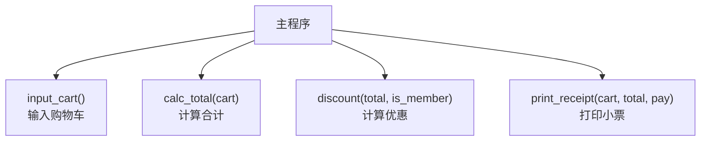
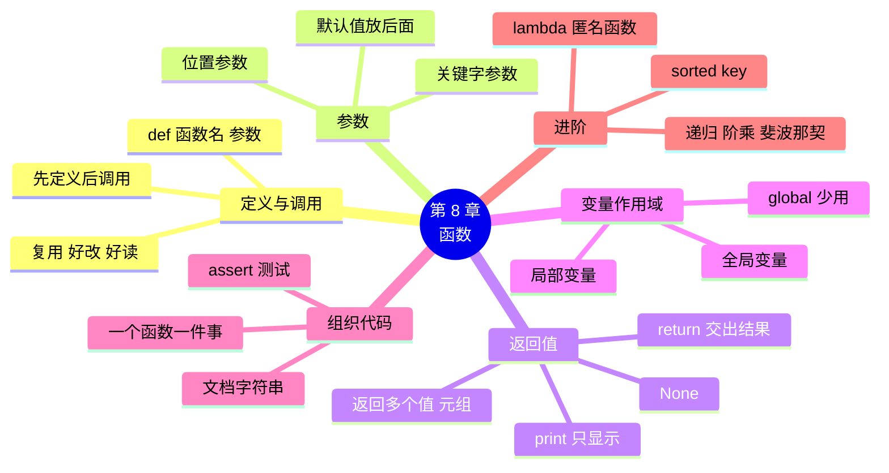

# 第 8 章 函数：把代码打包复用

!!! abstract "本章学时"
    理论 4 学时 · 实验 2 学时（本章共 3 个实验，教师可任选）

## 学习目标

学完本章，你应该能够：

1. **说出** 函数的定义、调用、参数、返回值等概念，以及使用函数的好处（记忆）；
2. **解释** return 与 print 的区别、局部变量与全局变量的区别（理解）；
3. **使用** def 定义带参数和返回值的函数，会用默认值和关键字参数调用（应用）；
4. **使用** assert 测试自己写的函数，用 `sorted(key=...)` 和 lambda 按指定规则排序（应用）；
5. **分析** 递归函数的执行过程，说出递归必须有结束条件的原因（分析）。

!!! info "先修要求"
    学习本章前，你需要：

    - 会写 if 判断和 for、while 循环（[第 4 章](../04-conditions/index.md)、[第 5 章](../05-loops/index.md)）；
    - 会用列表和字典，会用元组解包（[6.6.2 解包](../06-lists/index.md#662)、[7.3 字典和列表嵌套](../07-dicts/index.md#73)）；
    - 知道 `b = a` 让两个名字指向同一个列表（[6.7 常见坑](../06-lists/index.md#67)）。

??? abstract "本章概念清单（13 个，点击查看定义和例子）"
    1. [函数](../../appendix/glossary.md#g-函数)
    2. [参数](../../appendix/glossary.md#g-参数)
    3. [函数体](../../appendix/glossary.md#g-函数体)
    4. [位置参数](../../appendix/glossary.md#g-位置参数)
    5. [默认值](../../appendix/glossary.md#g-默认值)
    6. [关键字参数](../../appendix/glossary.md#g-关键字参数)
    7. [返回值](../../appendix/glossary.md#g-返回值)
    8. [局部变量](../../appendix/glossary.md#g-局部变量)
    9. [全局变量](../../appendix/glossary.md#g-全局变量)
    10. [文档字符串](../../appendix/glossary.md#g-文档字符串)
    11. [匿名函数](../../appendix/glossary.md#g-匿名函数)
    12. [递归](../../appendix/glossary.md#g-递归)
    13. [工具调用](../../appendix/glossary.md#g-工具调用)

## 情景导入

小周的收银程序已经有 200 多行了。陈姐让他加一个“退货”功能、一个“会员日”功能，小周一看，这两个功能都要算折扣，于是把收银那段“满 100 减 15、会员 9.5 折”的代码复制了两份过去。

一个月后，陈姐说：“下个月改成满 100 减 20。”小周改了收银里的那一处，忘了另外两处。月底对账，退货金额和收银金额对不上，查了一晚上才找到原因。

问题出在“复制粘贴”。同样的代码出现在好几个地方，改一处就要改所有地方，漏一处就出错。更好的办法是：把“算折扣”这段代码**打包**起来，起个名字叫 `discount`，哪里要用就“叫一声”这个名字。规则变了，只改这一个地方。

这个“打包起来、起个名字、随叫随用”的东西，就是[**函数**](../../appendix/glossary.md#g-函数 "把一段代码打包起来、起个名字，可以反复调用的程序单元"){ .term }。其实我们早就在用函数了：`print`、`input`、`len`、`round` 都是 Python 写好的函数。这一章，我们学习自己写函数。

## 8.1 定义和调用函数 { #81 }

### 8.1.1 def：定义一个函数 { #811 }

用 `def`（define，定义）关键字定义一个函数：

<div class="tryit" markdown>

```python
def greet(name):
    print("你好，" + name)

greet("小周")
greet("陈姐")
```

</div>

```text
你好，小周
你好，陈姐
```

第 1～2 行是**定义函数**：`def` 后面是函数名 `greet`，括号里的 `name` 是[**参数**](../../appendix/glossary.md#g-参数 "定义函数时括号里的变量，用来接收调用时传进来的值"){ .term }，表示调用时要“传进来”的数据；冒号后面缩进的部分是[**函数体**](../../appendix/glossary.md#g-函数体 "def 下面缩进的、调用时才执行的代码"){ .term }。

第 4～5 行是**调用函数**：写函数名加括号，括号里给出具体的值。调用时，“小周”被传给 name，然后执行函数体。

!!! warning "定义不等于执行"
    `def` 只是把代码打包起来、起个名字，函数体**一行都不执行**。只有调用时才执行。所以函数必须**先定义、后调用**，在定义之前调用会报 `NameError`。

函数的命名规则和变量一样（2.1.3 节），最好用动词或动词短语说明它“做什么”，如 `discount`（打折）、`mask_phone`（手机号脱敏）、`print_receipt`（打印小票）。

### 8.1.2 为什么要用函数 { #812 }

1. **复用**：写一次，到处调用，不用复制粘贴；
2. **好改**：规则变了只改一处，所有调用的地方自动跟着变；
3. **好读**：主程序里写 `pay = discount(total)`，一看就懂，不用去读里面的十几行；
4. **好分工**：一个大程序拆成很多函数，可以分给不同的人写，再拼起来（第 12 章团队项目就这样做）。

## 8.2 参数 { #82 }

### 8.2.1 位置参数 { #821 }

函数可以有多个参数，用逗号隔开。调用时，值按**位置**一一对应地传给参数，叫[**位置参数**](../../appendix/glossary.md#g-位置参数 "调用时按位置顺序一一对应传给参数的值"){ .term }：

```python
def add(a, b):
    return a + b

print(add(3, 5))
```

```text
8
```

3 传给 a，5 传给 b。给的值多了或少了都会报错，而且报错信息很清楚：

```text
>>> add(1)
TypeError: add() missing 1 required positional argument: 'b'
>>> add(1, 2, 3)
TypeError: add() takes 2 positional arguments but 3 were given
```

第一个的意思是“add() 缺少 1 个必需的位置参数 b”，第二个是“add() 需要 2 个位置参数，却给了 3 个”。

### 8.2.2 默认值与关键字参数 { #822 }

定义时可以给参数一个[**默认值**](../../appendix/glossary.md#g-默认值 "定义时给参数指定的值，调用时不传就用它"){ .term }，调用时不给这个参数，就用默认值：

<div class="tryit" markdown>

```python
def price_of(qty, price=3.5, rate=1.0):
    return qty * price * rate

print(price_of(2))                    # 只给 qty，其余用默认值
print(price_of(2, 4.5))               # 给了 price，覆盖默认值
print(price_of(2, rate=0.9))          # 跳过 price，只指定 rate
print(price_of(price=6.8, qty=1))     # 全部用名字指定，顺序随意
```

</div>

```text
7.0
9.0
6.3
6.8
```

调用时写成 `参数名=值` 的形式，叫[**关键字参数**](../../appendix/glossary.md#g-关键字参数 "调用时用“参数名=值”指定的参数，可以不按顺序"){ .term }。它有两个好处：可以跳过中间有默认值的参数（第 3 行）；可以不管顺序（第 4 行），而且一看就知道每个值是什么意思。

两条规则：定义时，**有默认值的参数要放在后面**，写成 `def f(a=1, b):` 会报 `SyntaxError: parameter without a default follows parameter with a default`；调用时，**关键字参数要放在位置参数后面**。

## 8.3 返回值 { #83 }

### 8.3.1 return：把结果带回来 { #831 }

`return` 的作用是**结束函数，并把一个值带回调用的地方**。这个值叫[**返回值**](../../appendix/glossary.md#g-返回值 "函数用 return 交回给调用者的结果，没有 return 时是 None"){ .term }：

```python
def add(a, b):
    return a + b

r = add(3, 5)
print(r, add(add(1, 2), 3))
```

```text
8 6
```

`add(3, 5)` 这个调用，执行完就“变成”了 8，所以可以赋值给变量，也可以放进表达式里，甚至可以作为另一个函数的参数（`add(add(1, 2), 3)`）。

执行到 return，函数**立即结束**，return 后面的代码不再执行。没有写 return，或者 return 后面什么都不写，函数返回 `None`。

下面的动画演示了函数的调用过程。注意右边变量表：调用时多出一块函数自己的变量，return 之后这块就消失了。

<iframe class="sim-frame" src="../../sims/function-call/main.html" height="640" loading="lazy" title="函数调用与返回"></iframe>
动画：函数调用与返回。第二个标签演示局部变量和全局变量，第三个标签演示递归（8.6.2 节）。[全屏打开](../../sims/function-call/main.html){ target=_blank }
{ .sim-caption }

### 8.3.2 return 与 print 的区别 { #832 }

这是初学者最容易混淆的地方。看两个函数：

```python
def add(a, b):
    return a + b          # 把结果交回去

def add2(a, b):
    print(a + b)          # 把结果显示在屏幕上

r = add2(3, 5)
print(r)
```

```text
8
None
```

`add2` 把 8 **显示**在了屏幕上，但并没有把它**交回来**，所以 r 得到的是 None。打个比方：return 是把算好的账单交到你手上，你可以拿去用；print 是把账单念一遍给你听，听完手里什么也没有。

经验是：**函数负责计算，用 return 交出结果；要不要显示、怎么显示，交给调用它的人决定**。这样的函数可以用在更多地方。

### 8.3.3 返回多个值 { #833 }

return 后面可以写多个值，用逗号隔开：

```python
def max_min(nums):
    return max(nums), min(nums)

r = max_min([3, 9, 1])
print(r, type(r))
hi, lo = max_min([3, 9, 1])
print(hi, lo)
```

```text
(9, 1) <class 'tuple'>
9 1
```

其实返回的是**一个元组**（6.6 节），用解包可以一次拿到多个值。

## 8.4 局部变量与全局变量 { #84 }

### 8.4.1 函数里的变量只在函数里有效 { #841 }

在函数里面赋值的变量（包括参数），叫[**局部变量**](../../appendix/glossary.md#g-局部变量 "在函数里赋值的变量，只在函数内有效，函数结束就消失"){ .term }，只在这个函数里有效；在函数外面（主程序里）赋值的变量，叫[**全局变量**](../../appendix/glossary.md#g-全局变量 "在主程序里赋值的变量，函数里可以读取，修改需 global"){ .term }。

<div class="tryit" markdown>

```python
def f():
    x = 10
    y = 5
    print("函数里", x)

x = 1
f()
print("函数外", x)
print(y)
```

</div>

```text
函数里 10
函数外 1
NameError: name 'y' is not defined
```

函数里的 x 和外面的 x 同名，但它们是**两个不同的变量**，函数里改 x 不影响外面。y 是函数的局部变量，函数一结束就消失了，在外面用它报 NameError。

这样设计的好处是：每个函数都有自己独立的“小天地”，写函数时不用担心变量名和别人重名。

### 8.4.2 在函数里使用全局变量 { #842 }

函数里可以**读取**全局变量：

```python
rate = 0.9
def dp(p):
    return p * rate
print(dp(10))
```

```text
9.0
```

但如果要在函数里**修改**全局变量，直接写会报错：

```python
count = 0
def add_one():
    count += 1
add_one()
```

```text
UnboundLocalError: cannot access local variable 'count' where it is not associated with a value
```

因为函数里出现了对 count 的赋值，Python 就把它当成局部变量，而这个局部变量还没有值。要修改全局变量，需要先用 `global` 声明：

```python
def add_one():
    global count
    count += 1
```

不过，**尽量少用 global**。更好的写法是把需要的数据作为参数传进去，把结果用 return 交出来，这样函数之间的关系一目了然。

!!! note "传列表进函数，函数里能改动它"
    数字和字符串传进函数，函数里怎么赋值都不影响外面；但列表、字典传进函数，函数里用 `append`、`pop` 等方法修改它，外面的列表**也会变**，因为参数和外面的变量是同一个列表的两个名字（6.7 节）。课后练习简答题 1 就考这个。

## 8.5 文档字符串与拆分长程序 { #85 }

### 8.5.1 文档字符串 { #851 }

函数体的第一行如果是一个字符串（通常用三引号），它就是这个函数的[**文档字符串**](../../appendix/glossary.md#g-文档字符串 "函数体第一行的说明字符串，help() 可以显示它"){ .term }（Docstring），用来说明函数是做什么的、参数和返回值是什么：

```python
def discount(total, is_member=False):
    """根据合计金额和是否会员，返回实付金额（保留两位小数）。"""
    ...
```

文档字符串不影响运行，但很有用：Thonny 中把鼠标停在函数名上、或者执行 `help(discount)`，就会显示它。别人用你的函数时，不用读代码也知道怎么用。AI 编程助手也会根据文档字符串更好地理解你的代码。

### 8.5.2 把长程序拆成几个函数 { #852 }

一个好习惯是：**每个函数只做一件事**，主程序只负责按顺序调用函数。以收银程序为例，可以拆成：



拆分之后，每个函数都很短，容易读懂、容易测试；哪里出了问题，就去查哪个函数。实验 8-1 先把折扣和打小票拆出来，实验 8-2 再把一组常用工具写成函数库，并用 `assert` 测试它们。

`assert 条件` 的意思是“我断定这个条件成立”：成立就什么也不做，不成立就报 `AssertionError`，提醒你函数算错了。写完函数，用几个已知答案的例子测一测，是程序员的基本功。

## 8.6 lambda 与递归入门 { #86 }

### 8.6.1 lambda 与 sorted(key=...) { #861 }

`sorted`、`max`、`min` 都可以接收一个 `key` 参数，告诉它“按什么来比”。key 的值是一个**函数**：对每个元素调用这个函数，按函数的返回值排序。

```python
names = ["可乐", "矿泉水", "面包"]
print(sorted(names, key=len))       # 按字数排，len 就是一个函数
```

```text
['可乐', '面包', '矿泉水']
```

7.2.2 节的词频排序 `key=lambda x: x[1]` 中，`lambda` 是一种只有一行的[**匿名函数**](../../appendix/glossary.md#g-匿名函数 "用 lambda 写成的一行、没有名字的函数"){ .term }（没有名字的函数），写法是 `lambda 参数: 返回值`。下面两种写法完全等价：

```python
def second(x):
    return x[1]

pairs = [("可乐", 3), ("面包", 5), ("牛奶", 1)]
print(sorted(pairs, key=second, reverse=True))
print(sorted(pairs, key=lambda x: x[1], reverse=True))
```

```text
[('面包', 5), ('可乐', 3), ('牛奶', 1)]
[('面包', 5), ('可乐', 3), ('牛奶', 1)]
```

lambda 只适合这种“临时用一下、一行就能写完”的小函数。本书对 lambda 的要求是：看到 `key=lambda x: ...` 能读懂它“按什么排”，会照着写。实验 8-3 用它给商品按销量、价格排序。

### 8.6.2 递归入门 { #862 }

函数在自己的函数体里又调用自己，叫[**递归**](../../appendix/glossary.md#g-递归 "函数在函数体里调用自己，必须有结束条件"){ .term }。经典的例子是阶乘：n! = n × (n-1) × … × 1。换个说法：**n 的阶乘 = n × (n-1) 的阶乘**，而 1 的阶乘是 1。照着这句话就能写出函数：

<div class="tryit" markdown>

```python
def fact(n):
    if n == 1:              # 结束条件（出口）
        return 1
    return n * fact(n - 1)  # 把问题变小，调用自己

print(fact(4), fact(10))
```

</div>

```text
24 3628800
```

计算 `fact(4)` 时，它要先算 `fact(3)`，`fact(3)` 又要先算 `fact(2)`……一直到 `fact(1)` 直接返回 1，然后再一层层乘回去：

```text
fact(4) = 4 × fact(3)
        = 4 × 3 × fact(2)
        = 4 × 3 × 2 × fact(1)
        = 4 × 3 × 2 × 1 = 24
```

上面动画的第三个标签演示了 `fact(3)` 的过程，可以看到右边一层层叠起来的 `fact()`。

另一个经典例子是斐波那契数列（1, 1, 2, 3, 5, 8, …，从第 3 个起，每个数是前两个数之和）：

```python
def fib(n):
    if n <= 2:
        return 1
    return fib(n - 1) + fib(n - 2)

print([fib(i) for i in range(1, 11)])
```

```text
[1, 1, 2, 3, 5, 8, 13, 21, 34, 55]
```

写递归的两个要点：**必须有结束条件**；**每次调用都要让问题变小**，向结束条件靠近。如果忘了结束条件，函数会无限地调用自己，直到 Python 报错：

```text
RecursionError: maximum recursion depth exceeded
```

意思是“超过了最大递归深度”。递归写起来简洁，但不一定快，`fib(40)` 要算很久。本书对递归只要求看懂这两个例子；能用循环解决的问题，初学阶段优先用循环。

!!! cert "证书考点 · 信息技术水平-人工智能（Python）"
    函数是“函数和代码复用”部分的全部内容：def 定义与调用、位置参数、默认值、关键字参数、return 与返回多个值（元组）、局部变量与全局变量、global、lambda；递归属于“程序设计方法”部分，常考阶乘、斐波那契的读程序题（详见[证书考点对照](../../certificate.md)）。

## 8.7 前沿视窗：让大模型来调用你写的函数 { #87 }

大模型很会聊天，但它不知道你店里今天卖了多少钱，也不会自己去查数据库。怎么让它帮上忙？现在流行的做法叫[**工具调用**](../../appendix/glossary.md#g-工具调用 "让大模型根据问题选择并调用程序员写好的函数，也叫函数调用"){ .term }（Tool Calling，也叫函数调用 Function Calling）：

1. 你写好一些函数，比如 `query_sales(date)` 查某天的销售额、`query_stock(name)` 查库存；
2. 把这些函数的名字、参数和**文档字符串**一起告诉大模型；
3. 顾客或店员问“昨天卖了多少钱？”，大模型判断出需要调用 `query_sales`，并给出参数 `date="昨天的日期"`；
4. 你的程序真正执行这个函数，把结果交回给大模型，大模型再组织成一句通顺的回答。

2023 年的一篇研究让语言模型自己学会了在什么时候调用计算器、搜索引擎、日历这些工具<sup class="cite">[[1]](#ref8-1)</sup>，此后各大模型都支持了这种能力。今天的“AI 智能体”（第 12 章），本质上就是“大模型 + 一组函数”。

所以本章学的东西，在 AI 时代反而更重要了：函数名要起得清楚，参数要设计得合理，文档字符串要写明白，因为读你函数说明的，可能不只是同事，还有大模型。

## 本章实验

!!! abstract "实验总览"
    | 实验 | 类型 | 建议时长 | 内容 |
    |---|---|---|---|
    | 实验 8-1 | ★ 基础 | 30 分钟 | 把实验 4-1 的收银程序改写成函数 |
    | 实验 8-2 | ★ 基础 | 30 分钟 | 写一个小店工具函数库，并用 assert 自测 |
    | 实验 8-3 | ☆ 拓展 | 30 分钟 | 用 sorted 和 lambda 按销量、价格给商品排序 |

    代码见配套资源 `labs/ch08/` 目录。

### 实验 8-1 ★ 把收银程序改写成函数 { #lab8-1 }

**实验目的**

1. 会把一段已有的代码改写成带参数、带返回值的函数；
2. 会用默认值和关键字参数调用函数；
3. 体会“规则只改一处”的好处。

**实验环境**：本机 CPU。

**实验数据**：程序中的三位顾客：128 元会员、86 元非会员、260 元会员。

**实验步骤与代码**

1. 打开实验 4-1 的代码，找出“计算优惠”的部分；
2. 打开 `labs/ch08/lab8_1_cashier.py`，对比改写后的代码：

```python
# 实验 8-1 把收银程序改写成函数
# 规则（同实验 4-1）：满 100 减 15；会员在满减之后再打 9.5 折

def discount(total, is_member=False):
    """根据合计金额和是否会员，返回实付金额（保留两位小数）。"""
    pay = total
    if total >= 100:
        pay = pay - 15
    if is_member:
        pay = pay * 0.95
    return round(pay, 2)


def print_receipt(total, pay):
    """打印小票的最后两行。"""
    print(f"原价 {total:.2f} 元，实付 {pay:.2f} 元，优惠 {total - pay:.2f} 元")


# 主程序：一段一段调用函数
pay1 = discount(128, True)
print_receipt(128, pay1)

pay2 = discount(86)                    # 不是会员，用默认值 False
print_receipt(86, pay2)

pay3 = discount(total=260, is_member=True)    # 关键字参数，意思更清楚
print_receipt(260, pay3)

# 规则改了，只需要改 discount 一处；所有用到它的地方都跟着变
print("三位顾客一共付了", round(pay1 + pay2 + pay3, 2), "元")
```

按照惯例，函数定义之间空两行，函数定义和主程序之间也空两行，这样看起来更清楚。

**运行结果**

```text
原价 128.00 元，实付 107.35 元，优惠 20.65 元
原价 86.00 元，实付 86.00 元，优惠 0.00 元
原价 260.00 元，实付 232.75 元，优惠 27.25 元
三位顾客一共付了 426.1 元
```

**实验记录表**

| 修改 | 需要改几处 | 三位顾客的实付 |
|---|---|---|
| 原规则 | — | 107.35、86.00、232.75 |
| 满 100 减 15 改为满 100 减 20 | | |
| 会员折扣改为 9 折 | | |
| 增加参数 `cut=15`，调用时传入不同的满减金额 | | |

**常见问题排查**

| 现象 | 原因 | 解决办法 |
|---|---|---|
| `NameError: name 'discount' is not defined` | 调用写在了定义的前面 | 先 def，后调用 |
| 实付显示 None | discount 里用了 print 而不是 return | 改为 `return round(pay, 2)` |
| `TypeError: discount() missing 1 required positional argument` | 调用时少给了参数 | 检查参数个数，或给参数加默认值 |

**思考与练习**

1. 再写一个函数 `input_total()`，负责输入并检查合计金额（输错就重新输，返回 float），让主程序变成“输入 → 计算 → 打印”三行。
2. `discount` 里为什么用 `return round(pay, 2)` 而不在 `print_receipt` 里才保留两位？两种做法各有什么好处？

**实验报告要求**

提交运行截图、实验记录表和思考题 1 的代码。

### 实验 8-2 ★ 小店工具函数库与 assert 自测 { #lab8-2 }

**实验目的**

1. 会把几个相关的函数写在一个文件里，作为“函数库”；
2. 会用 `from 文件名 import 函数名` 导入并使用自己写的函数；
3. 会用 assert 写测试，包括普通值和边界值。

**实验环境**：本机 CPU。

**实验数据**：测试用的手机号均为虚构。

**实验步骤与代码**

本实验有两个文件，要放在**同一个文件夹**里。第一个是函数库 `labs/ch08/shop_tools.py`，里面只有函数定义，没有主程序：

```python
"""街坊便利店的工具函数库（实验 8-2）。

把常用的小功能写成函数，放在一个文件里，别的程序可以导入使用（第 10 章详细讲）。
"""


def mask_phone(phone):
    """手机号脱敏：保留前 3 位和后 4 位，中间换成 4 个星号。"""
    phone = phone.strip().replace(" ", "").replace("-", "")
    return phone[:3] + "****" + phone[-4:]


def is_valid_phone(phone):
    """检查手机号：11 位、全是数字、以 1 开头，返回 True 或 False。"""
    return len(phone) == 11 and phone.isdigit() and phone.startswith("1")


def electricity_fee(kwh):
    """阶梯电费（教学用简化电价，同实验 4-2）。"""
    if kwh <= 200:
        fee = kwh * 0.59
    elif kwh <= 400:
        fee = 200 * 0.59 + (kwh - 200) * 0.64
    else:
        fee = 200 * 0.59 + 200 * 0.64 + (kwh - 400) * 0.89
    return round(fee, 2)


def stats(numbers):
    """返回一组数的合计、平均值、最大值、最小值（四个值一起返回）。"""
    total = sum(numbers)
    return total, round(total / len(numbers), 2), max(numbers), min(numbers)
```

这些函数都来自前面的实验（3-1、4-2、6-1），现在打包成了可以反复使用的工具。第二个文件 `labs/ch08/lab8_2_test.py` 导入并测试它们：

```python
# 实验 8-2 用 assert 自测工具函数库
from shop_tools import mask_phone, is_valid_phone, electricity_fee, stats

# assert 条件：条件成立就什么也不做；不成立就报 AssertionError，提醒“这里有错”
assert mask_phone("13800138000") == "138****8000"
assert mask_phone(" 138 0013-8000 ") == "138****8000"
print("mask_phone 通过")

assert is_valid_phone("13800138000") == True
assert is_valid_phone("1380013800") == False        # 少一位
assert is_valid_phone("138O0138000") == False       # 字母 O
print("is_valid_phone 通过")

assert electricity_fee(150) == 88.5
assert electricity_fee(200) == 118.0                 # 边界值
assert electricity_fee(350) == 214.0
assert electricity_fee(520) == 352.8
print("electricity_fee 通过")

total, avg, high, low = stats([1280, 1150.5, 1320])
assert total == 3750.5 and high == 1320 and low == 1150.5
print("stats 通过：", total, avg, high, low)

print("全部测试通过！")
```

运行 `lab8_2_test.py`（不是 shop_tools.py）。

**运行结果**

```text
mask_phone 通过
is_valid_phone 通过
electricity_fee 通过
stats 通过： 3750.5 1250.17 1320 1150.5
全部测试通过！
```

如果把某个 assert 的期望值写错，比如 `assert electricity_fee(350) == 224, "350 度电费算错了"`（逗号后面是出错时显示的提示），运行会停在这一行：

```text
    assert electricity_fee(350) == 224, "350 度电费算错了"
           ^^^^^^^^^^^^^^^^^^^^^^^^^^^
AssertionError: 350 度电费算错了
```

**实验记录表**

| 函数 | 你补充的测试（输入 → 期望结果） | 通过？ |
|---|---|---|
| mask_phone | | |
| is_valid_phone | | |
| electricity_fee | 400 → ？ | |
| stats | | |

**常见问题排查**

| 现象 | 原因 | 解决办法 |
|---|---|---|
| `ModuleNotFoundError: No module named 'shop_tools'` | 两个文件不在同一个文件夹，或文件名拼错 | 放在同一文件夹，文件名为 `shop_tools.py` |
| 运行 shop_tools.py 什么也没输出 | 它只有函数定义，没有调用 | 运行 lab8_2_test.py |
| 小数比较的 assert 失败 | 浮点数有微小误差（2.2.2 节） | 函数里先 round，或比较 `abs(a - b) < 0.001` |

**思考与练习**

1. 给函数库增加一个函数 `grade(score)`，返回成绩等级（规则同实验 4-3），并写至少 6 条 assert 测试（含 90、89、60、59 这些边界值）。
2. 有人说“测试都通过了，说明函数一定没错”，你同意吗？为什么？

**实验报告要求**

提交运行截图、实验记录表和思考题 1 的代码。

### 实验 8-3 ☆ 按销量、价格给商品排序 { #lab8-3 }

**实验目的**

1. 会把普通函数和 lambda 作为 `key` 传给 sorted；
2. 会对“字典的列表”按某个字段排序、取前几名。

**实验环境**：本机 CPU。

**实验数据**：程序中的 6 种商品，售价和销量为虚构。

**实验步骤与代码**

打开 `labs/ch08/lab8_3_sort.py`：

```python
# 实验 8-3 按销量、价格给商品排序
# 每种商品是一个字典（数据为虚构）
goods = [
    {"名称": "矿泉水", "售价": 2.0, "销量": 412},
    {"名称": "可乐", "售价": 3.5, "销量": 365},
    {"名称": "鲜牛奶", "售价": 4.5, "销量": 298},
    {"名称": "薯片", "售价": 7.5, "销量": 156},
    {"名称": "鸡蛋", "售价": 12.5, "销量": 203},
    {"名称": "坚果礼包", "售价": 39.9, "销量": 37},
]


def show(title, items):
    print(title)
    for g in items:
        print(f"  {g['名称']:<5}{g['售价']:>6.2f} 元  销量 {g['销量']:>3}  销售额 {g['售价'] * g['销量']:>8.2f}")


# 写法一：先写一个普通函数，告诉 sorted 按什么排
def by_sales(g):
    return g["销量"]


show("按销量从高到低：", sorted(goods, key=by_sales, reverse=True))

# 写法二：用 lambda 写一个没有名字的小函数，效果一样
show("按售价从低到高：", sorted(goods, key=lambda g: g["售价"]))

# 按销售额（售价 × 销量）排序，取前 3 名
top3 = sorted(goods, key=lambda g: g["售价"] * g["销量"], reverse=True)[:3]
print("销售额前三：", [g["名称"] for g in top3])
```

注意 `key=by_sales` 后面**没有括号**：这里是把函数本身交给 sorted，由 sorted 去调用它；写成 `by_sales()` 就变成自己调用了，会报错。

**运行结果**

```text
按销量从高到低：
  矿泉水    2.00 元  销量 412  销售额   824.00
  可乐     3.50 元  销量 365  销售额  1277.50
  鲜牛奶    4.50 元  销量 298  销售额  1341.00
  鸡蛋    12.50 元  销量 203  销售额  2537.50
  薯片     7.50 元  销量 156  销售额  1170.00
  坚果礼包  39.90 元  销量  37  销售额  1476.30
按售价从低到高：
  矿泉水    2.00 元  销量 412  销售额   824.00
  可乐     3.50 元  销量 365  销售额  1277.50
  鲜牛奶    4.50 元  销量 298  销售额  1341.00
  薯片     7.50 元  销量 156  销售额  1170.00
  鸡蛋    12.50 元  销量 203  销售额  2537.50
  坚果礼包  39.90 元  销量  37  销售额  1476.30
销售额前三： ['鸡蛋', '坚果礼包', '鲜牛奶']
```

（中文字符比英文宽，所以列没有完全对齐，原因见 3.5.2 节。）销量最低的坚果礼包，销售额却排第二，这提醒陈姐：不能只看卖了多少件。

**实验记录表**

| 要求 | key 怎么写 | 第一名 |
|---|---|---|
| 按销量从低到高 | | |
| 按名称字数从多到少 | | |
| 按毛利（售价 − 进价，进价自己设）排序 | | |

**常见问题排查**

| 现象 | 原因 | 解决办法 |
|---|---|---|
| `TypeError: '<' not supported between instances of 'dict' and 'dict'` | 字典不能直接比大小，没有给 key | 加上 `key=...` 指定按哪个字段排 |
| `TypeError: by_sales() missing 1 required positional argument` | 写成了 `key=by_sales()` | 去掉括号 |

**思考与练习**

1. 用 `max(goods, key=lambda g: g["销量"])` 直接找出销量最高的商品。
2. 把 `show` 函数改成可以指定显示前几条：`show(title, items, n=3)`。

**实验报告要求**

提交实验记录表和思考题的代码。

## 本章小结

- **函数**把一段代码打包起来、起个名字、随叫随用，好处是复用、好改、好读、好分工。用 `def 函数名(参数):` **定义**，用 `函数名(值)` **调用**；定义时函数体不执行，必须先定义后调用。
- **参数**：**位置参数**按顺序对应；参数可以有**默认值**，有默认值的放后面；调用时用**关键字参数** `名字=值` 可以跳过、换顺序。
- **return** 结束函数并交出**返回值**；没有 return 返回 None。return 是“交给你”，print 只是“显示给你看”。return 多个值实际返回元组，用解包接收。
- 函数里赋值的是**局部变量**，函数结束就消失；主程序里的是**全局变量**，函数里能读，要改需 `global` 声明，但应少用。列表、字典传进函数后被修改，外面也会变。
- 函数体第一行的字符串是**文档字符串**。每个函数只做一件事，长程序拆成几个函数。用 `assert` 测试函数，包括边界值。
- `sorted`、`max`、`min` 的 `key` 参数接收一个函数；**lambda** 是一行的匿名函数，`key=lambda x: x[1]` 表示按第 2 项排。
- **递归**是函数调用自己，必须有结束条件、每次让问题变小；经典例子是阶乘和斐波那契数列。
- 大模型的“工具调用”就是让大模型来调用你写的函数，函数名、参数和文档字符串要写清楚。



**下一章预告**

到目前为止，我们的程序有一个致命的问题：一关掉，数据就全没了。今天的销售记录、新办的会员卡，下次打开程序都得重新输入。另外，店员一不小心把数量输成了“两瓶”，程序就报错崩溃，正在结账的顾客只能干等。下一章学习**文件读写**和**异常处理**，让数据存得下来，让程序不怕输错。

## 参考文献

正文中的上标编号（如<sup class="cite">[[1]](#ref8-1)</sup>）对应下面的文献。带链接的可以直接打开；书籍可在图书馆或电子书平台查阅。

<div class="refs" markdown>

**教材与专著**

- <span id="ref8-2"></span>[2] 嵩天, 礼欣, 黄天羽. Python 语言程序设计基础[M]. 2 版. 北京: 高等教育出版社, 2017.
    <span class="ref-note">第 5 章“函数和代码复用”讲函数的定义、参数、返回值、变量作用域、lambda 和函数递归，对应 8.1～8.6 节。</span>

**经典论文与标准**

- <span id="ref8-1"></span>[1] SCHICK T, DWIVEDI-YU J, DESSÌ R, et al. Toolformer: language models can teach themselves to use tools[EB/OL]. (2023-02-09)[2026-11-01]. https://arxiv.org/abs/2302.04761.
    <span class="ref-note">让语言模型自己学会在什么时候调用计算器、搜索等外部工具，对应 8.7 节。</span>

**在线资源与数据**

- <span id="ref8-3"></span>[3] Python Software Foundation. Python 教程：4.8 定义函数、4.9 函数定义详解[EB/OL]. [2026-11-01]. https://docs.python.org/zh-cn/3.14/tutorial/controlflow.html#defining-functions.
    <span class="ref-note">官方教程中函数定义、默认值参数、关键字参数、lambda 和文档字符串的说明，对应 8.1～8.6 节。</span>

</div>

## 课后练习

选择题和判断题可以直接点击选项作答，系统会马上告诉你对错，并展开答案与解析；多选题选好后点“提交答案”。简答和实操题请先自己作答，再点开“答案与解析”核对。每道题的解析下方都有“回看”链接，做错了可以直接跳回正文复习。

**一、单项选择题**

<div class="quiz" data-answer="B" markdown>

**1.** Python 中定义函数使用的关键字是（　　）。

- A. `function`
- B. `def`
- C. `func`
- D. `define`

</div>

??? tip "答案与解析"
    **答案：B**

    def 是 define 的缩写。

    考查：定义函数 · 认知层次：记忆 · [回看 8.1.1](#811)
    { .quiz-meta }

<div class="quiz" data-answer="C" markdown>

**2.** 定义 `def f(a, b=2): return a * b`，`f(3)` 的值是（　　）。

- A. 3
- B. 5
- C. 6
- D. 报错

</div>

??? tip "答案与解析"
    **答案：C**

    b 没有给出，使用默认值 2，3 × 2 = 6。

    考查：默认值 · 认知层次：应用 · [回看 8.2.2](#822)
    { .quiz-meta }

<div class="quiz" data-answer="A" markdown>

**3.** 一个函数中没有 return 语句，调用它得到的返回值是（　　）。

- A. `None`
- B. `0`
- C. `""`
- D. 报错

</div>

??? tip "答案与解析"
    **答案：A**

    没有 return 或 return 后面不写值，返回 None。

    考查：返回值 · 认知层次：记忆 · [回看 8.3.1](#831)
    { .quiz-meta }

<div class="quiz" data-answer="D" markdown>

**4.** 执行下面的代码，输出是（　　）。

```python
def f(x):
    x = x + 1
    return x

a = 5
f(a)
print(a)
```

- A. 6
- B. None
- C. 报错
- D. 5

</div>

??? tip "答案与解析"
    **答案：D**

    函数里的 x 是局部变量，改它不影响外面的 a；而且返回值 6 没有被接收。

    考查：局部变量 · 认知层次：分析 · [回看 8.4.1](#841)
    { .quiz-meta }

<div class="quiz" data-answer="B" markdown>

**5.** 执行 `f = lambda x, y: x + y` 后，`f(2, 3)` 的值是（　　）。

- A. 6
- B. 5
- C. `(2, 3)`
- D. 报错

</div>

??? tip "答案与解析"
    **答案：B**

    lambda 接收两个参数，返回它们的和。

    考查：lambda · 认知层次：应用 · [回看 8.6.1](#861)
    { .quiz-meta }

<div class="quiz" data-answer="C" markdown>

**6.** 按 8.6.2 节定义的 `fact` 函数，`fact(5)` 的值是（　　）。

- A. 15
- B. 25
- C. 120
- D. 5

</div>

??? tip "答案与解析"
    **答案：C**

    5 × 4 × 3 × 2 × 1 = 120。

    考查：递归 · 认知层次：应用 · [回看 8.6.2](#862)
    { .quiz-meta }

<div class="quiz" data-answer="A" markdown>

**7.** 定义 `def add(a, b)` 后执行 `add(1)`，会报的错误类型是（　　）。

- A. `TypeError`
- B. `NameError`
- C. `ValueError`
- D. `SyntaxError`

</div>

??? tip "答案与解析"
    **答案：A**

    报 `TypeError: add() missing 1 required positional argument: 'b'`。

    考查：位置参数 · 认知层次：理解 · [回看 8.2.1](#821)
    { .quiz-meta }

<div class="quiz" data-answer="D" markdown>

**8.** 要在函数内部修改全局变量 count 的值，需要先写（　　）。

- A. `local count`
- B. `def count`
- C. `return count`
- D. `global count`

</div>

??? tip "答案与解析"
    **答案：D**

    用 global 声明后，函数里对 count 的赋值才作用于全局变量。

    考查：global · 认知层次：记忆 · [回看 8.4.2](#842)
    { .quiz-meta }

**二、多项选择题**

<div class="quiz quiz-multi" data-answer="ABC" markdown>

**1.** 定义 `def cost(qty, price=3.5): return qty * price`，下列调用正确的有（　　）。

- A. `cost(2)`
- B. `cost(2, 4.5)`
- C. `cost(qty=2)`
- D. `cost(price=4.5)`

</div>

??? tip "答案与解析"
    **答案：ABC**

    D 没有给出没有默认值的参数 qty，会报 TypeError。

    考查：参数 · 认知层次：应用 · [回看 8.2.2](#822)
    { .quiz-meta }

<div class="quiz quiz-multi" data-answer="AB" markdown>

**2.** 关于 return，下列说法正确的有（　　）。

- A. return 可以返回多个值，实际返回的是一个元组
- B. 执行到 return，函数立即结束
- C. 一个函数中只能写一个 return 语句
- D. 函数里用 print 显示结果，和用 return 返回结果效果一样

</div>

??? tip "答案与解析"
    **答案：AB**

    C：函数里可以有多个 return，比如在不同的 if 分支里。D：print 只显示，调用者拿不到结果。

    考查：return · 认知层次：理解 · [回看 8.3.2](#832)
    { .quiz-meta }

<div class="quiz quiz-multi" data-answer="ABD" markdown>

**3.** 关于递归，下列说法正确的有（　　）。

- A. 递归函数必须有结束条件
- B. 每次递归调用应该让问题的规模变小
- C. 递归一定比循环运行得快
- D. 没有结束条件的递归会报 RecursionError

</div>

??? tip "答案与解析"
    **答案：ABD**

    C：递归往往更慢，比如 fib(40) 要算很久。

    考查：递归 · 认知层次：理解 · [回看 8.6.2](#862)
    { .quiz-meta }

**三、判断题**

<div class="quiz quiz-judge" data-answer="×" markdown>

**1.** 程序执行到 def 语句时，函数体中的代码就会被执行一遍。（　　）

- √
- ×

</div>

??? tip "答案与解析"
    **答案：×**

    def 只定义，调用时才执行。

    考查：定义与调用 · 认知层次：理解 · [回看 8.1.1](#811)
    { .quiz-meta }

<div class="quiz quiz-judge" data-answer="√" markdown>

**2.** 定义函数时，有默认值的参数必须放在没有默认值的参数后面。（　　）

- √
- ×

</div>

??? tip "答案与解析"
    **答案：√**

    否则报 `SyntaxError: parameter without a default follows parameter with a default`。

    考查：默认值 · 认知层次：记忆 · [回看 8.2.2](#822)
    { .quiz-meta }

<div class="quiz quiz-judge" data-answer="×" markdown>

**3.** 在函数内部赋值的变量，函数调用结束后在主程序中仍然可以使用。（　　）

- √
- ×

</div>

??? tip "答案与解析"
    **答案：×**

    局部变量在函数结束后消失，在外面使用会报 NameError。

    考查：局部变量 · 认知层次：理解 · [回看 8.4.1](#841)
    { .quiz-meta }

<div class="quiz quiz-judge" data-answer="√" markdown>

**4.** `return a, b` 返回的是一个包含 a、b 的元组。（　　）

- √
- ×

</div>

??? tip "答案与解析"
    **答案：√**

    可以用 `x, y = f()` 解包接收。

    考查：返回多个值 · 认知层次：理解 · [回看 8.3.3](#833)
    { .quiz-meta }

<div class="quiz quiz-judge" data-answer="√" markdown>

**5.** `sorted(["可乐", "矿泉水", "面包"], key=len)` 会按字数从少到多排序。（　　）

- √
- ×

</div>

??? tip "答案与解析"
    **答案：√**

    key=len 表示对每个元素求 len，按结果排序。

    考查：sorted 的 key · 认知层次：应用 · [回看 8.6.1](#861)
    { .quiz-meta }

**四、简答题**

**1.** 读程序写结果，并解释为什么 a 没变而 b 变了。

```python
def change(n, items):
    n = n + 1
    items.append(n)
    return n

a = 1
b = [1]
c = change(a, b)
print(a, b, c)
```

??? tip "答案与解析"
    **参考答案**

    ```text
    1 [1, 2] 2
    ```

    n 是局部变量，`n = n + 1` 只是让局部变量 n 指向 2，外面的 a 不受影响。items 和外面的 b 是同一个列表的两个名字，`items.append(n)` 修改的就是 b 指向的列表，所以 b 变了。返回值 2 赋给 c。

    考查：参数传递、局部变量 · 认知层次：分析 · [回看 8.4.2](#842)
    { .quiz-meta }

**2.** 找错并改正。下面的程序想求两个圆的面积之和，运行后先输出了 3.14 和 12.56，接着报错 `TypeError: unsupported operand type(s) for +: 'NoneType' and 'NoneType'`，为什么？怎么改？

```python
def area(r):
    s = 3.14 * r * r
    print(s)

total = area(1) + area(2)
print(total)
```

??? tip "答案与解析"
    **参考答案**

    area 函数只用 print 显示了面积，没有 return，所以 `area(1)` 和 `area(2)` 的返回值都是 None，两个 None 不能相加。把 `print(s)` 改为 `return s`：

    ```python
    def area(r):
        return 3.14 * r * r
    ```

    编者运行改正后的程序，输出 `15.700000000000001`，末尾的误差是浮点数造成的（2.2.2 节），写成 `print(round(total, 2))` 即可显示 15.7。

    考查：return 与 print · 认知层次：分析 · [回看 8.3.2](#832)
    { .quiz-meta }

**3.** 结合情景导入里的例子，说说使用函数有哪些好处。

??? tip "答案与解析"
    **参考答案**

    （1）复用：算折扣的代码写一次，收银、退货、会员日都调用它，不用复制粘贴。（2）好改：折扣规则变了只改函数一处，不会漏改。（3）好读：主程序里写 `pay = discount(total)`，一看就明白。（4）好测试、好分工：每个函数可以单独用 assert 测试，大程序可以按函数分给不同的人写。

    考查：函数的作用 · 认知层次：理解 · [回看 8.1.2](#812)
    { .quiz-meta }

**五、实操题**

**1.** 写一个函数 `is_leap(year)`，判断闰年，返回 True 或 False（规则见第 4 章实操题 1），并用 assert 测试 2024、2025、1900、2000 四个年份。

??? tip "答案与解析"
    **参考答案**

    ```python
    def is_leap(year):
        """判断 year 是否为闰年。"""
        return (year % 4 == 0 and year % 100 != 0) or year % 400 == 0

    assert is_leap(2024) == True
    assert is_leap(2025) == False
    assert is_leap(1900) == False
    assert is_leap(2000) == True
    print("全部通过")
    ```

    编者运行输出“全部通过”。条件表达式本身的结果就是 True 或 False，可以直接 return，不必再写 if-else。

    考查：定义函数、assert · 认知层次：应用 · [回看 8.5.2](#852)
    { .quiz-meta }

**2.** 写一个函数 `grade(score)`，返回成绩等级（90 及以上优秀，80～89 良好，70～79 中等，60～69 及格，60 以下不及格）。然后对列表 `[95, 82, 76, 61, 45]` 中的每个成绩调用它，输出“95 优秀”这样的结果。

??? tip "答案与解析"
    **参考答案**

    ```python
    def grade(score):
        if score >= 90:
            return "优秀"
        elif score >= 80:
            return "良好"
        elif score >= 70:
            return "中等"
        elif score >= 60:
            return "及格"
        else:
            return "不及格"

    for s in [95, 82, 76, 61, 45]:
        print(s, grade(s))
    ```

    输出依次为：95 优秀、82 良好、76 中等、61 及格、45 不及格。每个分支都直接 return，执行到哪个 return 函数就在哪里结束。

    考查：多个 return、循环调用函数 · 认知层次：应用 · [回看 8.3.1](#831)
    { .quiz-meta }
