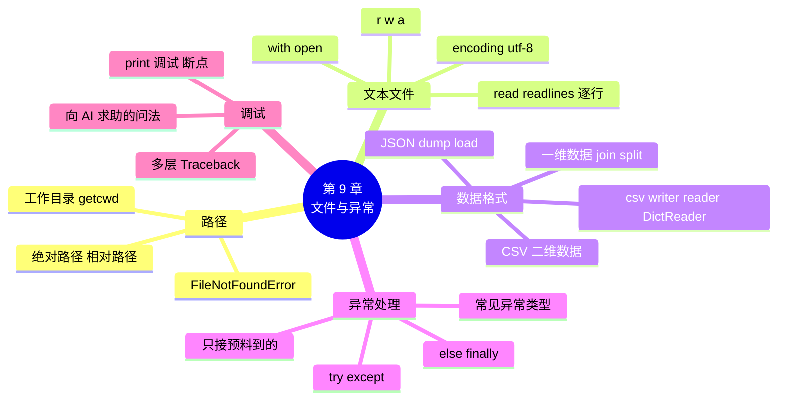

# 第 9 章 文件读写与异常处理

!!! abstract "本章学时"
    理论 4 学时 · 实验 2 学时（本章共 3 个实验，教师可任选）

## 学习目标

学完本章，你应该能够：

1. **说出** 绝对路径、相对路径和工作目录的含义，以及 `r`、`w`、`a` 三种打开方式的区别（记忆）；
2. **解释** 为什么读写中文文件要写 `encoding="utf-8"`，`with` 语句有什么好处（理解）；
3. **使用** csv 模块读写 CSV 文件，用 json 模块保存和读取字典、列表（应用）；
4. **使用** try、except、else、finally 处理常见异常，让程序不因输错而崩溃（应用）；
5. **分析** 多层 Traceback，找到出错的位置和原因，并能向 AI 助手清楚地描述问题（分析）。

!!! info "先修要求"
    学习本章前，你需要：

    - 理解乱码的成因，知道 UTF-8 和 GBK（[3.6 中文与编码初识](../03-strings/index.md#36)）；
    - 会用二维列表、字典的列表表示表格（[6.5 二维列表](../06-lists/index.md#65)、[7.3 字典和列表嵌套](../07-dicts/index.md#73)）；
    - 会定义和调用函数（[第 8 章](../08-functions/index.md)）。

??? abstract "本章概念清单（9 个，点击查看定义和例子）"
    1. [路径](../../appendix/glossary.md#g-路径)
    2. [绝对路径](../../appendix/glossary.md#g-绝对路径)
    3. [相对路径](../../appendix/glossary.md#g-相对路径)
    4. [工作目录](../../appendix/glossary.md#g-工作目录)
    5. [CSV](../../appendix/glossary.md#g-CSV)
    6. [表头](../../appendix/glossary.md#g-表头)
    7. [异常](../../appendix/glossary.md#g-异常)
    8. [断点](../../appendix/glossary.md#g-断点)
    9. [JSON Lines](../../appendix/glossary.md#g-JSON-Lines)

## 情景导入

小周的收银程序用了一个星期，陈姐问：“上周三卖了多少钱？”小周愣住了：程序每天晚上一关，当天的数据就全没了。原来，程序运行时的变量都放在**内存**里，关掉程序或者停电，内存里的东西就消失了。要长期保存，必须写进**文件**，存到硬盘上。

还有一件事让小周头疼。有一次，店员小林在“数量”那一栏输入了“两瓶”，程序“啪”地弹出一大段英文红字，直接退出了，排队的顾客只能干等着他重新打开程序、重新扫码。

这一章解决这两个问题：学会**读写文件**，让数据存得下来、读得回来；学会**异常处理**，让程序遇到意外时不崩溃，而是礼貌地提示“请重新输入”。最后，我们还会系统地学习**调试**，即怎样找到并改正程序里的错误。

## 9.1 文件路径 { #91 }

### 9.1.1 绝对路径与相对路径 { #911 }

要读写一个文件，先要告诉 Python 文件在哪里，也就是文件的[**路径**](../../appendix/glossary.md#g-路径 "文件在电脑中的位置"){ .term }。路径有两种写法：

- [**绝对路径**](../../appendix/glossary.md#g-绝对路径 "从盘符开始的完整路径，在哪里运行都指向同一个文件"){ .term }：从盘符开始的完整地址，例如 `D:\python\labs\data\sales_2025.csv`。不管程序在哪里运行，都能找到；但换一台电脑，盘符和文件夹可能不同，程序就找不到了。
- [**相对路径**](../../appendix/glossary.md#g-相对路径 "从工作目录出发的路径，`..` 表示上一级文件夹"){ .term }：从“当前所在的文件夹”出发的地址，例如 `data\sales_2025.csv` 表示当前文件夹下的 data 文件夹里的文件；`..\data\sales_2025.csv` 中的 `..` 表示“上一级文件夹”。

本书的实验代码都用相对路径。比如 `labs/ch09/lab9_1_csv.py` 读取 `../data/sales_2025.csv`：从 ch09 文件夹往上一级到 labs，再进入 data。这样整个 labs 文件夹拷到哪台电脑上都能直接运行。

!!! tip "Windows 路径的写法"
    Windows 的路径用反斜杠 `\`，而反斜杠在 Python 字符串里是转义字符（3.1.2 节）。写绝对路径时有三种办法：用原始字符串 `r"D:\python\new.txt"`；把反斜杠写两遍 `"D:\\python\\new.txt"`；或者干脆用正斜杠 `"D:/python/new.txt"`，Python 在 Windows 上也认。**推荐用正斜杠**，本书都这样写。

### 9.1.2 工作目录：最常见的坑 { #912 }

相对路径是“相对于谁”呢？相对于程序运行时的[**工作目录**](../../appendix/glossary.md#g-工作目录 "程序运行时的“当前文件夹”，相对路径从这里出发"){ .term }（也叫当前目录）。用下面两行可以查看：

```python
import os
print(os.getcwd())     # get current working directory，获取当前工作目录
```

在 Thonny 中点“运行”时，工作目录会自动切换到这个 .py 文件所在的文件夹，所以相对路径“相对于代码文件”，最符合直觉。但在 VS Code、命令行等其他环境中，工作目录可能是别的文件夹，同一个程序就可能报错：

```text
FileNotFoundError: [Errno 2] No such file or directory: '没有这个文件.txt'
```

遇到 `FileNotFoundError`（文件未找到），按顺序检查三件事：

1. 文件名有没有拼错，扩展名对不对（Windows 默认隐藏扩展名，`data.csv` 可能其实是 `data.csv.txt`）；
2. 用 `print(os.getcwd())` 看看工作目录是哪里，相对路径是否从这里出发；
3. 用 `os.path.exists("路径")` 测试，返回 True 才说明文件确实在那里。

## 9.2 读写文本文件 { #92 }

### 9.2.1 写文件 { #921 }

读写文件分三步：**打开**文件、**读或写**、**关闭**文件。Python 用 `open` 函数打开文件，最推荐的写法是配合 `with` 语句：

```python
with open("notes.txt", "w", encoding="utf-8") as f:
    f.write("今天进货：可乐 2 箱\n")
    f.write("明天记得补面包\n")
```

逐个解释：

- `"notes.txt"` 是文件路径（这里是相对路径，即当前文件夹下的 notes.txt）；
- `"w"` 是打开方式，表示“写”（write）；
- `encoding="utf-8"` 指定用 UTF-8 编码，**读写中文文件一定要写**，否则在中文 Windows 上可能按 GBK 处理，造成乱码（3.6.3 节）；
- `as f` 给打开的文件起个名字 f，后面用 `f.write()` 写入；
- `write` 不会自动换行，要换行得自己加 `\n`。

`with` 的好处是：缩进的代码执行完，**自动关闭文件**，即使中途出错也会关闭。不用 with 的话，要自己写 `f = open(...)` 和 `f.close()`，忘了关闭可能导致内容没有真正写进去。

三种打开方式的区别：

| 方式 | 含义 | 文件不存在时 | 文件已存在时 |
|---|---|---|---|
| `"r"` | 读（默认） | 报 FileNotFoundError | 从头读 |
| `"w"` | 写 | 新建 | **清空原内容**，从头写 |
| `"a"` | 追加（append） | 新建 | 保留原内容，写在最后 |

!!! warning "w 会清空文件"
    用 `"w"` 打开一个已有的文件，里面原来的内容会**立即被清空**，而且无法恢复。想在原文件后面接着写，用 `"a"`。

### 9.2.2 读文件 { #922 }

读文件有三种常用写法：

```python
with open("notes.txt", "a", encoding="utf-8") as f:     # 先追加一行
    f.write("鸡蛋涨价了\n")

with open("notes.txt", encoding="utf-8") as f:
    text = f.read()                 # 写法一：一次读出全部内容，得到一个字符串

with open("notes.txt", encoding="utf-8") as f:
    lines = f.readlines()           # 写法二：读出所有行，得到一个列表
print(lines)

with open("notes.txt", encoding="utf-8") as f:
    for line in f:                  # 写法三：一行一行地读（最常用）
        print(line.strip())
```

```text
['今天进货：可乐 2 箱\n', '明天记得补面包\n', '鸡蛋涨价了\n']
今天进货：可乐 2 箱
明天记得补面包
鸡蛋涨价了
```

从文件读出的每一行，末尾都带着换行符 `\n`，所以一般要先 `strip()` 去掉。写法三一次只读一行，再大的文件也不怕把内存占满，处理大文件时最常用。

还要记住：**从文件读出来的都是字符串**，和 input 一样。数字要用 `int()`、`float()` 转换后才能计算。

## 9.3 一维、二维数据与 CSV 文件 { #93 }

### 9.3.1 一维数据的存储 { #931 }

6.5 节说过，排成一行的数据叫一维数据，比如一周的营业额。存成文件时，最简单的方法是用逗号把它们连成一行，读回来时再按逗号拆开：

<div class="tryit" markdown>

```python
money = [1280, 1150.5, 1320]
with open("week.txt", "w", encoding="utf-8") as f:
    f.write(",".join(str(m) for m in money))
with open("week.txt", encoding="utf-8") as f:
    print([float(x) for x in f.read().split(",")])
```

</div>

```text
[1280.0, 1150.5, 1320.0]
```

写的时候用 `join` 把列表连成字符串（数字要先转成字符串），读的时候用 `split` 拆开，再转回数字。

### 9.3.2 CSV：二维数据的通用格式 { #932 }

把二维数据（表格）按“每行一条记录、每列用逗号隔开”存成纯文本，就是 [**CSV**](../../appendix/glossary.md#g-CSV "每行一条记录、各列用逗号分隔的纯文本表格文件"){ .term } 文件（Comma-Separated Values，逗号分隔值）。本书的配套数据 `sales_2025.csv` 就是 CSV，用记事本打开，前三行是这样的：

```text
日期,时间,单号,商品编号,商品名称,品类,单价,数量,金额,会员号,支付方式
2025-01-01,12:49,D00001,P05,酸奶200g,饮料,6.0,1,6.0,,微信
2025-01-01,12:49,D00001,P07,方便面,零食,4.5,1,4.5,,微信
```

第一行是[**表头**](../../appendix/glossary.md#g-表头 "CSV 或表格的第一行，写着各列的名字"){ .term }（各列的名字），下面每行是一条销售记录。两个逗号挨着（`,,`）表示那一格是空的（这单没有会员号）。CSV 可以用 Excel、WPS 直接打开，也是数据分析、人工智能最常用的数据格式之一。

CSV 看起来简单，用 `split(",")` 好像就能拆开。但如果某一格的内容本身含有逗号（比如商品名“薯片,番茄味”），规则就复杂了。所以读写 CSV 要用 Python 自带的 **csv 模块**，它会自动处理这些情况。

### 9.3.3 用 csv 模块读写 { #933 }

**写 CSV**：用 `csv.writer`，`writerow` 写一行（一个列表），`writerows` 写多行（二维列表）：

```python
import csv

rows = [["时间", "商品名称", "金额"], ["08:05", "鲜牛奶", 9.0], ["08:12", "面包", 5.5]]
with open("today.csv", "w", newline="", encoding="utf-8-sig") as f:
    csv.writer(f).writerows(rows)
```

这里有两个新参数：`newline=""` 防止在 Windows 上每行之间多出一个空行；`encoding="utf-8-sig"` 是带“签名”的 UTF-8，它在文件开头加了一个标记，让 Excel 认出这是 UTF-8 文件，双击打开就不会乱码（3.6.3 节的问题由此解决）。

**读 CSV** 有两种方法：

```python
with open("../data/sales_2025.csv", encoding="utf-8") as f:
    reader = csv.reader(f)
    header = next(reader)           # next 取出第一行（表头）
    first = next(reader)            # 再取一行
print(header[:4], first[:4])
```

```text
['日期', '时间', '单号', '商品编号'] ['2025-01-01', '12:49', 'D00001', 'P05']
```

`csv.reader` 把每一行变成一个列表，用索引取列。更方便的是 `csv.DictReader`，它把每一行变成一个**字典**，键就是表头，可以按列名取值：

```python
with open("../data/sales_2025.csv", encoding="utf-8") as f:
    for r in csv.DictReader(f):
        print(r["商品名称"], r["金额"])
        break                       # 只看第一行
```

```text
酸奶200g 6.0
```

`r["金额"]` 比 `row[8]` 好读得多，也不怕列的顺序变了。注意读出来的仍然都是**字符串**，计算前要 `float()`。实验 9-1 用 DictReader 读完全年 8437 行销售记录，按支付方式汇总金额。

## 9.4 JSON 文件 { #94 }

CSV 适合存放规整的表格。如果数据是“字典里有列表、列表里有字典”这样的嵌套结构（比如一位会员有好几个标签），用 **JSON** 更合适（7.3.2 节）。Python 自带 json 模块：

| 函数 | 作用 |
|---|---|
| `json.dump(数据, f)` | 把字典、列表写入文件 f |
| `json.load(f)` | 从文件 f 读出数据，还原成字典、列表 |
| `json.dumps(数据)` | 把字典、列表转成 JSON 字符串 |
| `json.loads(字符串)` | 把 JSON 字符串还原成字典、列表 |

记忆方法：带 s 的处理字符串（string），不带 s 的处理文件。

<div class="tryit" markdown>

```python
import json
d = {"姓名": "周洋", "积分": 693}
print(json.dumps(d))
print(json.dumps(d, ensure_ascii=False))
s = '{"姓名": "周洋", "积分": 693}'
print(json.loads(s)["积分"] + 7)
```

</div>

```text
{"\u59d3\u540d": "\u5468\u6d0b", "\u79ef\u5206": 693}
{"姓名": "周洋", "积分": 693}
700
```

默认情况下，中文会被转成 `\u59d3` 这样的编码，人看不懂；加上 `ensure_ascii=False`，中文就原样保存了。保存到文件时再加 `indent=2`，每层缩进 2 个空格，文件就整齐好读了，实验 9-3 会看到效果。

和 CSV 不同，JSON 能保留数据类型：存进去是数字 693，读回来还是数字，不用再转换。第 12 章调用大模型接口时，发送的请求和收到的回复都是 JSON，用的就是 `json.loads` 和 `json.dumps`。

## 9.5 异常处理 { #95 }

### 9.5.1 什么是异常 { #951 }

程序运行时发生的错误，叫[**异常**](../../appendix/glossary.md#g-异常 "程序运行时发生的错误，可以用 try-except 处理"){ .term }（Exception）。前面各章已经见过不少，这里汇总一下最常见的：

| 异常 | 意思 | 典型原因 | 例子 |
|---|---|---|---|
| `ValueError` | 值错误 | 类型对，但值不合适 | `int("两瓶")` |
| `TypeError` | 类型错误 | 不同类型不能这样运算 | `"a" + 1` |
| `ZeroDivisionError` | 除以零 | 除数为 0 | `10 / 0` |
| `IndexError` | 索引错误 | 索引超出范围 | `[1, 2][5]` |
| `KeyError` | 键错误 | 字典中没有这个键 | `{"a": 1}["b"]` |
| `NameError` | 名字错误 | 变量名或函数名不存在、拼错 | 使用了没定义的变量 |
| `FileNotFoundError` | 文件未找到 | 路径或文件名不对 | 打开不存在的文件 |
| `UnicodeDecodeError` | 解码错误 | 用错编码读文件 | 用 GBK 读 UTF-8 文件 |
| `ModuleNotFoundError` | 模块未找到 | 没有安装或名字拼错 | `import nomodule` |

注意，`SyntaxError`（语法错误）和 `IndentationError`（缩进错误）不是运行时的异常，而是程序还没运行，Python 检查代码时就发现的错误，必须改代码，不能“处理”。附录 C 有完整的报错速查表。

异常一旦发生而没有处理，程序就会停止，并显示 Traceback。但有些异常是**可以预料的**：用户总会有输错的时候，文件总可能被人删掉。对这类情况，我们可以提前“接住”异常，让程序继续运行。

### 9.5.2 try-except：接住异常 { #952 }

把可能出错的代码放在 `try` 里，把出错后的处理放在 `except` 里：

```python
text = input("数量：")
try:
    qty = int(text)
    print("数量是", qty)
except ValueError:
    print("请输入整数")
print("程序继续运行")
```

输入“两瓶”时：`int("两瓶")` 抛出 ValueError，try 里剩下的代码不再执行，程序跳到 `except ValueError:` 执行提示，然后继续往下运行，而不是崩溃。

`except` 后面写**异常的类型**，表示“只接这一种”。可以写多个 except，分别处理不同的异常；还可以用 `as e` 拿到异常的详细信息：

```python
try:
    int("x")
except ValueError as e:
    print("出错了：", e)
```

```text
出错了： invalid literal for int() with base 10: 'x'
```

### 9.5.3 else 与 finally { #953 }

完整的异常处理结构有四个部分：

```python
text = input("分给几个人：")
try:
    n = int(text)
    each = 12 / n
except ValueError:
    print("请输入整数")
except ZeroDivisionError:
    print("人数不能为 0")
else:
    print("每人分", each, "个")
finally:
    print("分包子结束")
```

| 部分 | 什么时候执行 |
|---|---|
| `try` | 总是先执行；某一行出错，后面的行就跳过 |
| `except 类型` | try 中发生了这种类型的异常时 |
| `else` | try 中**没有**发生任何异常时 |
| `finally` | **无论如何**都执行，常用来关闭文件、打印结束信息 |

输入 3、abc、0 三种情况，程序分别走了哪条路？看下面的动画：

<iframe class="sim-frame" src="../../sims/try-except/main.html" height="620" loading="lazy" title="异常捕获流程"></iframe>
动画：异常捕获流程。切换三组输入，观察出错后跳过了哪些行、哪个 except 接住了异常。[全屏打开](../../sims/try-except/main.html){ target=_blank }
{ .sim-caption }

### 9.5.4 用好异常处理 { #954 }

1. **只接你预料到的异常**。写成 `except Exception:` 或者光秃秃的 `except:` 能接住所有异常，看起来很省事，但会把代码里真正的 bug 也悄悄吞掉，让你找不到错误。
2. **try 里只放可能出错的那几行**，不要把整个程序都包进去。
3. **接住之后要有交代**：给用户一个明白的提示，或者让他重新输入（实验 9-2），不要什么都不做。
4. 能用 if 提前判断的（比如 4.4.3 节先 `isdigit()` 再 `int()`），也可以用 if；但像小数、负数、文件被删除这类情况，if 很难考虑周全，用 try 更简单可靠。

!!! cert "证书考点 · 信息技术水平-人工智能（Python）"
    文件和异常是两个独立的考点：文件部分考 open 的打开方式（r、w、a）、`encoding`、`with`、read/readlines/逐行读、一维与二维数据的存储、CSV 格式；异常部分考 try-except-else-finally 的执行顺序和常见异常类型（详见[证书考点对照](../../certificate.md)）。

## 9.6 调试：找到并改正错误 { #96 }

### 9.6.1 读懂多层 Traceback { #961 }

1.6 节学过读报错的三步法：**先看最后一行**（什么错）、**再看行号**（哪里错）、**最后看代码**（为什么错）。当程序里有函数调用时，Traceback 会有好几层：

```python
def unit_price(total, qty):
    return total / qty

def report(rows):
    for name, total, qty in rows:
        print(name, unit_price(total, qty))

rows = [["可乐", 7.0, 2], ["面包", 5.5, 0]]
report(rows)
```

```text
可乐 3.5
Traceback (most recent call last):
  File "……\receipt.py", line 9, in <module>
    report(rows)
    ~~~~~~^^^^^^
  File "……\receipt.py", line 6, in report
    print(name, unit_price(total, qty))
                ~~~~~~~~~~^^^^^^^^^^^^
  File "……\receipt.py", line 2, in unit_price
    return total / qty
           ~~~~~~^~~~~
ZeroDivisionError: division by zero
```

（路径中的“……”是编者省略的文件夹。）`most recent call last` 的意思是“最近的调用在最后”。从上往下读，就是程序一层层调用的过程：主程序（`<module>`）第 9 行调用了 report，report 第 6 行调用了 unit_price，unit_price 第 2 行做除法时出错。

所以，**最下面一层是出错的地方，往上是“谁调用了它”**。错误的原因常常不在最下面一层：除数 qty 为什么是 0？要往上找，原来是第 8 行的数据里面包的数量写成了 0。

### 9.6.2 print 调试与断点 { #962 }

有些错误不报错，只是结果不对（比如 4.5 节的条件顺序写反）。这时可以用两种方法：

**print 调试**：在可疑的地方临时加几行 print，把变量的值打出来看看，确认程序走到了哪里、变量是不是你以为的值。找到问题后记得删掉这些 print。

```python
for name, total, qty in rows:
    print("调试：", name, total, qty)      # 临时加的
    print(name, unit_price(total, qty))
```

[**断点**](../../appendix/glossary.md#g-断点 "调试时让程序暂停的位置，可以查看当时的变量"){ .term }：在 Thonny 中单击某一行左边的行号，会出现一个红点，这就是断点。然后点“调试”（Ctrl + F5），再点“继续”（F8），程序会一直运行到断点这一行停下来，你可以在“变量”面板中查看所有变量当时的值，再用“步过”（F6）一行一行往下走。和 5.6.2 节的单步执行相比，断点可以直接跳到你关心的地方，不用从第一行开始一步步点。

### 9.6.3 让 AI 帮忙查错的正确问法 { #963 }

第 1 章讲过 AI 编程助手的使用原则。查错时，AI 的帮助很大，但问法决定了答案的质量。对比两种问法：

- 不好的问法：“我的程序报错了，怎么办？”（AI 不知道你的代码、报错和目的，只能泛泛而谈。）
- 好的问法包括四样东西：

```text
【我想做什么】计算每种商品的单价（总金额 ÷ 数量）。
【我的代码】（粘贴完整代码，或出错函数及调用它的部分）
【完整的报错】（粘贴从 Traceback 到最后一行的全部内容）
【我已经试过】我检查了 unit_price 函数，除法写得没错。
请帮我解释错误原因，并告诉我应该检查哪里，先不要直接给出改好的代码。
```

最后一句很重要：先让 AI **解释原因**，自己动手改，这样下次遇到同样的错误你就会了。另外，**不要把真实的顾客姓名、手机号等个人信息粘贴给 AI**，测试用虚构数据代替。

## 9.7 前沿视窗：AI 的“粮食”也存在文件里 { #97 }

人工智能离不开数据，而数据就存放在文件里。本章学的几种格式，在 AI 领域天天都在用：

- **CSV**：表格类的训练数据，比如房价预测、客户流失预测，第 11 章和后续的《机器学习》课程会大量使用；
- **JSON**：调用大模型接口时，请求和回复都是 JSON（第 12 章）；
- [**JSON Lines**](../../appendix/glossary.md#g-JSON-Lines "每行一个 JSON 值的文本格式，扩展名 .jsonl，常用于大模型训练数据"){ .term }：每行一个 JSON 对象的文本文件，扩展名通常是 `.jsonl`<sup class="cite">[[1]](#ref9-1)</sup>。它可以像 9.2.2 节那样一行一行地读，再大的文件也不怕，所以常用来存放大模型的训练和微调数据，每行是一条“问题 + 回答”。

```text
{"问题": "可乐多少钱一瓶？", "回答": "可乐 3.5 元一瓶。"}
{"问题": "几点关门？", "回答": "我们每天 23:00 关门。"}
```

读写 `.jsonl` 文件，用的就是本章的知识：逐行读取，每行 `json.loads`。

另外，数据文件里常常有“脏数据”：空格、缺失值、格式不对的数字。训练模型之前，必须先读文件、检查、清洗，这一步要用到大量的 try-except 和字符串处理，也是数据工程师工作中最花时间的部分。

## 本章实验

!!! abstract "实验总览"
    | 实验 | 类型 | 建议时长 | 内容 |
    |---|---|---|---|
    | 实验 9-1 | ★ 基础 | 30 分钟 | 把当天的销售记录写入 CSV，再读回统计；汇总全年销售表 |
    | 实验 9-2 | ★ 基础 | 30 分钟 | 用 try-except 让收银程序输错也不崩溃 |
    | 实验 9-3 | ☆ 拓展 | 30 分钟 | 把会员通讯录保存为 JSON 文件并读回 |

    代码见配套资源 `labs/ch09/` 目录，数据在 `labs/data/` 目录。

### 实验 9-1 ★ 把每日销售记录存入 CSV 并读回统计 { #lab9-1 }

**实验目的**

1. 会用 `csv.writer` 把二维列表写入 CSV 文件；
2. 会用 `csv.reader`、`csv.DictReader` 读取 CSV 文件，并把字符串转成数字计算；
3. 会用相对路径读取其他文件夹中的数据文件。

**实验环境**：本机 CPU。

**实验数据**：程序中当天的 4 笔销售记录（虚构）；配套数据 `labs/data/sales_2025.csv`（虚构的全年销售明细，8437 行）。

**实验步骤与代码**

打开 `labs/ch09/lab9_1_csv.py`：

```python
# 实验 9-1 把每日销售记录存入 CSV，再读回来统计
import csv

# 第一部分：把今天的几笔销售记录（二维列表）写入 today.csv
header = ["时间", "商品名称", "单价", "数量", "金额"]
rows = [
    ["08:05", "鲜牛奶", 4.5, 2, 9.0],
    ["08:12", "面包", 5.5, 1, 5.5],
    ["12:30", "方便面", 4.5, 3, 13.5],
    ["18:46", "可乐", 3.5, 6, 21.0],
]
# newline="" 防止 Windows 上多出空行；utf-8-sig 让 Excel 打开不乱码
with open("today.csv", "w", newline="", encoding="utf-8-sig") as f:
    writer = csv.writer(f)
    writer.writerow(header)       # 写一行
    writer.writerows(rows)        # 写多行
print("已写入 today.csv，共", len(rows), "笔")

# 第二部分：读回 today.csv，算出今天的营业额
total = 0
with open("today.csv", encoding="utf-8-sig") as f:
    reader = csv.reader(f)
    next(reader)                  # 跳过表头
    for row in reader:            # 每一行是一个列表，里面全是字符串
        total += float(row[4])
print(f"今天营业额 {total:.2f} 元")

# 第三部分：读全年销售表（8437 行），按支付方式汇总金额
pay_sum = {}
with open("../data/sales_2025.csv", encoding="utf-8") as f:
    for r in csv.DictReader(f):   # 每一行是一个字典，键是表头
        way = r["支付方式"]
        pay_sum[way] = pay_sum.get(way, 0) + float(r["金额"])
for way, money in sorted(pay_sum.items(), key=lambda x: x[1], reverse=True):
    print(f"{way:<4}{money:>12,.2f} 元")
```

`{money:>12,.2f}` 中的逗号表示加千分位分隔符。

**运行结果**

```text
已写入 today.csv，共 4 笔
今天营业额 49.00 元
微信     63,313.30 元
支付宝    43,461.90 元
现金     11,459.60 元
```

运行后，ch09 文件夹里多了一个 today.csv。用 Excel 或 WPS 双击打开，中文显示正常。

**实验记录表**

| 问题 | 代码或操作 | 结果 |
|---|---|---|
| 用记事本打开 today.csv，第一行是什么？ | | |
| 把 `utf-8-sig` 改成 `utf-8`，用 Excel 打开是否乱码？ | | |
| 全年销售表中“饮料”品类的总金额 | | |
| 全年有多少行是会员消费（会员号不为空）？ | | |

**常见问题排查**

| 现象 | 原因 | 解决办法 |
|---|---|---|
| `FileNotFoundError` | 工作目录不是 ch09，相对路径找不到 | 在 Thonny 中打开该文件后运行；或用 `os.getcwd()` 检查 |
| `TypeError: unsupported operand type(s) for +=: 'int' and 'str'` | 读出的金额是字符串 | `float(row[4])` |
| Excel 中每行之间多了空行 | 写文件时漏了 `newline=""` | 加上该参数 |
| 用 DictReader 读 today.csv 报 `KeyError: '时间'` | 文件开头有 utf-8-sig 的签名，用 utf-8 读时第一列的名字变成了 `'\ufeff时间'` | 读 utf-8-sig 写的文件也用 `encoding="utf-8-sig"` |

**思考与练习**

1. 用 `"a"` 方式再写入两笔记录，运行两次后 today.csv 里有几笔？表头重复了吗？怎样避免？
2. 统计全年每个月的营业额（提示：`r["日期"][:7]` 得到“2025-01”这样的年月）。

**实验报告要求**

提交运行截图、实验记录表和思考题 2 的代码与结果。

### 实验 9-2 ★ 让收银程序不怕输错 { #lab9-2 }

**实验目的**

1. 会用 try-except 接住 ValueError，配合循环实现“输错就重新输”；
2. 会用 except、finally 处理除以零等情况；
3. 体会把“安全输入”写成函数的好处。

**实验环境**：本机 CPU。

**实验数据**：运行时输入。编者故意输入了“两瓶”和负数。

**实验步骤与代码**

打开 `labs/ch09/lab9_2_safe_cashier.py`：

```python
# 实验 9-2 让收银程序不怕输错


def input_number(prompt, kind=float):
    """反复输入，直到输入一个大于 0 的数为止，返回这个数。kind 可以是 float 或 int。"""
    while True:
        text = input(prompt)
        try:
            value = kind(text)            # 转换失败会抛出 ValueError
        except ValueError:
            print(f"  “{text}”不是有效的数字，请重新输入")
            continue
        if value <= 0:
            print("  必须大于 0，请重新输入")
            continue
        return value


total = 0
items = 0
while True:
    name = input("商品名（直接回车结账）：").strip()
    if name == "":
        break
    price = input_number("单价：")
    qty = input_number("数量：", int)
    total += price * qty
    items += 1

try:
    avg = total / items                   # 一件商品都没有时，items 是 0
    print(f"共 {items} 种商品，合计 {total:.2f} 元，平均每种 {avg:.2f} 元")
except ZeroDivisionError:
    print("购物车是空的，没有需要结账的商品")
finally:
    print("谢谢光临！")                   # 不管有没有出错，都会执行
```

`kind=float` 这个参数很巧妙：函数也可以作为参数传进去（8.6.1 节的 key 也是这样），`kind(text)` 就是 `float(text)` 或 `int(text)`。

**运行结果**（运行两次，第二次直接回车结账）

```text
商品名（直接回车结账）：可乐
单价：3.5
数量：两瓶
  “两瓶”不是有效的数字，请重新输入
数量：2
商品名（直接回车结账）：鸡蛋
单价：-12.5
  必须大于 0，请重新输入
单价：12.5
数量：1
商品名（直接回车结账）：
共 2 种商品，合计 19.50 元，平均每种 9.75 元
谢谢光临！
```

```text
商品名（直接回车结账）：
购物车是空的，没有需要结账的商品
谢谢光临！
```

**实验记录表**

| 在“数量”处输入 | 程序的反应 | 为什么 |
|---|---|---|
| 两瓶 | 提示重新输入 | int("两瓶") 抛出 ValueError |
| 2.5 | | |
| 0 | | |
| （空，直接回车） | | |

**常见问题排查**

| 现象 | 原因 | 解决办法 |
|---|---|---|
| 输错后程序直接结束 | except 后面没有 continue，也没有循环 | 放在 while True 里，出错 continue |
| 输入正确也一直让重新输入 | 忘了 return | 合格后 `return value` |
| 输错时仍弹出红字 | except 写的类型不对，比如写成了 TypeError | 先看报错的最后一行是什么异常，再写对应的 except |

**思考与练习**

1. 不用 try，只用 if 和字符串方法，能否判断“2.5”“-3”“1e3”都是合法的数字？体会 try 的方便。
2. 结账时把这一单的商品名、合计追加写入 `orders.txt`（用 `"a"` 方式）。

**实验报告要求**

提交运行截图、实验记录表和思考题 2 的代码。

### 实验 9-3 ☆ 会员通讯录存成 JSON { #lab9-3 }

**实验目的**

1. 会把“字典的列表”用 `json.dump` 保存为 JSON 文件；
2. 会用 `json.load` 读回数据，理解 JSON 能保留数字、列表等类型。

**实验环境**：本机 CPU。

**实验数据**：配套数据 `labs/data/members.csv` 中的前 3 位会员，以及程序中新增的 1 位会员（均为虚构）。

**实验步骤与代码**

打开 `labs/ch09/lab9_3_json.py`：

```python
# 实验 9-3 会员通讯录存成 JSON
import csv
import json

# 1. 从 members.csv 读出前 3 位会员，变成“字典的列表”
members = []
with open("../data/members.csv", encoding="utf-8") as f:
    for r in csv.DictReader(f):
        members.append({"会员号": r["会员号"], "姓名": r["姓名"],
                        "手机号": r["手机号"], "积分": int(r["积分"])})
        if len(members) == 3:
            break

# 2. 新增一位会员（虚构），并给他加一个“标签”列表
members.append({"会员号": "M061", "姓名": "林小满", "手机号": "13900002222",
                "积分": 0, "标签": ["新会员", "爱喝咖啡"]})

# 3. 保存为 JSON 文件：ensure_ascii=False 让中文原样保存，indent=2 让文件好读
with open("members.json", "w", encoding="utf-8") as f:
    json.dump(members, f, ensure_ascii=False, indent=2)
print("已保存", len(members), "位会员到 members.json")

# 4. 重新读回来，验证数据完整
with open("members.json", encoding="utf-8") as f:
    data = json.load(f)
print("读回的类型：", type(data), "，第一位会员的类型：", type(data[0]))
for m in data:
    print(m["会员号"], m["姓名"], m["积分"], m.get("标签", []))
```

**运行结果**

```text
已保存 4 位会员到 members.json
读回的类型： <class 'list'> ，第一位会员的类型： <class 'dict'>
M001 周洋 693 []
M002 黄敏 577 []
M003 张平 914 []
M061 林小满 0 ['新会员', '爱喝咖啡']
```

用记事本打开 members.json，开头是这样的：

```json
[
  {
    "会员号": "M001",
    "姓名": "周洋",
    "手机号": "19940265423",
    "积分": 693
  },
```

**实验记录表**

| 问题 | 结果 |
|---|---|
| 去掉 `ensure_ascii=False`，文件里的中文变成了什么样子？读回来还正常吗？ | |
| 去掉 `indent=2`，文件变成了什么样子？ | |
| members.json 中“积分”的值有没有引号？members.csv 中呢？说明了什么？ | |

**常见问题排查**

| 现象 | 原因 | 解决办法 |
|---|---|---|
| `json.decoder.JSONDecodeError` | JSON 文件被手工改坏了，比如多了逗号、用了单引号 | JSON 只能用双引号，最后一项后面不能有逗号 |
| 文件里的中文变成 `\u5468` | 没写 `ensure_ascii=False` | 加上该参数 |

**思考与练习**

1. 写一个函数 `add_points(member_no, points)`：读 members.json，给指定会员加积分，再存回去。
2. 把 4 位会员改存成 JSON Lines 格式（每行一个会员，用 `json.dumps`），再逐行读回。

**实验报告要求**

提交实验记录表和思考题 1 的代码。

## 本章小结

- 程序运行时的数据在内存里，关掉就没了，要长期保存必须写入文件。**绝对路径**从盘符开始，**相对路径**从**工作目录**出发；Thonny 运行时工作目录就是代码所在文件夹。找不到文件时检查文件名、工作目录，用 `os.path.exists` 测试。Windows 路径推荐写成正斜杠。
- `with open(路径, 方式, encoding="utf-8") as f:` 打开文件，结束后自动关闭。`r` 读、`w` 写（会清空）、`a` 追加。`read()` 读全部，`readlines()` 读成列表，`for line in f` 逐行读；读出的都是字符串，行末有 `\n`。
- 一维数据可用逗号连成一行保存；二维数据存成 **CSV**。用 csv 模块的 `writer`、`reader`、`DictReader` 读写，写文件加 `newline=""`，给 Excel 用的文件用 `utf-8-sig`。
- 嵌套的字典、列表用 **JSON** 保存：`dump`/`load` 处理文件，`dumps`/`loads` 处理字符串，`ensure_ascii=False` 保留中文，`indent` 让文件整齐。
- **异常**是运行时的错误。`try` 放可能出错的代码，`except 类型` 接住指定的异常，`else` 在没出错时执行，`finally` 总会执行。只接预料到的异常，接住后要给出提示。
- 调试：多层 **Traceback** 最下面是出错的地方，往上是调用者；用 print 调试和 Thonny **断点**查看变量。向 AI 求助要说清目的、代码、完整报错和已尝试的方法，先求解释再动手改，不贴真实个人信息。
- AI 的训练数据大多存在 CSV、JSON、JSON Lines 等文件中。



**下一章预告**

本章我们用了 `import csv`、`import json`、`import os`，这些都是 Python 自带的“工具箱”，叫模块。除了自带的，全世界的程序员还写了几十万个第三方库，处理 Excel、画图、做 AI，一行 `pip install` 就能装上。下一章学习**模块和第三方库**，还会学习**类和对象**，为以后看懂 AI 框架的代码做准备。

## 参考文献

正文中的上标编号（如<sup class="cite">[[1]](#ref9-1)</sup>）对应下面的文献。带链接的可以直接打开；书籍可在图书馆或电子书平台查阅。

<div class="refs" markdown>

**教材与专著**

- <span id="ref9-2"></span>[2] 嵩天, 礼欣, 黄天羽. Python 语言程序设计基础[M]. 2 版. 北京: 高等教育出版社, 2017.
    <span class="ref-note">第 7 章“文件和数据格式化”讲文件的打开和读写、一维和二维数据的格式化与处理，第 4 章讲异常处理，对应 9.2～9.5 节。</span>

**经典论文与标准**

- <span id="ref9-3"></span>[3] SHAFRANOVICH Y. Common format and MIME type for comma-separated values (CSV) files: RFC 4180[S/OL]. Internet Engineering Task Force, 2005[2026-11-01]. https://www.rfc-editor.org/rfc/rfc4180.
    <span class="ref-note">CSV 格式的规范，规定了逗号分隔、表头行、含逗号的字段要用双引号括起来等规则，对应 9.3.2 节。</span>

**在线资源与数据**

- <span id="ref9-1"></span>[1] JSON Lines[EB/OL]. [2026-11-01]. https://jsonlines.org/.
    <span class="ref-note">JSON Lines 格式的说明：UTF-8 编码、每行一个合法的 JSON 值、扩展名 .jsonl，对应 9.7 节。</span>
- <span id="ref9-4"></span>[4] Python Software Foundation. Python 教程：7.2 读写文件、8 错误和异常[EB/OL]. [2026-11-01]. https://docs.python.org/zh-cn/3.14/tutorial/inputoutput.html#reading-and-writing-files.
    <span class="ref-note">官方教程中 open、with、json 的用法；同一教程第 8 章讲 try、except、else、finally，对应 9.2、9.4、9.5 节。</span>
- <span id="ref9-5"></span>[5] Python Software Foundation. csv：CSV 文件读写[EB/OL]. [2026-11-01]. https://docs.python.org/zh-cn/3.14/library/csv.html.
    <span class="ref-note">csv 模块的官方说明，包括 newline="" 的原因，对应 9.3.3 节。</span>

</div>

## 课后练习

选择题和判断题可以直接点击选项作答，系统会马上告诉你对错，并展开答案与解析；多选题选好后点“提交答案”。简答和实操题请先自己作答，再点开“答案与解析”核对。每道题的解析下方都有“回看”链接，做错了可以直接跳回正文复习。

**一、单项选择题**

<div class="quiz" data-answer="C" markdown>

**1.** 要在文件原有内容的末尾继续写入，打开方式应该是（　　）。

- A. `"r"`
- B. `"w"`
- C. `"a"`
- D. `"x"`

</div>

??? tip "答案与解析"
    **答案：C**

    a 是追加；w 会清空原内容。

    考查：打开方式 · 认知层次：记忆 · [回看 9.2.1](#921)
    { .quiz-meta }

<div class="quiz" data-answer="B" markdown>

**2.** 关于 `with open(...) as f:`，下列说法正确的是（　　）。

- A. 必须在最后写 `f.close()`
- B. 缩进的代码执行完后会自动关闭文件
- C. 只能用来读文件，不能写文件
- D. 文件不存在时会自动创建，不管是什么打开方式

</div>

??? tip "答案与解析"
    **答案：B**

    with 结束时自动关闭文件。用 r 方式打开不存在的文件会报 FileNotFoundError。

    考查：with 语句 · 认知层次：理解 · [回看 9.2.1](#921)
    { .quiz-meta }

<div class="quiz" data-answer="D" markdown>

**3.** 文件 notes.txt 有 3 行，执行 `lines = f.readlines()` 后，lines 的类型是（　　）。

- A. 字符串
- B. 整数
- C. 字典
- D. 列表

</div>

??? tip "答案与解析"
    **答案：D**

    readlines 返回一个列表，每个元素是一行（带 \n 的字符串）。

    考查：读文件 · 认知层次：记忆 · [回看 9.2.2](#922)
    { .quiz-meta }

<div class="quiz" data-answer="A" markdown>

**4.** 执行 `int("两瓶")` 会产生的异常是（　　）。

- A. `ValueError`
- B. `TypeError`
- C. `NameError`
- D. `KeyError`

</div>

??? tip "答案与解析"
    **答案：A**

    参数是字符串类型没错，但值“两瓶”不能转成整数，是值错误。

    考查：常见异常 · 认知层次：理解 · [回看 9.5.1](#951)
    { .quiz-meta }

<div class="quiz" data-answer="C" markdown>

**5.** 在 try-except-else-finally 结构中，只有 try 中没有发生异常时才执行的是（　　）。

- A. `try`
- B. `except`
- C. `else`
- D. `finally`

</div>

??? tip "答案与解析"
    **答案：C**

    finally 无论如何都执行；else 只在没有异常时执行。

    考查：else 与 finally · 认知层次：记忆 · [回看 9.5.3](#953)
    { .quiz-meta }

<div class="quiz" data-answer="B" markdown>

**6.** 要让 `json.dump` 保存的文件中中文原样显示，应该加的参数是（　　）。

- A. `indent=2`
- B. `ensure_ascii=False`
- C. `encoding="gbk"`
- D. `newline=""`

</div>

??? tip "答案与解析"
    **答案：B**

    默认会把中文转成 \u 编码；indent 只影响缩进。

    考查：json · 认知层次：记忆 · [回看 9.4](#94)
    { .quiz-meta }

<div class="quiz" data-answer="D" markdown>

**7.** 用 `csv.DictReader` 读取 CSV 文件，每一行得到的是（　　）。

- A. 一个字符串
- B. 一个列表
- C. 一个元组
- D. 一个字典，键是表头中的列名

</div>

??? tip "答案与解析"
    **答案：D**

    csv.reader 每行得到列表，DictReader 每行得到字典。

    考查：csv 模块 · 认知层次：理解 · [回看 9.3.3](#933)
    { .quiz-meta }

<div class="quiz" data-answer="A" markdown>

**8.** 多层 Traceback 中，真正发生错误的那一行代码，显示在（　　）。

- A. 最下面一层（报错类型的上方）
- B. 最上面一层
- C. 中间一层
- D. Traceback 不显示出错的代码

</div>

??? tip "答案与解析"
    **答案：A**

    most recent call last：最近的调用在最后，最下面一层是出错的地方，往上是调用者。

    考查：读 Traceback · 认知层次：理解 · [回看 9.6.1](#961)
    { .quiz-meta }

**二、多项选择题**

<div class="quiz quiz-multi" data-answer="ABD" markdown>

**1.** 程序报 `FileNotFoundError`，可能的原因有（　　）。

- A. 文件名拼错了
- B. 工作目录不是你以为的文件夹，相对路径找不到
- C. 文件编码是 GBK
- D. 文件实际的扩展名和代码里写的不一样

</div>

??? tip "答案与解析"
    **答案：ABD**

    编码不对会报 UnicodeDecodeError，而不是找不到文件。

    考查：路径问题 · 认知层次：分析 · [回看 9.1.2](#912)
    { .quiz-meta }

<div class="quiz quiz-multi" data-answer="BC" markdown>

**2.** 下列关于 CSV 文件的说法，正确的有（　　）。

- A. CSV 文件只能用 Excel 打开
- B. CSV 是用逗号分隔各列的纯文本文件
- C. 用 csv 模块读出的数据都是字符串，计算前要转换
- D. 写 CSV 文件时不需要指定编码

</div>

??? tip "答案与解析"
    **答案：BC**

    CSV 是纯文本，记事本也能打开；中文 CSV 应指定编码，给 Excel 用的建议 utf-8-sig。

    考查：CSV · 认知层次：理解 · [回看 9.3.2](#932)
    { .quiz-meta }

<div class="quiz quiz-multi" data-answer="ACD" markdown>

**3.** 关于异常处理，下列做法合理的有（　　）。

- A. 只在 except 后写预料到的异常类型
- B. 用 `except:` 把整个程序包起来，就不会出任何错了
- C. 接住异常后给用户一个明白的提示
- D. try 里只放可能出错的那几行

</div>

??? tip "答案与解析"
    **答案：ACD**

    B 会把真正的 bug 也吞掉，让人找不到错误。

    考查：用好异常处理 · 认知层次：分析 · [回看 9.5.4](#954)
    { .quiz-meta }

**三、判断题**

<div class="quiz quiz-judge" data-answer="√" markdown>

**1.** 用 `"w"` 方式打开一个已经存在的文件，原来的内容会被清空。（　　）

- √
- ×

</div>

??? tip "答案与解析"
    **答案：√**

    要保留原内容，用 "a" 追加。

    考查：打开方式 · 认知层次：记忆 · [回看 9.2.1](#921)
    { .quiz-meta }

<div class="quiz quiz-judge" data-answer="×" markdown>

**2.** 从文本文件中读出的 `"25"`，可以直接和数字 5 相加得到 30。（　　）

- √
- ×

</div>

??? tip "答案与解析"
    **答案：×**

    读出的是字符串，`"25" + 5` 报 TypeError，要先 `int("25")`。

    考查：读出的是字符串 · 认知层次：理解 · [回看 9.2.2](#922)
    { .quiz-meta }

<div class="quiz quiz-judge" data-answer="√" markdown>

**3.** finally 中的代码不管 try 中是否发生异常都会执行。（　　）

- √
- ×

</div>

??? tip "答案与解析"
    **答案：√**

    常用于关闭文件、打印结束信息等收尾工作。

    考查：finally · 认知层次：记忆 · [回看 9.5.3](#953)
    { .quiz-meta }

<div class="quiz quiz-judge" data-answer="×" markdown>

**4.** `SyntaxError` 可以用 try-except 接住，让程序继续运行。（　　）

- √
- ×

</div>

??? tip "答案与解析"
    **答案：×**

    语法错误在程序运行前就被发现，程序根本不会开始运行，必须改代码。

    考查：异常类型 · 认知层次：理解 · [回看 9.5.1](#951)
    { .quiz-meta }

<div class="quiz quiz-judge" data-answer="√" markdown>

**5.** JSON 文件能保留数据的类型，存入的整数读回来仍然是整数。（　　）

- √
- ×

</div>

??? tip "答案与解析"
    **答案：√**

    这是 JSON 相比 CSV 的优点之一。

    考查：JSON · 认知层次：理解 · [回看 9.4](#94)
    { .quiz-meta }

**四、简答题**

**1.** 读程序写结果。分别写出输入 `4`、`x`、`0` 时的输出。

```python
text = input()
try:
    n = int(text)
    r = 8 / n
except ValueError:
    print("A")
except ZeroDivisionError:
    print("B")
else:
    print("C", r)
finally:
    print("D")
```

??? tip "答案与解析"
    **参考答案**

    输入 4：输出 `C 2.0` 和 `D`。输入 x：输出 `A` 和 `D`。输入 0：输出 `B` 和 `D`。

    没有异常时执行 else；有异常时执行匹配的 except；finally 三种情况都执行。

    考查：try-except-else-finally · 认知层次：应用 · [回看 9.5.3](#953)
    { .quiz-meta }

**2.** 找错并改正。下面的程序想把三个商品名追加到 goods.txt 中，每个占一行，运行两次后文件里应该有 6 行，但实际只有 1 行，而且三个名字挤在一起。请找出两处错误。

```python
names = ["可乐", "面包", "牛奶"]
for n in names:
    with open("goods.txt", "w", encoding="utf-8") as f:
        f.write(n)
```

??? tip "答案与解析"
    **参考答案**

    第一处：用了 `"w"` 方式，每次打开都会清空文件，所以最后只剩最后一次写入的内容。要追加应改为 `"a"`。

    第二处：write 不会自动换行，应写 `f.write(n + "\n")`。

    另外，在循环里反复打开文件效率不高，更好的写法是把 with 放在循环外：

    ```python
    names = ["可乐", "面包", "牛奶"]
    with open("goods.txt", "a", encoding="utf-8") as f:
        for n in names:
            f.write(n + "\n")
    ```

    考查：打开方式、write · 认知层次：分析 · [回看 9.2.1](#921)
    { .quiz-meta }

**3.** 程序报错时，你想请 AI 助手帮忙。请写出一个好的提问应该包含哪几部分内容，并说明为什么要请 AI“先解释原因，不要直接给出改好的代码”。

??? tip "答案与解析"
    **参考答案**

    应包含四部分：我想做什么（目的）、我的代码、完整的报错信息（从 Traceback 到最后一行）、我已经试过什么。

    先请 AI 解释原因，是为了让自己真正理解错误、自己动手改，下次遇到同样的问题就会处理；直接复制改好的代码，学不到东西，闭卷考试时也帮不上忙。此外，提问时不要粘贴真实的个人信息。

    考查：向 AI 求助 · 认知层次：理解 · [回看 9.6.3](#963)
    { .quiz-meta }

**五、实操题**

**1.** 读取配套数据 `labs/data/reviews.txt`（每行一条评价），统计一共有多少条评价、包含“排队”二字的有多少条。

??? tip "答案与解析"
    **参考答案**（程序放在 labs/ch09 文件夹中运行）

    ```python
    total = 0
    queue = 0
    with open("../data/reviews.txt", encoding="utf-8") as f:
        for line in f:
            line = line.strip()
            if line == "":
                continue
            total += 1
            if "排队" in line:
                queue += 1
    print("共", total, "条评价，提到排队的", queue, "条")
    ```

    编者运行结果：共 80 条评价，提到排队的 8 条。

    考查：逐行读文件 · 认知层次：应用 · [回看 9.2.2](#922)
    { .quiz-meta }

**2.** 写一个函数 `safe_divide(a, b)`：返回 a ÷ b 的结果；如果 b 为 0，打印“除数不能为 0”并返回 None。用 `safe_divide(10, 4)` 和 `safe_divide(1, 0)` 测试。

??? tip "答案与解析"
    **参考答案**

    ```python
    def safe_divide(a, b):
        try:
            return a / b
        except ZeroDivisionError:
            print("除数不能为 0")
            return None

    print(safe_divide(10, 4))
    print(safe_divide(1, 0))
    ```

    编者运行结果：第一行输出 `2.5`；第二次先输出“除数不能为 0”，再输出 `None`。

    考查：在函数中处理异常 · 认知层次：应用 · [回看 9.5.2](#952)
    { .quiz-meta }
