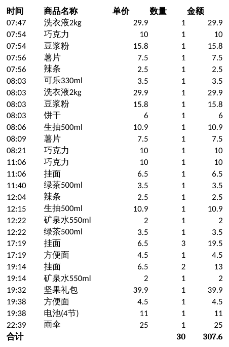
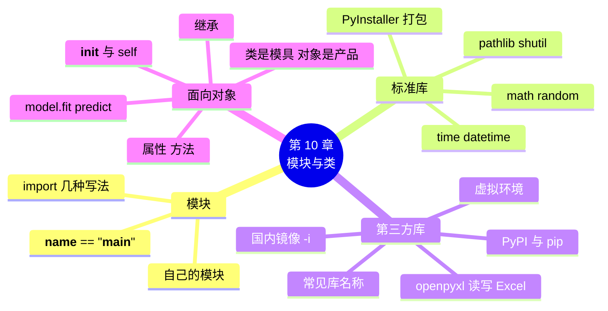

# 第 10 章 模块、第三方库与面向对象入门

!!! abstract "本章学时"
    理论 4 学时 · 实验 2 学时（本章共 3 个实验，教师可任选）

## 学习目标

学完本章，你应该能够：

1. **说出** 模块、标准库、第三方库的区别，以及常见第三方库的名称和用途（记忆）；
2. **解释** 类与对象的关系，以及 `__init__`、`self`、属性、方法的含义（理解）；
3. **使用** import 导入模块，使用 math、random、datetime、pathlib 等标准库完成小任务（应用）；
4. **使用** pip 安装第三方库，用 openpyxl 生成 Excel 文件，用 PyInstaller 打包程序（应用）；
5. **读懂** AI 框架中“创建对象、调用方法”的代码，例如 `model.fit(X, y)`（理解）。

!!! info "先修要求"
    学习本章前，你需要：

    - 会定义函数，会用 `from 文件名 import 函数名` 导入自己的函数（[实验 8-2](../08-functions/index.md#lab8-2)）；
    - 会读写 CSV 文件（[9.3 一维、二维数据与 CSV 文件](../09-files/index.md#93)）；
    - 会用字典、列表组织数据（[第 6 章](../06-lists/index.md)、[第 7 章](../07-dicts/index.md)）。

??? abstract "本章概念清单（11 个，点击查看定义和例子）"
    1. [模块](../../appendix/glossary.md#g-模块)
    2. [标准库](../../appendix/glossary.md#g-标准库)
    3. [第三方库](../../appendix/glossary.md#g-第三方库)
    4. [pip](../../appendix/glossary.md#g-pip)
    5. [虚拟环境](../../appendix/glossary.md#g-虚拟环境)
    6. [PyInstaller](../../appendix/glossary.md#g-PyInstaller)
    7. [类](../../appendix/glossary.md#g-类)
    8. [对象](../../appendix/glossary.md#g-对象)
    9. [属性](../../appendix/glossary.md#g-属性)
    10. [初始化方法](../../appendix/glossary.md#g-初始化方法)
    11. [继承](../../appendix/glossary.md#g-继承)

## 情景导入

陈姐的电脑桌面乱成一团：进货单、价目表、海报图片、会员表格……几百个文件堆在一起。她又提出新要求：“每天的销售日报能不能直接生成 Excel？我好发给会计。”

小周有点发愁：整理文件、生成 Excel，这些功能要从头写，得写多少代码？

其实不用。Python 最大的优势之一，就是有大量**别人已经写好的工具**：整理文件夹，Python 自带的 pathlib、shutil 模块就能做；生成 Excel，有一个叫 openpyxl 的第三方库专门做这件事；甚至做人工智能，也有现成的库，几行代码就能训练一个模型。

这一章学习怎样找到、安装和使用这些工具。最后，我们还会学习**类和对象**：你会发现，从 `"abc".upper()` 到 `model.fit()`，这些“点一下就能用”的写法背后，都是类在起作用。

## 10.1 模块与 import { #101 }

### 10.1.1 import 的几种写法 { #1011 }

一个 .py 文件就是一个[**模块**](../../appendix/glossary.md#g-模块 "一个 .py 文件就是一个模块，里面的函数等可以被其他程序导入使用"){ .term }（Module）。模块里写好了函数、变量等，别的程序用 `import`（导入）就能使用。前几章已经用过 `import random`、`import csv`、`import json`。导入有几种写法：

| 写法 | 使用时 | 说明 |
|---|---|---|
| `import math` | `math.sqrt(16)` | 最常用，用时写“模块名.函数名”，一看就知道函数来自哪里 |
| `import math as m` | `m.sqrt(16)` | 给模块起个短名字（别名），如 `import pandas as pd` |
| `from math import sqrt, pi` | `sqrt(16)` | 只导入需要的几个，用时不用写模块名 |
| `from math import *` | `sqrt(16)` | 导入全部，**不推荐**，容易和自己的变量名重名 |

`import` 一般写在程序的最开头。

### 10.1.2 把自己的函数做成模块 { #1012 }

实验 8-2 已经做过：把函数写在 `shop_tools.py` 里，另一个程序用 `from shop_tools import mask_phone` 导入。只要两个文件在同一个文件夹，自己写的 .py 文件就是一个模块。

自己的模块里常常还想写几行自测代码，但又不希望别人导入时也执行这些代码。这时用一个固定的写法：

```python
# price_tools.py
def discount(price, rate=0.9):
    return round(price * rate, 2)

print("__name__ 的值是：", __name__)
if __name__ == "__main__":
    print("直接运行，做个自测：", discount(10))
```

再写一个 `main.py` 导入它：

```python
import price_tools
print(price_tools.discount(3.5))
```

分别运行两个文件：

```text
__name__ 的值是： __main__
直接运行，做个自测： 9.0
```

```text
__name__ 的值是： price_tools
3.15
```

`__name__` 是 Python 自动设置的变量：**直接运行**这个文件时，它的值是 `"__main__"`；**被别人导入**时，它的值是模块名。所以 `if __name__ == "__main__":` 下面的代码，只在直接运行时执行，导入时不执行。看别人的代码时经常会遇到这一行，知道它的意思即可。

!!! warning "不要用库的名字给自己的文件起名"
    如果把自己的文件命名为 `random.py`、`csv.py`、`json.py`，`import random` 时 Python 会先找到你自己的文件，而不是标准库，导致各种奇怪的错误。Python 3.14 的报错已经会直接提醒你：

    ```text
    AttributeError: module 'random' has no attribute 'randint' (consider renaming '……\random.py' since it has the same name as the standard library module named 'random' and prevents importing that standard library module)
    ```

    括号里的意思是：“考虑给 random.py 改个名字，因为它和标准库模块 random 同名，导致无法导入标准库。”

## 10.2 常用标准库 { #102 }

Python 安装时自带了几百个模块，叫[**标准库**](../../appendix/glossary.md#g-标准库 "Python 安装时自带、不用另外安装的模块集合"){ .term }，不用另外安装，import 就能用。本节介绍几个最常用的。

### 10.2.1 math 与 random { #1021 }

`math` 提供数学函数：

<div class="tryit" markdown>

```python
import math
print(math.sqrt(16), math.ceil(2.1), math.floor(2.9), round(math.pi, 4))
```

</div>

```text
4.0 3 2 3.1416
```

`sqrt` 开平方，`ceil` 向上取整（2.1 → 3），`floor` 向下取整（2.9 → 2），`pi` 是圆周率。向上取整在生活里很常用：比如 25 瓶水，每箱 12 瓶，要 `math.ceil(25 / 12)` = 3 箱。

`random` 在第 5 章已经用过。补充一个 `random.seed(数字)`：设置“随机种子”后，每次运行得到的随机数序列都一样，方便调试和复现实验结果。本书的配套数据就是用 `seed(42)` 生成的。

### 10.2.2 time 与 datetime { #1022 }

`time` 模块最常用的两个函数：`time.time()` 返回当前时间（从 1970 年 1 月 1 日起的秒数），两次相减可以算出程序运行了多久；`time.sleep(2)` 让程序暂停 2 秒。

`datetime` 模块处理日期和时间，在小店里最常用：

<div class="tryit" markdown>

```python
from datetime import date, datetime, timedelta
d = date(2025, 3, 8)
print(d, d.weekday(), d + timedelta(days=30))
print((date(2025, 12, 31) - d).days)
print(datetime.strptime("2025-03-08 12:49", "%Y-%m-%d %H:%M"))
print(d.strftime("%Y年%m月%d日"))
```

</div>

```text
2025-03-08 5 2025-04-07
298
2025-03-08 12:49:00
2025年03月08日
```

逐个解释：`date(2025, 3, 8)` 创建一个日期；`weekday()` 返回星期几（0 是星期一，5 是星期六）；`timedelta(days=30)` 表示“30 天”这段时间，日期加上它就是 30 天后；两个日期相减得到相隔的天数；`strptime` 把字符串按格式**解析**成日期时间，`strftime` 把日期时间按格式**输出**成字符串。`%Y`、`%m`、`%d`、`%H`、`%M` 分别代表年、月、日、时、分。

用 `date.today()` 可以得到今天的日期。会员卡到期提醒、商品保质期检查，都离不开 datetime。

### 10.2.3 pathlib：处理文件和文件夹 { #1023 }

第 9 章用字符串写文件路径。`pathlib` 模块把路径变成一个“路径对象”，处理起来更方便：

```python
from pathlib import Path
p = Path("../data/sales_2025.csv")
print(p.name, p.suffix, p.stem, p.parent, p.exists())
```

```text
sales_2025.csv .csv sales_2025 ../data True
```

`name` 是文件名，`suffix` 是扩展名，`stem` 是不带扩展名的文件名，`parent` 是所在的文件夹。另外，`Path("文件夹") / "文件名"` 可以用 `/` 拼接路径；`p.iterdir()` 列出文件夹里的所有文件；`p.mkdir()` 新建文件夹。配合 `shutil.move(原路径, 新路径)` 移动文件，就能写出实验 10-1 的“文件整理助手”。

### 10.2.4 用 PyInstaller 把程序打包成 exe { #1024 }

写好的程序想给陈姐用，可她的电脑没有装 Python，怎么办？可以用 [**PyInstaller**](../../appendix/glossary.md#g-PyInstaller "把 Python 程序和解释器一起打包成可执行文件的第三方库"){ .term } 把程序和 Python 解释器一起打包成一个 exe 文件，双击就能运行。PyInstaller 是第三方库，先安装（10.3 节）：

```text
pip install pyinstaller
```

然后在命令行窗口中，进入程序所在的文件夹，执行：

```text
pyinstaller -F hello.py
```

`-F` 表示打包成单个文件。完成后，`dist` 文件夹里就是打包好的程序。编者在 Linux 上实测，一个 3 行的问候程序打包后约 12 MB，运行结果和直接运行 hello.py 相同；在 Windows 上会生成 `dist\hello.exe`（Windows 下的文件大小和效果待实测）。

文件大是因为里面装了一整个 Python 解释器。另外两点要注意：在哪种系统上打包，就只能在哪种系统上运行；有的杀毒软件会误报打包出来的 exe，这是常见现象。

## 10.3 用 pip 安装第三方库 { #103 }

### 10.3.1 pip install { #1031 }

标准库之外，全世界的开发者还写了几十万个[**第三方库**](../../appendix/glossary.md#g-第三方库 "由其他开发者编写、发布在 PyPI 上、需要用 pip 安装的库"){ .term }（也叫第三方包），统一发布在 Python 包索引网站 PyPI 上<sup class="cite">[[1]](#ref10-1)</sup>。安装第三方库的工具叫 [**pip**](../../appendix/glossary.md#g-pip "Python 的第三方库安装工具"){ .term }，在命令行窗口中执行：

```text
pip install openpyxl
```

编者在 Python 3.14 中实测的输出：

```text
Collecting openpyxl
  Downloading openpyxl-3.1.5-py2.py3-none-any.whl.metadata (2.5 kB)
Collecting et-xmlfile (from openpyxl)
  Downloading et_xmlfile-2.0.0-py3-none-any.whl.metadata (2.7 kB)
Downloading openpyxl-3.1.5-py2.py3-none-any.whl (250 kB)
Downloading et_xmlfile-2.0.0-py3-none-any.whl (18 kB)
Installing collected packages: et-xmlfile, openpyxl

Successfully installed et-xmlfile-2.0.0 openpyxl-3.1.5
```

pip 会自动下载这个库依赖的其他库（这里是 et-xmlfile），最后显示 `Successfully installed`（安装成功）。已经装过的，会显示 `Requirement already satisfied`（已满足）。其他常用命令：`pip list` 列出已安装的库；`pip uninstall 库名` 卸载。

在 Thonny 中更简单：菜单“工具 → 管理包”，搜索库名，点“安装”即可，Thonny 会自动装到它自带的 Python 里。

!!! note "命令行窗口从哪里打开"
    本书用的是 Thonny 自带的 Python，直接按 Win+R 打开的 cmd 窗口往往找不到它，会提示“'pip' 不是内部或外部命令”。请用 Thonny 菜单“**工具 → 打开系统 shell**”打开命令行窗口，在这个窗口里，`python`、`pip` 指的就是 Thonny 自带的 Python。本书后面所有在命令行中执行的命令（pip、pyinstaller、jupyter 等）都在这个窗口中运行。如果命令找不到，可以在前面加 `python -m`，如 `python -m pip install openpyxl`、`python -m PyInstaller -F hello.py`。详见附录 A。

!!! tip "用国内镜像加速下载"
    PyPI 服务器在国外，下载可能很慢甚至失败。可以改用国内的镜像网站，在命令后面加 `-i` 和镜像地址：

    ```text
    pip install openpyxl -i https://mirrors.tuna.tsinghua.edu.cn/pypi/web/simple
    ```

    这是清华大学的镜像，阿里云、中国科学技术大学等也提供镜像。设置方法详见附录 A。

### 10.3.2 虚拟环境是什么 { #1032 }

做不同的项目，可能需要同一个库的不同版本：项目 A 要 numpy 1.x，项目 B 要 numpy 2.x，装在一起就冲突了。解决办法是给每个项目建一个独立的“小房间”，各装各的库，这个小房间叫[**虚拟环境**](../../appendix/glossary.md#g-虚拟环境 "为一个项目单独准备的 Python 环境，各项目的库互不干扰"){ .term }。

本课程的实验都用 Thonny 自带的 Python，不需要虚拟环境。到了后续课程，安装 AI 框架时会经常遇到虚拟环境（用 `python -m venv` 或 conda 创建），现在知道它是什么就够了。

### 10.3.3 常见的第三方库 { #1033 }

计算机等级考试要求知道各个领域常用的第三方库。下表列出本书和后续课程会用到的：

| 领域 | 库 | 用途 | 本书/后续课程 |
|---|---|---|---|
| 数据处理 | NumPy | 数组和数值计算 | 第 11 章 |
| 数据处理 | pandas | 表格数据分析 | 第 11 章、数据分析课 |
| 数据可视化 | Matplotlib | 画折线图、柱状图等 | 第 11 章 |
| 办公自动化 | openpyxl | 读写 Excel | 本章 10.4 节 |
| 文本处理 | jieba | 中文分词 | 第 12 章 |
| 文本处理 | wordcloud | 生成词云图 | 自然语言处理课 |
| 网络 | requests | 访问网页和接口 | 第 12 章、网络爬虫课 |
| 机器学习 | scikit-learn | 经典机器学习算法 | 本章 10.6 节、机器学习课 |
| 深度学习 | PyTorch、飞桨（PaddlePaddle） | 训练神经网络 | 开发框架课 |
| 程序打包 | PyInstaller | 打包成可执行文件 | 本章 10.2.4 节 |
| 网站开发 | Flask、Django | 搭建网站后台 | — |

## 10.4 办公自动化：用 openpyxl 读写 Excel { #104 }

openpyxl 专门读写 Excel 的 .xlsx 文件<sup class="cite">[[2]](#ref10-2)</sup>。先认识 Excel 的三个概念：**工作簿**（Workbook，一个 .xlsx 文件）、**工作表**（Worksheet，下方的一个个标签页）、**单元格**（Cell，用“列字母 + 行号”表示，如 B3）。

写一个 Excel 文件：

```python
from openpyxl import Workbook

wb = Workbook()             # 新建一个工作簿
ws = wb.active              # 取出默认的第一张工作表
ws.title = "价目表"
ws.append(["商品", "售价"])  # append 在最后添加一行
ws.append(["可乐", 3.5])
ws["C1"] = "备注"            # 也可以直接给某个单元格赋值
wb.save("价目表.xlsx")
```

读一个 Excel 文件：

```python
from openpyxl import load_workbook

wb = load_workbook("价目表.xlsx")
ws = wb["价目表"]                      # 按名字取工作表
print(ws["A2"].value, ws.max_row)     # 单元格的值；最大行号
for row in ws.iter_rows(min_row=2, values_only=True):   # 从第 2 行起逐行读
    print(row)
```

```text
可乐 2
('可乐', 3.5, None)
```

C 列只有 C1 写了“备注”，所以第 2 行的 C 列是 None（空单元格）。

openpyxl 还能设置字体、颜色、列宽，甚至写入 Excel 公式。实验 10-2 从全年销售表中取出一天的数据，生成一张带合计行的销售日报。

## 10.5 类与对象 { #105 }

### 10.5.1 类是模具，对象是产品 { #1051 }

到现在，我们见过很多“点一下就能用”的写法：`"abc".upper()`、`money.append(100)`、`ws.append([...])`。这些写法的背后，是[**类**](../../appendix/glossary.md#g-类 "描述一类事物有哪些属性和方法的“模具”"){ .term }和[**对象**](../../appendix/glossary.md#g-对象 "用类创建出来的具体事物，每个对象有自己的属性值"){ .term }。

打个比方：**类**（Class）就像月饼模具，它规定了月饼的形状和花纹；**对象**（Object）就是用模具压出来的一个个月饼，每个月饼的馅可以不同。在 Python 里：

- `str` 是一个类，`"abc"`、`"街坊"` 是它的对象；
- `list` 是一个类，`[1, 2]`、`money` 是它的对象；
- `Workbook` 是一个类，`wb = Workbook()` 创建了它的一个对象。

每个对象都有自己的数据，叫[**属性**](../../appendix/glossary.md#g-属性 "对象所带的数据，用“对象.属性”访问"){ .term }（如商品的名称、单价）；也有自己会做的事，叫**方法**（如字符串的 upper、列表的 append）。用“对象.属性”取数据，用“对象.方法()”让它做事。

### 10.5.2 自己写一个类 { #1052 }

下面写一个“商品”类：

<div class="tryit" markdown>

```python
class Goods:
    def __init__(self, name, price):
        self.name = name
        self.price = price

    def discount(self, rate):
        return round(self.price * rate, 2)

cola = Goods("可乐", 3.5)
egg = Goods("鸡蛋", 12.5)
print(cola.name, egg.price, cola.discount(0.9))
cola.price = 3.8
print(cola.price, egg.price)
```

</div>

```text
可乐 12.5 3.15
3.8 12.5
```

逐行解释：

1. `class Goods:` 定义一个类，类名习惯用大写字母开头；
2. `def __init__(self, name, price):` 是一个特殊的方法（init 前后各两个下划线），叫[**初始化方法**](../../appendix/glossary.md#g-初始化方法 "名为 `__init__` 的特殊方法，创建对象时自动调用，用来设置属性"){ .term }。用 `Goods("可乐", 3.5)` 创建对象时，Python 会**自动调用**它，把 "可乐" 和 3.5 传给 name 和 price；
3. `self` 指的是“正在被创建或使用的这个对象自己”。`self.name = name` 的意思是“把传进来的 name 存为这个对象的 name 属性”；
4. `def discount(self, rate):` 定义一个方法，方法就是写在类里的函数，第一个参数必须是 self。调用时写 `cola.discount(0.9)`，self 自动就是 cola，只需要传 rate；
5. 修改 `cola.price` 不影响 `egg.price`：两个对象各有各的属性。

下面的动画演示了“一个模具压出多个对象”：创建几个商品对象，再点按钮调用它们的方法，看看哪个对象发生了变化。

<iframe class="sim-frame" src="../../sims/class-object/main.html" height="620" loading="lazy" title="类与对象：一个模具压出多个商品"></iframe>
动画：类与对象。左边是类（模具），右边是创建出来的对象；点对象上的按钮调用方法，只有这个对象会变化。[全屏打开](../../sims/class-object/main.html){ target=_blank }
{ .sim-caption }

写类最常见的两个错误，都和 self 有关：

```text
# __init__ 漏写了 self：def __init__(name, price):
TypeError: Goods.__init__() takes 2 positional arguments but 3 were given
# 方法漏写了 self：def show():，调用 g.show()
TypeError: G3.show() takes 0 positional arguments but 1 was given
```

调用 `g.show()` 时，Python 会自动把 g 作为第一个参数传进去，所以方法定义时必须留出 self 的位置。

### 10.5.3 什么时候用类 { #1053 }

当一组数据和处理它的函数“总是在一起”时，就适合写成类。比如“商品”总是有名称、单价、库存，总是要卖出、调价；“购物车”总是装着商品，总是要加入、算合计。实验 10-3 用两个类写了商品和购物车，可以和实验 6-2 的列表写法对比一下。

本书对面向对象的要求是：**看得懂别人写的类，会写简单的类**。更复杂的内容（类变量、私有属性、多重继承等），等你需要时再学。

## 10.6 看懂别人的类：继承与 model.fit() { #106 }

### 10.6.1 继承一句话 { #1061 }

一个类可以在另一个类的基础上扩展，叫[**继承**](../../appendix/glossary.md#g-继承 "子类在父类的基础上扩展，自动拥有父类的属性和方法"){ .term }。比如“饮料”是一种“商品”，除了名称和单价，还多了“是否冷藏”：

```python
class Drink(Goods):                   # 括号里写“父类”
    def __init__(self, name, price, cold=False):
        super().__init__(name, price)   # 先让父类做好它的初始化
        self.cold = cold

d = Drink("冰红茶", 3.0, True)
print(d.discount(0.5), d.cold)
```

```text
1.5 True
```

Drink 没有写 discount 方法，但从 Goods 那里“继承”了过来，可以直接用。一句话总结：**子类自动拥有父类的属性和方法，还可以添加自己的**。AI 框架里，自己定义一个神经网络，就是写一个继承框架基类的子类。

### 10.6.2 为什么 AI 代码里全是 model.fit() { #1062 }

后续学习机器学习时，你会看到大量这样的代码。下面用 scikit-learn 根据气温预测冷饮销量（数据为虚构），先体会一下：

```python
from sklearn.linear_model import LinearRegression

temp = [[22], [25], [28], [31], [34]]      # 气温（每个样本放在一个小列表里）
sales = [120, 150, 185, 210, 248]          # 当天冷饮销量

model = LinearRegression()                 # 1. 用类创建一个模型对象
model.fit(temp, sales)                     # 2. 调用 fit 方法，用数据训练模型
print(model.predict([[30]]))               # 3. 调用 predict 方法，预测 30 度时的销量
```

```text
[203.66666667]
```

现在你能看懂这几行了：`LinearRegression` 是一个类；`model` 是它的对象；`fit`、`predict` 是对象的方法；训练好的结果存在对象的属性里（如 `model.coef_` 是斜率，这里约 10.53，即气温每升高 1 度，销量约多 10.5 瓶）。

几乎所有 AI 库都采用这种“**创建对象 → fit 训练 → predict 预测**”的写法，不管模型内部多复杂，用起来都一样。这正是类的好处：把复杂的东西封装起来，只露出简单的方法给使用者。第 12 章还会用它体验文本分类。

!!! cert "证书考点 · 信息技术水平-人工智能（Python）"
    本章对应“Python 计算生态”部分：import 的几种写法；math、random、time、datetime 等标准库的常用函数；pip 安装第三方库；PyInstaller 打包（`-F` 参数）；各领域常用第三方库的名称与用途（数据分析 NumPy、pandas，可视化 Matplotlib，文本 jieba，机器学习 scikit-learn 等）。类与对象在二级大纲中要求较低，会读即可（详见[证书考点对照](../../certificate.md)）。

## 10.7 前沿视窗：开源生态与“包”的安全 { #107 }

为什么 Python 能成为人工智能的第一语言？很大程度上是因为它的**开源生态**：全世界的研究者和公司把自己的成果做成库，免费发布在 PyPI 上，别人一行 `pip install` 就能用。国内也有不少优秀的开源 AI 框架和平台，例如百度的深度学习框架飞桨（PaddlePaddle）<sup class="cite">[[3]](#ref10-3)</sup>，同样可以用 pip 安装，后续的开发框架课程会使用它。

但开放也带来风险。任何人都能往 PyPI 上传库，就有人故意上传和热门库名字只差一两个字母的“山寨库”，里面藏着窃取信息的恶意代码，等着有人打错字时装上。这类针对软件“供应链”的攻击近年来屡有报道。保护自己的方法很简单：

1. 安装前**核对库名的拼写**，从官方文档或教材中复制库名；
2. 只用 PyPI 官方或可信的国内镜像，不随便执行网上来路不明的安装命令；
3. 让 AI 助手推荐库时，**先去 PyPI 上确认这个库真的存在、下载量正常**，因为大模型偶尔会“编造”出不存在的库名，正好被别有用心的人利用。

## 本章实验

!!! abstract "实验总览"
    | 实验 | 类型 | 建议时长 | 内容 |
    |---|---|---|---|
    | 实验 10-1 | ★ 基础 | 30 分钟 | 用 pathlib 和 shutil 按扩展名批量整理文件 |
    | 实验 10-2 | ★ 基础 | 30 分钟 | 用 openpyxl 生成销售日报 Excel |
    | 实验 10-3 | ☆ 拓展 | 30 分钟 | 用类写“商品”和“购物车” |

    代码见配套资源 `labs/ch10/` 目录。实验 10-2 需要先安装 openpyxl。

### 实验 10-1 ★ 按扩展名批量整理文件 { #lab10-1 }

**实验目的**

1. 会用 pathlib 遍历文件夹、获取扩展名、新建文件夹；
2. 会用 shutil.move 移动文件；
3. 会用字典表示“扩展名 → 文件夹”的对应规则。

**实验环境**：本机 CPU。

**实验数据**：程序自动在 ch10 文件夹下新建“杂乱文件夹”，并生成 10 个练习用的空文件。

!!! warning "只在练习文件夹里操作"
    批量移动、删除文件的程序一旦写错，可能把重要文件弄乱。本实验只整理程序自己生成的“杂乱文件夹”。改成整理真实文件夹之前，**一定先备份**，并先用 print 代替 move 试运行，确认无误后再真正移动。

**实验步骤与代码**

打开 `labs/ch10/lab10_1_organize.py`：

```python
# 实验 10-1 按扩展名批量整理文件
# 为了安全，程序先自己造一个“杂乱文件夹”做练习，只整理这个文件夹里的文件
from pathlib import Path
import shutil

demo = Path("杂乱文件夹")

# 第一步：准备练习用的文件（如果文件夹已存在，先删掉重建）
if demo.exists():
    shutil.rmtree(demo)
demo.mkdir()
names = ["进货单.xlsx", "价目表.xlsx", "开业海报.png", "招牌.jpg", "会员.csv",
         "销售.csv", "通知.docx", "笔记.txt", "收银.py", "说明"]
for n in names:
    (demo / n).write_text("练习文件", encoding="utf-8")
print("整理前：", sorted(p.name for p in demo.iterdir()))

# 第二步：扩展名和文件夹的对应关系（一个字典）
rules = {".xlsx": "表格", ".csv": "表格", ".png": "图片", ".jpg": "图片",
         ".docx": "文档", ".txt": "文档", ".py": "代码"}

# 第三步：逐个文件判断扩展名，移动到对应的子文件夹
count = 0
for p in list(demo.iterdir()):           # 先转成列表，因为移动过程中文件夹内容会变
    if p.is_file():
        folder = rules.get(p.suffix.lower(), "其他")   # 不认识的扩展名放进“其他”
        target = demo / folder
        target.mkdir(exist_ok=True)       # 子文件夹已存在也不报错
        shutil.move(str(p), str(target / p.name))
        count += 1

print(f"共移动 {count} 个文件，整理后：")
for sub in sorted(demo.iterdir()):
    print(" ", sub.name, "：", sorted(f.name for f in sub.iterdir()))
```

`shutil.rmtree` 会删除整个文件夹及里面的所有内容，**千万不要用在其他文件夹上**。`write_text` 是 pathlib 写文本文件的简便方法。

**运行结果**

```text
整理前： ['价目表.xlsx', '会员.csv', '开业海报.png', '招牌.jpg', '收银.py', '笔记.txt', '说明', '进货单.xlsx', '通知.docx', '销售.csv']
共移动 10 个文件，整理后：
  代码 ： ['收银.py']
  其他 ： ['说明']
  图片 ： ['开业海报.png', '招牌.jpg']
  文档 ： ['笔记.txt', '通知.docx']
  表格 ： ['价目表.xlsx', '会员.csv', '进货单.xlsx', '销售.csv']
```

运行后打开“杂乱文件夹”，可以看到文件已经分门别类地放好了。

**实验记录表**

| 修改 | 结果 |
|---|---|
| 加一条规则：`.pdf` 放进“文档” | |
| 把文件名改成大写扩展名 `招牌.JPG`，还能正确分类吗？为什么？ | |
| 不写 `list(...)`，直接 `for p in demo.iterdir():`，结果有变化吗？ | |

**常见问题排查**

| 现象 | 原因 | 解决办法 |
|---|---|---|
| `FileExistsError` | 新建文件夹时它已经存在 | `mkdir(exist_ok=True)` |
| 中文文件名显示为乱码 | 终端编码问题 | 在 Thonny 中运行 |
| 文件被移动到了意想不到的位置 | 目标路径写错 | 先用 print 输出 `p` 和 `target`，确认后再 move |

**思考与练习**

1. 改进程序：先“试运行”，只打印“将要把 X 移动到 Y”，询问“确定吗？(y/n)”，输入 y 才真正移动。
2. 统计每个子文件夹里有几个文件，用字典保存并打印。

**实验报告要求**

提交运行截图、实验记录表和思考题 1 的代码。

### 实验 10-2 ★ 用 openpyxl 生成销售日报 Excel { #lab10-2 }

**实验目的**

1. 会用 pip（或 Thonny 的“管理包”）安装第三方库；
2. 会用 openpyxl 新建工作簿、写入数据和公式、设置格式并保存；
3. 会用 load_workbook 读取 Excel 文件。

**实验环境**：本机 CPU；需要安装 openpyxl（编者使用 3.1.5 版）。

**实验数据**：配套数据 `labs/data/sales_2025.csv` 中 2025 年 3 月 8 日的销售记录（虚构）。

**实验步骤与代码**

1. 在 Thonny 的“工具 → 管理包”中搜索并安装 openpyxl，或在命令行执行 `pip install openpyxl`；
2. 打开 `labs/ch10/lab10_2_excel.py`：

```python
# 实验 10-2 用 openpyxl 生成销售日报 Excel
# 需要先安装：pip install openpyxl
import csv
from openpyxl import Workbook, load_workbook
from openpyxl.styles import Font

day = "2025-03-08"                       # 要做日报的日期

# 1. 从全年销售表中找出这一天的记录
rows = []
with open("../data/sales_2025.csv", encoding="utf-8") as f:
    for r in csv.DictReader(f):
        if r["日期"] == day:
            rows.append([r["时间"], r["商品名称"], float(r["单价"]), int(r["数量"]), float(r["金额"])])
rows.sort()                              # 按时间排序（每行第一项是时间）
print(day, "共", len(rows), "条记录")

# 2. 新建工作簿，写表头和数据
wb = Workbook()
ws = wb.active                           # 默认的第一张工作表
ws.title = "销售日报"
ws.append(["时间", "商品名称", "单价", "数量", "金额"])
for row in rows:
    ws.append(row)

# 3. 最后加一行合计：直接写 Excel 公式，打开文件时由 Excel 计算
last = ws.max_row                        # 当前最后一行的行号
ws.append(["合计", "", "", f"=SUM(D2:D{last})", f"=SUM(E2:E{last})"])

# 4. 简单美化：表头和合计行加粗，设置列宽
for cell in ws[1]:
    cell.font = Font(bold=True)
for cell in ws[ws.max_row]:
    cell.font = Font(bold=True)
ws.column_dimensions["B"].width = 16

wb.save(f"销售日报_{day}.xlsx")
print("已保存", f"销售日报_{day}.xlsx")

# 5. 读回来检查
wb2 = load_workbook(f"销售日报_{day}.xlsx")
ws2 = wb2["销售日报"]
print("行数：", ws2.max_row, "列数：", ws2.max_column)
print("第 2 行：", [c.value for c in ws2[2]])
print("合计行：", [c.value for c in ws2[ws2.max_row]])
```

**运行结果**

```text
2025-03-08 共 27 条记录
已保存 销售日报_2025-03-08.xlsx
行数： 29 列数： 5
第 2 行： ['07:47', '洗衣液2kg', 29.9, 1, 29.9]
合计行： ['合计', None, None, '=SUM(D2:D28)', '=SUM(E2:E28)']
```

用 openpyxl 读回来时，合计行显示的是公式本身，因为 openpyxl 只读写文件、不会计算公式。用表格软件打开，公式会被计算出来。下图是编者用 LibreOffice Calc 打开后导出的样子，合计 30 件、307.6 元：

{ width=320 }

**实验记录表**

| 问题 | 结果 |
|---|---|
| 把 day 改成 "2025-12-31"，这天有几条记录、合计多少元？ | |
| 不写 `rows.sort()`，Excel 中的顺序有什么变化？ | |
| 给 C、E 两列设置数字格式 `cell.number_format = "0.00"`，效果如何？ | |

**常见问题排查**

| 现象 | 原因 | 解决办法 |
|---|---|---|
| `ModuleNotFoundError: No module named 'openpyxl'` | 没有安装，或装到了另一个 Python 里 | 用 Thonny 的“管理包”安装 |
| `PermissionError` 保存失败 | 这个 xlsx 文件正在 Excel 中打开 | 先关闭 Excel 中的文件再运行 |
| 只有表头没有数据 | 日期写错，比如写成 2025-3-8 | 和 CSV 中的格式一致：2025-03-08 |

**思考与练习**

1. 再增加一张工作表“品类汇总”（`wb.create_sheet("品类汇总")`），写入当天每个品类的销售额。
2. 改成函数 `make_daily_report(day)`，循环生成 3 月 1 日到 3 月 7 日的 7 份日报。

**实验报告要求**

提交生成的 Excel 文件截图、实验记录表和思考题 1 的代码。

### 实验 10-3 ☆ 用类写“商品”和“购物车” { #lab10-3 }

**实验目的**

1. 会定义带 `__init__`、属性和方法的类；
2. 会创建多个对象，并让对象之间相互配合（购物车里装商品对象）。

**实验环境**：本机 CPU。

**实验数据**：程序中的两种商品（虚构）。

**实验步骤与代码**

打开 `labs/ch10/lab10_3_class.py`：

```python
# 实验 10-3 用类写“商品”和“购物车”


class Goods:
    """商品：有名称、单价、库存三个属性。"""

    def __init__(self, name, price, stock=0):
        self.name = name
        self.price = price
        self.stock = stock

    def sell(self, qty):
        """卖出 qty 件，库存不够时返回 False。"""
        if qty > self.stock:
            return False
        self.stock -= qty
        return True

    def info(self):
        return f"{self.name}（{self.price:.2f} 元，库存 {self.stock}）"


class Cart:
    """购物车：记录买了哪些商品、各几件。"""

    def __init__(self):
        self.items = []                      # 每一项是 (商品对象, 数量)

    def add(self, goods, qty=1):
        if goods.sell(qty):                  # 先从库存里扣
            self.items.append((goods, qty))
            print(f"加入 {goods.name} × {qty}")
        else:
            print(f"{goods.name} 库存不足，只剩 {goods.stock} 件")

    def total(self):
        return sum(g.price * q for g, q in self.items)


cola = Goods("可乐", 3.5, 24)                # 用类创建对象
egg = Goods("鸡蛋", 12.5, 2)
print(cola.info(), egg.info())

cart = Cart()
cart.add(cola, 6)
cart.add(egg, 3)                             # 库存只有 2，加不进去
cart.add(egg)                                # qty 默认 1
print(f"合计 {cart.total():.2f} 元")
print("结账后：", cola.info(), egg.info())
```

**运行结果**

```text
可乐（3.50 元，库存 24） 鸡蛋（12.50 元，库存 2）
加入 可乐 × 6
鸡蛋 库存不足，只剩 2 件
加入 鸡蛋 × 1
合计 33.50 元
结账后： 可乐（3.50 元，库存 18） 鸡蛋（12.50 元，库存 1）
```

购物车的 add 方法调用了商品对象的 sell 方法：对象之间可以“互相打招呼”，这就是面向对象程序的样子。

**实验记录表**

| 操作 | 代码 | 结果 |
|---|---|---|
| 新建商品“面包”，单价 5.5，库存 10 | | |
| 把面包 3 个加入购物车 | | |
| 给 Goods 加方法 `restock(qty)` 补货，给鸡蛋补 10 盒 | | |

**常见问题排查**

| 现象 | 原因 | 解决办法 |
|---|---|---|
| `TypeError: ... takes 1 positional argument but 2 were given` | 方法定义时漏写了 self | 方法的第一个参数写 self |
| `AttributeError: 'Goods' object has no attribute 'stok'` | 属性名拼错 | 检查 `self.stock` 的拼写 |
| 所有商品的库存一起变了 | 写成了类的变量而不是 `self.` 属性 | 在 `__init__` 中用 `self.stock = stock` |

**思考与练习**

1. 给 Cart 加一个方法 `receipt()`，打印每种商品的名称、数量、小计和合计。
2. 写一个子类 `Food(Goods)`，多一个属性“保质期天数”，和一个方法 `is_expired(days_passed)`。

**实验报告要求**

提交实验记录表和思考题 1 的代码。

## 本章小结

- 一个 .py 文件就是一个**模块**。`import 模块`、`import 模块 as 别名`、`from 模块 import 名字` 是常用写法；不要用库名给自己的文件命名。`if __name__ == "__main__":` 下的代码只在直接运行时执行。
- Python 自带的**标准库**：math（sqrt、ceil、floor、pi）、random（randint、seed）、time（time、sleep）、datetime（date、timedelta、strptime、strftime）、pathlib（Path、name、suffix、iterdir、mkdir）。**PyInstaller** 用 `pyinstaller -F 文件.py` 把程序打包成可执行文件。
- **第三方库**发布在 PyPI 上，用 **pip** 安装，国内可加 `-i` 使用镜像；Thonny 可用“管理包”安装。**虚拟环境**为不同项目隔离各自的库。
- openpyxl 读写 Excel：Workbook、active、append、save；load_workbook、`ws["A2"].value`、iter_rows。
- **类**是模具，**对象**是产品。`__init__` 是**初始化方法**，创建对象时自动调用；**self** 指对象自己；**属性**是对象的数据，**方法**是对象会做的事。
- **继承**让子类自动拥有父类的属性和方法。AI 库普遍采用“创建对象 → fit → predict”的写法。
- 开源生态让 Python 成为 AI 第一语言；安装库时要核对名称，警惕山寨库。



**下一章预告**

实验 9-1 用循环读完了全年 8437 行销售记录，按支付方式汇总。如果陈姐还想看“每个月的营业额”“每个品类的销量排行”“周末和工作日比一比”，每个问题都要写一个循环，太累了。下一章学习三个数据处理“神器”：NumPy、pandas 和 Matplotlib，一行代码就能完成一次汇总，几行代码就能画出图表。

## 参考文献

正文中的上标编号（如<sup class="cite">[[1]](#ref10-1)</sup>）对应下面的文献。带链接的可以直接打开；书籍可在图书馆或电子书平台查阅。

<div class="refs" markdown>

**教材与专著**

- <span id="ref10-4"></span>[4] 嵩天, 礼欣, 黄天羽. Python 语言程序设计基础[M]. 2 版. 北京: 高等教育出版社, 2017.
    <span class="ref-note">第 5 章讲 time 库和 PyInstaller 库，第 9、10 章介绍 Python 计算生态和各领域常用第三方库，对应 10.2、10.3 节。</span>

**在线资源与数据**

- <span id="ref10-1"></span>[1] Python Software Foundation. PyPI: the Python package index[EB/OL]. [2026-11-01]. https://pypi.org/.
    <span class="ref-note">Python 官方的第三方库发布网站，可以搜索库名、查看版本和说明，对应 10.3 节。</span>
- <span id="ref10-2"></span>[2] GAZONI E, CLARK C. openpyxl: a Python library to read/write Excel 2010 xlsx/xlsm files[EB/OL]. [2026-11-01]. https://openpyxl.readthedocs.io/.
    <span class="ref-note">openpyxl 的官方文档，含教程和全部功能说明，对应 10.4 节和实验 10-2。</span>
- <span id="ref10-3"></span>[3] 百度. 飞桨 PaddlePaddle：源于产业实践的开源深度学习平台[EB/OL]. [2026-11-01]. https://www.paddlepaddle.org.cn/.
    <span class="ref-note">国产开源深度学习框架飞桨的官网，提供用 pip 安装的命令，对应 10.7 节。</span>
- <span id="ref10-5"></span>[5] PyInstaller Development Team. PyInstaller manual[EB/OL]. [2026-11-01]. https://pyinstaller.org/.
    <span class="ref-note">PyInstaller 的官方手册，说明 -F 等参数的用法和各操作系统上的注意事项，对应 10.2.4 节。</span>
- <span id="ref10-6"></span>[6] Python Software Foundation. Python 教程：9 类[EB/OL]. [2026-11-01]. https://docs.python.org/zh-cn/3.14/tutorial/classes.html.
    <span class="ref-note">官方教程中类的定义、`__init__`、实例属性和继承的说明，对应 10.5、10.6 节。</span>

</div>

## 课后练习

选择题和判断题可以直接点击选项作答，系统会马上告诉你对错，并展开答案与解析；多选题选好后点“提交答案”。简答和实操题请先自己作答，再点开“答案与解析”核对。每道题的解析下方都有“回看”链接，做错了可以直接跳回正文复习。

**一、单项选择题**

<div class="quiz" data-answer="B" markdown>

**1.** 执行 `import math` 后，`math.sqrt(16)` 的值是（　　）。

- A. 4
- B. 4.0
- C. 256
- D. 8.0

</div>

??? tip "答案与解析"
    **答案：B**

    sqrt 开平方，返回浮点数。

    考查：math 库 · 认知层次：应用 · [回看 10.2.1](#1021)
    { .quiz-meta }

<div class="quiz" data-answer="C" markdown>

**2.** 执行 `from math import pi` 后，正确使用圆周率的写法是（　　）。

- A. `math.pi`
- B. `math(pi)`
- C. `pi`
- D. `import.pi`

</div>

??? tip "答案与解析"
    **答案：C**

    from 导入后直接用名字，不用写模块名；此时 math 这个名字并没有被导入。

    考查：import 写法 · 认知层次：理解 · [回看 10.1.1](#1011)
    { .quiz-meta }

<div class="quiz" data-answer="A" markdown>

**3.** 安装第三方库 jieba 的命令是（　　）。

- A. `pip install jieba`
- B. `import jieba`
- C. `python jieba`
- D. `install jieba`

</div>

??? tip "答案与解析"
    **答案：A**

    pip install 安装；import 是在程序中导入已安装的库。

    考查：pip · 认知层次：记忆 · [回看 10.3.1](#1031)
    { .quiz-meta }

<div class="quiz" data-answer="D" markdown>

**4.** 类中用于在创建对象时初始化属性的方法名是（　　）。

- A. `init`
- B. `_init_`
- C. `__new__`
- D. `__init__`

</div>

??? tip "答案与解析"
    **答案：D**

    init 前后各两个下划线。

    考查：初始化方法 · 认知层次：记忆 · [回看 10.5.2](#1052)
    { .quiz-meta }

<div class="quiz" data-answer="B" markdown>

**5.** 在类中定义方法时，第一个参数通常写作（　　），它代表对象自己。

- A. `this`
- B. `self`
- C. `me`
- D. `obj`

</div>

??? tip "答案与解析"
    **答案：B**

    Python 约定用 self。

    考查：self · 认知层次：记忆 · [回看 10.5.2](#1052)
    { .quiz-meta }

<div class="quiz" data-answer="C" markdown>

**6.** 执行 `from datetime import date, timedelta` 后，`date(2025, 3, 8) + timedelta(days=30)` 的结果是（　　）。

- A. 2025-03-38
- B. 2025-04-08
- C. 2025-04-07
- D. 报错

</div>

??? tip "答案与解析"
    **答案：C**

    3 月有 31 天，3 月 8 日往后 30 天是 4 月 7 日。

    考查：datetime · 认知层次：应用 · [回看 10.2.2](#1022)
    { .quiz-meta }

<div class="quiz" data-answer="A" markdown>

**7.** `Path("a/b/sales.csv").suffix` 的值是（　　）。

- A. `'.csv'`
- B. `'sales'`
- C. `'sales.csv'`
- D. `'a/b'`

</div>

??? tip "答案与解析"
    **答案：A**

    suffix 是扩展名，stem 是不带扩展名的文件名，name 是完整文件名，parent 是所在文件夹。

    考查：pathlib · 认知层次：记忆 · [回看 10.2.3](#1023)
    { .quiz-meta }

<div class="quiz" data-answer="D" markdown>

**8.** 能把 Python 程序打包成可执行文件（如 Windows 的 exe）的第三方库是（　　）。

- A. jieba
- B. openpyxl
- C. NumPy
- D. PyInstaller

</div>

??? tip "答案与解析"
    **答案：D**

    命令 `pyinstaller -F 文件.py` 打包成单个文件。

    考查：常见第三方库 · 认知层次：记忆 · [回看 10.2.4](#1024)
    { .quiz-meta }

**二、多项选择题**

<div class="quiz quiz-multi" data-answer="ABC" markdown>

**1.** 下列属于 Python 标准库、不需要另外安装的有（　　）。

- A. math
- B. random
- C. json
- D. openpyxl

</div>

??? tip "答案与解析"
    **答案：ABC**

    openpyxl 是第三方库，需要用 pip 安装。

    考查：标准库与第三方库 · 认知层次：记忆 · [回看 10.2](#102)
    { .quiz-meta }

<div class="quiz quiz-multi" data-answer="ABC" markdown>

**2.** 关于类和对象，下列说法正确的有（　　）。

- A. 一个类可以创建多个对象
- B. 同一个类的不同对象，可以有不同的属性值
- C. 创建对象时会自动调用 `__init__` 方法
- D. 类中定义方法时不需要写 self

</div>

??? tip "答案与解析"
    **答案：ABC**

    方法的第一个参数必须留给 self，否则调用时报 TypeError。

    考查：类与对象 · 认知层次：理解 · [回看 10.5.2](#1052)
    { .quiz-meta }

<div class="quiz quiz-multi" data-answer="ABC" markdown>

**3.** 下列 import 写法中，正确的有（　　）。

- A. `import math`
- B. `import math as m`
- C. `from math import sqrt`
- D. `import sqrt from math`

</div>

??? tip "答案与解析"
    **答案：ABC**

    D 是其他编程语言的写法，Python 中会报 SyntaxError。

    考查：import 写法 · 认知层次：记忆 · [回看 10.1.1](#1011)
    { .quiz-meta }

**三、判断题**

<div class="quiz quiz-judge" data-answer="√" markdown>

**1.** 第三方库用 pip 安装以后，在程序中使用前仍然要 import。（　　）

- √
- ×

</div>

??? tip "答案与解析"
    **答案：√**

    安装是装到电脑上，import 是在程序中导入，两步都需要。

    考查：pip 与 import · 认知层次：理解 · [回看 10.3.1](#1031)
    { .quiz-meta }

<div class="quiz quiz-judge" data-answer="×" markdown>

**2.** 为了方便，推荐用 `from 模块 import *` 导入模块中的全部内容。（　　）

- √
- ×

</div>

??? tip "答案与解析"
    **答案：×**

    容易和自己的变量名重名，也看不出函数来自哪里，不推荐。

    考查：import 写法 · 认知层次：理解 · [回看 10.1.1](#1011)
    { .quiz-meta }

<div class="quiz quiz-judge" data-answer="×" markdown>

**3.** 用同一个类创建的两个对象，修改其中一个对象的属性，另一个对象的属性也会跟着变。（　　）

- √
- ×

</div>

??? tip "答案与解析"
    **答案：×**

    每个对象有自己的属性，互不影响。

    考查：对象的属性 · 认知层次：理解 · [回看 10.5.2](#1052)
    { .quiz-meta }

<div class="quiz quiz-judge" data-answer="√" markdown>

**4.** `if __name__ == "__main__":` 下面的代码，在这个文件被其他程序导入时不会执行。（　　）

- √
- ×

</div>

??? tip "答案与解析"
    **答案：√**

    被导入时 `__name__` 是模块名，不等于 "__main__"。

    考查：__name__ · 认知层次：理解 · [回看 10.1.2](#1012)
    { .quiz-meta }

<div class="quiz quiz-judge" data-answer="√" markdown>

**5.** 在 pip install 命令后加 `-i 镜像地址`，可以从国内镜像网站下载第三方库。（　　）

- √
- ×

</div>

??? tip "答案与解析"
    **答案：√**

    如清华大学镜像 `https://mirrors.tuna.tsinghua.edu.cn/pypi/web/simple`。

    考查：国内镜像 · 认知层次：记忆 · [回看 10.3.1](#1031)
    { .quiz-meta }

**四、简答题**

**1.** 读程序写结果。

```python
class Counter:
    def __init__(self, start=0):
        self.n = start

    def add(self, k=1):
        self.n += k
        return self.n

a = Counter()
b = Counter(10)
a.add()
a.add(5)
print(a.n, b.add(), b.n)
```

??? tip "答案与解析"
    **参考答案**

    ```text
    6 11 11
    ```

    a 从 0 开始，加 1 再加 5 得 6；b 从 10 开始，`b.add()` 加 1 返回 11，此时 b.n 也是 11。两个对象互不影响。

    考查：类、对象与方法 · 认知层次：应用 · [回看 10.5.2](#1052)
    { .quiz-meta }

**2.** 找错并改正。下面的程序运行时报错 `TypeError: Goods.__init__() takes 2 positional arguments but 3 were given`，为什么？怎么改？

```python
class Goods:
    def __init__(name, price):
        self.name = name
        self.price = price

g = Goods("可乐", 3.5)
```

??? tip "答案与解析"
    **参考答案**

    `__init__` 漏写了 self。创建对象时 Python 会自动把新对象作为第一个参数传进去，再加上 "可乐" 和 3.5 共 3 个参数，而定义里只有 2 个位置。改为 `def __init__(self, name, price):`。

    考查：self · 认知层次：分析 · [回看 10.5.2](#1052)
    { .quiz-meta }

**3.** 用自己的话解释下面三行代码分别做了什么：`model = LinearRegression()`、`model.fit(X, y)`、`model.predict(new_X)`。

??? tip "答案与解析"
    **参考答案**

    第一行用 LinearRegression 类创建一个模型对象（还没有学到任何东西）；第二行调用对象的 fit 方法，用数据 X 和答案 y 训练模型，学到的结果存在对象的属性里；第三行调用 predict 方法，用训练好的模型对新数据 new_X 做预测，返回预测结果。

    考查：看懂 AI 库的代码 · 认知层次：理解 · [回看 10.6.2](#1062)
    { .quiz-meta }

**五、实操题**

**1.** 输入会员的注册日期（格式如 2023-12-11），计算到 2025 年 12 月 31 日为止，他已经注册了多少天。

??? tip "答案与解析"
    **参考答案**

    ```python
    from datetime import date, datetime

    text = input("注册日期（如 2023-12-11）：")
    d = datetime.strptime(text, "%Y-%m-%d").date()
    print("已注册", (date(2025, 12, 31) - d).days, "天")
    ```

    编者输入 2023-12-11，输出“已注册 751 天”。`strptime` 得到的是日期时间，`.date()` 只取日期部分，才能和 date 相减。

    考查：datetime · 认知层次：应用 · [回看 10.2.2](#1022)
    { .quiz-meta }

**2.** 写一个会员类 Member：属性有会员号、姓名、积分；方法 `add_points(money)` 按消费金额加积分（每 1 元积 1 分，不足 1 元不积）；方法 `level()` 返回会员等级（积分 3000 及以上“金卡”，1000 及以上“银卡”，否则“普通”）。创建会员 M001 周洋（积分 693，虚构），消费 358.5 元后输出积分和等级。

??? tip "答案与解析"
    **参考答案**

    ```python
    class Member:
        def __init__(self, no, name, points=0):
            self.no = no
            self.name = name
            self.points = points

        def add_points(self, money):
            self.points += int(money)

        def level(self):
            if self.points >= 3000:
                return "金卡"
            elif self.points >= 1000:
                return "银卡"
            return "普通"

    m = Member("M001", "周洋", 693)
    m.add_points(358.5)
    print(m.points, m.level())
    ```

    编者运行结果：`1051 银卡`。`int(358.5)` 得 358，去掉了不足 1 元的部分。

    考查：定义类 · 认知层次：应用 · [回看 10.5.2](#1052)
    { .quiz-meta }
