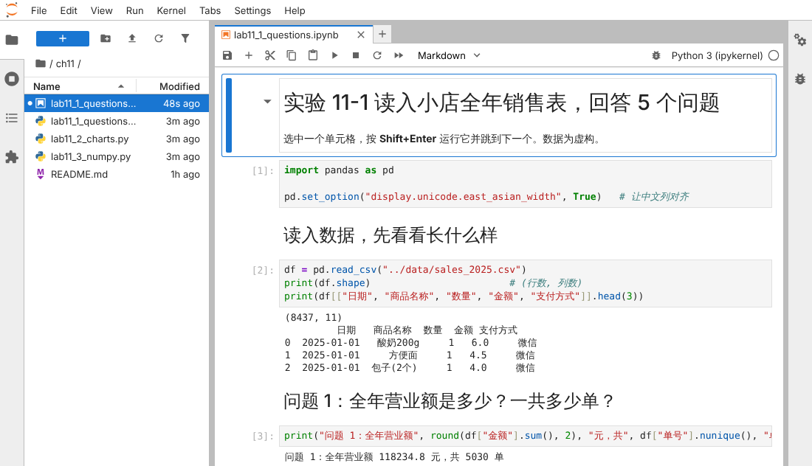
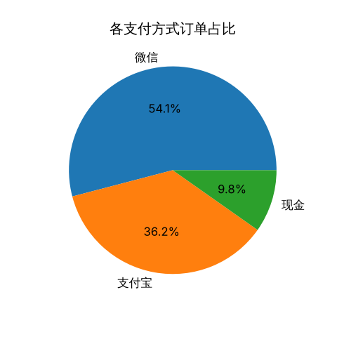
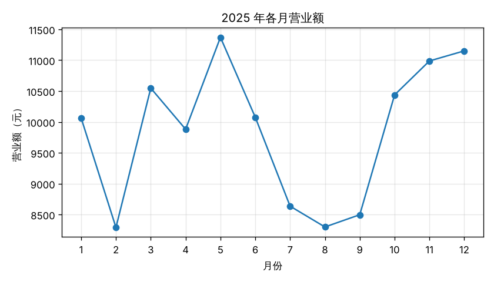
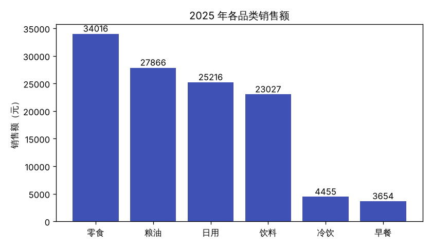
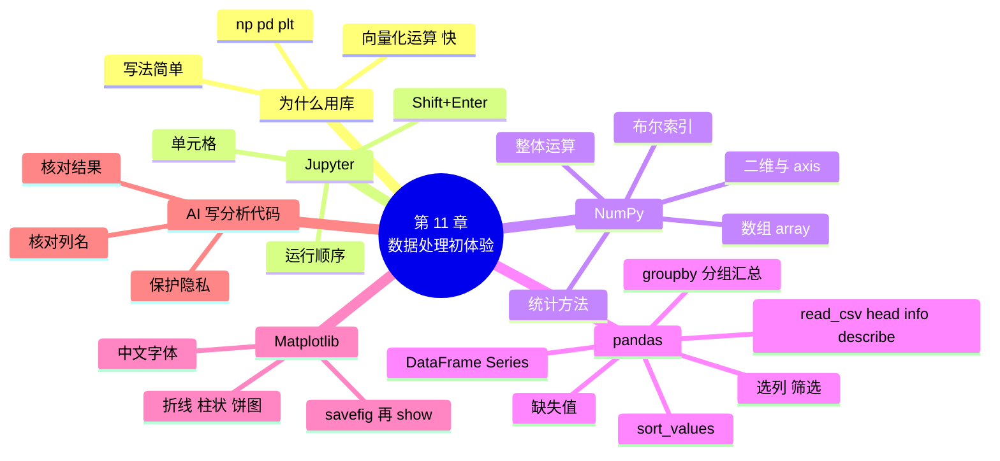

# 第 11 章 数据处理初体验：NumPy、pandas 与 Matplotlib

!!! abstract "本章学时"
    理论 4 学时 · 实验 2 学时（本章共 3 个实验，教师可任选）

## 学习目标

学完本章，你应该能够：

1. **说出** NumPy、pandas、Matplotlib 三个库各自的用途，以及 DataFrame、Series 的含义（记忆）；
2. **解释** 为什么用数组整体运算比写循环更简单、更快（理解）；
3. **使用** Jupyter 逐个单元格运行代码，查看中间结果（应用）；
4. **使用** pandas 读入 CSV 表格，完成选列、筛选、排序和分组汇总（应用）；
5. **使用** Matplotlib 画折线图、柱状图、饼图，并让中文正常显示（应用）。

!!! info "先修要求"
    学习本章前，你需要：

    - 会读写 CSV 文件，用循环按列汇总（[9.3 一维、二维数据与 CSV 文件](../09-files/index.md#93)、[实验 9-1](../09-files/index.md#lab9-1)）；
    - 会用 pip 或 Thonny 的“管理包”安装第三方库（[10.3 用 pip 安装第三方库](../10-modules-oop/index.md#103)）；
    - 会用字典按键汇总（[第 7 章](../07-dicts/index.md)），理解“对象.方法()”的写法（[10.5 类与对象](../10-modules-oop/index.md#105)）。

??? abstract "本章概念清单（10 个，点击查看定义和例子）"
    1. [向量化运算](../../appendix/glossary.md#g-向量化运算)
    2. [数组](../../appendix/glossary.md#g-数组)
    3. [布尔索引](../../appendix/glossary.md#g-布尔索引)
    4. [Jupyter](../../appendix/glossary.md#g-Jupyter)
    5. [单元格](../../appendix/glossary.md#g-单元格)
    6. [DataFrame](../../appendix/glossary.md#g-DataFrame)
    7. [Series](../../appendix/glossary.md#g-Series)
    8. [分组汇总](../../appendix/glossary.md#g-分组汇总)
    9. [缺失值](../../appendix/glossary.md#g-缺失值)
    10. [数据可视化](../../appendix/glossary.md#g-数据可视化)

## 情景导入

实验 9-1 里，小周用循环把全年 8437 行销售记录读了一遍，按支付方式算出了合计。陈姐看了很满意，接着又提了一串问题：

“全年卖得最好的 5 样东西是什么？会员到底贡献了多少？一周里哪天生意最好？每个月的营业额能不能画成图？我想贴在墙上。”

小周算了算：每个问题都要写一个循环、一个字典，再排序、再输出，五个问题就是五段程序；画图更是不知道从哪里下手。

同事小林看了一眼，说：“这种表格活儿用 pandas，一个问题一行代码。画图用 Matplotlib，十几行就够了。”

这一章就来学习 Python 做数据处理最常用的三个库：**NumPy** 负责大批数字的计算，**pandas** 负责表格，**Matplotlib** 负责画图。它们也是后续机器学习、深度学习课程每天都要用的工具。本章只求“会用、能看懂”，不追求面面俱到。

## 11.1 为什么要用数据处理库 { #111 }

### 11.1.1 循环与“一行代码” { #1111 }

问题：全年“饮料”这个品类卖了多少钱？用第 9 章的方法，要打开文件、逐行判断、累加：

```python
import csv

total = 0
with open("../data/sales_2025.csv", encoding="utf-8") as f:
    for row in csv.DictReader(f):
        if row["品类"] == "饮料":
            total += float(row["金额"])
print(round(total, 2))
```

用 pandas，读表一行，计算一行：

```python
import pandas as pd

df = pd.read_csv("../data/sales_2025.csv")
print(round(df[df["品类"] == "饮料"]["金额"].sum(), 2))
```

两段程序的结果都是 `23027.1`。第二种写法不用写循环，也不用自己转换类型，pandas 读入时已经把“金额”这一列识别成了数字。现在看不懂第二种写法没关系，11.4 节会一点点拆开讲。

### 11.1.2 快多少 { #1112 }

除了写起来简单，数据处理库还**快**。下面把 100 万个价格都打九折再求和，分别用循环和 NumPy 各做 10 次，比较用时：

```python
import time
import numpy as np

prices = [i % 50 + 0.5 for i in range(1_000_000)]   # 100 万个价格（虚构）
arr = np.array(prices)                               # 同样的数据放进 NumPy 数组

t = time.perf_counter()
for k in range(10):                  # 重复 10 次，计时更稳定
    total = 0
    for p in prices:
        total += p * 0.9
t1 = time.perf_counter() - t

t = time.perf_counter()
for k in range(10):
    total2 = (arr * 0.9).sum()       # 一行完成：全部乘 0.9 再求和
t2 = time.perf_counter() - t

print(f"循环：{total:.1f}，10 次用时 {t1:.3f} 秒")
print(f"NumPy：{total2:.1f}，10 次用时 {t2:.3f} 秒")
print(f"NumPy 快了约 {t1 / t2:.0f} 倍")
```

编者运行的结果：

```text
循环：22500000.0，10 次用时 0.807 秒
NumPy：22500000.0，10 次用时 0.034 秒
NumPy 快了约 24 倍
```

编者连续运行 3 次，倍数在 24～34 之间，你的电脑上数字会不同，但 NumPy 一定快很多。原因是 NumPy 的计算是用 C 语言写好、编译过的，一次处理一整批数字；而 Python 循环每次只处理一个数，每一步都要解释执行。`time.perf_counter()` 是 time 库里专门用来计时的函数，比 `time.time()` 更精确。

这种“对整个数组一次性做运算，不写循环”的写法叫[**向量化运算**](../../appendix/glossary.md#g-向量化运算 "对整个数组一次性做运算，不用写循环逐个处理元素"){ .term }。数据量越大，它的优势越明显。人工智能处理的图片、文本、表格动辄几百万个数字，所以几乎所有 AI 库都建立在 NumPy 之上。

### 11.1.3 三个库各管什么 { #1113 }

| 库 | 主要用途 | 常用的导入写法 | 本章用它做什么 |
|---|---|---|---|
| NumPy | 大批数字的计算（数组） | `import numpy as np` | 会员消费统计 |
| pandas | 表格数据的读取、筛选、汇总 | `import pandas as pd` | 回答陈姐的 5 个问题 |
| Matplotlib | 画图（数据可视化） | `import matplotlib.pyplot as plt` | 画月度折线图、品类柱状图 |

`np`、`pd`、`plt` 这三个别名是全世界通用的习惯写法，网上的例子、AI 生成的代码几乎都这样写，建议照用。三个库都是第三方库，需要先安装（见 11.2.1）。

## 11.2 Jupyter：边写边看的笔记本 { #112 }

### 11.2.1 安装与启动 { #1121 }

做数据处理时，常常要“读一下数据，看一眼；筛一下，再看一眼”。每次都从头运行整个程序很浪费时间。[**Jupyter**](../../appendix/glossary.md#g-Jupyter "在浏览器中分单元格编写和运行代码、结果显示在单元格下方的编程环境，文件扩展名 .ipynb"){ .term } 把程序分成一个个[**单元格**](../../appendix/glossary.md#g-单元格 "Jupyter 笔记本中可以单独运行的一段代码或文字"){ .term }，每个单元格可以单独运行，结果就显示在它的下方，像一本可以运行的笔记本。

在命令行（Windows 中按 Win+R，输入 cmd 回车）执行下面一行，一次装好本章需要的全部库：

```text
pip install jupyterlab numpy pandas matplotlib openpyxl -i https://pypi.tuna.tsinghua.edu.cn/simple
```

装好后，先用 `cd` 进入配套资源的 labs 文件夹，再启动 JupyterLab：

```text
cd D:\python-programming\labs
jupyter lab
```

浏览器会自动打开 JupyterLab 页面（地址形如 `http://localhost:8888/lab`，这是在你自己电脑上运行的，不需要联网）。关闭时，回到命令行窗口按 Ctrl+C。

!!! tip "不想用 Jupyter 也可以"
    本章所有实验都是普通的 .py 文件，用 Thonny 打开直接运行也完全可以。如果在 Thonny 中安装，用“工具 → 管理包”分别搜索 numpy、pandas、matplotlib 安装即可。

### 11.2.2 单元格与 Shift+Enter { #1122 }

在左侧文件列表中双击 `ch11/lab11_1_questions.ipynb`（.ipynb 是 Jupyter 笔记本文件的扩展名），就能看到实验 11-1 的笔记本：



记住三个操作就够用了：

| 操作 | 作用 |
|---|---|
| Shift+Enter | 运行当前单元格，并跳到下一个 |
| 工具栏的 + 号 | 在下面插入一个新单元格 |
| 菜单 Kernel → Restart Kernel and Run All Cells | 从头重新运行全部单元格 |

单元格左边的 `[1]`、`[2]` 是运行的先后顺序。Jupyter 会“记住”已经运行过的单元格中的变量，所以**顺序很重要**：如果跳过了读数据的单元格，后面的单元格会报 `NameError: name 'df' is not defined`。遇到奇怪的结果，就用“Restart Kernel and Run All Cells”从头再跑一遍。

本章的 .py 实验文件中，用 `# %%` 隔开的每一段，就对应笔记本中的一个单元格。在 Jupyter 中，单元格最后一行如果是一个变量或表达式（不写 print），也会把它的值显示出来，pandas 的表格还会显示成漂亮的网格。

## 11.3 NumPy：成批计算的数组 { #113 }

### 11.3.1 创建数组 { #1131 }

NumPy 的核心是[**数组**](../../appendix/glossary.md#g-数组 "NumPy 中存放一批同类型数字的数据结构，可以整体运算"){ .term }（ndarray）。数组像列表，但里面的元素一般是同一种类型的数字，可以整体运算。

```python
import numpy as np

prices = np.array([2.0, 3.5, 4.5, 6.0, 10.0])   # 从列表创建数组
print(prices)
print(type(prices), prices.dtype, prices.shape)
```

```text
[ 2.   3.5  4.5  6.  10. ]
<class 'numpy.ndarray'> float64 (5,)
```

注意数组打印时元素之间**没有逗号**，这是区分数组和列表的一个小办法。`dtype` 是元素的类型（float64 即浮点数），`shape` 是形状，`(5,)` 表示一维、5 个元素。

还有几种常用的创建方法：

```python
print(np.zeros(3))               # 3 个 0
print(np.arange(0, 10, 2))       # 和 range 类似：0 到 10（不含），步长 2
print(np.linspace(0, 1, 5))      # 0 到 1 之间平均取 5 个数（含两端）
```

```text
[0. 0. 0.]
[0 2 4 6 8]
[0.   0.25 0.5  0.75 1.  ]
```

### 11.3.2 整体运算与布尔筛选 { #1132 }

数组和一个数运算，会作用到**每一个元素**上：

```python
print(prices * 0.9)              # 全部打九折
print(prices + 1)                # 全部涨 1 元
```

```text
[1.8  3.15 4.05 5.4  9.  ]
[ 3.   4.5  5.5  7.  11. ]
```

两个一样长的数组运算，是**对应位置**的元素两两计算：

```python
qty = np.array([10, 6, 8, 3, 2])     # 每种商品卖出的件数
print(prices * qty)                  # 每种商品的销售额
print((prices * qty).sum())          # 合计
```

```text
[20. 21. 36. 18. 20.]
115.0
```

!!! warning "数组乘以数，和列表乘以数完全不同"
    `[2.0, 3.5] * 2` 得到 `[2.0, 3.5, 2.0, 3.5]`，是把列表**重复**两次；`np.array([2.0, 3.5]) * 2` 得到 `[4. 7.]`，是每个元素**乘以** 2。这是初学者最容易混淆的地方。

在方括号里写一个条件，可以只取出满足条件的元素，这叫[**布尔索引**](../../appendix/glossary.md#g-布尔索引 "在方括号里放一组 True/False，只取出 True 对应的元素或行"){ .term }：

```python
print(prices > 4)                # 每个元素比较一次，得到一组 True/False
print(prices[prices > 4])        # 只留下 True 对应的元素
```

```text
[False False  True  True  True]
[ 4.5  6.  10. ]
```

第一行的结果是一个由 True 和 False 组成的数组；把它放进方括号，NumPy 就只保留 True 位置上的元素。后面 pandas 的筛选也是同样的道理。

### 11.3.3 统计函数与二维数组 { #1133 }

数组自带常用的统计方法：

```python
print(prices.sum(), prices.mean(), prices.max(), prices.min())
print(prices.argmax())           # 最大值在第几个位置（从 0 开始）
print(np.median(prices), prices.std())
```

```text
26.0 5.2 10.0 2.0
4
4.5 2.7313000567495322
```

| 写法 | 含义 |
|---|---|
| `a.sum()` / `a.mean()` | 求和 / 平均值 |
| `a.max()` / `a.min()` | 最大值 / 最小值 |
| `a.argmax()` / `a.argmin()` | 最大值 / 最小值所在的位置 |
| `np.median(a)` | 中位数（排序后位于中间的数） |
| `a.std()` | 标准差（数据的分散程度，越大越分散） |

数组也可以是二维的，像一张只有数字的表格：

```python
m = np.array([[1, 2, 3],
              [4, 5, 6]])
print(m.shape)                   # 2 行 3 列
print(m[1, 2])                   # 第 1 行第 2 列（都从 0 数起）
print(m.sum(axis=0))             # 每一列求和（沿着行的方向往下加）
print(m.sum(axis=1))             # 每一行求和
```

```text
(2, 3)
6
[5 7 9]
[ 6 15]
```

`axis=0` 是“竖着加”，得到每列的合计；`axis=1` 是“横着加”，得到每行的合计。一张黑白图片在计算机里就是这样一个二维数组，每个数字是一个点的亮度；彩色图片、视频则是更多维的数组。后续课程处理图片时会经常用到。

## 11.4 pandas：处理表格 { #114 }

pandas 处理的是带表头的二维表格，和 Excel 很像。pandas 中的整张表叫 [**DataFrame**](../../appendix/glossary.md#g-DataFrame "pandas 中带行索引和列名的二维表格"){ .term }，表中的一列叫 [**Series**](../../appendix/glossary.md#g-Series "pandas 中带索引的一列数据，DataFrame 的每一列都是一个 Series"){ .term }。

### 11.4.1 读入数据，先看一看 { #1141 }

```python
import pandas as pd

pd.set_option("display.unicode.east_asian_width", True)   # 让中文列对齐

df = pd.read_csv("../data/sales_2025.csv")   # 读入 CSV，得到 DataFrame
print(df.shape)                              # (行数, 列数)
print(df.head())                             # 前 5 行
```

```text
(8437, 11)
         日期   时间    单号 商品编号  ...  数量  金额 会员号 支付方式
0  2025-01-01  12:49  D00001      P05  ...     1   6.0    NaN     微信
1  2025-01-01  12:49  D00001      P07  ...     1   4.5    NaN     微信
2  2025-01-01  07:39  D00002      P14  ...     1   4.0    NaN     微信
3  2025-01-01  08:10  D00003      P09  ...     1   6.0   M036     微信
4  2025-01-01  20:18  D00004      P23  ...     1   9.9   M019   支付宝

[5 rows x 11 columns]
```

`read_csv` 默认按 UTF-8 编码读取；如果文件是 Excel 另存的 GBK 编码，要写 `pd.read_csv("文件.csv", encoding="gbk")`。列太多时中间用 `...` 省略。最左边的 0、1、2……是 pandas 自动给每行加的编号，叫**行索引**。`NaN` 表示这一格是空的（这单不是会员消费），叫[**缺失值**](../../appendix/glossary.md#g-缺失值 "表格中空着没有数据的格子，pandas 中显示为 NaN"){ .term }。

拿到一份新数据，先用下面三个方法“体检”：

```python
df.info()                # 每列的名称、非空个数、类型
print(df.describe())     # 数字列的统计摘要
```

```text
<class 'pandas.DataFrame'>
RangeIndex: 8437 entries, 0 to 8436
Data columns (total 11 columns):
 #   Column    Non-Null Count  Dtype
---  ------    --------------  -----
 0   日期      8437 non-null   str
 1   时间      8437 non-null   str
 2   单号      8437 non-null   str
 3   商品编号  8437 non-null   str
 4   商品名称  8437 non-null   str
 5   品类      8437 non-null   str
 6   单价      8437 non-null   float64
 7   数量      8437 non-null   int64
 8   金额      8437 non-null   float64
 9   会员号    2924 non-null   str
 10  支付方式  8437 non-null   str
dtypes: float64(2), int64(1), str(8)
memory usage: 725.2 KB
              单价         数量         金额
count  8437.000000  8437.000000  8437.000000
mean      9.930639     1.421240    14.013844
std      10.153292     0.750447    17.497068
min       1.500000     1.000000     1.500000
25%       3.500000     1.000000     4.500000
50%       6.000000     1.000000     7.500000
75%      11.000000     2.000000    15.800000
max      39.900000     4.000000   159.600000
```

从 info 可以看出：会员号只有 2924 个非空，说明大约三分之一的记录是会员消费；单价、数量、金额被识别成了数字（float64 浮点数、int64 整数），其他列是文字（str）。describe 告诉我们每条记录的金额平均约 14 元，最大 159.6 元。

!!! note "不同版本显示略有不同"
    编者使用 pandas 3.1。pandas 2.x 版本中，文字列的类型显示为 `object` 而不是 `str`，类名显示为 `pandas.core.frame.DataFrame`，其他结果相同。

读写 Excel 也只要一行（需要已安装 openpyxl）：

```python
df2 = pd.read_excel("销售日报.xlsx")             # 读 Excel
df.to_excel("全年销售.xlsx", index=False)        # 写 Excel，index=False 表示不写行索引
df.to_csv("全年销售_备份.csv", index=False, encoding="utf-8-sig")  # 写 CSV，Excel 打开不乱码
```

### 11.4.2 选列与筛选 { #1142 }

用 `df["列名"]` 取出一列，得到一个 Series；用 `df[["列名1", "列名2"]]`（注意是**两层方括号**，里面是一个列表）取出几列，得到一个新的 DataFrame：

```python
print(df["金额"].head(3))
print(df[["商品名称", "金额"]].head(3))
```

```text
0    6.0
1    4.5
2    4.0
Name: 金额, dtype: float64
    商品名称  金额
0   酸奶200g   6.0
1     方便面   4.5
2  包子(2个)   4.0
```

**筛选行**的写法和 NumPy 的布尔索引一样：`df[条件]`，条件中用 `df["列名"]` 和比较运算符：

```python
big = df[df["金额"] >= 50]            # 金额不少于 50 元的记录
print(len(big))
print(big[["日期", "商品名称", "数量", "金额"]].head(3))
```

```text
308
           日期    商品名称  数量   金额
120  2025-01-06  花生油1.8L     2   79.8
132  2025-01-06     大米5kg     4  131.2
174  2025-01-08  花生油1.8L     2   79.8
```

注意行索引 120、132、174 保留了它们在原表中的编号。

多个条件同时满足用 `&`（并且），满足其一用 `|`（或者），**每个条件都要加圆括号**：

```python
d = df[(df["品类"] == "冷饮") & (df["数量"] >= 3)]   # 一次买 3 支及以上冷饮
print(len(d))
```

```text
77
```

!!! warning "pandas 的条件里不能用 and、or"
    第 4 章学的 `and`、`or` 用于单个的 True/False；pandas 中的条件是一整列 True/False，要用 `&`、`|`，并给每个条件加上圆括号。写成 `df[df["品类"] == "冷饮" and df["数量"] >= 3]` 会报错 `ValueError: The truth value of a Series is ambiguous...`，意思是“一整列 True/False 没法当成一个真假值来用”。

### 11.4.3 排序与分组汇总 { #1143 }

`sort_values` 按某一列排序，`ascending=False` 表示从大到小：

```python
top = df.sort_values("金额", ascending=False)
print(top[["日期", "商品名称", "金额"]].head(3))
```

```text
            日期    商品名称   金额
7321  2025-11-15  花生油1.8L  159.6
5608  2025-09-03    坚果礼包  159.6
1324  2025-03-01    坚果礼包  159.6
```

数据分析中最常用的操作是[**分组汇总**](../../appendix/glossary.md#g-分组汇总 "按某一列的值把行分成若干组，再对每组分别做统计"){ .term }：按某一列把行分成几组，再对每组做统计。例如“每个品类卖了多少钱”：

```python
print(df.groupby("品类")["金额"].sum())
```

```text
品类
冷饮     4455.0
日用    25216.3
早餐     3654.0
粮油    27865.9
零食    34016.5
饮料    23027.1
Name: 金额, dtype: float64
```

这一行代码从左往右读，就是三步：`groupby("品类")` 按品类分组 → `["金额"]` 取出每组的金额 → `.sum()` 每组求和。实验 9-1 中用循环加字典写了十几行才做到的事，这里一行就完成了。结果按品类名称排序，最下面一行写着列名和类型。

把 `.sum()` 换成别的方法，就得到别的统计：

| 写法 | 每组算出 |
|---|---|
| `.sum()` | 合计 |
| `.mean()` | 平均值 |
| `.count()` | 有几行（几条记录） |
| `.max()` / `.min()` | 最大 / 最小值 |
| `.nunique()` | 有几个不同的值（如不同的单号个数，即订单数） |

一次算好几种，用 `agg`：

```python
print(df.groupby("品类")["金额"].agg(["sum", "mean", "count"]).round(2))
```

```text
          sum   mean  count
品类
冷饮   4455.0   5.64    790
日用  25216.3  21.78   1158
早餐   3654.0   6.21    588
粮油  27865.9  29.33    950
零食  34016.5  15.54   2189
饮料  23027.1   8.34   2762
```

只想数一数某一列中每个值出现了几次，用更简单的 `value_counts()`，结果从多到少排好：

```python
print(df["支付方式"].value_counts())
```

```text
支付方式
微信      4570
支付宝    3040
现金       827
Name: count, dtype: int64
```

筛选、分组、汇总可以连在一起写。下面的动画用销售表的前 14 行演示 `df[条件].groupby(列)["金额"].汇总()` 的三个步骤，可以换不同的条件试试：

<iframe class="sim-frame" src="../../sims/pandas-group/main.html" height="800" loading="lazy" title="pandas 筛选与分组"></iframe>

动画：pandas 筛选与分组。选好筛选条件、分组列和汇总方式，按“下一步”依次观察筛选、分组、汇总，输出与 pandas 实际运行结果一致。[全屏打开](../../sims/pandas-group/main.html){ target=_blank }
{ .sim-caption }

### 11.4.4 新增列与缺失值 { #1144 }

给 DataFrame 新增一列，直接用 `df["新列名"] = ...` 赋值。例如从日期中取出月份（`.str[5:7]` 对整列字符串做切片，`.astype(int)` 把整列转成整数）：

```python
df["月份"] = df["日期"].str[5:7].astype(int)
print(df.groupby("月份")["金额"].sum().head(3))
```

```text
月份
1    10064.2
2     8290.3
3    10547.1
Name: 金额, dtype: float64
```

真实的数据经常有空格子。`isna().sum()` 数出每列有几个缺失值，`fillna` 把缺失值填上指定的内容，`notna()` 判断“不是空的”：

```python
print(df["会员号"].isna().sum())               # 会员号为空的有几行
member = df[df["会员号"].notna()]              # 只要会员的消费记录
df["会员号"] = df["会员号"].fillna("非会员")    # 空的填上“非会员”
```

```text
5513
```

5513 加上前面 info 显示的 2924 个非空，正好是 8437 行。

## 11.5 Matplotlib：把数据画成图 { #115 }

一张图往往比一张表更能说明问题。用程序把数据画成图，叫[**数据可视化**](../../appendix/glossary.md#g-数据可视化 "用程序把数据画成折线图、柱状图、饼图等图形，便于看出规律"){ .term }。Matplotlib 是 Python 最基础的画图库，pandas 的画图功能也是基于它的。

### 11.5.1 先解决中文显示 { #1151 }

Matplotlib 默认的字体不含中文，标题、坐标轴上的中文会显示成一个个方框，终端还会出现类似 `UserWarning: Glyph 20013 (\N{CJK UNIFIED IDEOGRAPH-4E2D}) missing from font(s) DejaVu Sans` 的警告，意思是默认字体里没有“中”这个字。画图前加上两行设置：

```python
import matplotlib.pyplot as plt

plt.rcParams["font.sans-serif"] = ["Microsoft YaHei", "SimHei", "PingFang SC", "WenQuanYi Zen Hei"]
plt.rcParams["axes.unicode_minus"] = False      # 让负号正常显示
```

第一行给出一串字体名，Matplotlib 按顺序找，找到哪个用哪个：Windows 一般有微软雅黑（Microsoft YaHei）和黑体（SimHei），苹果电脑有苹方（PingFang SC），Linux 常见文泉驿正黑（WenQuanYi Zen Hei）。第二行解决换了中文字体后负号显示成方框的问题。

### 11.5.2 折线图、柱状图、饼图 { #1152 }

三种最常用的图，各有适合的场合：

| 图 | 函数 | 适合表达 | 例子 |
|---|---|---|---|
| 折线图 | `plt.plot(x, y)` | 随时间的变化趋势 | 每月营业额 |
| 柱状图 | `plt.bar(x, y)` | 不同类别之间比大小 | 各品类销售额 |
| 饼图 | `plt.pie(数值, labels=名称)` | 各部分占整体的比例 | 各支付方式的占比 |

画图的步骤大致相同：准备数据 → 新建画布 → 画图 → 加标题、坐标轴名称 → 保存或显示。以饼图为例：

```python
import pandas as pd
import matplotlib.pyplot as plt

plt.rcParams["font.sans-serif"] = ["Microsoft YaHei", "SimHei", "WenQuanYi Zen Hei"]

df = pd.read_csv("../data/sales_2025.csv")
pay = df.groupby("支付方式")["单号"].nunique()   # 每种支付方式有多少单
print(pay)

plt.figure(figsize=(4, 4))                       # 新建画布，宽 4 英寸、高 4 英寸
plt.pie(pay.values, labels=pay.index, autopct="%.1f%%")   # autopct 显示百分比
plt.title("各支付方式订单占比")
plt.savefig("支付方式.png", dpi=120)             # 保存为图片
plt.show()                                       # 弹出窗口显示
```

```text
支付方式
微信     2720
支付宝    1819
现金      491
Name: 单号, dtype: int64
```

{ width=300 }

pandas 的分组结果可以直接拿来画图：`.index` 是组名（微信、支付宝、现金），`.values` 是每组的数值。

!!! tip "先 savefig，再 show"
    `plt.show()` 显示完图之后会清空画布。如果把 `savefig` 写在 `show` 后面，保存下来的是一张空白图片。在 Jupyter 中运行时，图会直接显示在单元格下方。

折线图和柱状图的完整代码见实验 11-2。

!!! cert "证书考点 · 信息技术水平-人工智能（Python）"
    本章对应“Python 计算生态”部分：知道 NumPy（数值计算）、pandas（数据分析）、Matplotlib（数据可视化）等常用第三方库的名称和用途，会用 pip 安装。全国计算机等级考试二级 Python 大纲只要求了解这些库“是做什么的”，不考具体函数；本章的具体用法主要为后续的机器学习、数据分析课程打基础（详见[证书考点对照](../../certificate.md)）。

## 11.6 前沿视窗：在 Jupyter 中让 AI 帮忙写分析代码 { #116 }

pandas 的方法很多，记不住怎么办？现在越来越多的人在做数据分析时，直接用自然语言让 AI 写代码。Jupyter 官方就有一个扩展叫 Jupyter AI：安装后，JupyterLab 侧边多出一个聊天面板，可以提问、让它解释或修改选中的代码、修复出错的单元格；也可以在单元格开头写 `%%ai` 加上一句话，让大模型生成内容。它支持接入多家公司的大模型，需要自己准备对应的 API Key<sup class="cite">[[5]](#ref11-5)</sup>。即使不装它，把表头和问题复制给任何一个 AI 助手，也能得到一段 pandas 代码。

但 AI 写的数据分析代码**一定要核对**，尤其是下面三种常见问题：

1. **列名对不上**：AI 不知道你的表里到底叫“金额”还是“销售额”，会凭猜测写，运行时报 `KeyError`；
2. **“看起来对”的错误**：例如把“订单数”算成了 `count()`（数的是商品行数 8437），而正确的是按单号 `nunique()`（5030 单）。程序不报错，数字却是错的。核对办法是用一个小例子手算一遍，或者换一种写法再算一次，看结果是否一致；
3. **隐私泄露**：Jupyter AI 的文档也提醒，聊天内容会发送给第三方的大模型服务<sup class="cite">[[5]](#ref11-5)</sup>。只把**表头和几行虚构的示例数据**发给 AI，让它写代码，再在自己的电脑上对真实数据运行。不要把含有顾客姓名、手机号的真实表格整个粘贴给在线 AI。

## 本章实验

!!! abstract "实验总览"
    | 实验 | 类型 | 建议时长 | 内容 |
    |---|---|---|---|
    | 实验 11-1 | ★ 基础 | 40 分钟 | 用 pandas 读入全年销售表，回答 5 个经营问题 |
    | 实验 11-2 | ★ 基础 | 30 分钟 | 用 Matplotlib 画月度营业额折线图和品类销售额柱状图 |
    | 实验 11-3 | ☆ 拓展 | 30 分钟 | 用 NumPy 统计会员消费 |

    代码见配套资源 `labs/ch11/` 目录。需要先安装 numpy、pandas、matplotlib（见 11.2.1）。实验 11-1 另附 Jupyter 笔记本 `lab11_1_questions.ipynb`。

### 实验 11-1 ★ 读入全年销售表，回答 5 个问题 { #lab11-1 }

**实验目的**

1. 会用 `read_csv` 读入表格，用 shape、head 查看数据；
2. 会用筛选、`groupby` 分组汇总、`value_counts` 计数回答实际问题；
3. 会用 Jupyter 逐个单元格运行代码（或用 Thonny 一次运行）。

**实验环境**：本机 CPU；需要安装 pandas（编者使用 3.1.0 版），可选 JupyterLab。

**实验数据**：配套数据 `labs/data/sales_2025.csv`，街坊便利店 2025 年全年 8437 条销售记录（虚构）。

**实验步骤与代码**

1. 用 JupyterLab 打开 `labs/ch11/lab11_1_questions.ipynb`，逐个单元格按 Shift+Enter 运行；或用 Thonny 打开 `lab11_1_questions.py` 直接运行；
2. 每运行一个问题，先自己猜一猜答案，再看结果。

```python
# 实验 11-1 读入小店全年销售表，回答 5 个问题
# 建议在 Jupyter 中按“# %%”分成几个单元格逐个运行；直接用 Thonny 运行也可以
import pandas as pd

pd.set_option("display.unicode.east_asian_width", True)   # 让中文列对齐

# %% 读入数据，先看看长什么样
df = pd.read_csv("../data/sales_2025.csv")
print(df.shape)                        # (行数, 列数)
print(df[["日期", "商品名称", "数量", "金额", "支付方式"]].head(3))

# %% 问题 1：全年营业额是多少？一共多少单？
print("问题 1：全年营业额", round(df["金额"].sum(), 2), "元，共", df["单号"].nunique(), "单")

# %% 问题 2：卖得最多（按金额）的 5 种商品是什么？
top5 = df.groupby("商品名称")["金额"].sum().sort_values(ascending=False).head(5)
print("问题 2：销售额前 5 的商品")
print(top5)

# %% 问题 3：会员消费的金额占全部营业额的百分之几？
member = df[df["会员号"].notna()]      # 会员号不为空的行
print(f"问题 3：会员消费 {member['金额'].sum():.2f} 元，占 {member['金额'].sum() / df['金额'].sum():.1%}")

# %% 问题 4：一次买 3 件及以上同一种商品的记录有多少条？最常见的是哪些商品？
big = df[df["数量"] >= 3]
print("问题 4：共", len(big), "条，最常见的是")
print(big["商品名称"].value_counts().head(3))

# %% 问题 5：一周中哪一天营业额最高？
df["日期"] = pd.to_datetime(df["日期"])
df["星期"] = df["日期"].dt.day_of_week  # 0 是星期一，6 是星期日
by_week = df.groupby("星期")["金额"].sum()
names = ["一", "二", "三", "四", "五", "六", "日"]
print("问题 5：")
for i, money in by_week.items():
    print(f"  星期{names[i]} {money:>10.2f} 元")
print("最高的是星期" + names[by_week.idxmax()])
```

**运行结果**

```text
(8437, 11)
         日期   商品名称  数量  金额 支付方式
0  2025-01-01   酸奶200g     1   6.0     微信
1  2025-01-01     方便面     1   4.5     微信
2  2025-01-01  包子(2个)     1   4.0     微信
问题 1：全年营业额 118234.8 元，共 5030 单
问题 2：销售额前 5 的商品
商品名称
坚果礼包      17755.5
花生油1.8L    10453.8
豆浆粉         9985.6
大米5kg        9348.0
洗衣液2kg      6607.9
Name: 金额, dtype: float64
问题 3：会员消费 40589.80 元，占 34.3%
问题 4：共 825 条，最常见的是
商品名称
酸奶200g       55
绿茶500ml      53
矿泉水550ml    46
Name: count, dtype: int64
问题 5：
  星期一   15393.10 元
  星期二   16461.70 元
  星期三   16264.90 元
  星期四   16081.60 元
  星期五   15886.40 元
  星期六   18716.80 元
  星期日   19430.30 元
最高的是星期日
```

几点说明：

- 问题 1 中一单可以有好几行（一次买了几样东西），所以订单数要数**不同单号的个数** `nunique()`，而不是行数；
- 问题 2 先分组求和，再用 `sort_values(ascending=False)` 从大到小排，`head(5)` 取前 5；
- 问题 5 中 `pd.to_datetime` 把文字日期转成真正的日期，`.dt.day_of_week` 取出星期几（0 表示星期一）；`idxmax()` 返回最大值对应的组名。周末两天的营业额明显高于工作日。

**实验记录表**

| 问题 | 结果 |
|---|---|
| 把问题 2 的 `head(5)` 改成 `tail(3)`，得到的是什么？ | |
| 问题 3 改成：会员一共下了多少单？ | |
| 把问题 5 改成“一天中几点钟的营业额最高”（提示：`df["时间"].str[:2]`） | |

**常见问题排查**

| 现象 | 原因 | 解决办法 |
|---|---|---|
| `ModuleNotFoundError: No module named 'pandas'` | 没有安装，或装到了另一个 Python 里 | Thonny 用“管理包”安装；Jupyter 中运行 `%pip install pandas` |
| `FileNotFoundError` | 当前文件夹不对，找不到 `../data/sales_2025.csv` | 确认程序放在 `labs/ch11` 下；Jupyter 要从 labs 文件夹启动 |
| `KeyError: '金额'` | 列名写错，或多了空格 | 用 `print(df.columns)` 查看准确的列名 |
| Jupyter 中报 `NameError: name 'df' is not defined` | 没有先运行读数据的单元格 | 从第一个单元格开始依次运行 |
| 中文列没有对齐 | 没有设置 east_asian_width | 运行第一个单元格中的 set_option |

**思考与练习**

1. 增加问题 6：哪个月的营业额最低？比最高的月份少多少元？
2. 增加问题 7：每位会员平均每单消费多少元？非会员呢？（提示：先分别筛选，再用金额合计除以订单数）

**实验报告要求**

提交运行截图、实验记录表和思考题 1 的代码。

### 实验 11-2 ★ 画月度营业额折线图和品类销售额柱状图 { #lab11-2 }

**实验目的**

1. 会设置中文字体，让图中的中文正常显示；
2. 会用 `plot`、`bar` 画折线图和柱状图，添加标题、坐标轴名称和数值标注；
3. 会用 `savefig` 把图保存为图片文件。

**实验环境**：本机 CPU；需要安装 pandas、matplotlib（编者使用 3.11.2 版）。

**实验数据**：配套数据 `labs/data/sales_2025.csv`（虚构）。

**实验步骤与代码**

打开 `labs/ch11/lab11_2_charts.py` 运行。运行时会依次弹出两个图形窗口，关闭第一个窗口后才会画第二张图；两张图同时保存在 ch11 文件夹中。

```python
# 实验 11-2 画月度销售折线图和品类柱状图
import pandas as pd
import matplotlib.pyplot as plt

# 设置中文字体：按顺序找，找到哪个用哪个（Windows 一般有微软雅黑和黑体）
plt.rcParams["font.sans-serif"] = ["Microsoft YaHei", "SimHei", "PingFang SC", "WenQuanYi Zen Hei"]
plt.rcParams["axes.unicode_minus"] = False      # 让负号正常显示

df = pd.read_csv("../data/sales_2025.csv")
df["月份"] = df["日期"].str[5:7].astype(int)     # "2025-03-08" 取出 "03"，转成整数 3

# 图 1：月度营业额折线图
monthly = df.groupby("月份")["金额"].sum()
print(monthly.round(1).to_dict())
plt.figure(figsize=(7, 4))
plt.plot(monthly.index, monthly.values, marker="o")
plt.title("2025 年各月营业额")
plt.xlabel("月份")
plt.ylabel("营业额（元）")
plt.xticks(range(1, 13))
plt.grid(alpha=0.3)
plt.tight_layout()
plt.savefig("月度营业额.png", dpi=120)
plt.show()

# 图 2：各品类销售额柱状图（从高到低）
cat = df.groupby("品类")["金额"].sum().sort_values(ascending=False)
print(cat.round(1).to_dict())
plt.figure(figsize=(7, 4))
plt.bar(cat.index, cat.values, color="#3f51b5")
for x, y in zip(cat.index, cat.values):          # 在柱子上方标出数值
    plt.text(x, y, f"{y:.0f}", ha="center", va="bottom")
plt.title("2025 年各品类销售额")
plt.ylabel("销售额（元）")
plt.tight_layout()
plt.savefig("品类销售额.png", dpi=120)
plt.show()
```

**运行结果**

```text
{1: 10064.2, 2: 8290.3, 3: 10547.1, 4: 9881.0, 5: 11370.3, 6: 10076.1, 7: 8635.0, 8: 8298.2, 9: 8496.4, 10: 10437.7, 11: 10987.6, 12: 11150.9}
{'零食': 34016.5, '粮油': 27865.9, '日用': 25216.3, '饮料': 23027.1, '冷饮': 4455.0, '早餐': 3654.0}
```





代码说明：

- `marker="o"` 在折线的每个数据点上画一个圆点；`plt.xticks(range(1, 13))` 让横轴显示 1～12 每个月；`plt.grid(alpha=0.3)` 加上浅色网格线，`alpha` 是透明度；
- `plt.text(x, y, 文字, ha="center", va="bottom")` 在坐标 (x, y) 处写字，水平居中、文字底部对齐柱子顶端；
- `plt.tight_layout()` 自动调整边距，防止坐标轴文字被裁掉。

从折线图可以看出，2 月和 7～9 月营业额较低，年底较高；从柱状图看，零食、粮油、日用、饮料是主力品类。

**实验记录表**

| 问题 | 结果 |
|---|---|
| 删掉设置中文字体的两行再运行，图上的中文变成了什么？终端出现了什么警告？ | |
| 把折线图的 `marker="o"` 改成 `marker="s"`，有什么变化？ | |
| 把柱状图改成横向的 `plt.barh(cat.index, cat.values)`，标注的数字还在正确位置吗？ | |

**常见问题排查**

| 现象 | 原因 | 解决办法 |
|---|---|---|
| 图中中文显示为方框 | 没有设置中文字体，或列出的字体电脑上都没有 | Windows 中确认列表里有 "Microsoft YaHei" 或 "SimHei" |
| 保存的图片是空白的 | `savefig` 写在了 `show` 后面 | 先 `savefig` 再 `show` |
| 运行后没有弹出窗口，程序卡住 | 第一张图的窗口还开着 | 关闭第一个图形窗口，程序才会继续画第二张 |
| 横轴月份显示成 2.5、5.0 这样的小数 | 没有指定刻度 | 加上 `plt.xticks(range(1, 13))` |

**思考与练习**

1. 在同一张折线图中画两条线：“饮料”和“冷饮”每月的销售额，并用 `plt.legend()` 加上图例（提示：`plt.plot(x, y, label="饮料")`）。
2. 画一张柱状图，显示一天中每个整点的订单数，说说小店的高峰时段。

**实验报告要求**

提交两张图片、实验记录表和思考题 1 的代码与图片。

### 实验 11-3 ☆ 用 NumPy 统计会员消费 { #lab11-3 }

**实验目的**

1. 会把 pandas 的结果转成 NumPy 数组；
2. 会用数组的统计方法、布尔索引和向量化运算；
3. 会用 `np.histogram` 做分段统计。

**实验环境**：本机 CPU；需要安装 numpy、pandas。

**实验数据**：配套数据 `labs/data/sales_2025.csv`（虚构）。

**实验步骤与代码**

打开 `labs/ch11/lab11_3_numpy.py` 运行：

```python
# 实验 11-3 用 NumPy 做会员消费统计
import numpy as np
import pandas as pd

df = pd.read_csv("../data/sales_2025.csv")
# 用 pandas 按会员号汇总每位会员全年的消费额，再转成 NumPy 数组
spend = df.groupby("会员号")["金额"].sum().to_numpy()
print("会员人数：", spend.size)
print("前 5 位：", spend[:5])

print(f"人均消费 {spend.mean():.2f} 元，中位数 {np.median(spend):.2f} 元")
print(f"最高 {spend.max():.2f} 元，最低 {spend.min():.2f} 元，标准差 {spend.std():.2f}")

# 布尔筛选：消费超过 800 元的会员有几位，他们的消费占会员总消费的多少
rich = spend[spend > 800]
print(f"消费超过 800 元的有 {rich.size} 位，占会员总消费的 {rich.sum() / spend.sum():.1%}")

# 向量化运算：全部会员按消费额的 1% 返现，不用写循环
cashback = np.round(spend * 0.01, 2)
print("返现总额：", cashback.sum().round(2), "元")

# 分段统计：消费额落在各区间的人数
bins = [0, 300, 600, 900, 2000]
counts, _ = np.histogram(spend, bins=bins)
for i in range(len(counts)):
    print(f"  {bins[i]}～{bins[i + 1]} 元：{counts[i]} 人")
```

**运行结果**

```text
会员人数： 60
前 5 位： [706.3 588.6 941.9 494.2 744.4]
人均消费 676.50 元，中位数 668.45 元
最高 1310.30 元，最低 392.60 元，标准差 186.02
消费超过 800 元的有 12 位，占会员总消费的 28.4%
返现总额： 405.89 元
  0～300 元：0 人
  300～600 元：22 人
  600～900 元：30 人
  900～2000 元：8 人
```

代码说明：

- `groupby` 按会员号汇总时，会员号为空的行会被自动跳过，所以只统计了 60 位会员；`.to_numpy()` 把 Series 转成 NumPy 数组；
- `np.histogram(数据, bins=分界点)` 返回两样东西：每个区间的个数，以及分界点本身。第二样这里用不到，按惯例用下划线 `_` 接住；
- 12 位（五分之一）消费最多的会员贡献了 28.4% 的会员消费，这类信息可以帮陈姐决定重点维护哪些老顾客。

**实验记录表**

| 问题 | 结果 |
|---|---|
| 平均数和中位数哪个大？说明什么？ | |
| 把 800 改成 1000，结果是多少？ | |
| 返现比例改成 2%，返现总额是多少？是不是正好是 1% 时的 2 倍？ | |

**常见问题排查**

| 现象 | 原因 | 解决办法 |
|---|---|---|
| `AttributeError: 'list' object has no attribute 'mean'` | 对列表调用了数组的方法 | 先用 `np.array()` 或 `.to_numpy()` 转成数组 |
| 区间人数加起来少于 60 | 有数据落在了最后一个分界点之外 | 把最后一个分界点改大 |

**思考与练习**

1. 用 `spend.argmax()` 找到消费最高的会员在数组中的位置；想一想，怎样才能知道他的会员号？（提示：不要转成数组，直接对 Series 用 `idxmax()`）
2. 把会员按消费额分成“金卡（≥900）、银卡（600～900）、普通（<600）”三档，用布尔索引分别统计人数。

**实验报告要求**

提交实验记录表和思考题 2 的代码。

## 本章小结

- 数据处理库写起来简单、运行快。对整个数组一次性运算、不写循环的写法叫**向量化运算**。NumPy 管数字计算，pandas 管表格，Matplotlib 管画图，习惯写法 `np`、`pd`、`plt`。
- **Jupyter** 把程序分成一个个**单元格**，Shift+Enter 运行，结果显示在下方；文件扩展名 .ipynb。单元格的运行顺序很重要。
- NumPy **数组**：`np.array` 创建；和数运算作用到每个元素，两个数组按位置运算；`a[a > 4]` 是**布尔索引**；sum、mean、max、argmax、`np.median`、std 统计；二维数组用 `axis` 指定方向。
- pandas 的整张表是 **DataFrame**，一列是 **Series**。`read_csv` / `read_excel` 读入，shape、head、info、describe 查看；`df["列"]` 选列，`df[条件]` 筛选（多个条件用 `&`、`|` 并加圆括号）；`sort_values` 排序；`groupby(列)["列"].sum()` **分组汇总**；`value_counts` 计数；isna、fillna 处理**缺失值**。
- Matplotlib：先设置 `font.sans-serif` 让中文正常显示；plot 折线图看趋势，bar 柱状图比大小，pie 饼图看占比；先 savefig 再 show。
- 用 AI 写数据分析代码要核对列名和结果，不把含个人信息的真实数据发给在线 AI。



**下一章预告**

到这里，你已经会写程序、会处理数据、会画图了。最后一章把这些本领组合起来：用 jieba 分析顾客评价的关键词，体验用 scikit-learn 训练一个文本分类模型，再通过网络接口调用大模型，让 AI 根据一周的销售数据自动写出经营小结，最后以小组为单位完成一个“小店管理助手”综合项目。

## 参考文献

正文中的上标编号（如<sup class="cite">[[5]](#ref11-5)</sup>）对应下面的文献。带链接的可以直接打开；书籍可在图书馆或电子书平台查阅。

<div class="refs" markdown>

**教材与专著**

- <span id="ref11-1"></span>[1] McKINNEY W. Python for data analysis: data wrangling with pandas, NumPy, and Jupyter[M]. 3rd ed. Sebastopol: O'Reilly Media, 2022. 在线开放版：https://wesmckinney.com/book/.
    <span class="ref-note">pandas 作者写的入门书，作者在网站上提供了免费阅读的开放版本。第 4、5、9、10 章分别讲 NumPy、pandas、画图和分组汇总，对应 11.3～11.5 节，适合学有余力的同学。</span>

**经典论文与标准**

- <span id="ref11-2"></span>[2] HARRIS C R, MILLMAN K J, VAN DER WALT S J, et al. Array programming with NumPy[J]. Nature, 2020, 585(7825): 357-362.
    <span class="ref-note">NumPy 开发团队发表在《自然》杂志上的论文，介绍了数组编程的思想和 NumPy 在科学研究中的作用，对应 11.1、11.3 节。</span>
- <span id="ref11-3"></span>[3] McKINNEY W. Data structures for statistical computing in Python[C]//Proceedings of the 9th Python in Science Conference. Austin, 2010: 56-61.
    <span class="ref-note">pandas 作者介绍 DataFrame 等数据结构设计的论文，对应 11.4 节。</span>
- <span id="ref11-4"></span>[4] HUNTER J D. Matplotlib: a 2D graphics environment[J]. Computing in Science & Engineering, 2007, 9(3): 90-95.
    <span class="ref-note">Matplotlib 作者介绍这个画图库的论文，对应 11.5 节。</span>

**在线资源与数据**

- <span id="ref11-5"></span>[5] Project Jupyter. Jupyter AI user documentation[EB/OL]. [2026-11-01]. https://jupyter-ai.readthedocs.io/en/v2/users/index.html.
    <span class="ref-note">Jupyter AI 的使用说明，介绍聊天面板、%%ai 魔法命令和支持的模型服务商，并提醒数据会发送给第三方，对应 11.6 节。</span>
- <span id="ref11-6"></span>[6] pandas development team. 10 minutes to pandas[EB/OL]. [2026-11-01]. https://pandas.pydata.org/docs/user_guide/10min.html.
    <span class="ref-note">pandas 官方的快速入门，涵盖选列、筛选、分组、读写文件，对应 11.4 节。</span>
- <span id="ref11-7"></span>[7] NumPy Developers. NumPy: the absolute basics for beginners[EB/OL]. [2026-11-01]. https://numpy.org/doc/stable/user/absolute_beginners.html.
    <span class="ref-note">NumPy 官方为初学者写的入门教程，对应 11.3 节。</span>
- <span id="ref11-8"></span>[8] Matplotlib Development Team. Quick start guide[EB/OL]. [2026-11-01]. https://matplotlib.org/stable/users/explain/quick_start.html.
    <span class="ref-note">Matplotlib 官方快速入门，介绍画布、坐标轴和常用图形，对应 11.5 节。</span>

</div>

## 课后练习

选择题和判断题可以直接点击选项作答，系统会马上告诉你对错，并展开答案与解析；多选题选好后点“提交答案”。简答和实操题请先自己作答，再点开“答案与解析”核对。每道题的解析下方都有“回看”链接，做错了可以直接跳回正文复习。

**一、单项选择题**

<div class="quiz" data-answer="B" markdown>

**1.** 执行下面的代码，输出是（　　）。

```python
import numpy as np
a = np.array([1, 2, 3])
print(a * 2)
```

- A. `[1, 2, 3, 1, 2, 3]`
- B. `[2 4 6]`
- C. `[2, 4, 6]`
- D. 报错

</div>

??? tip "答案与解析"
    **答案：B**

    数组乘以数，每个元素都乘 2。数组打印时元素之间没有逗号，所以不是 C；A 是列表乘 2 的结果。

    考查：向量化运算 · 认知层次：应用 · [回看 11.3.2](#1132)
    { .quiz-meta }

<div class="quiz" data-answer="A" markdown>

**2.** 用 pandas 读取 CSV 文件，应使用（　　）。

- A. `pd.read_csv("文件.csv")`
- B. `pd.open("文件.csv")`
- C. `pd.load("文件.csv")`
- D. `pd.csv("文件.csv")`

</div>

??? tip "答案与解析"
    **答案：A**

    读 Excel 用 `pd.read_excel`。

    考查：读入数据 · 认知层次：记忆 · [回看 11.4.1](#1141)
    { .quiz-meta }

<div class="quiz" data-answer="D" markdown>

**3.** `df.shape` 的结果是 `(8437, 11)`，它表示（　　）。

- A. 8437 列、11 行
- B. 数据占用 8437 KB
- C. 一共有 8437 个格子
- D. 8437 行、11 列

</div>

??? tip "答案与解析"
    **答案：D**

    shape 是“(行数, 列数)”。

    考查：查看数据 · 认知层次：理解 · [回看 11.4.1](#1141)
    { .quiz-meta }

<div class="quiz" data-answer="C" markdown>

**4.** 要从 df 中筛选出“金额”大于 100 的行，正确的写法是（　　）。

- A. `df["金额" > 100]`
- B. `df["金额"] > 100`
- C. `df[df["金额"] > 100]`
- D. `df.filter(金额 > 100)`

</div>

??? tip "答案与解析"
    **答案：C**

    B 只得到一列 True/False，还要放进 `df[...]` 才能取出行。A 会先比较字符串和数字，直接报错。

    考查：筛选 · 认知层次：应用 · [回看 11.4.2](#1142)
    { .quiz-meta }

<div class="quiz" data-answer="B" markdown>

**5.** 想快速看看一个 DataFrame 的前几行，应使用（　　）。

- A. `df.info()`
- B. `df.head()`
- C. `df.first()`
- D. `df.top()`

</div>

??? tip "答案与解析"
    **答案：B**

    head 默认显示前 5 行，`head(3)` 显示前 3 行；info 显示列名、非空个数和类型。

    考查：查看数据 · 认知层次：记忆 · [回看 11.4.1](#1141)
    { .quiz-meta }

<div class="quiz" data-answer="A" markdown>

**6.** 想比较 6 个品类的销售额谁高谁低，最合适的图是（　　）。

- A. 柱状图 `plt.bar`
- B. 折线图 `plt.plot`
- C. 饼图 `plt.pie`
- D. 都不合适

</div>

??? tip "答案与解析"
    **答案：A**

    比较类别之间的大小用柱状图；折线图适合看随时间的变化，饼图适合看占整体的比例。

    考查：图表选择 · 认知层次：分析 · [回看 11.5.2](#1152)
    { .quiz-meta }

<div class="quiz" data-answer="D" markdown>

**7.** 用 Matplotlib 画图，标题中的中文显示成一个个方框，应该（　　）。

- A. 重新安装 Matplotlib
- B. 把标题改成英文是唯一的办法
- C. 把 dpi 调大
- D. 设置 `plt.rcParams["font.sans-serif"]` 为电脑上有的中文字体

</div>

??? tip "答案与解析"
    **答案：D**

    Matplotlib 默认字体不含中文，指定一个中文字体（如 Microsoft YaHei、SimHei）即可。

    考查：中文显示 · 认知层次：应用 · [回看 11.5.1](#1151)
    { .quiz-meta }

<div class="quiz" data-answer="C" markdown>

**8.** `df.groupby("品类")["金额"].sum()` 的结果中，每一行表示（　　）。

- A. 一条销售记录的金额
- B. 一种商品的销售额合计
- C. 一个品类的销售额合计
- D. 全部记录的金额合计

</div>

??? tip "答案与解析"
    **答案：C**

    按品类分组，每组得到一个合计，所以有几个品类就有几行。

    考查：分组汇总 · 认知层次：理解 · [回看 11.4.3](#1143)
    { .quiz-meta }

**二、多项选择题**

<div class="quiz quiz-multi" data-answer="ABC" markdown>

**1.** 关于 NumPy 数组，下列说法正确的有（　　）。

- A. 数组中的元素一般是同一种类型
- B. 数组可以直接和一个数做运算，不用写循环
- C. 处理大量数字时，数组运算比 Python 循环快得多
- D. 数组打印出来和列表完全一样，元素之间用逗号隔开

</div>

??? tip "答案与解析"
    **答案：ABC**

    数组打印时元素之间没有逗号，如 `[2 4 6]`。

    考查：NumPy 数组 · 认知层次：理解 · [回看 11.3](#113)
    { .quiz-meta }

<div class="quiz quiz-multi" data-answer="ABD" markdown>

**2.** 拿到一份新表格，下列哪些方法可以帮你了解数据的基本情况？（　　）

- A. `df.head()`
- B. `df.info()`
- C. `plt.show()`
- D. `df.describe()`

</div>

??? tip "答案与解析"
    **答案：ABD**

    head 看前几行，info 看列名、非空个数和类型，describe 看数字列的统计摘要。plt.show 是显示图形。

    考查：查看数据 · 认知层次：记忆 · [回看 11.4.1](#1141)
    { .quiz-meta }

<div class="quiz quiz-multi" data-answer="BCD" markdown>

**3.** 关于 Jupyter，下列说法正确的有（　　）。

- A. Jupyter 必须联网才能使用
- B. 按 Shift+Enter 运行当前单元格
- C. 笔记本文件的扩展名是 .ipynb
- D. 如果没有先运行读数据的单元格，后面用到 df 的单元格会报 NameError

</div>

??? tip "答案与解析"
    **答案：BCD**

    JupyterLab 运行在自己的电脑上，浏览器访问的是本机地址 localhost，不需要联网。

    考查：Jupyter · 认知层次：理解 · [回看 11.2](#112)
    { .quiz-meta }

**三、判断题**

<div class="quiz quiz-judge" data-answer="×" markdown>

**1.** `np.array([1, 2]) * 2` 和 `[1, 2] * 2` 的结果相同。（　　）

- √
- ×

</div>

??? tip "答案与解析"
    **答案：×**

    前者是 `[2 4]`（每个元素乘 2），后者是 `[1, 2, 1, 2]`（列表重复两次）。

    考查：向量化运算 · 认知层次：理解 · [回看 11.3.2](#1132)
    { .quiz-meta }

<div class="quiz quiz-judge" data-answer="√" markdown>

**2.** `df["金额"]` 取出的是表中的一列，它的类型是 Series。（　　）

- √
- ×

</div>

??? tip "答案与解析"
    **答案：√**

    整张表是 DataFrame，一列是 Series；用两层方括号 `df[["金额"]]` 取出的则是只有一列的 DataFrame。

    考查：DataFrame 与 Series · 认知层次：记忆 · [回看 11.4.2](#1142)
    { .quiz-meta }

<div class="quiz quiz-judge" data-answer="×" markdown>

**3.** 在 pandas 中筛选多个条件，可以写成 `df[df["品类"] == "冷饮" and df["数量"] >= 3]`。（　　）

- √
- ×

</div>

??? tip "答案与解析"
    **答案：×**

    要用 `&`，并给每个条件加圆括号：`df[(df["品类"] == "冷饮") & (df["数量"] >= 3)]`。

    考查：多条件筛选 · 认知层次：应用 · [回看 11.4.2](#1142)
    { .quiz-meta }

<div class="quiz quiz-judge" data-answer="√" markdown>

**4.** 用 Matplotlib 保存图片时，`plt.savefig()` 应该写在 `plt.show()` 之前。（　　）

- √
- ×

</div>

??? tip "答案与解析"
    **答案：√**

    show 显示完会清空画布，之后再 savefig 得到的是空白图片。

    考查：保存图片 · 认知层次：应用 · [回看 11.5.2](#1152)
    { .quiz-meta }

<div class="quiz quiz-judge" data-answer="×" markdown>

**5.** 让在线 AI 写数据分析代码时，把含有顾客姓名和手机号的完整表格粘贴给它，结果最准确，所以推荐这样做。（　　）

- √
- ×

</div>

??? tip "答案与解析"
    **答案：×**

    在线 AI 会把内容发送到服务商的服务器。只发表头和几行虚构的示例数据，拿到代码后在自己电脑上运行。

    考查：数据安全 · 认知层次：评价 · [回看 11.6](#116)
    { .quiz-meta }

**四、简答题**

**1.** 读程序写结果。

```python
import numpy as np
a = np.array([3, 8, 5, 10])
print(a[a > 4])
print(a.sum(), a.max())
```

??? tip "答案与解析"
    **参考答案**

    ```text
    [ 8  5 10]
    26 10
    ```

    `a > 4` 得到 `[False True True True]`，布尔索引保留 8、5、10，顺序不变。为了对齐，NumPy 在 8 和 5 前面多留了一个空格。

    考查：布尔索引与统计 · 认知层次：应用 · [回看 11.3.2](#1132)
    { .quiz-meta }

**2.** 找错并改正。小周想筛选出“零食”品类的记录，写了 `df["品类" == "零食"]`，运行时报错 `KeyError: False`，为什么？怎么改？

??? tip "答案与解析"
    **参考答案**

    方括号里的 `"品类" == "零食"` 是两个字符串比较，结果是 False，于是程序去找名叫 False 的列，当然找不到。应改为 `df[df["品类"] == "零食"]`：先用 `df["品类"]` 取出这一列，再和“零食”比较，得到一列 True/False，最后放进 `df[...]` 筛选行。

    考查：筛选 · 认知层次：分析 · [回看 11.4.2](#1142)
    { .quiz-meta }

**3.** 用自己的话说明 `df[df["支付方式"] == "微信"].groupby("品类")["金额"].mean()` 这一行代码依次做了哪几件事，结果是什么样子。

??? tip "答案与解析"
    **参考答案**

    第一步，筛选出支付方式是微信的行；第二步，把这些行按品类分组；第三步，取出每组的金额，求平均值。结果是一个 Series：每个品类一行，值是该品类用微信支付的记录的平均金额，最后一行显示 `Name: 金额, dtype: float64`。

    考查：分组汇总 · 认知层次：理解 · [回看 11.4.3](#1143)
    { .quiz-meta }

**五、实操题**

**1.** 用 pandas 统计 2025 年每个月的订单数（不同单号的个数），找出订单最多的月份。

??? tip "答案与解析"
    **参考答案**

    ```python
    import pandas as pd

    df = pd.read_csv("../data/sales_2025.csv")
    df["月份"] = df["日期"].str[5:7].astype(int)
    orders = df.groupby("月份")["单号"].nunique()
    print(orders)
    print("订单最多的是", orders.idxmax(), "月，共", orders.max(), "单")
    ```

    编者运行结果：1～12 月依次为 434、337、424、408、434、433、424、434、406、431、418、447 单，最后一行输出“订单最多的是 12 月，共 447 单”。注意要用 `nunique()` 数不同单号，用 `count()` 数出来的是商品行数。

    考查：分组汇总 · 认知层次：应用 · [回看 11.4.3](#1143)
    { .quiz-meta }

**2.** 画一张柱状图，显示一天中每个整点（7 点、8 点……）的订单数，标题为“各时段订单数”，保存为“时段订单.png”。

??? tip "答案与解析"
    **参考答案**

    ```python
    import pandas as pd
    import matplotlib.pyplot as plt

    plt.rcParams["font.sans-serif"] = ["Microsoft YaHei", "SimHei", "WenQuanYi Zen Hei"]

    df = pd.read_csv("../data/sales_2025.csv")
    df["小时"] = df["时间"].str[:2].astype(int)     # "08:10" 取出 "08"，转成 8
    hours = df.groupby("小时")["单号"].nunique()
    print(hours.to_dict())

    plt.figure(figsize=(7, 4))
    plt.bar(hours.index, hours.values)
    plt.xticks(hours.index)
    plt.title("各时段订单数")
    plt.xlabel("时（点）")
    plt.ylabel("订单数")
    plt.savefig("时段订单.png", dpi=120)
    plt.show()
    ```

    编者运行结果：`{7: 558, 8: 839, 9: 264, 11: 249, 12: 593, 13: 276, 17: 280, 18: 580, 19: 558, 20: 270, 21: 241, 22: 322}`。早上 8 点订单最多（839 单），中午 12 点和傍晚 18～19 点也是高峰，正好是上班前、午饭和下班的时间。

    考查：柱状图 · 认知层次：应用 · [回看 11.5.2](#1152)
    { .quiz-meta }
