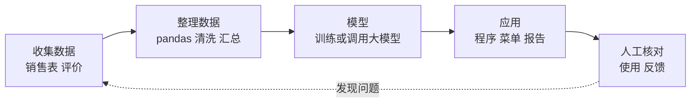
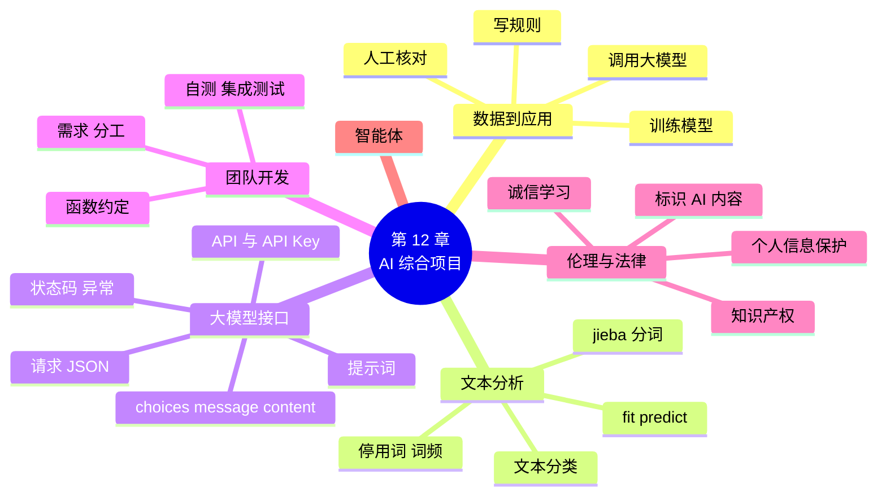

# 第 12 章 Python 与人工智能：综合项目

!!! abstract "本章学时"
    理论 4 学时 · 实验 2 学时（本章共 3 个实验，教师可任选）

## 学习目标

学完本章，你应该能够：

1. **说出** 一个 AI 应用从数据、模型到应用的基本流程，以及 API、API Key、提示词的含义（记忆）；
2. **解释** 机器学习“用数据训练模型”和自己写规则的区别（理解）；
3. **使用** jieba 分词统计关键词，用 scikit-learn 训练一个简单的文本分类模型（应用）；
4. **使用** requests 调用大模型接口，从回复的 JSON 中取出内容，并处理常见错误（应用）；
5. **合作完成** 一个由多个模块组成的小项目，并能判断编程和使用 AI 时的做法是否合法、合规（应用、评价）。

!!! info "先修要求"
    学习本章前，你需要：

    - 会用字典计数、按值排序（[第 7 章](../07-dicts/index.md)），会读写文件和用 try-except 处理异常（[第 9 章](../09-files/index.md)）；
    - 知道 JSON 和字典的对应关系（[9.4 JSON 文件](../09-files/index.md#94)）；
    - 会导入自己写的模块，看得懂 `model.fit()` 的写法（[第 10 章](../10-modules-oop/index.md)）；
    - 会用 pandas 筛选和分组汇总（[第 11 章](../11-data-libs/index.md)）。

??? abstract "本章概念清单（10 个，点击查看定义和例子）"
    1. [机器学习](../../appendix/glossary.md#g-机器学习)
    2. [分词](../../appendix/glossary.md#g-分词)
    3. [文本分类](../../appendix/glossary.md#g-文本分类)
    4. [API](../../appendix/glossary.md#g-API)
    5. [API Key](../../appendix/glossary.md#g-API-Key)
    6. [HTTP 状态码](../../appendix/glossary.md#g-HTTP-状态码)
    7. [提示词](../../appendix/glossary.md#g-提示词)
    8. [大语言模型](../../appendix/glossary.md#g-大语言模型)
    9. [智能体](../../appendix/glossary.md#g-智能体)
    10. [需求分析](../../appendix/glossary.md#g-需求分析)

## 情景导入

一个学期下来，小周已经为街坊便利店写了不少小程序：收银、会员查询、销售日报、月度图表……陈姐很满意，又提出了新的想法：

“每周一早上，我都要花半个小时翻上周的数据，写一段经营小结发到店员群里。现在 AI 这么厉害，能不能让它帮我写？还有顾客在小程序里留的评价，好的坏的混在一起，能不能自动分一分？”

小周想了想，这其实是三件事：用 jieba 把顾客评价拆成词，看看大家最常说什么；用一个小模型自动判断评价是好评还是差评；把一周的数据整理好，交给大模型写成一段通顺的小结。

再把以前的功能合在一起，就是一个像样的“小店管理助手”了。这么多功能一个人写太慢，小周拉上了两位同学组成小组，各写一部分，最后拼起来。

这一章是全书的综合项目。你会把前面学过的字符串、字典、函数、文件、模块、pandas 全部用上，第一次接触“机器学习”和“调用大模型”，并体验团队合作开发的流程。

## 12.1 从数据到模型到应用 { #121 }

### 12.1.1 让程序“变聪明”的三种办法 { #1211 }

同样是“判断一条评价是好评还是差评”，程序可以有三种做法：

| 做法 | 怎么做 | 优点 | 缺点 |
|---|---|---|---|
| 写规则 | 自己写 if：包含“太久”“缺货”“贵”就是差评 | 简单，结果可解释 | 规则写不完，换个说法就认不出 |
| 训练模型（[**机器学习**](../../appendix/glossary.md#g-机器学习 "不靠人写规则，而是让模型从数据中自己总结规律，再用规律对新数据做判断"){ .term }） | 准备一批标好“好评/差评”的评价，让模型自己总结规律 | 不用自己想规则，数据越多越准 | 需要标好的数据，结果可能出错 |
| 调用大模型 | 把评价发给大模型，问它“这是好评还是差评” | 不用准备数据，理解能力强 | 要联网、可能收费，要注意数据安全 |

第 4 章的分支结构就是“写规则”。本章 12.2 节体验“训练模型”，12.3 节体验“调用大模型”。实际的 AI 应用常常三种办法一起用。

### 12.1.2 AI 应用的基本流程 { #1212 }

不管用哪种办法，一个 AI 应用大致都要经过下面几个环节：



图中每一个环节，你都已经学过对应的 Python 本领：收集和整理数据靠文件读写和 pandas；做成应用靠函数、模块和菜单程序。本章新学的只是中间“模型”这一环。最后一环“人工核对”同样重要：AI 给出的结果可能出错，**用之前要由人来核对**。

## 12.2 文本分析与机器学习体验 { #122 }

### 12.2.1 jieba 中文分词 { #1221 }

英文单词之间有空格，用 `split()` 就能拆开；中文的词和词之间没有空格，要靠专门的工具把句子切成一个个词，这叫[**分词**](../../appendix/glossary.md#g-分词 "把一句中文切分成一个个词的过程"){ .term }。jieba 是最常用的 Python 中文分词库，用 `pip install jieba` 安装。

```python
import jieba

s = "街坊便利店的鲜牛奶每天早上到货"
print(jieba.lcut(s))                  # 精确模式：最常用
print(jieba.lcut(s, cut_all=True))    # 全模式：列出所有可能的词
```

```text
['街坊', '便利店', '的', '鲜牛奶', '每天', '早上', '到货']
['街坊', '便利', '便利店', '的', '鲜牛奶', '牛奶', '每天', '早上', '上到', '到货']
```

`lcut` 返回一个列表。精确模式把句子切成最合理的词，适合做统计；全模式把所有可能成词的组合都列出来，会有重复和“上到”这样的怪词。第一次运行时，jieba 会显示几行“Building prefix dict...”的加载信息，这是正常的。

jieba 不认识的新词（如店名、商品名）可能被切开。用 `add_word` 告诉它：

```python
jieba.add_word("街坊便利店")
print(jieba.lcut(s))
```

```text
['街坊便利店', '的', '鲜牛奶', '每天', '早上', '到货']
```

分好词以后，用第 7 章学过的字典计数，就能找出顾客评价里最常出现的词。统计前要去掉“很”“的”“，”这类没有实际意义的**停用词**。完整的程序见实验 12-1。

!!! cert "证书考点 · 信息技术水平-人工智能（Python）"
    jieba 库是全国计算机等级考试二级 Python 大纲中“Python 计算生态”部分明确列出的第三方库。常考的用法有：`jieba.lcut(s)` 精确模式、`jieba.lcut(s, cut_all=True)` 全模式、`jieba.lcut_for_search(s)` 搜索引擎模式，以及 `jieba.add_word(w)` 添加新词；常结合字典做词频统计考查（详见[证书考点对照](../../certificate.md)）。

### 12.2.2 三步训练一个分类模型 { #1222 }

现在体验机器学习：让模型从 32 条标好“好评/差评”的评价中自己学习，然后判断新的评价。下面用到 scikit-learn 库（`pip install scikit-learn`，导入时写 sklearn），这里只求“看懂、跑通”，原理留给后续的机器学习课程。

先看看数据（`labs/data/review_labels.csv`，虚构）：

| 评价 | 类别 |
|---|---|
| 老板很热情 | 好评 |
| 东西很新鲜 | 好评 |
| 排队太久 | 差评 |
| 牛奶过期了 | 差评 |
| …… | …… |

程序见 `labs/ch12/demo12_2_classify.py`：

```python
import jieba
import pandas as pd
from sklearn.feature_extraction.text import CountVectorizer
from sklearn.naive_bayes import MultinomialNB

jieba.setLogLevel(20)                              # 不显示 jieba 的加载信息

df = pd.read_csv("../data/review_labels.csv")      # 32 条带标签的评价（虚构）

# 1. 把文字变成数字：统计每条评价里各个词出现的次数
vec = CountVectorizer(tokenizer=jieba.lcut, token_pattern=None)
X = vec.fit_transform(df["评价"])
print("一共认识", len(vec.vocabulary_), "个词")

# 2. 三步：创建模型、训练、预测（第 10 章见过的写法）
model = MultinomialNB()
model.fit(X, df["类别"])

new = ["包子很好吃，老板热情", "排队太久了，还缺货", "价格便宜，就是有点挤", "冷饮很冰"]
pred = model.predict(vec.transform(new))
prob = model.predict_proba(vec.transform(new))
for text, p, pr in zip(new, pred, prob):
    print(f"{text:<12} → {p}（好评可能性 {pr[0]:.0%}）")
```

```text
一共认识 64 个词
包子很好吃，老板热情   → 好评（好评可能性 99%）
排队太久了，还缺货    → 差评（好评可能性 2%）
价格便宜，就是有点挤   → 差评（好评可能性 13%）
冷饮很冰         → 好评（好评可能性 65%）
```

（实际运行时，最前面还会打印 3 条随机抽取的样本，这里省略。）

读懂这段程序只需要抓住三点：

1. **计算机只认数字**。`CountVectorizer` 先用 jieba 把每条评价分词，再数一数每个词出现了几次，把一句话变成一串数字。参数 `tokenizer=jieba.lcut` 就是告诉它“用 jieba 来分词”；
2. **训练还是那三步**：创建模型对象 → `fit` 训练 → `predict` 预测。这里用的“朴素贝叶斯”（MultinomialNB）是一种很适合文本分类的简单模型；
3. **模型会出错，也会“没把握”**。“价格便宜，就是有点挤”其实褒贬都有，模型判成了差评；“冷饮很冰”判成好评，但只有 65% 的把握。训练数据只有 32 条，模型学到的东西很有限。真实的项目要用成千上万条数据，并且要拿一批模型**没见过**的数据来测试准确率。

像这样让程序自动判断一段文字属于哪一类，叫[**文本分类**](../../appendix/glossary.md#g-文本分类 "让程序自动判断一段文字属于哪一类"){ .term }。垃圾短信识别、新闻自动分栏目、客服工单自动分派，用的都是这类技术。

## 12.3 调用大模型接口 { #123 }

### 12.3.1 API、API Key 与 token { #1231 }

大模型的全称是[**大语言模型**](../../appendix/glossary.md#g-大语言模型 "用海量文字训练出来、能理解和生成自然语言的大型 AI 模型，简称大模型"){ .term }（LLM），它们非常庞大，普通电脑运行不了，它们运行在服务商的服务器上。我们的程序通过网络把问题发过去，服务器把模型的回答发回来。程序之间这样约定好格式、互相调用的方式，叫 [**API**](../../appendix/glossary.md#g-API "程序之间约定好格式、互相调用功能的方式，也叫应用程序接口"){ .term }（应用程序接口）。

使用之前，要在服务商的开放平台注册账号、实名认证，然后创建一个 [**API Key**](../../appendix/glossary.md#g-API-Key "服务商发给用户、调用 API 时用来证明身份的一串密钥，要妥善保管"){ .term }，它是一长串字符，相当于你的“通行证”，每次请求都要带上。服务商按使用量收费，计量单位是**词元**（token）：发过去的问题和收到的回答都要算词元。

!!! danger "API Key 等于你的钱包"
    别人拿到你的 API Key，就能以你的名义调用、花你的钱。所以：

    1. **不要把 API Key 直接写在代码里**，更不要把含有密钥的代码发到群里、上传到网上。本书的程序从“环境变量”中读取密钥；
    2. 不要截图外传。万一泄露，立即到开放平台删除这个 Key，重新创建一个；
    3. 在平台上设置消费上限，避免程序写错（如死循环）反复调用，产生大额费用。

发给大模型的问题，也叫[**提示词**](../../appendix/glossary.md#g-提示词 "发给大模型的问题或指令"){ .term }（prompt）。提示词写得好不好，直接影响回答的质量。写提示词有几个简单的技巧：

| 技巧 | 不好的写法 | 好的写法 |
|---|---|---|
| 说明身份和任务 | 写个小结 | 你是一家社区便利店的经营助理，请写本周经营小结 |
| 给出数据 | （不给数据，让它自己编） | 营业额：2446.9 元，订单数：101 单…… |
| 规定格式和长度 | 写详细点 | 不超过 150 字，分“总体情况、亮点、建议”三点 |

一定要把**真实的数据**交给大模型，并要求它只根据这些数据写。否则大模型可能会“编造”出看起来很合理、实际不存在的数字。

### 12.3.2 用 requests 发送请求 { #1232 }

国内外大多数大模型服务（如 DeepSeek、阿里云百炼上的通义千问）都提供了相同格式的接口，常称为“OpenAI 兼容格式”<sup class="cite">[[3]](#ref12-3)</sup><sup class="cite">[[4]](#ref12-4)</sup>：用 POST 方式把一段 JSON 发到 `接口地址/chat/completions`，服务器回复一段 JSON。下面用 requests 库（`pip install requests`）来发请求。

为了让每位同学都能在没有账号、不花钱、不联网的情况下练习，配套资源提供了一个**模拟服务器** `labs/ch12/mock_llm_server.py`。它在你自己的电脑上运行，请求和回复的格式与真实接口相同，只是回答按固定模板生成，不会真正思考。先在一个命令行窗口运行它（不要关闭）：

```text
python mock_llm_server.py
```

```text
模拟服务器已启动：http://127.0.0.1:8000  （按 Ctrl+C 停止）
```

`127.0.0.1` 是“本机”的意思。然后在 Thonny 中运行下面的程序：

```python
import json
import requests

headers = {"Authorization": "Bearer test-key"}               # 带上 API Key
data = {"model": "mock-model",                               # 用哪个模型
        "messages": [{"role": "user", "content": "营业额：2446.9 元\n订单数：101 单"}]}

resp = requests.post("http://127.0.0.1:8000/chat/completions",
                     headers=headers, json=data, timeout=60)
print(resp.status_code)
result = resp.json()                                         # JSON 文本变成字典
print(json.dumps(result, ensure_ascii=False, indent=2))      # 整齐地打印出来看看
```

```text
200
{
  "id": "chatcmpl-mock-1793498934",
  "object": "chat.completion",
  "created": 1793498934,
  "model": "mock-model",
  "choices": [
    {
      "index": 0,
      "message": {
        "role": "assistant",
        "content": "【本周经营小结】\n1. 总体情况：营业额：2446.9 元；订单数：101 单。\n2. 亮点：销售额最高的商品可以继续保证货源，周末客流大，可提前备货。\n3. 建议：针对顾客反映的问题（如排队）安排高峰时段加开收银。\n（以上内容由模拟服务器按模板生成，仅用于练习。）"
      },
      "finish_reason": "stop"
    }
  ],
  "usage": {
    "prompt_tokens": 22,
    "completion_tokens": 133,
    "total_tokens": 155
  }
}
```

逐项看看请求和回复：

- **请求**：`requests.post(地址, headers=请求头, json=数据, timeout=秒数)`。请求头中的 `Authorization` 写 `Bearer` 加一个空格再加 API Key；`json=data` 让 requests 自动把字典转成 JSON 文本发送；`messages` 是一个列表，每条消息是一个字典，`role` 为 `"user"` 表示这是用户说的话；`timeout=60` 表示最多等 60 秒；
- **回复**：`resp.status_code` 是 [**HTTP 状态码**](../../appendix/glossary.md#g-HTTP-状态码 "服务器回复请求时附带的三位数字，表示请求的结果"){ .term }，200 表示成功；`resp.json()` 把回复的 JSON 变成字典。回答的文字藏在好几层里面：`result["choices"][0]["message"]["content"]`，choices 是一个列表，所以要先取第 0 个；`usage` 记录了这次用了多少词元（模拟服务器按字数估算，真实服务按模型的规则计算）。

下面的动画把这个过程分成三步，还可以体验“密钥为空”和“服务器没启动”两种出错情况：

<iframe class="sim-frame" src="../../sims/llm-request/main.html" height="760" loading="lazy" title="大模型接口：一次请求与回复"></iframe>

动画：大模型接口的一次请求与回复。按“下一步”依次观察请求、回复和取出内容，回复格式与模拟服务器一致。[全屏打开](../../sims/llm-request/main.html){ target=_blank }
{ .sim-caption }

请求不一定成功。常见的状态码如下（以 DeepSeek 的文档为例<sup class="cite">[[3]](#ref12-3)</sup>）：

| 状态码 | 含义 | 常见原因 |
|---|---|---|
| 200 | 成功 | |
| 400 | 格式错误 | 请求的 JSON 写错了，如缺少 messages |
| 401 | 认证失败 | API Key 写错、过期或没带 |
| 402 | 余额不足 | 账户没钱了 |
| 429 | 请求太频繁 | 短时间内请求太多次，稍等再试 |
| 500、503 | 服务器故障或繁忙 | 服务商的问题，稍后再试 |

另外，如果网络不通或服务器没启动，请求根本发不出去，requests 会抛出 `ConnectionError` 异常。所以正式的程序要先用 try-except 接住异常，再判断状态码，最后才去取回复内容，见实验 12-2。

### 12.3.3 换成真实的大模型 { #1233 }

真实服务和模拟服务器的用法完全相同，只需要换三样东西：接口地址、API Key、模型名称。实验 12-2 的程序从环境变量 `LLM_BASE_URL`、`LLM_API_KEY`、`LLM_MODEL` 中读取这三样，没有设置时就使用模拟服务器。以 DeepSeek 为例，在 Windows 的命令行中先设置环境变量，再在**同一个窗口**中运行程序：

```text
set LLM_BASE_URL=https://api.deepseek.com
set LLM_API_KEY=你在开放平台创建的密钥
set LLM_MODEL=deepseek-flash
python lab12_2_report.py
```

`set` 设置的环境变量只在这个命令行窗口中有效，关掉窗口就没了，比写在代码里安全。程序中用 `os.environ.get("LLM_API_KEY", "test-key")` 读取，意思是“有这个环境变量就用它的值，没有就用 test-key”。

!!! note "待实测"
    编者编写本书时（2026 年 11 月）没有可用的付费账号，上面接入真实服务的步骤**尚未实际运行**，本书展示的运行结果全部来自模拟服务器。接口地址和模型名称取自 DeepSeek 官方文档<sup class="cite">[[3]](#ref12-3)</sup>；大模型服务更新很快，模型名称经常变化，使用前请以服务商的最新文档为准。阿里云百炼（通义千问）的接口地址、模型名称见其官方文档<sup class="cite">[[4]](#ref12-4)</sup>，用法相同。

除了 requests，也可以用服务商推荐的 openai 库（`pip install openai`）调用，写法更短，但本质上做的是同样的事：组装 JSON、发送、解析回复。用 requests 写一遍，能帮你看清楚每一步到底发生了什么。

## 12.4 团队开发：从想法到程序 { #124 }

一个人写几十行的小程序，想到哪写到哪也能完成。几个人合作写一个几百行的项目，就需要一些方法，否则你改了我的代码、我等着你的函数，最后拼不起来。一个简单的团队开发流程如下，第一步[**需求分析**](../../appendix/glossary.md#g-需求分析 "开发前和用户一起弄清楚“程序要做什么”，并写成清单"){ .term }最容易被忽略，却决定了后面所有的工作：

| 阶段 | 做什么 | 本章项目中的例子 |
|---|---|---|
| 1. 需求分析 | 和用户商量，写清楚“程序要做什么” | 陈姐要：按天查销售、看月度营业额、看评价关键词、生成周报 |
| 2. 设计与分工 | 把程序拆成几个模块，每人负责一个；**约定好函数的名字、参数和返回值** | 组员 A 写 sales.py，B 写 reviews.py，C 写 report.py，组长写 main.py |
| 3. 编写与自测 | 各自写代码，在 `if __name__ == "__main__":` 下自测 | 直接运行 sales.py 测试几个日期 |
| 4. 集成与测试 | 把各模块拼起来，按测试表逐项测试，记录问题 | 输错日期、服务器没开时，程序不能崩溃 |
| 5. 交付与改进 | 写使用说明，交给用户使用，收集反馈 | 陈姐用了一周后提出新需求 |

第 2 步的“约定”最关键。例如组长和组员 A 约定：

```python
def day_summary(df, day):
    """返回某一天的 (营业额, 订单数, 销售额最高的商品)；这天没有记录时返回 None"""
```

有了这个约定（函数名、参数、返回什么），组长不用等 A 写完，就可以先写 main.py 中调用它的部分；A 也可以随时改进函数内部的写法，只要不改约定，就不会影响别人。这正是第 8 章“函数是一个黑盒子”的好处，文档字符串就是写在代码里的约定。

团队合作还有几个好习惯：

1. **统一代码风格**：都按 PEP 8 写，变量名有意义，关键处写注释；
2. **保存历史版本**：每完成一个功能就保存一份，出了问题可以退回。专业开发者用 Git 这类“版本管理”工具，自动记录每个人每次改了什么，后续课程会学到；
3. **代码互查**：写完后请同组同学读一遍，往往能发现自己看不出的错误；
4. **用 AI 辅助要说明**：哪些代码是 AI 帮忙写的，要在注释或报告中说明，并且自己要读懂、测试过。

## 12.5 编程伦理与法律 { #125 }

会编程，意味着你有能力批量地处理数据、自动地做事情。能力越大，越要守规矩。

**1. 保护个人信息**

《中华人民共和国个人信息保护法》于 2021 年 11 月 1 日起施行<sup class="cite">[[5]](#ref12-5)</sup>。姓名、手机号、身份证号、住址、消费记录都属于个人信息。和编程有关的几条底线：

- 收集个人信息要告知并取得本人同意，只收集需要的，不多收集；
- 不得非法买卖、提供、公开他人的个人信息。写爬虫批量抓取别人的个人信息、把会员表发到网上，都是违法行为；
- 把数据发给在线 AI 处理，也是把数据交给了第三方。真实的会员表、顾客评价中如果有姓名、手机号，**先删掉或换成编号**再发送，或者只发表头和虚构的示例数据。本书全部数据都是虚构的。

**2. 标识 AI 生成的内容**

国家互联网信息办公室等四部门发布的《人工智能生成合成内容标识办法》自 2025 年 9 月 1 日起施行，要求 AI 服务提供者对生成的文本、图片、音频、视频等内容添加标识<sup class="cite">[[6]](#ref12-6)</sup>。我们自己用 AI 写的周报、文案，对外发布时也应当说明“由 AI 生成”，不能冒充人工撰写，更不能用 AI 编造新闻、伪造他人的声音和图像。实验 12-2 在保存的小结末尾加上了“本内容由人工智能生成，请人工核对后使用”。

**3. 尊重知识产权**

网上的代码不等于可以随便用。开源代码也有“许可证”，规定了能不能商用、要不要注明出处。使用别人的代码，要遵守许可证，并注明来源。

**4. 诚信学习**

用 AI 帮忙学习编程是好事，但作业和考试要遵守老师的规定。把 AI 写的代码原样交上去，自己却看不懂，既是不诚信，也学不到本领。等级考试是闭卷上机，靠的还是自己的真本事。

## 12.6 前沿视窗：AI 编程智能体 { #126 }

第 1 章介绍的 AI 编程助手，主要是“你问它答”：你贴代码，它解释或修改，最终由你复制、运行。2025 年以来，AI 编程工具迅速发展为[**智能体**](../../appendix/glossary.md#g-智能体 "能根据任务自己决定下一步、调用工具（读写文件、运行命令等）并反复尝试直到完成的 AI 程序"){ .term }（Agent）：你用一句话描述任务，它自己去读项目里的文件、修改多个文件、在终端里运行命令和测试，看到报错再接着改，直到完成。

例如阿里云的通义灵码提供了文件查找、文件读取、文件修改、终端执行等十多种工具，供智能体模式调用<sup class="cite">[[7]](#ref12-7)</sup>；Anthropic 的 Claude Code 也能读懂整个项目、编辑文件、运行命令<sup class="cite">[[8]](#ref12-8)</sup>。还记得第 8 章说的吗？智能体本质上就是“大模型 + 一组工具函数”，大模型负责决定下一步调用哪个函数。

这会让编程变得不再需要学习吗？恰恰相反：

1. **你要能说清楚需求**。“帮我做个管理系统”这样含糊的要求，智能体只能瞎猜；能把需求拆成模块、约定好函数，才能让它干得又快又好，这正是 12.4 节学的内容；
2. **你要能读懂和检查它的结果**。智能体会犯错，有时还会“自信地”犯错。看不懂代码，就发现不了问题；
3. **你要把好安全关**。智能体能直接修改文件、运行命令，使用时要先在练习文件夹中试，重要文件先备份，执行删除、上传等操作前要仔细确认。

学好基础，再用好 AI，你就能用一个人的力量做出过去一个小团队才能做的事。

## 本章实验

!!! abstract "实验总览"
    | 实验 | 类型 | 建议时长 | 内容 |
    |---|---|---|---|
    | 实验 12-1 | ★ 基础 | 30 分钟 | 用 jieba 统计顾客评价的关键词 |
    | 实验 12-2 | ★ 基础 | 40 分钟 | 用大模型接口根据一周数据生成经营小结（模拟服务器） |
    | 实验 12-3 | ★ 基础 | 线下 2 学时 | 团队项目：街坊便利店管理助手 |

    代码见配套资源 `labs/ch12/` 目录。需要安装 jieba、pandas、requests；12.2.2 节的体验程序另需 scikit-learn。

### 实验 12-1 ★ 统计顾客评价的关键词 { #lab12-1 }

**实验目的**

1. 会用 jieba 对中文分词；
2. 会去掉停用词，用字典统计词频并排序；
3. 会根据统计结果给出简单的经营建议。

**实验环境**：本机 CPU；需要安装 jieba（编者使用 0.42.1 版）。

**实验数据**：配套数据 `labs/data/reviews.txt`，80 条顾客评价，每行一条（虚构）。

**实验步骤与代码**

打开 `labs/ch12/lab12_1_keywords.py` 运行：

```python
# 实验 12-1 用 jieba 找出顾客评价里的关键词
# 需要先安装：pip install jieba
import jieba

# 1. 读入评价，一行一条
with open("../data/reviews.txt", encoding="utf-8") as f:
    reviews = [line.strip() for line in f if line.strip()]
print("共", len(reviews), "条评价")

# 2. 先看看分词的效果
print(jieba.lcut(reviews[0]))

# 3. 停用词：没有实际意义、不想统计的词
stop = {"很", "太", "都", "也", "就", "了", "的", "有", "是", "和", "，", "。", "！", "、"}

# 4. 逐条分词，用字典计数（第 7 章的方法）
counts = {}
for r in reviews:
    for w in jieba.lcut(r):
        if w in stop or len(w) < 2:      # 去掉停用词和单个字
            continue
        counts[w] = counts.get(w, 0) + 1

# 5. 按次数从多到少排序，输出前 10 个
top = sorted(counts.items(), key=lambda x: x[1], reverse=True)[:10]
print("出现最多的 10 个词：")
for w, n in top:
    print(f"  {w:<6}{n:>3} 次")

# 6. 看看提到“排队”的评价有几条
queue = [r for r in reviews if "排队" in r]
print("提到“排队”的评价有", len(queue), "条，例如：", queue[0])
```

**运行结果**

```text
共 80 条评价
Building prefix dict from the default dictionary ...
Loading model from cache /tmp/jieba.cache
Loading model cost 0.858 seconds.
Prefix dict has been built successfully.
['老板', '很', '热情', '，', '找零', '很快', '，', '排队', '太久', '。']
出现最多的 10 个词：
  方便     20 次
  店里     14 次
  价格     13 次
  找零     12 次
  很快     12 次
  东西     11 次
  新鲜     11 次
  老板     10 次
  热情     10 次
  离家近    10 次
提到“排队”的评价有 8 条，例如： 老板很热情，找零很快，排队太久。
```

中间 4 行是 jieba 第一次分词时加载词典的提示（Windows 上缓存文件的路径不同），不影响结果。代码说明：

- 第 1 步用列表推导式读入，`if line.strip()` 跳过空行；
- 第 4 步中 `len(w) < 2` 去掉了单个字，因为单字（如“香”）往往意思不完整，这是一种简单粗暴的做法，也会误删有用的字；
- “方便”出现最多，说明顾客最看重的是便利，这正是社区小店的优势；但“店里”既可能出现在“店里很干净”，也可能出现在“店里有点挤”，单看词频分不出好坏，还要回到原文看。

**实验记录表**

| 问题 | 结果 |
|---|---|
| 去掉 `len(w) < 2` 这个条件，前 10 名有什么变化？ | |
| 把“排队”换成“缺货”“面包”，各有几条？ | |
| 用 `jieba.add_word("排队太久")` 后再统计，“排队太久”出现几次？ | |

**常见问题排查**

| 现象 | 原因 | 解决办法 |
|---|---|---|
| `ModuleNotFoundError: No module named 'jieba'` | 没有安装 | Thonny 用“管理包”安装 jieba |
| `UnicodeDecodeError` | 打开文件时没写 encoding | 加上 `encoding="utf-8"` |
| 统计结果里有“，”“。” | 停用词集合里没有这个标点 | 把它加进 stop 集合 |

**思考与练习**

1. 用 Matplotlib 把前 10 个词画成横向柱状图（`plt.barh`）。
2. 准备两个列表：好评短语和差评短语，统计含有差评短语的评价有几条，找出顾客最不满意的两个问题。

**实验报告要求**

提交运行截图、实验记录表，以及你根据统计结果给陈姐提的一条经营建议。

### 实验 12-2 ★ 让大模型写本周经营小结 { #lab12-2 }

**实验目的**

1. 会用 pandas 把一周的数据整理成文字，写出清楚的提示词；
2. 会用 requests 发送请求、从回复的 JSON 中取出内容；
3. 会处理连接失败、状态码不是 200 等错误，会从环境变量读取 API Key；
4. 知道 AI 生成的内容要标识、要人工核对。

**实验环境**：本机 CPU；需要安装 pandas、requests（编者使用 requests 2.34.2 版）。默认使用模拟服务器，不需要联网和账号。

**实验数据**：配套数据 `labs/data/sales_2025.csv` 中 2025 年 12 月 22 日至 28 日的销售记录（虚构）。

**实验步骤与代码**

1. 打开一个命令行窗口，用 `cd` 进入 `labs/ch12` 文件夹，运行 `python mock_llm_server.py`，看到“模拟服务器已启动”后**不要关闭**这个窗口；
2. 在 Thonny 中打开 `labs/ch12/lab12_2_report.py` 运行：

```python
# 实验 12-2 让大模型根据一周销售数据写经营小结
# 需要先安装：pip install pandas requests
# 默认连接本机的模拟服务器（先运行 mock_llm_server.py）；换成真实大模型的方法见教材 12.3 节
import os
import pandas as pd
import requests

# ---------- 第一步：用 pandas 算出一周的数据 ----------
df = pd.read_csv("../data/sales_2025.csv")
week = df[(df["日期"] >= "2025-12-22") & (df["日期"] <= "2025-12-28")]
total = week["金额"].sum()
orders = week["单号"].nunique()
top3 = week.groupby("商品名称")["金额"].sum().sort_values(ascending=False).head(3)
by_day = week.groupby("日期")["金额"].sum()

facts = (f"统计时间：2025-12-22 至 2025-12-28\n"
         f"营业额：{total:.1f} 元\n"
         f"订单数：{orders} 单\n"
         f"销售额前三：{'、'.join(f'{k}{v:.0f}元' for k, v in top3.items())}\n"
         f"营业额最高的一天：{by_day.idxmax()}（{by_day.max():.1f} 元）\n"
         f"顾客意见：排队太久（8 条评价提到）")
print(facts)

# ---------- 第二步：组装请求 ----------
BASE_URL = os.environ.get("LLM_BASE_URL", "http://127.0.0.1:8000")   # 接口地址
API_KEY = os.environ.get("LLM_API_KEY", "test-key")                  # 密钥：从环境变量读，不写在代码里
MODEL = os.environ.get("LLM_MODEL", "mock-model")                    # 模型名称

prompt = ("你是一家社区便利店的经营助理。请根据下面的数据，用不超过 150 字写一段本周经营小结，"
          "分“总体情况、亮点、建议”三点：\n" + facts)
headers = {"Authorization": "Bearer " + API_KEY, "Content-Type": "application/json"}
data = {"model": MODEL,
        "messages": [{"role": "user", "content": prompt}],
        "temperature": 0.7}

# ---------- 第三步：发送请求，取出回复 ----------
try:
    resp = requests.post(BASE_URL + "/chat/completions", headers=headers, json=data, timeout=60)
except requests.exceptions.ConnectionError:
    print("连接失败：请检查模拟服务器是否已启动，或网络、地址是否正确")
else:
    if resp.status_code == 200:
        result = resp.json()                                   # 把回复的 JSON 变成字典
        answer = result["choices"][0]["message"]["content"]   # 一层层取出回复内容
        print("\n" + answer)
        print("\n本次用量：", result["usage"]["total_tokens"], "个 token")
        with open("本周经营小结.txt", "w", encoding="utf-8") as f:
            f.write(answer + "\n\n（本内容由人工智能生成，请人工核对后使用）\n")
        print("已保存到 本周经营小结.txt")
    else:
        print("请求失败，状态码", resp.status_code, "：", resp.json()["error"]["message"])
```

**运行结果**

```text
统计时间：2025-12-22 至 2025-12-28
营业额：2446.9 元
订单数：101 单
销售额前三：花生油1.8L399元、坚果礼包319元、大米5kg295元
营业额最高的一天：2025-12-27（527.4 元）
顾客意见：排队太久（8 条评价提到）

【本周经营小结】
1. 总体情况：统计时间：2025-12-22 至 2025-12-28；营业额：2446.9 元；订单数：101 单；销售额前三：花生油1.8L399元、坚果礼包319元、大米5kg295元；营业额最高的一天：2025-12-27（527.4 元）；顾客意见：排队太久（8 条评价提到）。
2. 亮点：销售额最高的商品可以继续保证货源，周末客流大，可提前备货。
3. 建议：针对顾客反映的问题（如排队）安排高峰时段加开收银。
（以上内容由模拟服务器按模板生成，仅用于练习。）

本次用量： 444 个 token
已保存到 本周经营小结.txt
```

再做两个出错试验，编者的运行结果如下：

| 操作 | 输出的最后一行 |
|---|---|
| 关闭模拟服务器窗口后再运行 | `连接失败：请检查模拟服务器是否已启动，或网络、地址是否正确` |
| 启动模拟服务器，在命令行中 `set LLM_API_KEY=` 设为空后再运行 | `请求失败，状态码 401 ： 缺少或错误的 API Key` |

代码说明：

- 第一步中，日期是“2025-12-22”这样格式统一的文字，可以直接用 `>=`、`<=` 比较大小筛选一段日期；
- 第二步的提示词说明了身份、任务、字数和格式，并把 pandas 算好的真实数据放了进去；
- 第三步用 try-except-else：连接失败走 except；连上了走 else，再看状态码；
- 模拟服务器的回答只是把数据填进模板，所以“总体情况”写得很生硬。真实的大模型会写出通顺的文字，但也可能把数字写错，**一定要和第一步打印的数据核对**。

**实验记录表**

| 问题 | 结果 |
|---|---|
| 把统计时间改成 2025-12-15 至 2025-12-21，营业额和订单数是多少？ | |
| 把 `["choices"][0]` 写成 `["choices"]`，会报什么错？为什么？ | |
| 在模拟服务器窗口中，每次请求显示了什么？ | |
| （有条件时）换成真实的大模型服务，回答和模拟服务器有什么不同？数字都对吗？ | |

**常见问题排查**

| 现象 | 原因 | 解决办法 |
|---|---|---|
| 连接失败 | 模拟服务器没启动，或被关掉了 | 先运行 mock_llm_server.py，并保持窗口打开 |
| 启动模拟服务器时报 `OSError: [Errno 98]` 或 `[WinError 10048]` | 8000 端口已被占用（比如服务器已经开着一个） | 关掉之前的服务器窗口，或把两个程序中的 8000 都改成 8001 |
| 状态码 401 | API Key 为空或错误 | 检查环境变量 LLM_API_KEY |
| 真实服务报 402 | 账户余额不足 | 到开放平台充值，或继续使用模拟服务器 |
| 等很久才报 `ReadTimeout` | 回答太长或服务器太忙 | 稍后再试，或缩短要求的字数 |

**思考与练习**

1. 把实验 12-1 统计出的前 5 个关键词也加进 facts，让小结能反映顾客的评价。
2. 改写提示词，让大模型以“给店员的一封短信”的口吻写，比较两种提示词的回答（需要真实服务）。

**实验报告要求**

提交运行截图、实验记录表和你写的提示词。如使用了真实的大模型服务，截图前**务必遮住 API Key**。

### 实验 12-3 ★ 团队项目：街坊便利店管理助手 { #lab12-3 }

**实验目的**

1. 体验需求分析、分工、自测、集成、测试的团队开发流程；
2. 会把程序拆成多个模块，按约定好的函数互相调用；
3. 综合运用全书知识，完成一个有菜单的实用程序。

**实验环境**：本机 CPU；需要安装 pandas、jieba、requests。建议 3～4 人一组，线下课完成。

**实验数据**：配套数据 `labs/data/sales_2025.csv`、`labs/data/reviews.txt`（虚构）。

**实验步骤与代码**

1. **需求分析**（20 分钟）：小组讨论，列出“管理助手”要有哪些功能。配套代码已经实现了 4 个功能，每组至少再增加 1 个自己的功能；
2. **分工**（10 分钟）：每人负责一个模块，组长负责 main.py。写下每个函数的约定（名字、参数、返回值）；
3. **编写与自测**（40 分钟）：各自完成模块，直接运行自己的文件，用 `if __name__ == "__main__":` 下的代码自测；
4. **集成与测试**（20 分钟）：把模块放进同一个文件夹，运行 main.py，按下面的测试表逐项测试；
5. **展示**（每组 5 分钟）：演示程序，说说分工和遇到的问题。

配套代码 `labs/ch12/shop_assistant/` 文件夹中有 4 个文件。

sales.py（组员 A，销售查询）：

```python
# sales.py 销售查询模块（组员 A 负责）
import pandas as pd

DATA = "../../data/sales_2025.csv"


def load():
    """读入全年销售表，返回 DataFrame"""
    return pd.read_csv(DATA)


def day_summary(df, day):
    """返回某一天的 (营业额, 订单数, 销售额最高的商品)；这天没有记录时返回 None"""
    d = df[df["日期"] == day]
    if len(d) == 0:
        return None
    best = d.groupby("商品名称")["金额"].sum().idxmax()
    return float(round(d["金额"].sum(), 2)), d["单号"].nunique(), best


def monthly(df):
    """返回各月营业额（Series，索引是 1～12 月）"""
    month = df["日期"].str[5:7].astype(int)
    return df.groupby(month)["金额"].sum().round(1)


def week_facts(df, start, end):
    """把 start～end 这几天的数据整理成几行文字，供大模型写小结"""
    w = df[(df["日期"] >= start) & (df["日期"] <= end)]
    top3 = w.groupby("商品名称")["金额"].sum().sort_values(ascending=False).head(3)
    by_day = w.groupby("日期")["金额"].sum()
    return (f"统计时间：{start} 至 {end}\n"
            f"营业额：{w['金额'].sum():.1f} 元\n"
            f"订单数：{w['单号'].nunique()} 单\n"
            f"销售额前三：{'、'.join(top3.index)}\n"
            f"营业额最高的一天：{by_day.idxmax()}")


if __name__ == "__main__":          # 组员自测：直接运行本文件
    df = load()
    print(day_summary(df, "2025-03-08"))
    print(day_summary(df, "2025-13-01"))
    print(monthly(df).head(3).to_dict())
```

直接运行 sales.py 的自测结果：

```text
(307.6, 18, '洗衣液2kg')
None
{1: 10064.2, 2: 8290.3, 3: 10547.1}
```

3 月 8 日的营业额 307.6 元，和实验 10-2 生成的销售日报一致，说明函数是对的。`groupby(month)` 直接按一个算出来的 Series 分组，不用先把月份加成新列。

reviews.py（组员 B，评价分析）：

```python
# reviews.py 顾客评价分析模块（组员 B 负责）
import jieba

jieba.setLogLevel(20)               # 不显示 jieba 加载词典时的提示信息
STOP = {"很", "太", "都", "也", "就", "了", "的", "有", "是", "和"}


def top_words(path, n=5):
    """统计评价文件中出现最多的 n 个词，返回 [(词, 次数), ...]"""
    counts = {}
    with open(path, encoding="utf-8") as f:
        for line in f:
            for w in jieba.lcut(line.strip()):
                if w in STOP or len(w) < 2:
                    continue
                counts[w] = counts.get(w, 0) + 1
    return sorted(counts.items(), key=lambda x: x[1], reverse=True)[:n]


def count_keyword(path, word):
    """统计包含某个词的评价条数"""
    with open(path, encoding="utf-8") as f:
        return sum(1 for line in f if word in line)


if __name__ == "__main__":
    print(top_words("../../data/reviews.txt"))
    print(count_keyword("../../data/reviews.txt", "排队"))
```

```text
[('方便', 20), ('店里', 14), ('价格', 13), ('找零', 12), ('很快', 12)]
8
```

report.py（组员 C，调用大模型）：

```python
# report.py 经营小结模块（组员 C 负责）：调用大模型接口，失败时给出提示
import os
import requests

BASE_URL = os.environ.get("LLM_BASE_URL", "http://127.0.0.1:8000")
API_KEY = os.environ.get("LLM_API_KEY", "test-key")
MODEL = os.environ.get("LLM_MODEL", "mock-model")


def ask_llm(prompt):
    """把 prompt 发给大模型，成功返回回复文字，失败返回以“出错：”开头的说明"""
    headers = {"Authorization": "Bearer " + API_KEY}
    data = {"model": MODEL, "messages": [{"role": "user", "content": prompt}]}
    try:
        resp = requests.post(BASE_URL + "/chat/completions", headers=headers, json=data, timeout=60)
    except requests.exceptions.RequestException:
        return "出错：连接不上大模型服务，请检查服务器或网络"
    if resp.status_code != 200:
        return f"出错：状态码 {resp.status_code}"
    return resp.json()["choices"][0]["message"]["content"]


def weekly_report(facts, complaint):
    prompt = ("你是一家社区便利店的经营助理。请根据下面的数据，用不超过 150 字写本周经营小结，"
              "分“总体情况、亮点、建议”三点：\n" + facts + "\n顾客意见：" + complaint)
    return ask_llm(prompt)


if __name__ == "__main__":
    print(ask_llm("营业额：100 元"))
```

main.py（组长，主程序）：

```python
# main.py 街坊便利店管理助手 主程序（组长负责，把各组员的模块组合起来）
# 运行前：在 shop_assistant 文件夹中运行本文件；使用功能 4 前先启动 ../mock_llm_server.py
import sales
import reviews
import report

REVIEWS = "../../data/reviews.txt"
MENU = """
===== 街坊便利店管理助手 =====
1. 查询某天的销售情况
2. 查看各月营业额
3. 顾客评价关键词
4. 生成本周经营小结（大模型）
0. 退出"""


def main():
    df = sales.load()
    while True:
        print(MENU)
        choice = input("请选择：").strip()
        if choice == "1":
            day = input("日期（如 2025-03-08）：").strip()
            r = sales.day_summary(df, day)
            if r is None:
                print("这一天没有销售记录，请检查日期格式")
            else:
                print(f"{day} 营业额 {r[0]} 元，{r[1]} 单，卖得最好的是 {r[2]}")
        elif choice == "2":
            for m, money in sales.monthly(df).items():
                print(f"{m:>2} 月 {money:>9.1f} 元 " + "■" * int(money // 1000))
        elif choice == "3":
            for w, n in reviews.top_words(REVIEWS):
                print(f"  {w}：{n} 次")
        elif choice == "4":
            facts = sales.week_facts(df, "2025-12-22", "2025-12-28")
            n = reviews.count_keyword(REVIEWS, "排队")
            text = report.weekly_report(facts, f"有 {n} 条评价提到排队太久")
            print(text)
            if not text.startswith("出错"):
                with open("本周经营小结.txt", "w", encoding="utf-8") as f:
                    f.write(text + "\n\n（本内容由人工智能生成，请人工核对后使用）\n")
                print("已保存到 本周经营小结.txt")
        elif choice == "0":
            print("再见！")
            break
        else:
            print("没有这个选项，请输入 0～4")


if __name__ == "__main__":
    main()
```

**运行结果**（先启动模拟服务器；依次输入 1、2025-03-08、2、3、4、0，为节省篇幅，重复出现的菜单只保留第一次）

```text
===== 街坊便利店管理助手 =====
1. 查询某天的销售情况
2. 查看各月营业额
3. 顾客评价关键词
4. 生成本周经营小结（大模型）
0. 退出
请选择：1
日期（如 2025-03-08）：2025-03-08
2025-03-08 营业额 307.6 元，18 单，卖得最好的是 洗衣液2kg
请选择：2
 1 月   10064.2 元 ■■■■■■■■■■
 2 月    8290.3 元 ■■■■■■■■
 3 月   10547.1 元 ■■■■■■■■■■
 4 月    9881.0 元 ■■■■■■■■■
 5 月   11370.3 元 ■■■■■■■■■■■
 6 月   10076.1 元 ■■■■■■■■■■
 7 月    8635.0 元 ■■■■■■■■
 8 月    8298.2 元 ■■■■■■■■
 9 月    8496.4 元 ■■■■■■■■
10 月   10437.7 元 ■■■■■■■■■■
11 月   10987.6 元 ■■■■■■■■■■
12 月   11150.9 元 ■■■■■■■■■■■
请选择：3
  方便：20 次
  店里：14 次
  价格：13 次
  找零：12 次
  很快：12 次
请选择：4
【本周经营小结】
1. 总体情况：统计时间：2025-12-22 至 2025-12-28；营业额：2446.9 元；订单数：101 单；销售额前三：花生油1.8L、坚果礼包、大米5kg；营业额最高的一天：2025-12-27；顾客意见：有 8 条评价提到排队太久。
2. 亮点：销售额最高的商品可以继续保证货源，周末客流大，可提前备货。
3. 建议：针对顾客反映的问题（如排队）安排高峰时段加开收银。
（以上内容由模拟服务器按模板生成，仅用于练习。）
已保存到 本周经营小结.txt
请选择：0
再见！
```

功能 2 不用 Matplotlib，而是用 `"■" * 整数` 在终端里画了一个简易的横向柱状图，每个方块代表 1000 元。

**集成测试表**（编者已按此表测试，“实际结果”一栏为编者的运行结果；增加新功能后，请补充自己的测试项）

| 编号 | 操作 | 预期结果 | 实际结果 |
|---|---|---|---|
| 1 | 选 1，输入 2025-03-08 | 显示营业额 307.6 元、18 单 | 通过 |
| 2 | 选 1，输入 2025-3-8 | 提示“这一天没有销售记录”，不崩溃 | 通过 |
| 3 | 输入 5 | 提示“没有这个选项” | 通过 |
| 4 | 没有启动模拟服务器，选 4 | 提示“出错：连接不上大模型服务”，不崩溃 | 通过 |
| 5 | 选 0 | 显示“再见！”并退出 | 通过 |

**常见问题排查**

| 现象 | 原因 | 解决办法 |
|---|---|---|
| `ModuleNotFoundError: No module named 'sales'` | main.py 和各模块不在同一个文件夹 | 4 个文件放在同一个文件夹中 |
| `FileNotFoundError` | 数据路径不对 | 模块中的路径是相对于 shop_assistant 文件夹的，确认在这个文件夹中运行 |
| 组员的函数一调用就报 `TypeError` | 参数的个数或顺序和约定不一致 | 对照文档字符串中的约定，统一修改 |
| 改了组员的模块后功能 1 不对了 | 多人改同一个文件 | 每人只改自己负责的文件；改约定前先和组长商量 |

**思考与练习**（每组至少选做一项，作为新增功能）

1. 功能 5：输入商品名称，显示它全年的销量（件）和销售额。
2. 功能 6：用 12.2.2 节的模型，判断用户输入的一条新评价是好评还是差评。
3. 功能 7：把功能 2 的月度营业额画成折线图并保存为图片。
4. 把功能 4 的统计时间改成由用户输入开始日期，自动算出 7 天后的结束日期（提示：第 10 章的 datetime 和 timedelta）。

**实验报告要求**

每组提交一份报告：需求清单、分工表（谁负责哪个模块和哪些函数）、函数约定、集成测试表、运行截图、每人一段 100 字左右的心得（写清楚自己做了什么、是否使用了 AI 以及怎样核对的）。

## 本章小结

- 让程序“变聪明”有三种办法：写规则、训练模型（**机器学习**）、调用大模型。AI 应用的流程是收集数据、整理数据、模型、应用、人工核对。
- 中文**分词**用 jieba：`lcut` 精确模式、`cut_all=True` 全模式、`lcut_for_search` 搜索引擎模式、`add_word` 添加新词；配合停用词和字典做词频统计。
- 机器学习体验：CountVectorizer 把文字变成数字，模型对象三步走：创建、fit、predict。**文本分类**模型会出错，数据越多越可靠。
- 大模型通过 **API** 调用：请求头带 **API Key**，JSON 中写 model 和 messages；回复内容在 `result["choices"][0]["message"]["content"]`；按词元计费。先 try-except 接住连接错误，再看 **HTTP 状态码**。API Key 不写进代码、不外传；**提示词**要说明身份、给出数据、规定格式。
- 团队开发：需求分析、设计分工、编写自测、集成测试、交付改进。关键是约定好函数的名字、参数和返回值。
- 遵守个人信息保护法，标识 AI 生成的内容，尊重知识产权，诚信学习。AI 编程**智能体**能自己改文件、跑命令，更需要你说清需求、读懂结果、把好安全关。



**全书结语**

从第 1 章的 `print("你好")` 到这一章的小店管理助手，你已经走完了 Python 编程的入门之路：会用变量、分支、循环描述解决问题的步骤，会用列表、字典组织数据，会用函数和模块组织程序，会读写文件、处理表格、画图，还会调用 AI。接下来的机器学习、深度学习、自然语言处理等课程，都会在这些本领的基础上展开。编程是练出来的，多写、多改、多读别人的代码，你会越来越熟练。

## 参考文献

正文中的上标编号（如<sup class="cite">[[3]](#ref12-3)</sup>）对应下面的文献。带链接的可以直接打开；书籍可在图书馆或电子书平台查阅。

<div class="refs" markdown>

**教材与专著**

- <span id="ref12-1"></span>[1] 嵩天, 礼欣, 黄天羽. Python 语言程序设计基础[M]. 2 版. 北京: 高等教育出版社, 2017.
    <span class="ref-note">第 6 章的“文本词频统计”实例用 jieba 统计《三国演义》中的人物出场次数，第 10 章介绍 Python 计算生态，对应 12.2.1 节和实验 12-1。</span>

**经典论文与标准**

- <span id="ref12-5"></span>[5] 全国人民代表大会常务委员会. 中华人民共和国个人信息保护法[Z]. 2021-08-20.
    <span class="ref-note">我国保护个人信息的专门法律，2021 年 11 月 1 日起施行，对应 12.5 节。</span>
- <span id="ref12-6"></span>[6] 国家互联网信息办公室. 关于印发《人工智能生成合成内容标识办法》的通知[EB/OL]. (2025-03-14)[2026-11-01]. https://www.cac.gov.cn/2025-03/14/c_1743654685896173.htm.
    <span class="ref-note">国家网信办等四部门发布的办法，规定 AI 生成合成内容要添加标识，2025 年 9 月 1 日起施行，对应 12.5 节。</span>

**在线资源与数据**

- <span id="ref12-2"></span>[2] scikit-learn developers. Working with text data[EB/OL]. [2026-11-01]. https://scikit-learn.org/stable/tutorial/text_analytics/working_with_text_data.html.
    <span class="ref-note">scikit-learn 官方的文本分类教程，用 CountVectorizer 和朴素贝叶斯给新闻分类，对应 12.2.2 节。</span>
- <span id="ref12-3"></span>[3] 深度求索. DeepSeek API 文档[EB/OL]. [2026-11-01]. https://api-docs.deepseek.com/zh-cn/.
    <span class="ref-note">DeepSeek 开放平台的中文文档，含接口地址、模型名称、请求示例和错误码说明，对应 12.3 节和实验 12-2。</span>
- <span id="ref12-4"></span>[4] 阿里云. 如何通过 OpenAI 接口调用千问模型[EB/OL]. [2026-11-01]. https://help.aliyun.com/zh/model-studio/compatibility-of-openai-with-dashscope.
    <span class="ref-note">阿里云百炼平台用 OpenAI 兼容格式调用通义千问的说明，含接口地址和 API Key 的环境变量设置，对应 12.3 节。</span>
- <span id="ref12-7"></span>[7] 阿里云. 通义灵码：工具使用[EB/OL]. [2026-11-01]. https://help.aliyun.com/zh/lingma/user-guide/tools.
    <span class="ref-note">介绍通义灵码智能体可以调用的文件读写、终端执行等编程工具，对应 12.6 节。</span>
- <span id="ref12-8"></span>[8] Anthropic. Claude Code overview[EB/OL]. [2026-11-01]. https://code.claude.com/docs/en/overview.
    <span class="ref-note">Claude Code 的官方介绍，说明智能体式编程工具可以读懂项目、编辑文件、运行命令，对应 12.6 节。</span>

</div>

## 课后练习

选择题和判断题可以直接点击选项作答，系统会马上告诉你对错，并展开答案与解析；多选题选好后点“提交答案”。简答和实操题请先自己作答，再点开“答案与解析”核对。每道题的解析下方都有“回看”链接，做错了可以直接跳回正文复习。

**一、单项选择题**

<div class="quiz" data-answer="C" markdown>

**1.** `jieba.lcut("会员积分很划算")` 的结果是（　　）。

- A. `"会员 积分 很 划算"`
- B. `('会员', '积分', '很', '划算')`
- C. `['会员', '积分', '很', '划算']`
- D. `{'会员', '积分', '很', '划算'}`

</div>

??? tip "答案与解析"
    **答案：C**

    lcut 返回列表（l 就是 list 的意思）。

    考查：jieba 分词 · 认知层次：记忆 · [回看 12.2.1](#1221)
    { .quiz-meta }

<div class="quiz" data-answer="B" markdown>

**2.** 要让 jieba 把“街坊便利店”当成一个词，应使用（　　）。

- A. `jieba.lcut("街坊便利店", cut_all=True)`
- B. `jieba.add_word("街坊便利店")`
- C. `jieba.new("街坊便利店")`
- D. `jieba.lcut_for_search("街坊便利店")`

</div>

??? tip "答案与解析"
    **答案：B**

    add_word 向词典中添加新词；全模式和搜索引擎模式会切出更多的词，而不是把它们合成一个。

    考查：jieba 分词 · 认知层次：记忆 · [回看 12.2.1](#1221)
    { .quiz-meta }

<div class="quiz" data-answer="A" markdown>

**3.** 在 scikit-learn 中，用数据训练模型的方法通常叫（　　）。

- A. `fit`
- B. `predict`
- C. `train`
- D. `learn`

</div>

??? tip "答案与解析"
    **答案：A**

    三步：创建模型对象、fit 训练、predict 预测。

    考查：机器学习体验 · 认知层次：记忆 · [回看 12.2.2](#1222)
    { .quiz-meta }

<div class="quiz" data-answer="D" markdown>

**4.** 调用大模型接口时，服务器返回状态码 401，最可能的原因是（　　）。

- A. 网络断了
- B. 请求太频繁
- C. 服务器内部故障
- D. API Key 错误或没有带上

</div>

??? tip "答案与解析"
    **答案：D**

    401 是认证失败；网络断了根本收不到状态码，requests 会抛出 ConnectionError；请求太频繁是 429；服务器故障是 500。

    考查：HTTP 状态码 · 认知层次：理解 · [回看 12.3.2](#1232)
    { .quiz-meta }

<div class="quiz" data-answer="C" markdown>

**5.** 按 OpenAI 兼容格式调用大模型，回复的字典为 result，取出回答文字的正确写法是（　　）。

- A. `result["content"]`
- B. `result["choices"]["message"]["content"]`
- C. `result["choices"][0]["message"]["content"]`
- D. `result["message"][0]["content"]`

</div>

??? tip "答案与解析"
    **答案：C**

    choices 是一个列表，要先用 [0] 取出第一个元素（字典），再取 message，再取 content。

    考查：解析 JSON 回复 · 认知层次：应用 · [回看 12.3.2](#1232)
    { .quiz-meta }

<div class="quiz" data-answer="B" markdown>

**6.** 保管 API Key 的做法，正确的是（　　）。

- A. 直接写在代码里，方便同学复制运行
- B. 存放在环境变量中，程序运行时读取
- C. 截图发到班级群里备份
- D. 写在实验报告里，方便老师检查

</div>

??? tip "答案与解析"
    **答案：B**

    API Key 相当于钱包，泄露后别人可以用你的账户调用、花你的钱。

    考查：API Key 安全 · 认知层次：评价 · [回看 12.3.1](#1231)
    { .quiz-meta }

<div class="quiz" data-answer="A" markdown>

**7.** 下面的提示词中，最可能得到准确、有用的经营小结的是（　　）。

- A. 你是便利店经营助理，请根据以下数据（营业额 2446.9 元、订单 101 单……）用不超过 150 字写本周小结，分三点
- B. 写个小结
- C. 帮我写一份很好的便利店周报，越长越好
- D. 你随便编一些数字，写一份看起来专业的周报

</div>

??? tip "答案与解析"
    **答案：A**

    好的提示词要说明身份和任务、给出真实数据、规定格式和长度。D 让模型编造数据，绝对不可取。

    考查：提示词 · 认知层次：评价 · [回看 12.3.1](#1231)
    { .quiz-meta }

<div class="quiz" data-answer="D" markdown>

**8.** 团队开发中，组长不用等组员写完函数就能先写调用它的代码，主要是因为（　　）。

- A. 组长写代码比较快
- B. Python 会自动生成函数
- C. 可以先用 AI 写一个
- D. 事先约定好了函数的名字、参数和返回值

</div>

??? tip "答案与解析"
    **答案：D**

    有了约定，调用的一方只需要知道“怎么调用、得到什么”，不必关心函数内部怎么写。

    考查：团队开发 · 认知层次：理解 · [回看 12.4](#124)
    { .quiz-meta }

**二、多项选择题**

<div class="quiz quiz-multi" data-answer="ABD" markdown>

**1.** 一次大模型接口请求中，通常需要包含（　　）。

- A. API Key（放在请求头中）
- B. 模型名称 model
- C. 服务器的密码
- D. 消息列表 messages

</div>

??? tip "答案与解析"
    **答案：ABD**

    请求头带 API Key，JSON 中写 model 和 messages。

    考查：大模型接口 · 认知层次：记忆 · [回看 12.3.2](#1232)
    { .quiz-meta }

<div class="quiz quiz-multi" data-answer="ACD" markdown>

**2.** 下列做法中，符合个人信息保护要求的有（　　）。

- A. 把会员表交给 AI 分析前，删掉姓名、手机号，只保留编号
- B. 写爬虫批量抓取网上别人的手机号，卖给推销公司
- C. 只收集业务需要的信息，并告知顾客用途
- D. 让 AI 写代码时，只发表头和几行虚构的示例数据

</div>

??? tip "答案与解析"
    **答案：ACD**

    B 是违法行为。

    考查：个人信息保护 · 认知层次：评价 · [回看 12.5](#125)
    { .quiz-meta }

<div class="quiz quiz-multi" data-answer="BC" markdown>

**3.** 关于机器学习训练出的文本分类模型，下列说法正确的有（　　）。

- A. 模型训练好以后，判断结果一定是对的
- B. 训练数据越多、越有代表性，模型通常越可靠
- C. 计算机要先把文字变成数字，模型才能学习
- D. 模型只能判断训练数据里出现过的原句

</div>

??? tip "答案与解析"
    **答案：BC**

    模型会出错，例如“价格便宜，就是有点挤”被判成了差评；模型学到的是词语和类别之间的规律，所以没见过的新句子也能判断。

    考查：文本分类 · 认知层次：理解 · [回看 12.2.2](#1222)
    { .quiz-meta }

**三、判断题**

<div class="quiz quiz-judge" data-answer="×" markdown>

**1.** 中文的词与词之间和英文一样有空格，所以用 `split()` 就能分词。（　　）

- √
- ×

</div>

??? tip "答案与解析"
    **答案：×**

    中文词之间没有空格，要用 jieba 这样的分词工具。

    考查：分词 · 认知层次：理解 · [回看 12.2.1](#1221)
    { .quiz-meta }

<div class="quiz quiz-judge" data-answer="√" markdown>

**2.** 网络不通时调用 `requests.post()`，程序会抛出异常，而不是返回一个状态码。（　　）

- √
- ×

</div>

??? tip "答案与解析"
    **答案：√**

    请求根本没送到服务器，就没有状态码，requests 抛出 ConnectionError，要用 try-except 接住。

    考查：异常处理 · 认知层次：理解 · [回看 12.3.2](#1232)
    { .quiz-meta }

<div class="quiz quiz-judge" data-answer="×" markdown>

**3.** 大模型的回答是根据大量数据训练出来的，所以其中的数字不需要核对。（　　）

- √
- ×

</div>

??? tip "答案与解析"
    **答案：×**

    大模型可能写错数字甚至编造内容，必须和原始数据核对。

    考查：人工核对 · 认知层次：评价 · [回看 12.1.2](#1212)
    { .quiz-meta }

<div class="quiz quiz-judge" data-answer="√" markdown>

**4.** 用 AI 生成的文案对外发布时，应当说明是由 AI 生成的。（　　）

- √
- ×

</div>

??? tip "答案与解析"
    **答案：√**

    《人工智能生成合成内容标识办法》自 2025 年 9 月 1 日起施行，要求对 AI 生成合成的内容进行标识。

    考查：AI 内容标识 · 认知层次：记忆 · [回看 12.5](#125)
    { .quiz-meta }

<div class="quiz quiz-judge" data-answer="×" markdown>

**5.** 有了 AI 编程智能体，只要说一句“帮我做个管理系统”，就不再需要学习编程了。（　　）

- √
- ×

</div>

??? tip "答案与解析"
    **答案：×**

    要能说清需求、拆分模块，能读懂和检查结果，还要把好安全关，这些都离不开编程基础。

    考查：AI 编程智能体 · 认知层次：评价 · [回看 12.6](#126)
    { .quiz-meta }

**四、简答题**

**1.** 读程序写结果。

```python
result = {"choices": [{"message": {"role": "assistant", "content": "你好"}}],
          "usage": {"total_tokens": 12}}
print(result["choices"][0]["message"]["content"], result["usage"]["total_tokens"])
```

??? tip "答案与解析"
    **参考答案**

    ```text
    你好 12
    ```

    按“列表用下标、字典用键”一层层取下去。

    考查：解析 JSON 回复 · 认知层次：应用 · [回看 12.3.2](#1232)
    { .quiz-meta }

**2.** 找错并改正。小周写了 `answer = result["choices"]["message"]["content"]`，运行时报错 `TypeError: list indices must be integers or slices, not str`，为什么？怎么改？

??? tip "答案与解析"
    **参考答案**

    `result["choices"]` 是一个列表，列表只能用整数下标（或切片）取元素，不能用字符串 "message"。应改为 `result["choices"][0]["message"]["content"]`，先取出列表的第 0 个元素（一个字典），再取 message。

    考查：解析 JSON 回复 · 认知层次：分析 · [回看 12.3.2](#1232)
    { .quiz-meta }

**3.** 陈姐想把全部会员的姓名、手机号和消费记录发给在线大模型，让它分析“哪些会员可能流失”。请你从个人信息保护的角度给她提两条建议。

??? tip "答案与解析"
    **参考答案**（言之有理即可）

    1. 发送前删掉姓名、手机号等能识别到具体个人的信息，只用会员编号代替，分析完再在本地对应回去；
    2. 更好的做法是只把表头和几行虚构的示例数据发给 AI，让它写出分析代码，再在自己的电脑上对真实数据运行，真实数据不出本机。此外，收集和使用会员信息要事先告知会员用途。

    考查：个人信息保护 · 认知层次：评价 · [回看 12.5](#125)
    { .quiz-meta }

**五、实操题**

**1.** 已知差评短语有“排队太久”“有时候缺货”“价格有点贵”“店里有点挤”“冷饮不够冰”“晚上没有面包了”。编程统计 `labs/data/reviews.txt` 中每种差评短语各出现在几条评价中，以及含有任一差评短语的评价共有几条。

??? tip "答案与解析"
    **参考答案**

    ```python
    bad = ["排队太久", "有时候缺货", "价格有点贵", "店里有点挤", "冷饮不够冰", "晚上没有面包了"]
    with open("../data/reviews.txt", encoding="utf-8") as f:
        reviews = [line.strip() for line in f if line.strip()]

    for b in bad:
        print(b, sum(1 for r in reviews if b in r))
    print("含有差评的评价共", sum(1 for r in reviews if any(b in r for b in bad)), "条")
    ```

    编者运行结果：排队太久 8、有时候缺货 4、价格有点贵 4、店里有点挤 4、冷饮不够冰 4、晚上没有面包了 8，含有差评的评价共 32 条。`any()` 只要列表中有一个为 True 就返回 True。“排队”和“晚上没面包”是顾客最不满意的两个问题。

    考查：文本统计 · 认知层次：应用 · [回看 12.2.1](#1221)
    { .quiz-meta }

**2.** 给小店管理助手的 sales.py 增加一个函数 `product_summary(df, name)`，返回某商品全年的销量（件）和销售额，商品不存在时返回 None；在 main.py 中增加菜单项 5 调用它。

??? tip "答案与解析"
    **参考答案**

    sales.py 中增加：

    ```python
    def product_summary(df, name):
        """返回某商品全年的 (销量, 销售额)；没有这个商品时返回 None"""
        d = df[df["商品名称"] == name]
        if len(d) == 0:
            return None
        return int(d["数量"].sum()), float(round(d["金额"].sum(), 2))
    ```

    main.py 的菜单中加一行 `5. 查询商品全年销售`，并在 `elif choice == "0":` 前增加：

    ```python
            elif choice == "5":
                name = input("商品名称：").strip()
                r = sales.product_summary(df, name)
                if r is None:
                    print("没有这个商品")
                else:
                    print(f"{name} 全年卖出 {r[0]} 件，销售额 {r[1]} 元")
    ```

    编者输入“酸奶200g”，输出“酸奶200g 全年卖出 668 件，销售额 4008.0 元”。别忘了把最后的提示改成“请输入 0～5”，并在集成测试表中补充测试项。

    考查：团队开发、模块 · 认知层次：应用 · [回看 12.4](#124)
    { .quiz-meta }
